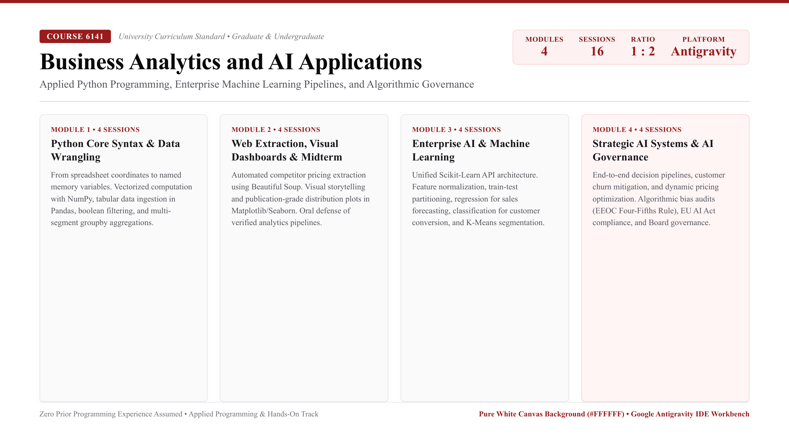

# Business Analytics and AI Application (Course 6141)

## Course Overview

Students in this course will develop a comprehensive understanding of business analytics and artificial intelligence fundamentals, covering topics such as business requirement analysis, data collection, and machine learning. Designed specifically for undergraduate and Master of Business Administration (MBA) students with zero prior programming background, this course emphasizes intuitive, evidence-based reasoning over abstract theoretical complexity.

Through hands-on exercises, students gain operational proficiency in Python programming, progressing from core syntax to intermediate techniques essential for enterprise data projects. Students acquire data manipulation skills using foundational libraries including NumPy and Pandas for data cleaning, aggregation, and financial visualization. They also master automated web data extraction techniques using HyperText Markup Language (HTML), Cascading Style Sheets (CSS), and Beautiful Soup to collect public competitor intelligence. 

With an introduction to modern machine learning tools through Scikit-Learn, participants learn to implement, interpret, and evaluate predictive models. Ethical considerations in artificial intelligence projects, algorithmic risk management, and governance frameworks are examined to ensure the responsible application of these analytical technologies.

## Development Environment and AI Error Protocol

All sessions use Google Antigravity IDE with four workspace panels: `[1] File Explorer`, `[2] Code Editor`, `[3] AI Agent Chat`, and `[4] Integrated Terminal`. When an error occurs, students identify the error type in Panel `[4]`, capture the traceback with `Windows Key + Shift + S` or `Command + Shift + 4`, paste it into Panel `[3]`, review the explanation, apply the verified fix in Panel `[2]`, and confirm an error-free execution with return code 0. Session 1.1 provides the complete orientation; every later lab applies the same workflow.

## Table of Contents

* **Module 1: Foundations of Business Analytics and Python Programming**
  * [Session 1.1: Business Analytics Architecture, Google Antigravity IDE Initialization, and Core Arithmetic](#session-01-01)
  * [Session 1.2: Essential Python Syntax Completion: Control Flow, Collections, and Business Automation](#session-01-02)
  * [Session 1.3: Tabular Data Wrangling Part 1: NumPy Arrays, Pandas DataFrames, and CSV Ingestion](#session-01-03)
  * [Session 1.4: Tabular Data Wrangling Part 2: Advanced Filtering, Multi-Segment GroupBy, and Financial Auditing](#session-01-04)
* **Module 2: Web Data Extraction, Visual Dashboards, and Midterm Milestone**
  * [Session 2.1: Web Data Extraction: Scraping Financial and Competitor Intelligence with Beautiful Soup](#session-02-01)
  * [Session 2.2: Business Data Visualization: Exploratory Plotting and Executive Dashboards](#session-02-02)
  * [Session 2.3: Midterm Applied Analytics Formulation Part 1: Problem Structuring and Data Audit](#session-02-03)
  * [Session 2.4: Midterm Analytics Pipeline Defense Part 2: Exploratory Findings and Executive Review](#session-02-04)
* **Module 3: Artificial Intelligence, Machine Learning Fundamentals, and Scikit-Learn**
  * [Session 3.1: Foundations of Artificial Intelligence: Enterprise Value Creation and Decision Automation](#session-03-01)
  * [Session 3.2: Advanced Data Analysis: Feature Engineering, Scaling, and Business Data Preprocessing](#session-03-02)
  * [Session 3.3: Practical Machine Learning with Scikit-Learn: Model Training and Validation](#session-03-03)
  * [Session 3.4: Core Concepts of Machine Learning: Supervised vs. Unsupervised Learning and Evaluation Metrics](#session-03-04)
* **Module 4: Strategic AI Integration, Enterprise Decision-Making, and AI Governance**
  * [Session 4.1: Integration of Business Analytics and Enterprise AI Architecture: End-to-End Decision Systems](#session-04-01)
  * [Session 4.2: AI Applications in Business Decision-Making Part 1: Predictive Customer Analytics and Churn](#session-04-02)
  * [Session 4.3: AI Applications in Business Decision-Making Part 2: Pricing Optimization and Revenue Management](#session-04-03)
  * [Session 4.4: Ethical Considerations in Artificial Intelligence: Algorithmic Bias, Regulatory Compliance, and AI Governance](#session-04-04)

---

## Module 1: Foundations of Business Analytics and Python Programming

Module 1 establishes the computational foundation for business students. Students learn to translate executive business questions into structured quantitative workflows, set up a standardized Python execution environment, master variables and arithmetic for commercial metrics, control program flow, and inspect tabular corporate filings using Pandas.

<a id="session-01-01"></a>
### Session 1.1: Business Analytics Architecture, Google Antigravity IDE Initialization, and Core Arithmetic

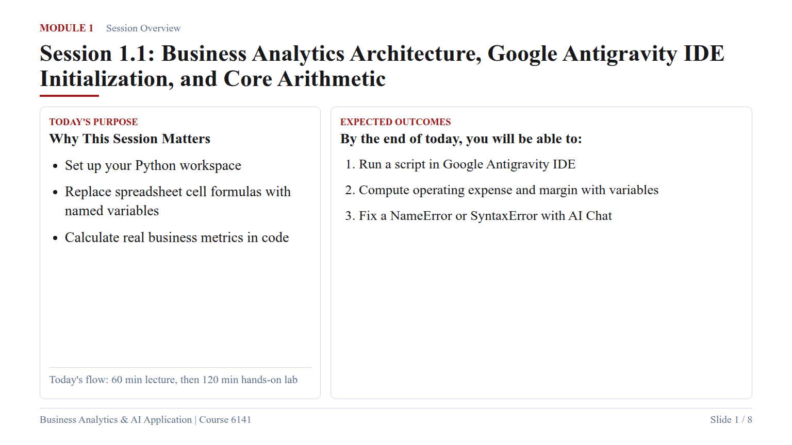

* **Lecture Presentation:** [Download Slides (PDF)](slides/session_01_01_lecture.pdf)
* **Reading (PDF):** [Download Reading (PDF)](handouts/session_01_01_reading.pdf): read before class
* **Schedule:** Week 1 (115/09/13 - 115/09/19) | In-person classes (1:2 Delivery Ratio: 60 Min Lecture + 120 Min Lab)

* **Session Purpose:**
  * Set up your Python workspace
  * Replace spreadsheet cell formulas with named variables
  * Calculate real business metrics in code
* **Expected Learning Outcomes (By the end of this session, you will be able to):**
  1. Run a script in Google Antigravity IDE
  2. Compute operating expense and margin with variables
  3. Fix a NameError or SyntaxError with AI Chat

* **Keywords (Core Programming Concepts):**
  * `Python Interpreter`: The computational engine that reads Python source code and executes instructions sequentially line-by-line in real time without requiring compilation.
  * `Variable Assignment`: Storing data in computer memory using an assignment operator (`=`) and an intuitive descriptive label (such as `net_sales = 574785.0`), replacing fragile cell coordinates like `C13`.
  * `Primitive Data Types`: The foundational categories of information processed by Python: whole numbers (`int`), decimal numbers (`float`), and text strings (`str`).
  * `Traceback & Exception`: The automatic diagnostic navigation report generated by Python when an instruction violates a syntax or runtime rule, pinpointing the exact file and line number.
  * `Integrated Development Environment (IDE)`: A unified software workstation (Google Antigravity IDE) providing an editor, execution terminal, file explorer, and integrated AI assistant in a single interface.

* **Core Programming & Computational Foundations:**
  * Sequential Execution & Program State: Python executes code strictly line-by-line from top to bottom. Unlike spreadsheets where formulas across sheets can trigger circular reference loops, Python code maintains a clear, linear flow where each statement computes or alters memory state sequentially.
  * Cell Coordinate Formulas vs. Descriptive Variables: Transitioning from Excel spatial grid thinking (such as `=C13-E13`) to self-documenting computational recipes (`operating_expense = net_sales - operating_income`). Code variables retain clear business meaning and eliminate silent formula drift.
  * Interpreter Diagnostics & Traceback Mechanics: Python acts as an interactive assistant. When a syntax or naming rule is violated, Python pauses and outputs a Traceback pointing to the exact line number and cause, turning errors into immediate learning signals rather than system failures.

* **Hands-On Coding Micro-Examples:**
  * *Micro-Example 1 (Variable Arithmetic):* Defining commercial numbers (`net_sales = 574785.0`, `operating_income = 36852.0`) and calculating Operating Expense and Operating Margin Percentage with standard math operators (`-`, `/`, `*`).
  * *Micro-Example 2 (Dynamic Parameter Reusability):* Changing a single baseline assumption (such as revising sales tax or discounting prices by 5%) and observing how Python recalculates all downstream figures instantaneously without manual cell dragging.
  * *Micro-Example 3 (Traceback Troubleshooting & AI Fix):* Creating an intentional variable typo (`netsales` instead of `net_sales`), observing the `NameError` in the terminal, capturing it with `Windows Key + Shift + S`, and pasting into the AI chat to verify how the co-pilot identifies the typo and supplies the correction.

* **Lab Practice Dataset:**
  * File Link: [data/session_01_01_dataset.csv](data/session_01_01_dataset.csv)
  * Simple 4-row tabular financial dataset used to verify calculations:
    * `Segment_Name`: North America, International, AWS, Consolidated Total.
    * `Net_Sales_USD_M`: Revenue in millions of U.S. Dollars.
    * `Operating_Income_USD_M`: Operating income in millions of U.S. Dollars.

* **Official Python Documentation & References:**
  * [Python 3.12 Official Tutorial: Using Python as an Interactive Calculator](https://docs.python.org/3/tutorial/introduction.html#using-python-as-a-calculator).
  * [PEP 8: Style Guide for Python Code (Readability and Variable Naming Standards)](https://peps.python.org/pep-0008/).
  * [Google Antigravity IDE Quickstart: Workspace Panels and AI Pair Programming](https://antigravity.google/docs).

* **Integrated Development Environment Architecture (Google Antigravity IDE):**
  * Students use Google Antigravity IDE, a modern AI-powered development environment designed for business analytics, financial modeling, and collaborative data science.
  
  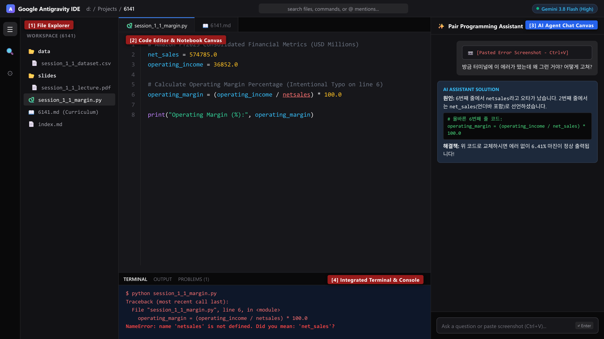

  * **The 4 Workspace Panels:**
    * `[1] File Explorer (Left Panel):` Workspace file hierarchy. Used to organize corporate datasets (`data/`), slide decks (`slides/`), Python scripts (`.py`), and curriculum documentation (`.md`).
    * `[2] Code Editor & Notebook Canvas (Center Top):` Primary workspace for writing Python code, defining financial variables, and executing arithmetic business formulas.
    * `[3] AI Agent Chat Canvas (Right Panel):` An interactive AI pair-programming assistant powered by Gemini. Students paste code snippets or error screenshots directly into this window to receive plain-English root cause explanations and verified code corrections.
    * `[4] Integrated Terminal & Console (Center Bottom):` Command line interface running the Python execution kernel. Displays script output results and detailed system error tracebacks.

  * **AI Error Diagnosis Protocol (Capture and Resolve in Seconds):**
    * *Zero Fear Principle:* In Python, an error is not a system failure or a test penalty. It is simply a diagnostic navigation clue (Traceback) showing the exact line number and rule violation.
    * *Step A (Identify):* When code execution stops, look at the last line in Panel `[4]` (Terminal), which names the error type (e.g., `NameError`, `SyntaxError`, `TypeError`).
    * *Step B (Capture):* Take a fast screen capture of the error message using `Windows Key + Shift + S` (Windows) or `Command + Shift + 4` (macOS).
    * *Step C (Paste & Prompt):* Click inside Panel `[3]` (AI Agent Chat), press `Ctrl + V` to attach the captured image, and ask: *"Why did this error happen, and what is the exact corrected code?"*
    * *Step D (Apply):* Review the AI explanation, understand the typo or missing parenthesis, and copy the verified fix back into Panel `[2]`.

* **Step-by-Step Lab Protocol (Exercise 1: Foundational Practice):**
  * *Step 1: Open Environment & Dataset:* Launch Google Antigravity IDE. Place `data/session_01_01_dataset.csv` in your working directory and open the raw file via Panel `[1]` (File Explorer) to observe comma-separated tabular records.
  * *Step 2: Inspect Primary Sources & Financial Terminology:* Confirm against Note 15 of Amazon's Form 10-K that Consolidated Net Sales for FY2023 equaled `$574,785` million and Operating Income equaled `$36,852` million.
  * *Step 3: Define Variables and Execute First Python Calculations:*
    In your first Python notebook cell, type the following arithmetic statements and run the cell:
    ```python
    # Amazon Consolidated Financial Metrics for FY2023 (in USD Millions)
    net_sales = 574785.0
    operating_income = 36852.0

    # Calculate Operating Expenses
    operating_expense = net_sales - operating_income

    # Calculate Operating Margin Percentage
    operating_margin_pct = (operating_income / net_sales) * 100.0

    print("Operating Expense (USD M):", operating_expense)
    print("Operating Margin (%):", round(operating_margin_pct, 2))
    ```
  * *Step 4: Bridge Excel Spreadsheet Mechanics to Python Code:*
    * In Microsoft Excel, if `Net_Sales` is in cell `C13` (`574785.00`) and `Operating_Income` is in cell `E13` (`36852.00`), the expense formula in cell `D13` is `=C13-E13`, and the margin formula in cell `F13` is `=(E13/C13)*100`.
    * Notice that Python variable assignment (`operating_income / net_sales`) performs the identical mathematical operation as cell references, but uses memorable descriptive English words instead of abstract grid coordinates like `E13`.
  * *Step 5: Compare Segment Profitability:*
    Execute a comparative calculation for Amazon Web Services (AWS) in FY2023:
    ```python
    aws_sales = 90757.0
    aws_income = 24631.0
    aws_margin_pct = (aws_income / aws_sales) * 100.0
    print("AWS Operating Margin (%):", round(aws_margin_pct, 2))
    ```
    Confirm that the AWS operating margin (`27.14%`) is over four times higher than the consolidated corporate operating margin (`6.41%`), demonstrating how cloud infrastructure drives corporate operating cash flow.

* **Step-by-Step Applied Coding Practice (Exercise 2+: Hands-On Programming & Debugging):**
  * *Coding Challenge:* In Google Antigravity IDE, create a new script named `session_1_1_practice.py` to calculate financial metrics across multiple business units and practice error debugging.
  * *Task 1 (Segment Margin Calculation):* Define variables for Amazon Web Services (AWS) using FY2023 figures (`aws_sales = 90757.0`, `aws_income = 24631.0`). Compute `aws_margin_pct` and print the formatted result with `round(..., 2)`.
  * *Task 2 (Intentional Syntax Error & AI Diagnosis):* Deliberately omit the closing parenthesis in your `print()` statement (e.g., `print("AWS Margin:", round(aws_margin_pct, 2)`). Run the script in Panel `[4]` (Terminal), observe the `SyntaxError`, capture the terminal message using `Windows Key + Shift + S`, paste it into Panel `[3]` (AI Agent Chat) with `Ctrl + V`, and verify the AI's explanation and fix.
  * *Task 3 (Multi-Unit Comparison Output):* Combine consolidated and cloud margin calculations into a single clean script that prints both metrics formatted with labels. Verify that the script executes with return code 0.

---

<a id="session-01-02"></a>
### Session 1.2: Essential Python Syntax Completion: Control Flow, Collections, and Business Automation

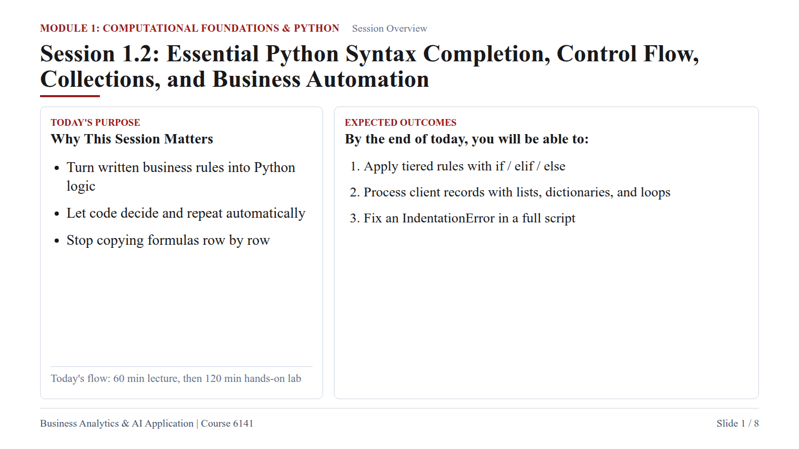

* **Lecture Presentation:** [Download Slides (PDF)](slides/session_01_02_lecture.pdf)
* **Reading (PDF):** [Download Reading (PDF)](handouts/session_01_02_reading.pdf): read before class
* **Schedule:** Week 2 (115/09/20 - 115/09/26) | In-person classes (1:2 Delivery Ratio: 60 Min Lecture + 120 Min Lab)

* **Session Purpose:**
  * Turn written business rules into Python logic
  * Let code decide and repeat automatically
  * Stop copying formulas row by row
* **Expected Learning Outcomes (By the end of this session, you will be able to):**
  1. Apply tiered rules with if / elif / else
  2. Process client records with lists, dictionaries, and loops
  3. Fix an IndentationError in a full script

* **Keywords (Core Programming Concepts):**
  * `Boolean Expression`: A logical comparison that evaluates strictly to `True` or `False`, used by computers to test commercial conditions (such as `annual_spend >= 50000.0`).
  * `Conditional Branching (else)`: Directing code execution down distinct logical pathways depending on operational thresholds, eliminating complex spreadsheet nested logic.
  * `List Collection`: An ordered, mutable sequence of business records enclosed in square brackets (e.g., `daily_orders = [120, 85, 94, 142]`), indexed sequentially starting from zero.
  * `Dictionary Collection`: A key-value associative data structure enclosed in curly braces (e.g., `{"client_id": "CUST-101", "annual_spend_USD": 145000.0}`), enabling instant data retrieval by descriptive business keys rather than numeric indices.
  * `Definite Iteration (for loop)`: A programmatic control structure that automatically iterates over every record in a collection, executing identical business rules across thousands of entries in milliseconds.

* **Core Programming & Computational Foundations:**
  * Eliminating Fragile Nested Spreadsheets: In Excel, multi-tier decision policies require nested formulas such as `=IF(C2>100000, "Platinum", IF(C2>50000, "Gold", IF(C2>20000, "Silver", "Standard")))`. These formulas quickly become unreadable, impossible to audit, and vulnerable to formula drift. In Python, conditional branching (`if-elif-else`) structures business rules into clean vertical indentation blocks that mirror managerial decision trees.
  * Deterministic Repetition over Human Fatigue: When processing transactional ledgers with thousands of rows, human analysts experience fatigue, eye strain, and copy-paste errors. A Python `for` loop executes repetitive calculations across 10 records or 1,000,000 records with identical mathematical precision and zero cognitive degradation.
  * Real-World Entity Modeling with Dictionaries: Modeling complex commercial entities as structured computational objects. A single customer account is captured as a dictionary of labeled attributes (name, industry, spend, risk score), while an enterprise client portfolio is structured as an iterable list of dictionaries.
  * Indentation as Syntax Structure (The Whitespace Discipline): Unlike older programming languages that use curly brackets `{}` or `BEGIN/END` tokens, Python enforces clean code formatting through whitespace indentation (4 spaces). An `IndentationError` occurs when code blocks are misaligned, serving as an automated guardrail for code readability.

* **Hands-On Coding Micro-Examples:**
  * *Micro-Example 1 (Conditional Customer Tiering):*
    Evaluating client annual spend to determine customer loyalty tiers and discount rates:
    ```python
    annual_spend = 82000.0

    if annual_spend >= 100000.0:
        tier = "Platinum"
        discount_rate = 0.15
    elif annual_spend >= 50000.0:
        tier = "Gold"
        discount_rate = 0.10
    elif annual_spend >= 20000.0:
        tier = "Silver"
        discount_rate = 0.05
    else:
        tier = "Standard"
        discount_rate = 0.0

    print(f"Customer Tier: {tier} | Approved Discount: {discount_rate * 100:.0f}%")
    ```
  * *Micro-Example 2 (Iterative Revenue Accumulation):*
    Looping through a list of daily store sales to calculate cumulative revenue and average daily performance:
    ```python
    daily_sales = [4200.0, 5100.0, 3900.0, 6200.0, 7800.0, 8400.0, 4900.0]
    total_revenue = 0.0

    for sale in daily_sales:
        total_revenue += sale

    avg_daily_sales = total_revenue / len(daily_sales)
    print("Total Weekly Revenue (USD):", round(total_revenue, 2))
    print("Average Daily Sales (USD):", round(avg_daily_sales, 2))
    ```
  * *Micro-Example 3 (Dictionary Client Profile & Safe Retrieval):*
    Storing commercial account attributes in a dictionary and computing available credit limits:
    ```python
    client = {
        "client_id": "CUST-104",
        "company_name": "Apex Logistics",
        "annual_spend_USD": 215000.0,
        "credit_limit_USD": 75000.0,
        "outstanding_balance_USD": 23400.0
    }

    available_credit = client["credit_limit_USD"] - client["outstanding_balance_USD"]
    print(f"{client['company_name']} Available Credit: ${available_credit:,.2f}")
    ```

* **Lab Practice Dataset:**
  * File Link: [data/session_01_02_dataset.csv](data/session_01_02_dataset.csv)
  * Standard 10-row commercial client dataset used for batch automation and loop exercises:
    * `Customer_ID`: Unique client identification code (e.g., `CUST-101`).
    * `Industry_Segment`: Commercial vertical (Retail, Technology, Healthcare, Finance, Manufacturing).
    * `Annual_Spend_USD`: Total historical purchase volume in U.S. Dollars.
    * `Order_Count`: Total orders completed in the fiscal year.
    * `Avg_Order_Value_USD`: Average transaction size in U.S. Dollars.
    * `Payment_Terms_Days_Count`: Invoiced credit settlement period (30, 60, 90 days).
    * `Risk_Score_Count`: Internal risk assessment index (1 to 100).

* **Official Python Documentation & References:**
  * [Python 3.12 Official Tutorial: More Control Flow Tools (if Statements and for Loops)](https://docs.python.org/3/tutorial/controlflow.html).
  * [Python 3.12 Official Tutorial: Data Structures (Lists, Dictionaries, and Tuples)](https://docs.python.org/3/tutorial/datastructures.html).
  * [PEP 8: Style Guide for Python Code (Indentation and Whitespace Standards)](https://peps.python.org/pep-0008/#indentation).

* **Step-by-Step Lab Protocol (Exercise 1: Guided Practice - Client Portfolio Automation):**
  * *Step 1: Create Practice File:* Launch Google Antigravity IDE and create a new script named `session_1_2_automation.py` in your working directory.
  * *Step 2: Build a Client Portfolio List:*
    Define an iterable list of customer dictionaries containing audited client records from `data/session_01_02_dataset.csv`:
    ```python
    clients = [
        {"id": "CUST-101", "segment": "Retail", "spend": 145000.0, "risk": 15},
        {"id": "CUST-102", "segment": "Technology", "spend": 82000.0, "risk": 22},
        {"id": "CUST-103", "segment": "Healthcare", "spend": 31000.0, "risk": 38},
        {"id": "CUST-104", "segment": "Finance", "spend": 215000.0, "risk": 12},
        {"id": "CUST-105", "segment": "Manufacturing", "spend": 64000.0, "risk": 45}
    ]
    ```
  * *Step 3: Automate Tier Assignment and Credit Multiplier via for Loop:*
    Write a `for` loop that iterates over each client, applies conditional branching based on `spend`, and computes an approved credit limit:
    ```python
    for c in clients:
        # Tiering logic based on annual purchase volume
        if c["spend"] >= 100000.0 and c["risk"] < 30:
            c["tier"] = "Platinum"
            c["credit_limit"] = c["spend"] * 0.40
        elif c["spend"] >= 50000.0 and c["risk"] < 50:
            c["tier"] = "Gold"
            c["credit_limit"] = c["spend"] * 0.25
        else:
            c["tier"] = "Standard"
            c["credit_limit"] = c["spend"] * 0.10

        print(f"Client {c['id']} ({c['segment']}): Tier={c['tier']} | Credit Limit=${c['credit_limit']:,.2f}")
    ```
  * *Step 4: Execute and Verify Output in Terminal:*
    Run the script in Panel `[4]` (Terminal) using `$ python session_1_2_automation.py`. Confirm that all 5 client accounts are evaluated and printed with proper credit limits.

* **Step-by-Step Applied Coding Practice (Exercise 2+: Hands-On Programming & AI Debugging):**
  * *Coding Challenge:* In Google Antigravity IDE, create a new script named `session_1_2_practice.py` to automate a multi-tier commercial commission payout pipeline.
  * *Task 1 (Tiered Commission Functionality):*
    A sales team records quarterly sales volumes: `sales_reps = [{"name": "Alice", "revenue": 142000.0}, {"name": "Bob", "revenue": 68000.0}, {"name": "Charlie", "revenue": 35000.0}]`. Write a loop calculating commission payouts: `12%` for revenue over `$100,000`, `8%` for revenue between `$50,000` and `$100,000`, and `5%` for revenue below `$50,000`.
  * *Task 2 (Deliberate IndentationError & AI Diagnosis):*
    Intentionally misalign one line inside the `if` block (e.g., adding 2 extra spaces or removing indentation). Run the script in Panel `[4]` (Terminal), observe the red `IndentationError: unexpected indent`, capture the terminal traceback with `Windows Key + Shift + S`, paste the image into Panel `[3]` (AI Agent Chat) with `Ctrl + V`, and review how the AI explains whitespace alignment.
  * *Task 3 (Dictionary Summary Output):*
    Correct the indentation, append the calculated `commission_payout` back into each rep's dictionary, and print a formatted compensation summary with zero syntax errors. Verify that the script terminates with return code 0.


<a id="session-01-03"></a>
### Session 1.3: Tabular Data Wrangling Part 1: NumPy Arrays, Pandas DataFrames, and CSV Ingestion

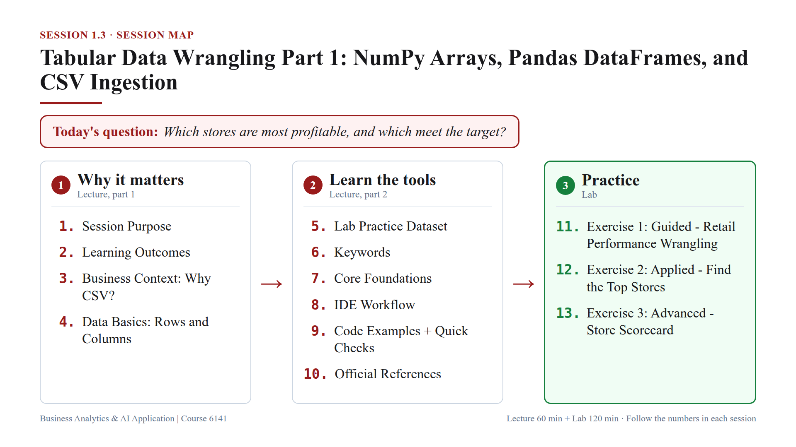

* **Lecture Presentation:** [Download Slides (PDF)](slides/session_01_03_lecture.pdf)
* **Reading (PDF):** [Download Reading (PDF)](handouts/session_01_03_reading.pdf): read before class
* **Schedule:** Week 3 (115/09/27 - 115/10/03) | In-person classes (1:2 Delivery Ratio: 60 Min Lecture + 120 Min Lab)

* **1. Session Purpose:**
  * Business systems (sales registers, accounting, customer databases, Excel) share tables as Comma-Separated Values (CSV) files
  * Our case: a retail chain exports monthly results for its 12 stores as a CSV file
  * Each row holds one store's sales, costs, visitors, and customer rating
  * Your manager asks: which stores are most profitable, and which meet the target? Today, Python answers these questions for every store at once

* **2. Expected Learning Outcomes (By the end of this session, you will be able to):**
  1. "Did the store data load correctly?": read and inspect a `DataFrame` (a table in Python, like one Excel sheet)
  2. "What is each store's profit margin?": create new columns with vectorized math (one formula runs on every row at once)
  3. "Which stores meet our target?": filter rows with `.loc[]` (keep rows that match a condition) and fix a `KeyError` (the column name does not exist)

* **3. Business Context: Why CSV?**
  * Where business data comes from: sales registers, the accounting system, the customer database, and Excel reports. Each system can export its tables as one shared file.
  * `.xlsx` (Excel file) vs `.csv` (CSV file):

    | | `.xlsx` Excel file | `.csv` CSV file |
    |---|---|---|
    | Format | Packed format | Plain text |
    | What you need to open it | A spreadsheet program such as Excel | Almost anything: Notepad, Excel, Google Sheets, Python `pandas`, AI assistants |
    | Opened in Notepad | Unreadable symbols (starts with `PK`) | Readable: `Store_ID,Region_Name,Monthly_Sales_USD` |

  * Trade-off: CSV keeps only values, with no formulas and no formatting.

* **4. Data Basics: Rows and Columns:**
  * **Row** (read across): one record. Here, all the facts about one store, such as row `1` = everything about `STR-1001`.
  * **Column** (read down): one type of information for every store, such as `Monthly_Sales_USD`. In pandas, one column is a `Series`.
  * **Cell:** one value where a row and a column meet, such as `185000.0`.
  * Size of a table: `df.shape` returns `(12, 6)` = 12 rows, 6 columns. Row labels (the `index`) start at `0`, not 1.

* **5. Lab Practice Dataset:**
  * File Link: [data/session_01_03_dataset.csv](data/session_01_03_dataset.csv)
  * Audited 12-row commercial store dataset used for vector arithmetic and filtering:
    * `Store_ID`: Unique retail location code (e.g., `STR-1001`).
    * `Region_Name`: Geographic division (East, West, North, South).
    * `Monthly_Sales_USD`: Gross store revenue in U.S. Dollars.
    * `Operating_Cost_USD`: Monthly operational store overhead in U.S. Dollars.
    * `Customer_Footfall_Count`: Total monthly foot traffic count.
    * `Customer_Satisfaction_Score`: Customer review rating (1.0 to 5.0 scale).

* **6. Keywords (Core Programming Concepts):**
  * `pandas` and `NumPy`:
    * What: free Python libraries for tables (`pandas`) and fast number arrays (`NumPy`)
    * Why: they sort, filter, and calculate tables of any size
  * `CSV file` and `pd.read_csv()`:
    * What: a plain-text table where commas separate values; `pd.read_csv()` loads it
    * Why: most business systems export data as CSV
  * `DataFrame`:
    * What: a whole table in Python, with row labels and column names
    * Why: it is the main object you clean, calculate, and filter
  * `Series`:
    * What: one column of a DataFrame, such as `df["Monthly_Sales_USD"]`
    * Why: most calculations work column by column
  * `Vectorized Computation`:
    * What: one formula applied to every row at once, with no loop
    * Why: fast, and nothing to drag down row by row
  * `.loc[]` vs `.iloc[]`:
    * What: `.loc[]` selects by label or condition; `.iloc[]` selects by position number
    * Why: pull out exactly the rows a question needs
    * Example: `df.loc[df["Region_Name"] == "West"]` keeps the West rows; `df.iloc[0:2]` keeps rows 0 and 1 (`0:2` starts at 0 and stops **before** 2)

* **7. Core Programming & Computational Foundations:**
  * **7.1 Columns, not cells: one formula for every row**
    * *The idea:* In Excel, a formula lives in one cell. To calculate the margin of 12 stores, you type the formula once and drag it down, which creates 12 separate copies, one per row. In pandas, a calculation is written once for a whole column, and pandas applies it to every row at the same time. This is called vectorized computation: the formula works on the whole column (a "vector" of values) instead of cell by cell.
    * *See it on real data:* operating margin for the first 3 stores.

      | | Excel | pandas |
      |---|---|---|
      | What you write | `=(C2-D2)/C2*100` in `E2`, then drag down to `E13` | `df["Operating_Margin_Pct"] = (df["Monthly_Sales_USD"] - df["Operating_Cost_USD"]) / df["Monthly_Sales_USD"] * 100` |
      | How many formulas exist | 12, one per row | 1, for the whole column |
      | `STR-1000` | `30.99` | `30.985915` |
      | `STR-1001` | `34.05` | `34.054054` |
      | `STR-1002` | `27.55` | `27.551020` |

    * *Common mistake (in Excel):* someone types a number over `E5`, for example to "fix" a value for a meeting. That row's formula is gone, the cell still looks normal, and next month's report is wrong without any warning sign that catches the eye. In pandas there is no per-row copy to overwrite: the next run recalculates every row from the data.
    * *More examples:*

      | Code | Result | What it tells you |
      |---|---|---|
      | `df["Monthly_Sales_USD"] - df["Operating_Cost_USD"]` | `44000.0` for `STR-1000` | operating profit for every store |
      | `df["Monthly_Sales_USD"] / df["Customer_Footfall_Count"]` | `11.45` for `STR-1000` | sales per visitor: what an average visitor spends |
      | `df["Operating_Cost_USD"] / df["Monthly_Sales_USD"] * 100` | `69.01` for `STR-1000` | cost as a share of sales, in percent |
      | `df["Monthly_Sales_USD"] * 1.05` | `149100.0` for `STR-1000` | a "what if sales grew 5%?" scenario |
      | `df["Monthly_Sales_USD"] / 1000` | `142.0` for `STR-1000` | sales in thousands, easier to read in a report |

    * *Remember:* write the rule once for the column; pandas applies it to every row.
  * **7.2 Inside a DataFrame: index, columns, and values**
    * *The idea:* A DataFrame has three parts, like a labeled spreadsheet:
      * the **index**: one label per row, shown at the left. By default the labels are `0, 1, 2, ...`, counting from `0`, not `1`;
      * the **columns**: one name per column, shown at the top, such as `Store_ID`;
      * the **values**: the data itself, stored as a NumPy array (a fast block of numbers that pandas uses underneath).
    * *See it on real data:* the first 3 rows as pandas prints them.

      ```text
         Store_ID Region_Name  Monthly_Sales_USD  ...
      0  STR-1000        East           142000.0  ...
      1  STR-1001        West           185000.0  ...
      2  STR-1002       North            98000.0  ...
      ```

      The `0`, `1`, `2` on the left are the index, not data. `STR-1001` is in the row labeled `1`, which is the **second** row.
    * *One column vs a smaller table:* `df["Store_ID"]` (single brackets) returns one column, a `Series`. `df[["Store_ID", "Region_Name"]]` (double brackets: a list inside the brackets) returns a smaller `DataFrame` with the listed columns.
    * *Common mistake:* counting rows from 1. In Python, the first row has position `0`, so "the third row" is position `2`.
    * *More examples:*

      | Code | Result | What it tells you |
      |---|---|---|
      | `type(df["Store_ID"])` | `Series` | single brackets give one column |
      | `df[["Store_ID", "Region_Name"]].shape` | `(12, 2)` | double brackets give a smaller table: 12 rows, 2 columns |
      | `df.columns.tolist()` | `['Store_ID', 'Region_Name', ...]` | the exact column names, to copy instead of typing |
      | `df.index.tolist()` | `[0, 1, 2, ..., 11]` | the row labels start at `0` |
      | `len(df)` | `12` | the number of rows |
      | `df.loc[0, "Store_ID"]` | `'STR-1000'` | one value: row label `0`, column `Store_ID` |

    * *Remember:* index on the left, column names on top, values in between; counting starts at `0`.
  * **7.3 Data types: every column has exactly one type**
    * *The idea:* pandas gives each column one data type (`dtype`), and every value in that column follows it. The type decides what you can do with the column: you can add numbers, but not text.

      | `dtype` | Meaning | Columns in our data |
      |---|---|---|
      | `float64` | decimal numbers | `Monthly_Sales_USD`, `Operating_Cost_USD`, `Customer_Satisfaction_Score` |
      | `int64` | whole numbers | `Customer_Footfall_Count` |
      | `str` | text (older pandas versions show `object`) | `Store_ID`, `Region_Name` |

    * *Why it matters:* if a number is typed with a comma, such as `"1,200"`, pandas cannot read it as a number, so the whole column becomes text. Adding text joins the pieces instead of summing them: a column with `"1,200"` and `"800"` "sums" to `"1,200800"`, not `2000`. In Excel the same value would sit in its cell as text and be quietly skipped by `SUM`.
    * *How to catch it:* run `df.dtypes` right after loading. A sales column showing `str` instead of `float64` means some values were stored as text.
    * *More examples:*

      | Code | Result | What it tells you |
      |---|---|---|
      | `df["Monthly_Sales_USD"].sum()` | `1829000.0` | a number column adds up as numbers |
      | `df["Region_Name"].head(3).sum()` | `'EastWestNorth'` | a text column "adds up" by joining the words |
      | `pd.Series(["1,200", "800"]).sum()` | `'1,200800'` | numbers stored as text are joined, not summed |
      | `pd.Series(["1,200", "800"]).str.replace(",", "").astype(float).sum()` | `2000.0` | remove the comma, convert to `float`, and the sum is right |
      | `df["Customer_Footfall_Count"].mean()` | `13075.0` | an `int64` column works for averages too |

    * *Remember:* check the types first; a number column must show `float64` or `int64`.
  * **7.4 Check before you calculate: four inspection tools**
    * *The idea:* A professional analyst never calculates on data they have not looked at. Four commands answer the first questions about any new file:

      | Command | Question it answers | Result for our file |
      |---|---|---|
      | `df.shape` | How big is the table? | `(12, 6)`: 12 rows, 6 columns |
      | `df.head(3)` | What do the first rows look like? | `STR-1000`, `STR-1001`, `STR-1002` |
      | `df.info()` | What are the types, and are values missing? | `12 non-null` in every column: no gaps |
      | `df.describe()` | What are the typical, smallest, and largest values? | sales: mean `152416.67`, min `89000.0`, max `225000.0` |

    * *Common mistake:* `df.shape` has no brackets, because it is a stored value (an attribute). `df.head()` and `df.info()` do have brackets, because they are actions (methods). Writing `df.shape()` raises `TypeError: 'tuple' object is not callable`.
    * *More examples:*

      | Code | Result | What it tells you |
      |---|---|---|
      | `df["Region_Name"].value_counts()` | `East 3`, `West 3`, `North 3`, `South 3` | how many stores each region has |
      | `df.isnull().sum().sum()` | `0` | the number of empty cells in the whole table |
      | `df["Customer_Satisfaction_Score"].min()` | `3.8` | the lowest rating |
      | `df["Customer_Satisfaction_Score"].max()` | `4.9` | the highest rating |
      | `df["Customer_Satisfaction_Score"].mean()` | `4.35` (rounded) | the average rating |

    * *Remember:* shape, head, info, describe: look first, calculate second.
  * **7.5 Picking rows: by label with `.loc[]`, by position with `.iloc[]`**
    * *The idea:* There are two ways to point at a row. `.loc[]` uses the **label** in the index, or a condition. `.iloc[]` uses the **position**, counting from `0`. On a freshly loaded file the labels and positions are the same, so the two look alike. They differ as soon as the rows are reordered.
    * *See it on real data:* sort the stores by sales, from lowest to highest. The row order changes, but every row keeps its label.

      | Request | Meaning | Result |
      |---|---|---|
      | `sorted_df.loc[1, "Store_ID"]` | the row whose label is `1` | `STR-1001`, wherever it now sits |
      | `sorted_df.iloc[0]["Store_ID"]` | whatever row is now first | `STR-1006`, the lowest sales |

    * *Filtering with `.loc[]`:* `.loc[]` also accepts a condition, such as `df.loc[df["Region_Name"] == "West"]`, and keeps only the rows where the condition is `True`. This is the form you will use most.
    * *Common mistake:* misspelling a column name. `df["Monthly_Sale_USD"]` (missing `s`) raises `KeyError: 'Monthly_Sale_USD'`: pandas looked for a column with that exact name and found none. Copy column names from `df.columns` instead of typing them.
    * *More examples:*

      | Code | Result | What it tells you |
      |---|---|---|
      | `df.loc[df["Region_Name"] == "East", "Store_ID"]` | `STR-1000`, `STR-1004`, `STR-1008` | the East stores: a condition plus one column |
      | `df.loc[df["Customer_Satisfaction_Score"] >= 4.5, "Store_ID"]` | `STR-1001`, `STR-1004`, `STR-1005`, `STR-1008`, `STR-1011` | the 5 best-rated stores |
      | `df.iloc[0]["Store_ID"]` | `'STR-1000'` | the first row |
      | `df.iloc[-1]["Store_ID"]` | `'STR-1011'` | `-1` means the last row |
      | `df.iloc[0:3]["Store_ID"]` | `STR-1000`, `STR-1001`, `STR-1002` | rows at positions 0, 1, 2 (stops before 3) |
      | `df.loc[2, "Region_Name"]` | `'North'` | row label `2`, column by name |
      | `df.iloc[2, 1]` | `'North'` | the same cell by position: row 2, column 1 |

    * *Remember:* `.loc[]` = label or condition; `.iloc[]` = position from `0`.

* **8. Development Workflow in Google Antigravity IDE:**

  

  * `[1]` File Explorer: create your script with your name and the session code (for example, `Reacher_S13_demo_1.py`), and check the dataset is in `data/`.
  * `[2]` Code Editor: write a few lines, run, repeat. Small steps keep errors small.
  * `[3]` AI Agent Chat: on an error, capture the traceback (Python's error report) with `Win + Shift + S` (macOS: `Cmd + Shift + 4`), paste it with `Ctrl + V`, and ask why it failed.
  * `[4]` Terminal: run `python` followed by your script name. Return code `0` means the script finished with no errors.

* **9. Hands-On Coding Micro-Examples:**
  * Every example has three parts: **1. Input** (load the data), **2. Process** (calculate or select), and **3. Output** (print the result).
  * Name each file with your own name and the session code, for example `Reacher_S13_demo_1.py` (pattern: `YourName_S13_demo_1.py`).
  * *Micro-Example 1 (Load a CSV File and Inspect It):* `YourName_S13_demo_1.py`
    ```python
    # 1. Input: load the tool and the data
    import pandas as pd
    df = pd.read_csv("data/session_01_03_dataset.csv")

    # 2. Process: measure the table and take a preview
    dimensions = df.shape
    column_types = df.dtypes
    preview = df.head(3)

    # 3. Output: show the results
    print("Dataset Dimensions (Rows, Columns):", dimensions)
    print("Column Data Types:\n", column_types)
    print(preview)
    ```
    * *How it works, line by line:*
      * `import pandas as pd` loads the pandas library and gives it the short name `pd`, so every pandas tool can be written as `pd.something`.
      * `pd.read_csv(...)` opens the CSV file, reads the first line as column names, and stores the table in a variable named `df` (short for DataFrame). The path `data/...` starts from the project folder.
      * `df.shape`, `df.dtypes`, and `df.head(3)` measure the table, list each column's type, and copy the first 3 rows. Each result is stored in its own variable, so part 3 can print it.
      * `print()` shows a result in the Terminal. A script that calculates without printing shows nothing at all.
    * *Read the output:*

      ```text
      Dataset Dimensions (Rows, Columns): (12, 6)
      Column Data Types:
       Store_ID                           str
      Region_Name                        str
      Monthly_Sales_USD              float64
      ...
         Store_ID Region_Name  ...  Customer_Footfall_Count  Customer_Satisfaction_Score
      0  STR-1000        East  ...                    12400                          4.2
      ```

      * `(12, 6)` means 12 rows (stores) and 6 columns, as expected for this file.
      * The money columns are `float64` (numbers), so you can calculate with them.
      * The `...` in the preview is not missing data: pandas hides middle columns when the table is wider than the Terminal.
  * *Quick Check 1 (`.tail()`):*
    * New tool: `.tail(n)` shows the last `n` rows. Why: new records are often added at the bottom.
    * Task: in part **2. Process**, change `preview = df.head(3)` to `preview = df.____(3)` so it shows the last 3 rows.
    * Check: the preview shows index `9`, `10`, `11` (`STR-1009`, `STR-1010`, `STR-1011`).
  * *Micro-Example 2 (Calculate New Columns Without a Loop):* `YourName_S13_demo_2.py`
    ```python
    # 1. Input: load the store data
    import pandas as pd
    df = pd.read_csv("data/session_01_03_dataset.csv")

    # 2. Process: profit and margin for every store at once
    df["Operating_Profit_USD"] = (
        df["Monthly_Sales_USD"] - df["Operating_Cost_USD"]
    )
    df["Operating_Margin_Pct"] = (
        df["Operating_Profit_USD"] / df["Monthly_Sales_USD"] * 100.0
    )

    # 3. Output: show the first three stores
    print(df[["Store_ID", "Monthly_Sales_USD",
              "Operating_Margin_Pct"]].head(3))
    ```
    * *How it works, line by line:*
      * `df["Monthly_Sales_USD"] - df["Operating_Cost_USD"]` subtracts two columns. pandas lines them up row by row, so each store's cost is subtracted from that same store's sales (section 7.1).
      * `df["Operating_Profit_USD"] = ...` stores the result as a new column. If the name does not exist yet, pandas adds it at the right end of the table.
      * The second calculation uses the new profit column straight away: profit / sales x 100.
      * The round brackets around each calculation only let the formula continue on the next line; they do not change the result.
      * `df[["Store_ID", "Monthly_Sales_USD", "Operating_Margin_Pct"]]` (double brackets) keeps just those 3 columns, and `.head(3)` keeps the first 3 rows.
    * *Read the output:*

      ```text
         Store_ID  Monthly_Sales_USD  Operating_Margin_Pct
      0  STR-1000           142000.0             30.985915
      1  STR-1001           185000.0             34.054054
      2  STR-1002            98000.0             27.551020
      ```

      * `STR-1000`: `(142000 - 98000) / 142000 x 100 = 30.99`%. Of every $100 of sales, about $31 is left as operating profit.
      * `STR-1002` sells the least and also keeps the smallest share as profit (`27.55`%).
      * The long decimals are correct but hard to read; Quick Check 2 rounds them.
  * *Quick Check 2 (`.round()`):*
    * New tool: `.round(n)` rounds every number in a column to `n` decimal places. Why: long decimals such as `30.985915` are hard to read in a report.
    * Task: add one line at the end of part **2. Process**: `df["Operating_Margin_Pct"] = df["Operating_Margin_Pct"].____(1)`
    * Check: the margins print as `31.0`, `34.1`, and `27.6`.
  * *Micro-Example 3 (Filter Rows and Fill Missing Values):* `YourName_S13_demo_3.py`
    ```python
    # 1. Input: load the store data
    import pandas as pd
    df = pd.read_csv("data/session_01_03_dataset.csv")

    # 2. Process: keep West stores with sales of $150,000+
    west_high_sales = df.loc[
        (df["Region_Name"] == "West")
        & (df["Monthly_Sales_USD"] >= 150000.0)
    ]
    #    then fill missing satisfaction scores with the median
    median_score = df["Customer_Satisfaction_Score"].median()
    df["Customer_Satisfaction_Score"] = (
        df["Customer_Satisfaction_Score"].fillna(median_score)
    )

    # 3. Output: show the filtered stores and the median
    print(west_high_sales[["Store_ID", "Monthly_Sales_USD"]])
    print("Median Satisfaction Score Imputed:", median_score)
    ```
    * *How it works, line by line:*
      * `(df["Region_Name"] == "West")` checks every row and gives `True` for West stores and `False` for the others. Note the double `==`: it compares, while a single `=` stores a value.
      * `(df["Monthly_Sales_USD"] >= 150000.0)` gives `True` for stores selling $150,000 or more.
      * `&` combines the two answers row by row: a row is `True` only if both are `True`. Each condition sits in its own brackets so that Python compares first and combines second.
      * `df.loc[...]` keeps the `True` rows and stores them in `west_high_sales`; the original `df` is not changed.
      * `.median()` finds the middle value of the satisfaction scores: half the stores score higher, half lower. `.fillna(median_score)` puts that value into any empty cell (`NaN`, "Not a Number").
    * *Read the output:*

      ```text
         Store_ID  Monthly_Sales_USD
      1  STR-1001           185000.0
      5  STR-1005           175000.0
      9  STR-1009           160000.0
      Median Satisfaction Score Imputed: 4.35
      ```

      * All 3 West stores sell $150,000 or more, so all 3 pass. With a higher limit, such as $170,000, only 2 would. The index labels `1`, `5`, `9` show where each store sat in the original table: filtering keeps the labels.
      * The median of the 12 scores is `4.35`. This dataset has no empty scores, so `.fillna()` changes nothing today, but the same line protects the script when next month's file has gaps.
  * *Quick Check 3 (`len()`):*
    * New tool: `len()` counts items; for a DataFrame, it returns the number of rows. Why: it answers "how many?" questions in one step. Example: `len(df)` returns `12`.
    * Task: add one line to part **3. Output**: `print("Stores found:", ___(west_high_sales))`
    * Check: the Terminal shows `Stores found: 3`.

* **10. Official Python Documentation & References:**
  * [Pandas Official Documentation: 10 Minutes to Pandas](https://pandas.pydata.org/docs/user_guide/10min.html).
  * [Pandas Official Guide: Indexing and Selecting Data (.loc and .iloc)](https://pandas.pydata.org/docs/user_guide/indexing.html).
  * [NumPy Official Documentation: NumPy Quickstart Tutorial](https://numpy.org/doc/stable/user/quickstart.html).

* **11. Exercise 1: Guided Practice - Retail Performance Wrangling:**
  * *Step 1: Open Workspace:* In Google Antigravity IDE, create a new script named `YourName_S13_wrangling.py`, replacing `YourName` with your own name (for example, `Reacher_S13_wrangling.py`). Verify that `data/session_01_03_dataset.csv` is present in Panel `[1]`.
  * *Step 2: Load, Calculate, and Summarize:*
    Type the following Python statements:
    ```python
    # 1. Input: load the store data
    import pandas as pd
    df = pd.read_csv("data/session_01_03_dataset.csv")

    # 2. Process: add profit and margin columns, then summarize
    df["Operating_Profit_USD"] = (
        df["Monthly_Sales_USD"] - df["Operating_Cost_USD"]
    )
    df["Operating_Margin_Pct"] = (
        df["Operating_Profit_USD"] / df["Monthly_Sales_USD"] * 100.0
    )
    summary = df.describe()

    # 3. Output: show summary statistics for sales and margin
    print("Descriptive Financial Statistics:\n",
          summary[["Monthly_Sales_USD", "Operating_Margin_Pct"]])
    ```
    * `.describe()` returns summary statistics: count, mean, standard deviation, min, max, and quartiles.
  * *Step 3: Compare Excel Mechanics with Pandas:*
    * In Excel, you type `=(C2-D2)/C2*100` in cell `E2` and drag it down, so every row gets its own copy of the formula. If someone types a number over `E5`, that row is wrong, and the mistake is easy to miss.
    * In Pandas, one line of `df["Operating_Margin_Pct"]` code covers every row, so there is no copy to overwrite.
  * *Step 4: Execute in Terminal:*
    Run the script via Panel `[4]` (Terminal) using `python YourName_S13_wrangling.py`. Confirm that the summary statistics are printed.

* **12. Exercise 2: Applied Practice - Find the Top Stores:**
  * *Coding Challenge:* In `YourName_S13_practice.py`, find the top stores: `Operating_Margin_Pct >= 30.0` and `Customer_Satisfaction_Score >= 4.5`.
  * *Task 1 (Targeted Filtering):* Use `.loc[]` to select the qualified stores and output only `Store_ID`, `Region_Name`, and `Operating_Margin_Pct`.
  * *Task 2 (Deliberate KeyError & AI Diagnosis):* Deliberately misspell a column name (e.g., `df["Monthly_Sale_USD"]` instead of `"Monthly_Sales_USD"`). Read the `KeyError` (the column name does not exist), capture the traceback with `Win + Shift + S`, paste it into Panel `[3]` (AI Agent Chat) with `Ctrl + V`, and review the AI's explanation.
  * *Task 3 (Clean CSV Export):* Correct the column name, then sort with `.sort_values()`; add `ascending=False` for the highest margin first. Save the table with `.to_csv()` to `data/top_performing_stores.csv`.
  * *Success Check:* the result has 5 stores, led by `STR-1011` (South, 36.89%), and the script ends with return code `0`.

* **13. Exercise 3: Advanced Practice - Store Scorecard:**
  * *Goal:* Build a one-page scorecard that sorts all 12 stores into three tiers, so the regional manager can see at a glance which stores to reward and which to watch.
  * *What you need:*
    * File: `data/session_01_03_dataset.csv` (12 rows, described in **5. Lab Practice Dataset**).
    * Script name: `YourName_S13_challenge.py`.
    * Tools you already know: `pd.read_csv()`, column math, `.round()`, `&`, `.loc[]`, `.sort_values()`, `len()`, and `.to_csv()`.
  * *Requirements (follow them in order):*
    1. Add `Operating_Profit_USD` = `Monthly_Sales_USD` - `Operating_Cost_USD`.
    2. Add `Operating_Margin_Pct` = `Operating_Profit_USD` / `Monthly_Sales_USD` x 100, rounded to 1 decimal place.
    3. Add `Sales_per_Visitor_USD` = `Monthly_Sales_USD` / `Customer_Footfall_Count`, rounded to 2 decimal places. It shows how much an average visitor spends.
    4. Add a `Tier` column using these rules, in this order:
       * Every store starts as `"Standard"`.
       * `"Gold"`: `Operating_Margin_Pct >= 33.0` **and** `Customer_Satisfaction_Score >= 4.5`.
       * `"Watch"`: `Operating_Margin_Pct < 30.0`.
    5. Print how many stores are in each tier, one line per tier, for example `Gold stores: 4`.
    6. Print all 12 stores sorted by `Operating_Margin_Pct`, highest first, showing only `Store_ID`, `Region_Name`, `Operating_Margin_Pct`, `Sales_per_Visitor_USD`, `Customer_Satisfaction_Score`, and `Tier`.
    7. Save the same sorted table to `data/store_scorecard.csv` without row labels.
    8. Answer in a comment at the end of your script: which tier holds the store with the highest `Sales_per_Visitor_USD`, and what does that tell the manager?
  * *New tool for this exercise: set a value for selected rows only:*
    * `df["Tier"] = "Standard"` writes one value into every row of a new column.
    * `df.loc[mask, "Tier"] = "Gold"` changes only the rows where `mask` is `True`. `mask` is a condition like the one in Micro-Example 3, with each part wrapped in `( )` and joined with `&`.
  * *Hints:*
    * To count a tier, filter first, then use `len()`: `len(df.loc[df["Tier"] == "Gold"])`.
    * Pass a list of column names to `df[[ ... ]]` to keep only the columns you need.
  * *Self-Check (expected results):*
    * `Gold stores: 4` (`STR-1011`, `STR-1004`, `STR-1008`, `STR-1001`), `Watch stores: 5`, `Standard stores: 3`.
    * The first row of the sorted table is `STR-1011` (South, `36.9`), and the last row is `STR-1006` (North, `23.6`).
    * The highest `Sales_per_Visitor_USD` is `STR-1002` (`11.95`), a **Watch** store with a margin of `27.6`. High spending per visitor does not guarantee a high profit margin.

---

<a id="session-01-04"></a>
### Session 1.4: Tabular Data Wrangling Part 2: Advanced Filtering, Multi-Segment GroupBy, and Financial Auditing

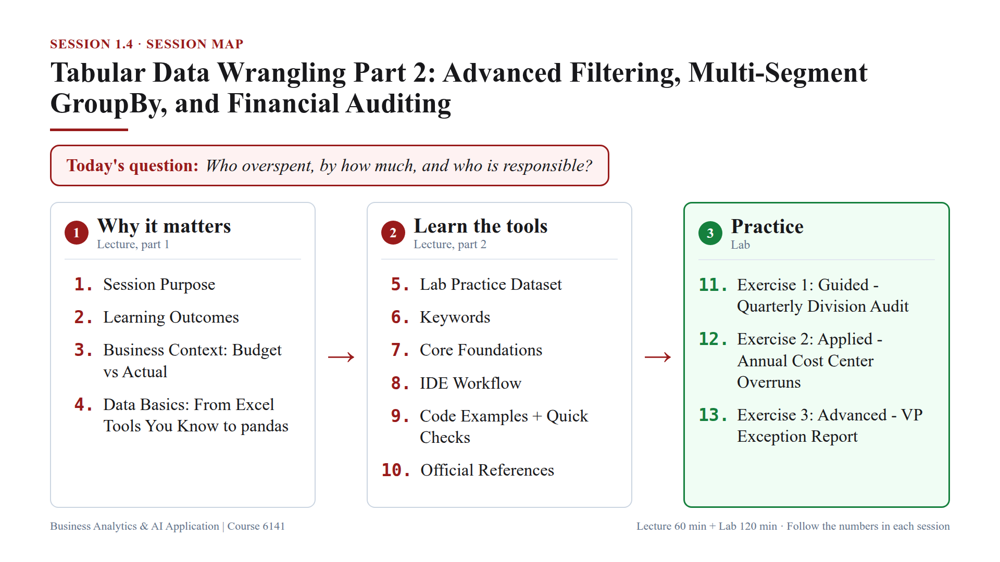

* **Lecture Presentation:** [Download Slides (PDF)](slides/session_01_04_lecture.pdf)
* **Reading (PDF):** [Download Reading (PDF)](handouts/session_01_04_reading.pdf): read before class
* **Schedule:** Week 4 (115/10/04 - 115/10/10) | In-person classes (1:2 Delivery Ratio: 60 Min Lecture + 120 Min Lab)

* **1. Session Purpose:**
  * Each division gets a spending budget every quarter, and finance compares it with what was actually spent
  * Our case: 4 divisions x 4 quarters = 16 rows in one CSV file
  * The finance director asks: who overspent, by how much, and who is responsible? Today, Python answers this for the whole year at once

* **2. Expected Learning Outcomes (By the end of this session, you will be able to):**
  1. "Which quarters went over budget?": filter rows with a Boolean mask (a `True`/`False` value for every row) and `&`
  2. "How much did each division overspend this year?": summarize groups with `groupby()` (split rows into groups, like an Excel pivot table, which is a summary table with one row per group) and `.agg()`
  3. "Who is responsible?": join tables with `pd.merge()` (join two tables on a shared column, like Excel's `VLOOKUP` formula, which looks up a value in another table) and fix a `KeyError`

* **3. Business Context: Budget vs Actual:**
  * Four terms, one example (Consumer division, Q1):

    | Term | Meaning | Example |
    |---|---|---|
    | Budget | planned spending | `780,000` |
    | Actual | real spending | `810,000` |
    | Variance | Actual - Budget | `+30,000` |
    | Variance % | Variance / Budget x 100 | `+3.85%` |

  * Positive variance = overspent; negative variance = under budget.
  * Cost center: the accounting code a division's spending is charged to, such as `CC-202` for Consumer. Each cost center has a responsible VP (Vice President).
  * Company rule in our data: a quarter is flagged (`Audit_Status` = `Variance_Flag`) when the variance is more than 2%.
  * Consumer division by quarter: Q1 `+3.85%` (flagged), Q2 `+1.92%` (over, within the rule), Q3 `+5.77%` (flagged), Q4 `-0.64%` (under budget).

* **4. Data Basics: From Excel Tools You Know to pandas:**
  * Three Excel tools, in one line each:
    * **Filter:** hides the rows that do not match a rule, such as showing only the Consumer division.
    * **Pivot Table:** summarizes a large table by group. For example, put `Division_Name` in Rows and `Actual_Expense_USD` in Values to get total spending per division: 4 rows instead of 16.
    * **`VLOOKUP`:** a formula that looks up a value, such as a cost center code, in another table and returns a value from the same row, such as the VP's name. You tell it which column to return by number (for example, the 2nd column).
  * The same three jobs in pandas:
    * Filter -> Boolean mask `df[mask]`: the rule is written in code, so it repeats exactly next quarter.
    * Pivot Table -> `df.groupby().agg()`: one line; run it again when new data arrives.
    * `VLOOKUP` -> `pd.merge()`: `VLOOKUP` returns a column by number; `pd.merge()` matches rows by column name, such as `Cost_Center_Code`.

* **5. Lab Practice Dataset:**
  * File Link: [data/session_01_04_dataset.csv](data/session_01_04_dataset.csv)
  * Audited 16-row quarterly budget dataset (4 divisions x 4 quarters; each row is one division's spending in one quarter):
    * `Transaction_ID`: Unique record identifier (e.g., `TXN-5001`).
    * `Division_Name`: Operating business unit (Cloud, Consumer, Enterprise, Logistics).
    * `Cost_Center_Code`: Accounting cost center (CC-101, CC-202, CC-303, CC-404).
    * `Fiscal_Quarter`: Financial reporting quarter (Q1, Q2, Q3, Q4).
    * `Budget_Expense_USD`: Authorized spending budget in U.S. Dollars.
    * `Actual_Expense_USD`: Realized expenditure in U.S. Dollars.
    * `Audit_Status`: Internal audit classification (`Verified`, or `Variance_Flag` when spending is more than 2% over budget).

* **6. Keywords (Core Programming Concepts):**
  * `Boolean Mask`:
    * What: one `True` or `False` per row
    * Why: picks exactly the rows that meet a rule
  * `&` `|` `~`:
    * What: "and", "or", "not" for masks
    * Why: Python's `and` / `or` fail on whole columns
  * `Split-Apply-Combine`:
    * What: split rows into groups, calculate each group, combine the results
    * Why: the idea behind every pivot table
  * `groupby()` + `.agg()`:
    * What: `groupby()` splits; `.agg()` sums, counts, or averages each group
    * Why: yearly totals per division in one step
  * `pd.merge()`:
    * What: joins two tables row by row
    * Why: adds facts from another table, such as the VP's name, with no copy-paste
  * `Key Column`:
    * What: a column both tables share, such as `Cost_Center_Code`
    * Why: tells pandas which rows belong together

* **7. Core Programming & Computational Foundations:**
  * **7.1 Combining rules: `&`, not `and`**
    * *The idea:* A rule on a column, such as `df["Division_Name"] == "Consumer"`, does not give one answer. It gives one `True` or `False` **for every row**: a whole column of answers, called a Boolean mask. To combine two rules, Python must compare the two columns row by row: row 1 with row 1, row 2 with row 2, and so on. pandas uses `&` ("and"), `|` ("or"), and `~` ("not") for this row-by-row work.
    * *See it on real data:* the first 4 rows of our dataset.

      | Row | Division | `is_consumer` | `is_over` | Both true (`&`) | Either true (or) |
      |---|---|---|---|---|---|
      | `TXN-5000` | Cloud | `False` | `False` | `False` | `False` |
      | `TXN-5001` | Consumer | `True` | `True` | `True` | `True` |
      | `TXN-5002` | Enterprise | `False` | `False` | `False` | `False` |
      | `TXN-5003` | Logistics | `False` | `True` | `False` | `True` |

      Here `is_consumer = df["Division_Name"] == "Consumer"` and `is_over = df["Actual_Expense_USD"] > df["Budget_Expense_USD"]`. With `is_consumer & is_over`, a row is kept only when **both** columns say `True` (`TXN-5001`). With `is_consumer | is_over`, one `True` is enough (`TXN-5001` and `TXN-5003`).
    * *Common mistake 1, using `and`:* Python's own `and` can only judge one `True` or `False` at a time. Given a whole column, it does not know whether you mean "all rows", "any row", or "row by row", so it stops with `ValueError: The truth value of a Series is ambiguous`. "Ambiguous" means "it could mean several things".
    * *Common mistake 2, missing brackets:* Python works out `&` **before** `==` and `>`. So in `df["Division_Name"] == "Consumer" & df["Actual_Expense_USD"] > df["Budget_Expense_USD"]`, it first tries `"Consumer" & df["Actual_Expense_USD"]`, which makes no sense, and raises a `TypeError`. Brackets force the right order: `(df["Division_Name"] == "Consumer") & (df["Actual_Expense_USD"] > df["Budget_Expense_USD"])`.
    * In these examples, `is_over = df["Actual_Expense_USD"] > df["Budget_Expense_USD"]`.
    * *More examples:*

      | Code | Result | What it tells you |
      |---|---|---|
      | `(df["Division_Name"] == "Logistics") & is_over` | `Q1`, `Q3` | the Logistics quarters that overspent |
      | `(df["Fiscal_Quarter"] == "Q4") & is_over` | `Enterprise` | only one division overspent in Q4 |
      | `(df["Audit_Status"] == "Variance_Flag") & (df["Fiscal_Quarter"] == "Q3")` | `TXN-5008`, `TXN-5009`, `TXN-5011` | the flagged quarters in Q3 |
      | `(~is_over).sum()` | `8` | `~` flips the rule: 8 quarters stayed within budget |
      | `df["Division_Name"].isin(["Cloud", "Enterprise"]).sum()` | `8` | `.isin()` is a short way to write "Cloud or Enterprise" |

    * *Remember:* one rule gives one `True` / `False` per row; combine rules with `&`, `|`, or `~`, and put each rule in its own brackets.
  * **7.2 Split-apply-combine: how `groupby()` builds a summary**
    * *The idea:* Most management questions are about groups: "How much did **each division** spend?" Answering them always takes the same three steps, whether in an Excel pivot table or in pandas:
      1. **Split** the rows into groups, one per division.
      2. **Apply** a calculation inside each group, such as a sum.
      3. **Combine** the answers into a new, smaller table with one row per group.
    * *See it on real data:* the Consumer division's 4 quarterly rows go into one group, and `"sum"` adds them up:

      | Step | Consumer division |
      |---|---|
      | Split | Q1 `810000.0`, Q2 `795000.0`, Q3 `825000.0`, Q4 `775000.0` |
      | Apply (`"sum"`) | `810000.0 + 795000.0 + 825000.0 + 775000.0 = 3205000.0` |
      | Combine | one row: `Consumer` `3205000.0` |

      The same steps run for Cloud, Enterprise, and Logistics at the same time, so the 16 rows become 4: Cloud `1785000.0`, Consumer `3205000.0`, Enterprise `1280000.0`, Logistics `2468000.0`.
    * *What you choose:* the column to split by (`groupby("Division_Name")`), the column to calculate on, and the calculation: `"sum"` for totals, `"mean"` for averages, `"count"` for how many rows, `"max"` for the largest value.
    * *More examples:*

      | Code | Result | What it tells you |
      |---|---|---|
      | `df.groupby("Fiscal_Quarter")["Actual_Expense_USD"].sum()` | Q1 `2185000.0`, Q2 `2171000.0`, Q3 `2235000.0`, Q4 `2147000.0` | total spending per quarter: Q3 was the most expensive |
      | `df.groupby("Division_Name")["Transaction_ID"].count()` | `4` for each division | a quick check that no quarter is missing |
      | `df.groupby("Cost_Center_Code")["Actual_Expense_USD"].max()` | `CC-202` `825000.0` (largest) | the most expensive quarter of each cost center |
      | `df.groupby("Audit_Status")["Transaction_ID"].count()` | `Variance_Flag` `6`, `Verified` `10` | how many quarters were flagged |

    * *Remember:* `groupby()` does the split, `.agg()` does the apply, and pandas does the combine for you.
  * **7.3 Joining tables: match by name, not by position**
    * *The idea:* Information often sits in two tables: spending in one, the responsible VP in another. Joining means bringing the matching row from the second table next to each row of the first, using a column that both share: the key column, here `Cost_Center_Code`.
    * *Why Excel's `VLOOKUP` is fragile:* `VLOOKUP` is told to return "the 2nd column" of the lookup table. If someone later inserts a new column, such as `Region`, the 2nd column is now `Region`, and every formula quietly returns a region instead of a VP name. No error appears, so the mistake is easy to miss.
    * *Why `pd.merge()` is safer:* `pd.merge(spending, vp_info, on="Cost_Center_Code")` matches rows by the **name** of the key column and brings over every other column by name. Moving or inserting columns changes nothing.
    * In these examples, `ledger = pd.merge(df, vp_info, on="Cost_Center_Code", how="left")`, as in Micro-Example 3, and `vp_renamed` is `vp_info` with its key column renamed to `CostCenter`.
    * *More examples:*

      | Code | Result | What it tells you |
      |---|---|---|
      | `ledger.shape` | `(16, 8)` | still 16 rows; one new column, `VP_Lead`, added (7 + 1) |
      | `ledger.loc[ledger["Division_Name"] == "Logistics", "VP_Lead"]` | `David Kim` in all 4 rows | one VP row is matched to every quarter of that cost center |
      | `pd.merge(df, vp_renamed, on="Cost_Center_Code")` | `KeyError: 'Cost_Center_Code'` | `vp_renamed` calls the key `CostCenter`: the names must match exactly |

    * *Remember:* name the key column with `on=`; the key must have exactly the same name and the same values in both tables.
  * **7.4 What happens to rows with no match: `how="left"` vs `how="inner"`**
    * *The idea:* Sometimes a row in the main table has no partner in the other table, for example a new cost center that has not been given a VP yet. The `how=` setting decides what happens to that row.
    * *See it on an example:* suppose our spending table also had a new cost center, `CC-505`, which is not in `vp_info`:

      | `Cost_Center_Code` | `Variance_USD` | `VP_Lead` with `how="left"` | with `how="inner"` |
      |---|---|---|---|
      | `CC-202` | `85000.0` | Marcus Vance | Marcus Vance |
      | `CC-404` | `28000.0` | David Kim | David Kim |
      | `CC-505` | `5000.0` | `NaN` (empty) | row removed |

      `NaN` stands for "Not a Number", pandas' mark for a missing value.
    * *Why it matters:* with `how="inner"`, the `CC-505` overspend silently disappears from the report, and nobody is asked to explain it. With `how="left"`, the row stays and the empty `VP_Lead` tells you that someone must be assigned.
    * In these examples, `vp_3_rows` is `vp_info` without the `CC-404` row (as if Logistics had no VP yet), and `merged` is the result of the left merge.
    * *More examples:*

      | Code | Result | What it tells you |
      |---|---|---|
      | `pd.merge(df, vp_3_rows, on="Cost_Center_Code", how="left")` | `16` rows, `4` with `NaN` in `VP_Lead` | `vp_3_rows` lacks `CC-404`: its 4 quarters stay, with no VP |
      | `pd.merge(df, vp_3_rows, on="Cost_Center_Code", how="inner")` | `12` rows | the 4 Logistics quarters silently disappear |
      | `merged["VP_Lead"].isnull().sum()` | `4` | count the gaps after a left merge |

    * *Remember:* use `how="left"` when every row of your main table must stay in the report, then look for `NaN` to find the gaps.

* **8. Development Workflow in Google Antigravity IDE:**
  * `[1]` File Explorer: create your script with your name and the session code (for example, `Reacher_S14_demo_1.py`), and check the dataset is in `data/`.
  * `[2]` Code Editor: write a few lines, run, repeat. Small steps keep errors small.
  * `[3]` AI Agent Chat: on an error, capture the traceback (Python's error report) with `Win + Shift + S` (macOS: `Cmd + Shift + 4`), paste it with `Ctrl + V`, and ask why it failed.
  * `[4]` Terminal: run `python` followed by your script name. Return code `0` means the script finished with no errors.

* **9. Hands-On Coding Micro-Examples:**
  * Every example has three parts: **1. Input**, **2. Process**, and **3. Output**. Name each file with your own name and the session code, for example `Reacher_S14_demo_1.py` (pattern: `YourName_S14_demo_1.py`).
  * *Micro-Example 1 (Find Overspending with a Boolean Mask):* `YourName_S14_demo_1.py`
    ```python
    # 1. Input: load the quarterly budget data
    import pandas as pd
    df = pd.read_csv("data/session_01_04_dataset.csv")

    # 2. Process: Consumer quarters that spent more than budget
    mask = (
        (df["Division_Name"] == "Consumer")
        & (df["Actual_Expense_USD"] > df["Budget_Expense_USD"])
    )
    overruns = df[mask]

    # 3. Output: count and list them
    print("Consumer overrun quarters:", len(overruns))
    print(overruns[["Fiscal_Quarter", "Budget_Expense_USD",
                    "Actual_Expense_USD"]])
    ```
    * *How it works, line by line:*
      * `(df["Division_Name"] == "Consumer")` gives one `True` / `False` per row: `True` for the 4 Consumer rows.
      * `(df["Actual_Expense_USD"] > df["Budget_Expense_USD"])` compares the two money columns row by row: `True` where a quarter spent more than planned.
      * `&` keeps `True` only where both are `True` (section 7.1). The result, `mask`, is a column of 16 `True` / `False` values. Naming it makes the rule easy to read and reuse.
      * `df[mask]` keeps the rows where `mask` is `True` and stores them in `overruns`.
      * `len(overruns)` counts those rows.
    * *Read the output:*

      ```text
      Consumer overrun quarters: 3
        Fiscal_Quarter  Budget_Expense_USD  Actual_Expense_USD
      1             Q1            780000.0            810000.0
      5             Q2            780000.0            795000.0
      9             Q3            780000.0            825000.0
      ```

      * The Consumer division overspent in 3 of its 4 quarters; only Q4 (`775000.0`) stayed within the `780000.0` budget.
      * Q3 has the largest overrun: `825000 - 780000 = 45000`, or `5.77`% over budget.
      * The labels `1`, `5`, `9` are the original row positions in the 16-row file.
  * *Quick Check 1 (`~`):*
    * New tool: `~` (not) turns every `True` into `False`, and every `False` into `True`. Why: find the opposite group, such as quarters that stayed within budget.
    * Task: in part **2. Process**, change `& (df["Actual_Expense_USD"] > df["Budget_Expense_USD"])` to `& _(df["Actual_Expense_USD"] > df["Budget_Expense_USD"])`.
    * Check: the script prints `Consumer overrun quarters: 1`, and the table shows `Q4` (budget `780000.0`, actual `775000.0`). The label still says "overrun", since only the rule changed.
  * *Micro-Example 2 (Total Each Division with `groupby()`):* `YourName_S14_demo_2.py`
    ```python
    # 1. Input: load the quarterly budget data
    import pandas as pd
    df = pd.read_csv("data/session_01_04_dataset.csv")

    # 2. Process: yearly totals for each division
    div_summary = df.groupby("Division_Name").agg(
        Total_Budget_USD=("Budget_Expense_USD", "sum"),
        Total_Actual_USD=("Actual_Expense_USD", "sum"),
        Quarters=("Transaction_ID", "count"),
    )
    div_summary["Variance_USD"] = (
        div_summary["Total_Actual_USD"]
        - div_summary["Total_Budget_USD"]
    )

    # 3. Output: one row per division
    print(div_summary[["Total_Actual_USD", "Variance_USD"]])
    ```
    * *How it works, line by line:*
      * `df.groupby("Division_Name")` splits the 16 rows into 4 groups, one per division (section 7.2).
      * Inside `.agg(...)`, each line has the form `New_Name=("Source_Column", "calculation")`. For example, `Total_Budget_USD=("Budget_Expense_USD", "sum")` adds up the budget of each division and calls the result `Total_Budget_USD`.
      * `Quarters=("Transaction_ID", "count")` counts the rows in each group; it is a quick check that every division has 4 quarters.
      * The next line subtracts two of the new columns to get each division's yearly variance.
    * *Read the output:*

      ```text
                     Total_Actual_USD  Variance_USD
      Division_Name
      Cloud                 1785000.0      -15000.0
      Consumer              3205000.0       85000.0
      Enterprise            1280000.0           0.0
      Logistics             2468000.0       28000.0
      ```

      * The division names are now the row labels: `groupby()` turns the group names into the index.
      * Consumer overspent by `85000.0` for the year and Logistics by `28000.0`; Enterprise spent exactly its budget; Cloud stayed `15000.0` under.
      * Consumer had one quarter under budget, yet it is still the largest yearly overspender: quarterly flags and yearly totals answer different questions.
  * *Quick Check 2 (`.sort_values()`):*
    * New tool: `.sort_values()` reorders rows by one column; `ascending=False` puts the largest first. Why: the director reads the biggest overspender first.
    * Task: add one line at the end of part **2. Process**: `div_summary = div_summary.___________("Variance_USD", ascending=False)`
    * Check: the first row is `Consumer` (`85000.0`), then `Logistics` (`28000.0`).
  * *Micro-Example 3 (Add VP Names with `pd.merge()`):* `YourName_S14_demo_3.py` (VP names are fictional)
    ```python
    # 1. Input: budget data and a VP list (fictional names)
    import pandas as pd
    df = pd.read_csv("data/session_01_04_dataset.csv")
    vp_info = pd.DataFrame({
        "Cost_Center_Code": ["CC-101", "CC-202", "CC-303", "CC-404"],
        "VP_Lead": ["Sarah Chen", "Marcus Vance",
                    "Elena Rostova", "David Kim"],
    })

    # 2. Process: add VP names, then flag spending over budget
    ledger = pd.merge(df, vp_info, on="Cost_Center_Code", how="left")
    ledger["Over_Budget"] = (
        ledger["Actual_Expense_USD"] > ledger["Budget_Expense_USD"]
    )

    # 3. Output: show the first three rows
    print(ledger[["Transaction_ID", "VP_Lead", "Over_Budget"]].head(3))
    ```
    * *How it works, line by line:*
      * `pd.DataFrame({...})` builds a small table directly in code. Inside the curly brackets, each column name is followed by its list of values, in row order. The two lists must have the same length (here 4).
      * `pd.merge(df, vp_info, on="Cost_Center_Code", how="left")` takes each of the 16 rows of `df`, looks up its cost center in `vp_info`, and adds the matching `VP_Lead` (section 7.3). `how="left"` keeps every row of `df`, even one with no match (section 7.4).
      * `ledger["Actual_Expense_USD"] > ledger["Budget_Expense_USD"]` compares row by row and stores `True` / `False` in a new `Over_Budget` column.
    * *Read the output:*

      ```text
        Transaction_ID        VP_Lead  Over_Budget
      0       TXN-5000     Sarah Chen        False
      1       TXN-5001   Marcus Vance         True
      2       TXN-5002  Elena Rostova        False
      ```

      * Every row now carries the name of the person responsible for that spending; no VP name was copied by hand.
      * `TXN-5001` (Consumer, Q1) is over budget, and Marcus Vance is accountable for it.
      * The table still has 16 rows; `.head(3)` only shows the first 3.
  * *Quick Check 3 (`.value_counts()`):*
    * New tool: `.value_counts()` counts how often each value appears in a column. Why: answers "how many quarters were over budget?" in one line.
    * Task: add one line to part **3. Output**: `print(ledger["Over_Budget"].____________())`
    * Check: the Terminal shows `False 8` and `True 8`: half of the 16 quarters went over budget.

* **10. Official Python Documentation & References:**
  * [Pandas User Guide: GroupBy: Split-Apply-Combine](https://pandas.pydata.org/docs/user_guide/groupby.html).
  * [Pandas User Guide: Merge, Join, Concatenate and Compare](https://pandas.pydata.org/docs/user_guide/merging.html).
  * [Python PEP 8: Guidelines for Line Breaks around Binary Operators](https://peps.python.org/pep-0008/#should-a-line-break-before-or-after-a-binary-operator).

* **11. Exercise 1: Guided Practice - Quarterly Division Audit:**
  * *Step 1: Open Script:* In Google Antigravity IDE, create a new script named `YourName_S14_audit.py`, replacing `YourName` with your own name (for example, `Reacher_S14_audit.py`).
  * *Step 2: Group by Division and Quarter:*
    Type the following code:
    ```python
    # 1. Input: load the quarterly budget data
    import pandas as pd
    df = pd.read_csv("data/session_01_04_dataset.csv")

    # 2. Process: variance per row, then group by two columns
    df["Variance_USD"] = df["Actual_Expense_USD"] - df["Budget_Expense_USD"]
    df["Variance_Pct"] = df["Variance_USD"] / df["Budget_Expense_USD"] * 100.0
    quarterly_audit = df.groupby(["Division_Name", "Fiscal_Quarter"]).agg(
        Total_Actual=("Actual_Expense_USD", "sum"),
        Total_Variance=("Variance_USD", "sum"),
        Mean_Variance_Pct=("Variance_Pct", "mean"),
    )

    # 3. Output: one row per division and quarter
    print("Quarterly Division Audit Summary:\n", quarterly_audit)
    ```
    * Grouping by a list of two columns gives one row per division and quarter: 16 rows, labeled by both values.
  * *Step 3: Verify Output Integrity:*
    Confirm that quarters with overruns show positive `Total_Variance` values. 8 of the 16 rows should be positive.
  * *Step 4: Execute in Terminal:*
    Run the script via Panel `[4]` (Terminal) using `python YourName_S14_audit.py` and confirm return code `0`.

* **12. Exercise 2: Applied Practice - Annual Cost Center Overruns:**
  * *Coding Challenge:* In `YourName_S14_practice.py`, find the cost centers that overspent for the whole year.
  * *Task 1 (Annual Cost Center Aggregation):* Group the data by `Cost_Center_Code`, sum budget and actual spending, compute the yearly variance %, and keep cost centers more than `1.0`% over budget.
  * *Task 2 (Deliberate KeyError & AI Diagnosis):* Merge the result with `vp_info` (from Micro-Example 3), but type `on="Cost_Center"` on purpose. Read the `KeyError` (the column name does not exist), capture the traceback with `Win + Shift + S`, paste it into Panel `[3]` (AI Agent Chat) with `Ctrl + V`, and review the AI's explanation of join keys.
  * *Task 3 (Audit Brief Output):* Fix the key to `on="Cost_Center_Code"`, then print the cost center, the VP, and the overrun in USD.
  * *Success Check:* 2 cost centers: `CC-202` (Marcus Vance, `85000.0`, 2.72%) and `CC-404` (David Kim, `28000.0`, 1.15%); the script ends with return code `0`.

* **13. Exercise 3: Advanced Practice - VP Exception Report:**
  * *Goal:* Build an exception report that tells the finance director which VPs must explain their spending. A VP is escalated when the cost center has repeated flagged quarters **and** overspent for the whole year.
  * *What you need:*
    * File: `data/session_01_04_dataset.csv` (16 rows, described in **5. Lab Practice Dataset**).
    * The `vp_info` table from Micro-Example 3 (VP names are fictional).
    * Script name: `YourName_S14_challenge.py`.
    * Tools you already know: Boolean masks, `groupby()` + `.agg()`, `pd.merge()`, `.sort_values()`, and `.to_csv()`.
  * *Requirements (follow them in order):*
    1. Add `Variance_USD` = `Actual_Expense_USD` - `Budget_Expense_USD` and `Variance_Pct` = `Variance_USD` / `Budget_Expense_USD` x 100, rounded to 2 decimal places.
    2. Add `My_Flag` = `True` when `Variance_Pct > 2.0`. Check your rule: count the rows where `My_Flag` disagrees with `Audit_Status == "Variance_Flag"`. The count must be `0`.
    3. **Flagged summary:** keep only the flagged rows, then group by `Cost_Center_Code` and compute `Flagged_Quarters` (count of rows), `Flagged_Overrun_USD` (sum of `Variance_USD`), and `Worst_Variance_Pct` (largest `Variance_Pct`).
    4. **Yearly summary:** using all 16 rows, group by `Cost_Center_Code`, sum budget and actual spending, and compute `Year_Variance_Pct` = (actual - budget) / budget x 100, rounded to 2 decimal places.
    5. Start from `vp_info` and merge in the yearly summary, then the flagged summary, both with `on="Cost_Center_Code"` and `how="left"`. If a cost center had no flagged quarter, its empty values must become `0`.
    6. Add `Escalate` = `True` when `Flagged_Quarters >= 2` **and** `Year_Variance_Pct > 1.0`.
    7. Sort by `Flagged_Overrun_USD`, then by `Worst_Variance_Pct`, both largest first. Print the table and save it to `data/vp_exception_report.csv` without row labels.
  * *New tools for this exercise:*
    * `.reset_index()`: after `groupby()`, the group names (here, the cost center codes) become the row labels. `.reset_index()` turns them back into a normal column, so you can merge on `Cost_Center_Code`.
    * `.fillna(0)`: replaces empty values (`NaN`) with `0`, for example `report["Flagged_Quarters"] = report["Flagged_Quarters"].fillna(0)`.
    * Sorting by two columns: `.sort_values(["Flagged_Overrun_USD", "Worst_Variance_Pct"], ascending=False)`. The second column only decides ties in the first.
    * `"max"` inside `.agg()` returns the largest value in each group, just as `"sum"` returns the total.
  * *Hints:*
    * Build the two summaries as two separate tables first, print each one, and only then merge.
    * `(df["My_Flag"] != (df["Audit_Status"] == "Variance_Flag")).sum()` counts disagreements, because each `True` counts as 1.
  * *Self-Check (expected results):*
    * Rule check: `0` disagreements; 6 of the 16 quarters are flagged.
    * Table order: `CC-202` Marcus Vance (2 flagged, `75000.0`, worst `5.77`), `CC-404` David Kim (2, `45000.0`, `4.92`), `CC-303` Elena Rostova (1, `10000.0`, `3.12`), `CC-101` Sarah Chen (1, `10000.0`, `2.22`).
    * `Escalate` is `True` only for Marcus Vance (`Year_Variance_Pct` `2.72`) and David Kim (`1.15`). Elena Rostova and Sarah Chen each had one flagged quarter but finished the year at or under budget.

---

## Module 2: Web Data Extraction, Visual Dashboards, and Midterm Milestone

Module 2 shifts focus from internal corporate records to external market intelligence and visual storytelling. Students learn to extract public competitor price data using web scrapers, construct publication-grade business charts, and present audited exploratory findings during the midterm milestone.

<a id="session-02-01"></a>
### Session 2.1: Web Data Extraction: Scraping Financial and Competitor Intelligence with Beautiful Soup

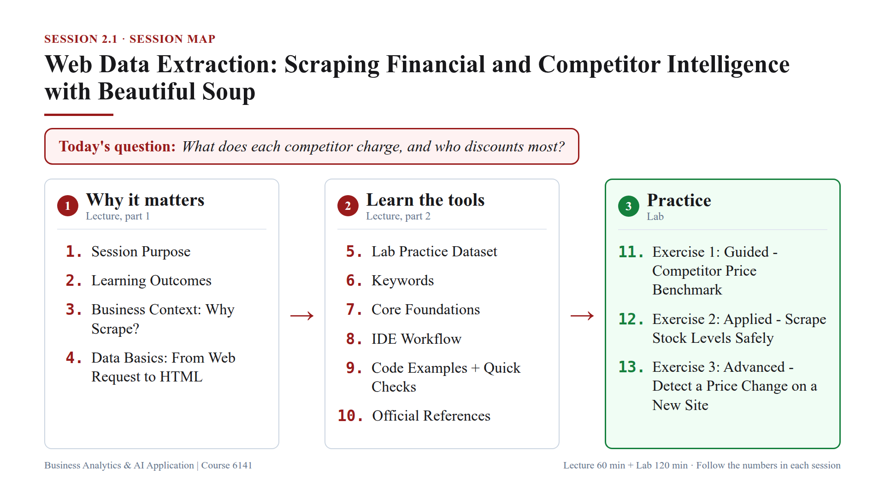

* **Lecture Presentation:** [Download Slides (PDF)](slides/session_02_01_lecture.pdf)
* **Reading (PDF):** [Download Reading (PDF)](handouts/session_02_01_reading.pdf): read before class
* **Schedule:** Week 5 (115/10/11 - 115/10/17) | In-person classes (1:2 Delivery Ratio: 60 Min Lecture + 120 Min Lab)

* **1. Session Purpose:**
  * Our pricing team watches 3 competitor websites, where prices sit on web pages, not in CSV files
  * Copying hundreds of prices by hand is slow and error-prone
  * The pricing manager asks: what does each competitor charge, and who discounts most? Today, Python reads a web page and turns it into a table

* **2. Expected Learning Outcomes (By the end of this session, you will be able to):**
  1. "How does a web page reach my computer?": explain an HTTP (HyperText Transfer Protocol) GET request and read HTML (HyperText Markup Language: the text with tags that describes a web page)
  2. "What is BetaMart charging?": extract prices with Beautiful Soup (a Python library that reads HTML) and CSS (Cascading Style Sheets) selectors (an address for tags, such as `.price`)
  3. "What if a product has no stock tag?": handle a missing tag (the search returns `None`, meaning nothing found) and fix an `AttributeError`

* **3. Business Context: Why Scrape?**
  * By hand: open each competitor page, copy each price into Excel, and do it all again tomorrow. 3 sites x 100 products = 300 copy-pastes a day, with typos.
  * With a Python script: read every product on the page in seconds, get the same result every run, and run it again every morning. The output is a clean table, ready for pandas.
  * Rules of the road (scrape responsibly):
    * Public pages only, never behind a login
    * Check the site's `robots.txt` and terms of use. `robots.txt` is a short public file on a website (for example, `betamart.example/robots.txt`) that lists which pages automated scripts may and may not read.
    * Pause between requests, for example `time.sleep(2)` (wait 2 seconds), so the site is not overloaded
    * Name your script in the request. The User-Agent is a short label sent with every request that tells the site who is asking.

* **4. Data Basics: From Web Request to HTML:**
  * 1. Your browser or Python script sends an HTTP GET request: "send me this page".
  * 2. The web server answers with the page as HTML text.
  * The browser draws that text as a page for people; Python reads the text itself. In the example below, `data-sku` stores the product's SKU (Stock Keeping Unit), the store's product code:

    ```html
    <div class="product" data-sku="SKU-801">
      <h3 class="name">Office Desk Chair</h3>
      <span class="price">$49.50</span>
      <span class="stock">120 units</span>
    </div>
    ```

* **5. Lab Practice Dataset:**
  * Saved web page: [data/session_02_01_catalog.html](data/session_02_01_catalog.html), a fictional BetaMart catalog page with 4 product cards (SKU-807 has no stock tag).
  * File Link: [data/session_02_01_dataset.csv](data/session_02_01_dataset.csv)
  * Audited 12-row competitor pricing dataset compiled from automated extraction (competitor names are fictional):
    * `Product_SKU`: Stock Keeping Unit, the product code (e.g., `SKU-801`).
    * `Competitor_Name`: Competitor (AlphaRetail, BetaMart, GammaGlobal).
    * `Category_Name`: Merchandise category (Electronics, Office Supplies, Hardware, Appliances).
    * `List_Price_USD`: Extracted competitor catalog price in U.S. Dollars.
    * `Promotion_Discount_Pct`: Advertised promotional markdown percentage.
    * `Stock_Availability_Units`: Available warehouse stock units.

* **6. Keywords (Core Programming Concepts):**
  * `HTTP GET`:
    * What: a request, using the HyperText Transfer Protocol (HTTP), that asks a web server for a page
    * Why: every page your browser or script reads starts with one
  * `HTML Tag`:
    * What: a label around content, such as `<span class="price">`
    * Why: tags tell you where each price or name sits
  * `DOM Tree`:
    * What: Document Object Model: tags nested inside tags, like folders
    * Why: one product card holds its name, price, and stock
  * `Beautiful Soup (bs4)`:
    * What: a Python library that reads HTML into a searchable tree
    * Why: find tags by name or class in one line
  * `CSS Selector`:
    * What: a short address for tags: `.price` = class "price"
    * Why: `.select()` / `.select_one()` use it to pick tags
  * `Ethical Scraping`:
    * What: follow `robots.txt`, pause between requests, stay on public pages
    * Why: protects the website and your company

* **7. Core Programming & Computational Foundations:**
  * **7.1 A web page is text with tags, not a table**
    * *The idea:* When you open a web page, your browser receives a long piece of text written in HTML and draws it as a page. The prices you see are inside that text, wrapped in tags such as `<span class="price">$49.50</span>`. A tag has three parts: an opening tag (`<span ...>`), the content (`$49.50`), and a closing tag (`</span>`). The `class="price"` part is a label that the website's designers put on the tag, and it is what we use to find it.
    * *See it on real data:* one product card from our saved BetaMart page.

      ```text
      <div class="product" data-sku="SKU-801">
        <h3 class="name">Office Desk Chair</h3>
        <span class="price">$49.50</span>
        <span class="stock">120 units</span>
      </div>
      ```

      | What we want | Where it is in the HTML |
      |---|---|
      | Product code | the `data-sku` setting of the `div` tag: `SKU-801` |
      | Name | inside the `h3` tag with class `name`: `Office Desk Chair` |
      | Price | inside the `span` tag with class `price`: `$49.50` |
      | Stock | inside the `span` tag with class `stock`: `120 units` |

    * *More examples:*

      | Code | Result | What it tells you |
      |---|---|---|
      | `<h3 class="name">Office Desk Chair</h3>` | tag `h3`, class `name`, content `Office Desk Chair` | the product name |
      | `<span class="stock">120 units</span>` | tag `span`, class `stock`, content `120 units` | the stock level, as text |
      | `<div class="product" data-sku="SKU-801">` | tag `div`, class `product`, setting `data-sku` | the card that holds one product; its code is a setting, not content |
      | `<h1>BetaMart Weekly Prices</h1>` | tag `h1`, no class, content `BetaMart Weekly Prices` | the page heading |

    * *Remember:* scraping means finding the right tags and taking the text inside them.
  * **7.2 Tags inside tags: the DOM tree**
    * *The idea:* Tags are nested: the `div` card contains the name, price, and stock tags, just as a folder contains files. This nesting is called the DOM tree (Document Object Model). Beautiful Soup reads the HTML text and builds this tree, so you can ask for "the price tag inside this card" instead of searching through raw text.
    * *Why nesting matters:* our page has 4 cards, and each one has its own price. If you search the whole page for `.price`, you get all 4 prices. If you first take one card and then search inside it, you get exactly that card's price, already paired with the right name.
    * *See it on real data:*

      | Search | Result |
      |---|---|
      | `soup.select(".price")` (whole page) | 4 tags: `$49.50`, `$320.00`, `$429.00`, `$195.00` |
      | `card.select_one(".price")` (one card) | 1 tag: `$49.50`, for `SKU-801` only |

    * *More examples:*

      | Code | Result | What it tells you |
      |---|---|---|
      | `soup.select(".stock")` | 3 tags: `120 units`, `38 units`, `15 units` | whole page: only 3, because one card has no stock tag |
      | `soup.select(".product")[1].find("h3").text` | `Wireless Router` | the name inside the second card (position `1`) |
      | `soup.select(".product")[3]["data-sku"]` | `SKU-810` | the code of the fourth card |
      | `soup.select_one(".product .stock").text` | `120 units` | a space in a selector means "inside": a stock tag inside a product card |

    * *Remember:* loop over the cards, then search inside each card; that keeps every value with its own product.
  * **7.3 Four ways to find tags**

    | Method | Finds | Returns | Example |
    |---|---|---|---|
    | `.find("h3")` | the first tag with that name | one tag | `Office Desk Chair` |
    | `.find_all("h3")` | every tag with that name | a list of tags | 4 product names |
    | `.select_one(".price")` | the first tag matching a CSS selector | one tag | `$49.50` |
    | `.select(".price")` | every tag matching a CSS selector | a list of tags | 4 prices |

    * *The idea:* `find` methods search by tag name; `select` methods use CSS selectors (Cascading Style Sheets), the same short addresses web designers use: `.price` means "class `price`", and `div.product` means "a `div` tag with class `product`".
    * *Getting the content:* a tag is not yet text. `.text` takes the words inside it (`"$49.50"`), and `tag["data-sku"]` reads a setting written inside the opening tag (`"SKU-801"`). `.strip()` removes spaces and line breaks around the text.
    * *More examples:*

      | Code | Result | What it tells you |
      |---|---|---|
      | `soup.find("span").text` | `$49.50` | the first `span` on the page happens to be a price |
      | `len(soup.find_all("span"))` | `7` | 4 price tags + 3 stock tags |
      | `len(soup.select("div.product"))` | `4` | the number of product cards |
      | `soup.select_one(".discount")` | `None` | no tag on the page has the class `discount` |
      | `soup.h1.text` | `BetaMart Weekly Prices` | a short way to get the first tag of a kind |

    * *Remember:* one tag: `find` / `select_one`; all tags: `find_all` / `select`; then `.text` for the words.
  * **7.4 Text is not a number yet**
    * *The idea:* Everything scraped is text, even prices. `"$49.50"` cannot be added or averaged. Two steps turn it into a number: remove the dollar sign with `.replace("$", "")`, which gives `"49.50"`, then convert it with `float()`, which gives `49.5`.
    * *Common mistake:* forgetting the conversion. Text "added" together is joined, not summed, and `float("$49.50")` with the `$` still there raises `ValueError: could not convert string to float`.
    * *More examples:*

      | Code | Result | What it tells you |
      |---|---|---|
      | `float("320.00")` | `320.0` | clean text converts directly |
      | `float("$1,299.99".replace("$", "").replace(",", ""))` | `1299.99` | remove every symbol first: the `$` and the thousands comma |
      | `int("120 units".split()[0])` | `120` | `.split()` cuts the text at spaces; `[0]` takes the first piece, `"120"` |
      | `"49.5" + "10"` | `'49.510'` | text is joined, not added |
      | `float("49.5") + 10` | `59.5` | after conversion, the math works |

    * *Remember:* clean the text first, then `float()`.
  * **7.5 Select by class name, not by position**
    * *The idea:* You could tell a script "take the 2nd tag in each card". That works until the website adds something, such as a red "SALE" badge before the price; then the 2nd tag is the badge and the script quietly collects the word "SALE". Selecting by class name (`.price`) follows the label, not the position, so it keeps working when the layout changes.
    * *More examples:* the same card before and after the website adds a "SALE" badge in front of the price.

      | Code | Before the badge | After the badge | What it tells you |
      |---|---|---|---|
      | `card.find_all("span")[0].text` | `$49.50` | `SALE` | "the first `span`" now points at the badge |
      | `card.select_one(".price").text` | `$49.50` | `$44.50` | the class name still finds the price |

    * *Remember:* use class names; still recheck the script whenever the site is redesigned, because class names can change too.
  * **7.6 When a tag is missing: `None`**
    * *The idea:* Real pages are irregular. On our page, the card for `SKU-807` has no stock tag. When `.select_one(".stock")` finds nothing, it returns `None`, Python's word for "nothing". Asking for the text of nothing, `None.text`, stops the script with `AttributeError: 'NoneType' object has no attribute 'text'`.
    * *The fix:* store the result first, check it, then read it:

      ```text
      stock_tag = card.select_one(".stock")
      if stock_tag is not None:
          stock = stock_tag.text.strip()
      else:
          stock = "not shown"
      ```

    * *More examples:*

      | Code | Result | What it tells you |
      |---|---|---|
      | `soup.select(".product")[2].select_one(".stock")` | `None` | the third card (`SKU-807`) has no stock tag |
      | `[c["data-sku"] for c in soup.select(".product") if c.select_one(".stock") is None]` | `['SKU-807']` | list every card with a missing stock tag |
      | `soup.select(".product")[0].select_one(".stock").text` | `120 units` | the first card has one, so `.text` works |

    * *Remember:* any tag might be missing; check for `None` before you read `.text`.

* **8. Development Workflow in Google Antigravity IDE:**
  * `[1]` File Explorer: create your script with your name and the session code (for example, `Reacher_S21_demo_1.py`), and check the files are in `data/`.
  * `[2]` Code Editor: write a few lines, run, repeat. Small steps keep errors small.
  * `[3]` AI Agent Chat: on an error, capture the traceback (Python's error report) with `Win + Shift + S` (macOS: `Cmd + Shift + 4`), paste it with `Ctrl + V`, and ask why it failed.
  * `[4]` Terminal: run `python` followed by your script name. Return code `0` means the script finished with no errors. First time only: `pip install beautifulsoup4`.

* **9. Hands-On Coding Micro-Examples:**
  * Every example has three parts: **1. Input**, **2. Process**, and **3. Output**. Name each file with your own name and the session code, for example `Reacher_S21_demo_1.py` (pattern: `YourName_S21_demo_1.py`).
  * First time only: install Beautiful Soup in the Terminal with `pip install beautifulsoup4`.
  * The examples read a saved copy of a fictional competitor page, `data/session_02_01_catalog.html`, so they work the same in class without internet access. On a live site, `requests.get(url).text` returns the same kind of HTML text.
  * *Micro-Example 1 (Read a Web Page with Beautiful Soup):* `YourName_S21_demo_1.py`
    ```python
    # 1. Input: read the saved web page (HTML text)
    from bs4 import BeautifulSoup
    html_text = open("data/session_02_01_catalog.html").read()

    # 2. Process: build the tree, then find the first product name
    soup = BeautifulSoup(html_text, "html.parser")
    first_name = soup.find("h3").text

    # 3. Output: show what we found
    print("Page title:", soup.title.text)
    print("First product:", first_name)
    ```
    * *How it works, line by line:*
      * `from bs4 import BeautifulSoup` loads Beautiful Soup. The library is installed as `beautifulsoup4` but imported as `bs4`.
      * `open("data/...html").read()` opens the saved page and reads the whole file as one long piece of text, stored in `html_text`. On a live website, `requests.get(url).text` would give you the same kind of text.
      * `BeautifulSoup(html_text, "html.parser")` reads that text and builds the DOM tree (section 7.2), stored in `soup`. `"html.parser"` is the HTML reader that comes with Python.
      * `soup.find("h3")` returns the first `h3` tag on the page, and `.text` takes the words inside it.
      * `soup.title.text` reads the page's title, the text shown on the browser tab.
    * *Read the output:*

      ```text
      Page title: BetaMart Online Catalog (fictional)
      First product: Office Desk Chair
      ```

      * The title confirms that the script read the right page.
      * Only one name is printed, because `.find()` stops at the first match; Quick Check 1 counts all of them.
  * *Quick Check 1 (`.find_all()`):*
    * New tool: `.find_all()` returns every matching tag as a list; `.find()` returns only the first. Why: count how many products the page shows.
    * Task: add one line to part **3. Output**: `print("Products on page:", len(soup.________("h3")))`
    * Check: the Terminal shows `Products on page: 4`.
  * *Micro-Example 2 (Turn Product Cards into Rows):* `YourName_S21_demo_2.py`
    ```python
    # 1. Input: read and parse the saved web page
    from bs4 import BeautifulSoup
    html_text = open("data/session_02_01_catalog.html").read()
    soup = BeautifulSoup(html_text, "html.parser")

    # 2. Process: one dictionary per product card
    products = []
    for card in soup.select(".product"):
        price_text = card.select_one(".price").text
        products.append({
            "sku": card["data-sku"],
            "name": card.select_one(".name").text.strip(),
            "price_usd": float(price_text.replace("$", "")),
        })

    # 3. Output: one line per product
    for item in products:
        print(item)
    ```
    * *How it works, line by line:*
      * `products = []` starts an empty list that will collect one dictionary per product.
      * `for card in soup.select(".product"):` repeats the indented lines once for each product card; on each pass, `card` is one card (section 7.2).
      * `card.select_one(".price").text` finds the price tag **inside this card** and takes its text, such as `"$49.50"`.
      * `products.append({...})` adds one dictionary to the list. A dictionary pairs names with values: `"sku"` with `card["data-sku"]`, `"name"` with the cleaned name, and `"price_usd"` with the price as a number.
      * `float(price_text.replace("$", ""))` removes the dollar sign and converts the text to a number (section 7.4).
      * The last loop prints each dictionary on its own line.
    * *Read the output:*

      ```text
      {'sku': 'SKU-801', 'name': 'Office Desk Chair', 'price_usd': 49.5}
      {'sku': 'SKU-804', 'name': 'Wireless Router', 'price_usd': 320.0}
      {'sku': 'SKU-807', 'name': 'Compact Refrigerator', 'price_usd': 429.0}
      {'sku': 'SKU-810', 'name': 'Cordless Drill', 'price_usd': 195.0}
      ```

      * 4 cards became 4 rows, each with its code, name, and price kept together.
      * `49.5` has no quotation marks: it is now a number. `pd.DataFrame(products)` would turn this list straight into a table with columns `sku`, `name`, and `price_usd`.
  * *Quick Check 2 (`.get_text(strip=True)`):*
    * New tool: `.get_text(strip=True)` returns the words inside a tag, with spaces and line breaks removed from both ends. Why: one call does the work of `.text.strip()`.
    * Task: in part **2. Process**, change `"name": card.select_one(".name").text.strip(),` to `"name": card.select_one(".name").________(strip=True),`
    * Check: the output does not change; the first line is still `{'sku': 'SKU-801', 'name': 'Office Desk Chair', 'price_usd': 49.5}`.
  * *Micro-Example 3 (From Scraped Prices to a Comparison Table):* `YourName_S21_demo_3.py`
    ```python
    # 1. Input: prices already scraped from 3 competitor sites
    import pandas as pd
    df = pd.read_csv("data/session_02_01_dataset.csv")

    # 2. Process: price after the advertised discount
    df["Effective_Price_USD"] = (
        df["List_Price_USD"] * (1 - df["Promotion_Discount_Pct"] / 100)
    ).round(2)
    electronics = df.loc[df["Category_Name"] == "Electronics"]

    # 3. Output: compare competitors, then save the table
    print(electronics[["Competitor_Name", "List_Price_USD",
                       "Effective_Price_USD"]])
    electronics.to_csv("data/electronics_prices.csv", index=False)
    ```
    * *How it works, line by line:*
      * The CSV holds prices already scraped from 3 competitor sites, one row per product.
      * `df["List_Price_USD"] * (1 - df["Promotion_Discount_Pct"] / 100)` calculates the price a customer actually pays after the advertised discount, for all 12 rows at once. Example: `299.99 x (1 - 10 / 100) = 269.99`.
      * `.round(2)` keeps 2 decimals, as for money.
      * `df.loc[df["Category_Name"] == "Electronics"]` keeps the 3 Electronics rows, one per competitor.
      * `electronics.to_csv("data/electronics_prices.csv", index=False)` saves those rows as a new CSV file; `index=False` leaves out the row labels, which are not data.
    * *Read the output:*

      ```text
        Competitor_Name  List_Price_USD  Effective_Price_USD
      0     AlphaRetail          299.99               269.99
      4        BetaMart          320.00               281.60
      8     GammaGlobal          310.00               263.50
      ```

      * AlphaRetail has the lowest list price, but GammaGlobal is cheapest after its 15% discount (`263.50`).
      * A comparison on list prices alone would pick the wrong competitor: always compare the price the customer actually pays.
  * *Quick Check 3 (`.min()`):*
    * New tool: `.min()` returns the smallest value in a column; `.max()` returns the largest. Why: answers "what is the lowest competitor price?" in one step.
    * Task: add two lines to part **3. Output**: `lowest = electronics["Effective_Price_USD"].___()` and `print("Lowest price:", lowest)`
    * Check: the Terminal shows `Lowest price: 263.5` (GammaGlobal).

* **10. Official Python Documentation & References:**
  * [Beautiful Soup 4 Official Documentation](https://beautiful-soup-4.readthedocs.io/en/latest/).
  * [Requests: HTTP for Humans Official Documentation](https://requests.readthedocs.io/en/latest/).
  * [World Wide Web Consortium (W3C) HTML5 Standards](https://www.w3.org/TR/html52/).

* **11. Exercise 1: Guided Practice - Competitor Price Benchmark:**
  * *Step 1: Open Script:* In Google Antigravity IDE, create a new script named `YourName_S21_benchmark.py`, replacing `YourName` with your own name (for example, `Reacher_S21_benchmark.py`).
  * *Step 2: Benchmark Competitors by Category:*
    Type the following code:
    ```python
    # 1. Input: prices scraped from 3 competitor sites
    import pandas as pd
    df = pd.read_csv("data/session_02_01_dataset.csv")

    # 2. Process: effective price, then average by category and competitor
    df["Effective_Price_USD"] = (
        df["List_Price_USD"] * (1 - df["Promotion_Discount_Pct"] / 100)
    ).round(2)
    benchmark = df.groupby(["Category_Name", "Competitor_Name"]).agg(
        Avg_Discount_Pct=("Promotion_Discount_Pct", "mean"),
        Avg_Effective_Price=("Effective_Price_USD", "mean"),
    )

    # 3. Output: one row per category and competitor
    print("Competitor Category Pricing Benchmark:\n", benchmark)
    ```
  * *Step 3: Analyze Business Insights:*
    In Electronics and Hardware, find the competitor with the deepest discount and the competitor with the lowest effective price. Are they the same?
  * *Step 4: Execute in Terminal:*
    Run `python YourName_S21_benchmark.py` in Panel `[4]` (Terminal) and confirm return code `0`.
  * *Success Check:* Electronics: GammaGlobal has both the deepest discount (15%) and the lowest price (`263.5`). Hardware: GammaGlobal has the deepest discount (15%), but AlphaRetail has the lowest price (`157.5`). The deepest discount is not always the lowest price.

* **12. Exercise 2: Applied Practice - Scrape Stock Levels Safely:**
  * *Coding Challenge:* In `YourName_S21_practice.py`, extend Micro-Example 2 so each row also has the stock level.
  * *Task 1 (Add the Stock Field):* Inside the loop, add `"stock": card.select_one(".stock").text.strip()` to the dictionary.
  * *Task 2 (Read the AttributeError & AI Diagnosis):* Run the script. The SKU-807 card has no stock tag, so `.select_one(".stock")` returns `None` and Python stops with `AttributeError: 'NoneType' object has no attribute 'text'`. Capture the traceback with `Win + Shift + S`, paste it into Panel `[3]` (AI Agent Chat) with `Ctrl + V`, and review the AI's explanation.
  * *Task 3 (Safe Extraction and Export):* Save the tag first with `stock_tag = card.select_one(".stock")`. If `stock_tag is not None`, use `stock_tag.text.strip()`; else use `"not shown"`. Save the table with `pd.DataFrame(products).to_csv("data/competitor_price_audit.csv", index=False)`.
  * *Success Check:* the CSV file has 4 rows, SKU-807 shows `not shown`, and the script ends with return code `0`.

* **13. Exercise 3: Advanced Practice - Detect a Price Change on a New Site:**
  * *Goal:* Scrape a second competitor page that uses **different tags**, compare it with last week's data in the CSV, and report which product's discount changed.
  * *What you need:*
    * Saved web page: [data/session_02_01_gamma.html](data/session_02_01_gamma.html), a fictional GammaGlobal page with 4 products.
    * Last week's data: `data/session_02_01_dataset.csv` (use only the rows where `Competitor_Name` is `"GammaGlobal"`).
    * Script name: `YourName_S21_challenge.py`.
    * Tools you already know: `BeautifulSoup`, `.select()`, `.select_one()`, `None` checks, `float()`, `pd.DataFrame()`, `pd.merge()`, and `.to_csv()`.
  * *How the GammaGlobal page is built (open the file in the Code Editor to see it):*
    * Each product is an `li` tag with class `item`, and its SKU is stored in `data-sku`.
    * The product name is in a tag with class `title`.
    * Every product has a `list-price` tag, such as `$189.00`.
    * A product **on sale** also has a `sale-price` tag. A product without a sale has **no** `sale-price` tag.
  * *Requirements (follow them in order):*
    1. For each product, collect `sku`, `name`, `List_Price_Web` (the list price as a number), and `Current_Price_Web`: the sale price if the `sale-price` tag exists, otherwise the list price.
    2. Add `Discount_Pct_Web` = (`List_Price_Web` - `Current_Price_Web`) / `List_Price_Web` x 100, rounded to 1 decimal place.
    3. Turn the list into a DataFrame. Merge it with the GammaGlobal rows of the CSV, matching `sku` on the web side with `Product_SKU` on the CSV side.
    4. Add `Discount_Changed` = `True` when `Discount_Pct_Web` is not equal to `Promotion_Discount_Pct`.
    5. Print `sku`, `name`, `Current_Price_Web`, `Discount_Pct_Web`, `Promotion_Discount_Pct`, and `Discount_Changed`, then save the table to `data/gamma_price_check.csv` without row labels.
    6. Print one summary line, for example `Products with a changed discount: 1`.
  * *New tools for this exercise:*
    * `.select(".item")` works for any class name; only the name changes from the BetaMart page (`.product`) to this page (`.item`).
    * Merging when the key columns have **different names**: `pd.merge(web_df, gamma_df, left_on="sku", right_on="Product_SKU", how="left")`. `left_on` names the key in the first table and `right_on` the key in the second.
    * `!=` means "not equal". On two columns, it gives one `True` / `False` per row.
  * *Hints:*
    * Read the sale tag first with `sale_tag = card.select_one(".sale-price")`, then use `if sale_tag is not None:` to choose the current price.
    * Filter the CSV before merging: `gamma_df = df.loc[df["Competitor_Name"] == "GammaGlobal"]`.
  * *Self-Check (expected results):*
    * Current prices on the page: `SKU-802` `160.65`, `SKU-805` `45.0` (no sale tag), `SKU-808` `263.5`, `SKU-811` `391.0`.
    * Only `SKU-811` (Electric Oven) changed: the web shows `15.0`% off, while last week's CSV says `10.0`%.
    * Summary line: `Products with a changed discount: 1`. Business meaning: GammaGlobal deepened its oven discount this week, so our pricing team should review our appliance prices.

---

<a id="session-02-02"></a>
### Session 2.2: Business Data Visualization: Exploratory Plotting and Executive Dashboards

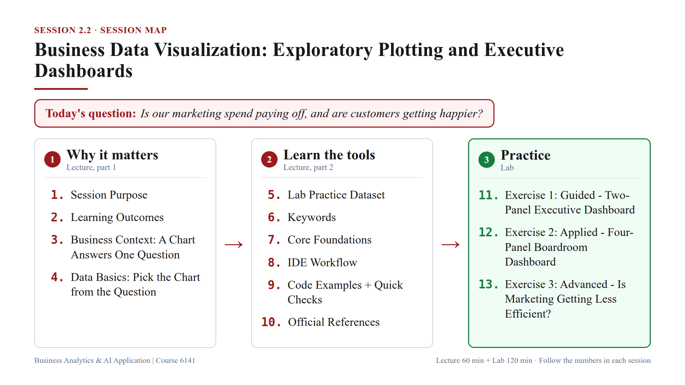

* **Lecture Presentation:** [Download Slides (PDF)](slides/session_02_02_lecture.pdf)
* **Reading (PDF):** [Download Reading (PDF)](handouts/session_02_02_reading.pdf): read before class
* **Schedule:** Week 6 (115/10/18 - 115/10/24) | In-person classes (1:2 Delivery Ratio: 60 Min Lecture + 120 Min Lab)

* **1. Session Purpose:**
  * The marketing team keeps 12 months of results in one table: revenue, marketing spend, cost per new customer, and customer loyalty
  * Executives often have only a minute or two per chart, and a table of 72 numbers hides the trend
  * The CMO (Chief Marketing Officer) asks: is our marketing spend paying off, and are customers getting happier? Today, Python turns the table into charts that answer this at a glance

* **2. Expected Learning Outcomes (By the end of this session, you will be able to):**
  1. "Is revenue growing month by month?": draw a line chart with Matplotlib (Python's main charting library) using `fig, ax = plt.subplots()` (`fig` is the whole image; `ax` is one chart inside it)
  2. "In which months did we spend the most on marketing?": draw a bar chart with Seaborn (a library built on Matplotlib for quick, clean statistical charts)
  3. "Which numbers move together?": read a correlation heatmap (a colored grid of correlations, each from -1 to +1), and fix an `IndexError` in a 2x2 dashboard

* **3. Business Context: A Chart Answers One Question:**
  * A table makes the reader hunt for the pattern; a chart shows it. In our table, revenue rises from `12.4` to `25.8` (USD millions), but the jump in November and December is easy to miss among 72 numbers.
  * Five rules for charts that executives trust:
    * One message per chart, and the title states it, for example "Revenue More Than Doubled from Jan to Dec"
    * Label every axis with its unit, such as "USD M" (millions of U.S. Dollars)
    * Bar charts start at zero; a cut-off axis makes small differences look huge
    * No 3D effects or decoration; every mark on the chart should carry data
    * Use colors that still work in black-and-white print and for color-blind readers

* **4. Data Basics: Pick the Chart from the Question:**

  | Business question | Chart | Python |
  |---|---|---|
  | How does a number change over time? | Line chart | `ax.plot()` |
  | Which category is biggest? | Bar chart | `sns.barplot()` or `ax.bar()` |
  | Do two numbers move together? | Scatter plot | `ax.scatter()` |
  | Which of many numbers move together? | Correlation heatmap | `sns.heatmap()` |

  * **Correlation** measures how closely two columns move together, on a scale from -1 to +1:
    * `+1`: when one goes up, the other always goes up
    * `0`: no straight-line pattern
    * `-1`: when one goes up, the other always goes down
  * Correlation is not causation. In our data, marketing spend and revenue have a correlation of `0.996`, but both also simply grew through the year. A high correlation alone does not prove that the spending caused the revenue.

* **5. Lab Practice Dataset:**
  * File Link: [data/session_02_02_dataset.csv](data/session_02_02_dataset.csv)
  * Audited 12-row monthly performance dataset (fictional teaching data), one row per month:
    * `Month_Index`: Month number, 1 to 12.
    * `Month_Name`: Three-letter month name, `Jan` through `Dec`.
    * `Organic_Revenue_USD_M`: Organic revenue in millions of U.S. Dollars. "Organic" means revenue from the company's own operations, not from buying other companies.
    * `Paid_Marketing_Spend_USD_M`: Paid advertising spend in millions of U.S. Dollars.
    * `Customer_Acquisition_Cost_USD`: CAC (Customer Acquisition Cost): the average marketing cost to win one new customer, in U.S. Dollars.
    * `Net_Promoter_Score`: NPS (Net Promoter Score): a customer loyalty score from -100 to +100, based on how likely customers are to recommend the company. Our values range from `58` to `74`.

* **6. Keywords (Core Programming Concepts):**
  * `Matplotlib` and `Seaborn`:
    * What: Python charting libraries; Seaborn adds quick, clean statistical charts on top of Matplotlib
    * Why: they turn a DataFrame into a chart image with a few lines of code
  * `Figure` and `Axes`:
    * What: the `Figure` is the whole image; each `Axes` is one chart inside it
    * Why: you draw on a specific `Axes`, so a dashboard can hold several charts
  * `Line Chart`:
    * What: points joined in time order
    * Why: shows trends, such as monthly revenue
  * `Bar Chart`:
    * What: one bar per category; the bar length is the value
    * Why: compares sizes, such as spend by month
  * `Scatter Plot`:
    * What: one dot per row, with one column on each axis
    * Why: shows whether two numbers move together
  * `Correlation Heatmap`:
    * What: a grid of correlations, colored from -1 to +1
    * Why: spots which of many numbers move together, in one picture

* **7. Core Programming & Computational Foundations:**
  * Draw on an `Axes`, not on the screen:
    * `fig, ax = plt.subplots()` creates one figure with one chart area
    * Then call methods on `ax`: `ax.plot()`, `ax.set_title()`, `ax.set_ylabel()`
    * Why: every instruction goes to a named chart, which matters once a figure holds several charts
  * Save the chart as a file:
    * `fig.savefig("data/chart.png", dpi=150, bbox_inches="tight")` writes an image file
    * `dpi` (dots per inch) sets the sharpness: 150 for screens, 300 for print
    * `bbox_inches="tight"` trims empty white borders
  * Grids of charts:
    * `fig, axes = plt.subplots(2, 2)` creates 4 charts, and `axes` is a 2-row by 2-column table
    * Reach one chart with a row and a column number, both starting at `0`: `axes[0, 1]` is the top-right chart
    * `axes[2]` asks for a third row that does not exist, so Python raises an `IndexError`
  * `plt.tight_layout()` spaces the charts so that titles and labels do not overlap.

* **8. Development Workflow in Google Antigravity IDE:**
  * `[1]` File Explorer: create your script with your name and the session code (for example, `Reacher_S22_demo_1.py`), and check the dataset is in `data/`. Saved charts appear here as `.png` files; click one to open it.
  * `[2]` Code Editor: write a few lines, run, repeat. Small steps keep errors small.
  * `[3]` AI Agent Chat: on an error, capture the traceback (Python's error report) with `Win + Shift + S` (macOS: `Cmd + Shift + 4`), paste it with `Ctrl + V`, and ask why it failed.
  * `[4]` Terminal: run `python` followed by your script name. Return code `0` means the script finished with no errors. First time only: `pip install matplotlib seaborn`.

* **9. Hands-On Coding Micro-Examples:**
  * Every example has three parts: **1. Input**, **2. Process**, and **3. Output**. Name each file with your own name and the session code, for example `Reacher_S22_demo_1.py` (pattern: `YourName_S22_demo_1.py`).
  * The examples save each chart as a `.png` file in `data/`. Open the file in Panel `[1]` to see the chart.
  * *Micro-Example 1 (Line Chart: Revenue Trend):* `YourName_S22_demo_1.py`
    ```python
    # 1. Input: load the monthly results
    import pandas as pd
    import matplotlib.pyplot as plt
    df = pd.read_csv("data/session_02_02_dataset.csv")

    # 2. Process: one figure with one chart, revenue by month
    fig, ax = plt.subplots(figsize=(10, 5))
    ax.plot(df["Month_Name"], df["Organic_Revenue_USD_M"],
            color="#991B1B", marker="o")
    ax.set_title("Revenue More Than Doubled from Jan to Dec")
    ax.set_ylabel("Organic Revenue (USD M)")

    # 3. Output: save the chart as an image file
    fig.savefig("data/revenue_trend.png", dpi=150, bbox_inches="tight")
    print("Saved: data/revenue_trend.png")
    ```
    * `import matplotlib.pyplot as plt` loads Matplotlib's charting tools under the short name `plt`.
    * `figsize=(10, 5)` sets the image size in inches: 10 wide, 5 tall.
    * `ax.plot(x, y)` draws the line; `color` sets its color, and `marker="o"` puts a dot on each month.
  * *Quick Check 1 (`ax.grid()`):*
    * New tool: `ax.grid(True, linestyle=":")` adds light dotted guide lines behind the chart. Why: readers can line up a point with its value on the axis.
    * Task: add one line at the end of part **2. Process**: `ax.____(True, linestyle=":")`
    * Check: open `data/revenue_trend.png`; dotted grid lines now sit behind the revenue line.
  * *Micro-Example 2 (Bar Chart: Marketing Spend by Month):* `YourName_S22_demo_2.py`
    ```python
    # 1. Input: load the monthly results
    import pandas as pd
    import matplotlib.pyplot as plt
    import seaborn as sns
    df = pd.read_csv("data/session_02_02_dataset.csv")

    # 2. Process: one bar per month
    fig, ax = plt.subplots(figsize=(10, 4))
    sns.barplot(data=df, x="Month_Name", y="Paid_Marketing_Spend_USD_M",
                color="#475569", ax=ax)
    ax.set_title("Marketing Spend Peaks in November and December")
    ax.set_xlabel("")
    ax.set_ylabel("Paid Marketing Spend (USD M)")

    # 3. Output: save the chart
    fig.savefig("data/marketing_spend_bar.png", dpi=150, bbox_inches="tight")
    print("Saved: data/marketing_spend_bar.png")
    ```
    * `sns.barplot(data=df, x=..., y=...)` reads the column names straight from the DataFrame; `ax=ax` tells Seaborn which chart to draw on.
    * `ax.set_xlabel("")` removes the x-axis label, because the month names already explain the axis.
  * *Quick Check 2 (`.nlargest()`):*
    * New tool: `df.nlargest(3, "Column_Name")` returns the 3 rows with the largest values in that column. Why: confirms the chart's message with exact numbers.
    * Task: add one line to part **3. Output**: `print(df.________(3, "Paid_Marketing_Spend_USD_M")[["Month_Name", "Paid_Marketing_Spend_USD_M"]])`
    * Check: the Terminal lists `Dec` (`6.4`), `Nov` (`5.2`), and `Oct` (`4.1`).
  * *Micro-Example 3 (Correlation Heatmap):* `YourName_S22_demo_3.py`
    ```python
    # 1. Input: load the monthly results
    import pandas as pd
    import matplotlib.pyplot as plt
    import seaborn as sns
    df = pd.read_csv("data/session_02_02_dataset.csv")

    # 2. Process: correlation between every pair of 4 columns
    cols = ["Organic_Revenue_USD_M", "Paid_Marketing_Spend_USD_M",
            "Customer_Acquisition_Cost_USD", "Net_Promoter_Score"]
    corr = df[cols].corr().round(2)
    fig, ax = plt.subplots(figsize=(8, 6))
    sns.heatmap(corr, annot=True, cmap="RdBu_r", vmin=-1, vmax=1, ax=ax)
    ax.set_title("All Four Measures Rose Together in 2024")

    # 3. Output: print the numbers, then save the chart
    print(corr)
    fig.savefig("data/kpi_correlation_heatmap.png", dpi=150,
                bbox_inches="tight")
    ```
    * `.corr()` returns a table with the correlation of every pair of columns. Each column with itself is always `1.0`.
    * `annot=True` writes each number in its cell. `cmap="RdBu_r"` colors from blue (`-1`) through white (`0`) to red (`+1`); `vmin=-1, vmax=1` fixes that scale.
    * Result: every value is between `0.97` and `1.00`, because all four measures grew through the year. Remember: correlation is not causation.
  * *Quick Check 3 (`.corr()` on two columns):*
    * New tool: `column_a.corr(column_b)` returns one correlation number for two columns. Why: answers a single question without a whole heatmap.
    * Task: add one line to part **3. Output**: `print(round(df["Paid_Marketing_Spend_USD_M"].____(df["Organic_Revenue_USD_M"]), 3))`
    * Check: the Terminal shows `0.996`.

* **10. Official Python Documentation & References:**
  * [Matplotlib Official Documentation: User Guide](https://matplotlib.org/stable/users/index.html).
  * [Seaborn Official Documentation: Statistical Data Visualization](https://seaborn.pydata.org/).
  * [Edward Tufte: The Visual Display of Quantitative Information (Principles of Information Design)](https://www.edwardtufte.com/tufte/books_vdqi).

* **11. Exercise 1: Guided Practice - Two-Panel Executive Dashboard:**
  * *Step 1: Open Script:* In Google Antigravity IDE, create a new script named `YourName_S22_dashboard.py`, replacing `YourName` with your own name (for example, `Reacher_S22_dashboard.py`).
  * *Step 2: Build Two Charts Side by Side:*
    Type the following code:
    ```python
    # 1. Input: load the monthly results
    import pandas as pd
    import matplotlib.pyplot as plt
    df = pd.read_csv("data/session_02_02_dataset.csv")

    # 2. Process: one figure, two charts side by side
    fig, (ax1, ax2) = plt.subplots(1, 2, figsize=(14, 5))

    # Left chart: revenue trend
    ax1.plot(df["Month_Name"], df["Organic_Revenue_USD_M"],
             color="#991B1B", marker="s", linewidth=2)
    ax1.set_title("Monthly Revenue (USD M)")
    ax1.grid(True, linestyle=":")

    # Right chart: cost per new customer vs customer loyalty
    ax2.scatter(df["Customer_Acquisition_Cost_USD"],
                df["Net_Promoter_Score"], color="#1E293B", s=80)
    ax2.set_title("Loyalty (NPS) vs Cost per New Customer (CAC)")
    ax2.set_xlabel("CAC (USD)")
    ax2.set_ylabel("Net Promoter Score")
    ax2.grid(True, linestyle=":")

    # 3. Output: save the dashboard
    plt.tight_layout()
    fig.savefig("data/executive_dashboard_2panel.png", dpi=200)
    print("Dashboard saved: data/executive_dashboard_2panel.png")
    ```
    * `plt.subplots(1, 2)` makes 1 row with 2 charts, and `(ax1, ax2)` names them left and right.
    * `ax.scatter(x, y)` draws one dot per month; `s=80` sets the dot size.
  * *Step 3: Inspect Output:* Open `data/executive_dashboard_2panel.png` in Panel `[1]` and check that titles and axis labels do not overlap.
  * *Step 4: Execute in Terminal:* Run `python YourName_S22_dashboard.py` in Panel `[4]` and confirm return code `0`.
  * *Success Check:* the image has 2 charts. The right chart's dots climb from bottom-left to top-right: months with a higher cost per new customer also had higher loyalty, which matches their correlation of `0.98`.

* **12. Exercise 2: Applied Practice - Four-Panel Boardroom Dashboard:**
  * *Coding Challenge:* In `YourName_S22_practice.py`, build a 2x2 dashboard with 4 charts: revenue trend (line), marketing spend by month (bar), cost per new customer by month (line), and the correlation heatmap.
  * *Task 1 (2x2 Layout):* Create the grid with `fig, axes = plt.subplots(2, 2, figsize=(16, 10))`. Draw each chart on its own position: `axes[0, 0]`, `axes[0, 1]`, `axes[1, 0]`, and `axes[1, 1]`. Pass `ax=axes[1, 1]` to `sns.heatmap()`.
  * *Task 2 (Deliberate IndexError & AI Diagnosis):* Change one position to `axes[2].plot(...)`. Run the script and read `IndexError: index 2 is out of bounds for axis 0 with size 2`. Capture the traceback with `Win + Shift + S`, paste it into Panel `[3]` (AI Agent Chat) with `Ctrl + V`, and review the AI's explanation of row and column numbers.
  * *Task 3 (Fix and Export):* Fix the position, call `plt.tight_layout()`, and save the dashboard to `data/boardroom_dashboard.png` with `dpi=300`.
  * *Success Check:* `data/boardroom_dashboard.png` shows 4 charts with no overlapping titles, and the script ends with return code `0`.

* **13. Exercise 3: Advanced Practice - Is Marketing Getting Less Efficient?:**
  * *Goal:* Answer the CMO's question with a new measure and one honest chart: does each marketing dollar still bring in as much revenue at the end of the year as at the start?
  * *What you need:*
    * File: `data/session_02_02_dataset.csv` (described in **5. Lab Practice Dataset**).
    * Script name: `YourName_S22_challenge.py`.
    * Tools you already know: column math, `.round()`, `.mean()`, `.sort_values()`, a `for` loop with `if` / `else` (Session 1.2), `fig, ax = plt.subplots()`, and `fig.savefig()`.
  * *Requirements (follow them in order):*
    1. Add `Revenue_per_Marketing_USD` = `Organic_Revenue_USD_M` / `Paid_Marketing_Spend_USD_M`, rounded to 2 decimal places. It shows how many dollars of revenue came with each dollar of paid marketing in that month.
    2. Compute the 12-month average of that column and round it to 2 decimal places.
    3. Build a list of 12 colors with a `for` loop: `"#991B1B"` (red) for months **below** the average, `"#94A3B8"` (grey) for all others.
    4. Draw a bar chart with `ax.bar()`: month names on the x-axis, `Revenue_per_Marketing_USD` as the bar heights, and your color list.
    5. Add a dashed horizontal line at the average, then a title that states your finding and a y-axis label with its unit ("USD of revenue per USD of marketing").
    6. Save the chart to `data/marketing_efficiency.png` with `dpi=150`.
    7. Print the average, then the best and the worst month with their values.
  * *New tools for this exercise:*
    * `ax.bar(x_values, heights, color=color_list)`: Matplotlib's own bar chart. When `color` is a list, bar 1 gets color 1, bar 2 gets color 2, and so on.
    * `ax.axhline(y=5.08, linestyle="--", color="black")`: draws a horizontal line across the chart at height `y`, useful for marking an average or a target.
    * Building a list in a loop: start with `colors = []`, then `colors.append("#991B1B")` adds one item to the end.
  * *Hints:*
    * Loop over the column itself: `for value in df["Revenue_per_Marketing_USD"]:`.
    * For the best and worst month, sort the DataFrame by the new column and read the first and last rows, for example with `.head(1)` and `.tail(1)`.
  * *Self-Check (expected results):*
    * Average: `5.08`. Best month: `Jan` (`5.9`). Worst month: `Dec` (`4.03`).
    * The 6 red bars are `Jul` through `Dec`: every month in the second half of the year is below average.
    * Business meaning: spending rose faster than revenue. Revenue doubled, but each marketing dollar brought in about 32% less revenue in December than in January, and the cost per new customer rose from `48.5` to `68.0`. The CMO should ask whether the November and December campaigns were worth their extra cost.

---

<a id="session-02-03"></a>
### Session 2.3: Midterm Applied Analytics Formulation Part 1: Problem Structuring and Data Audit

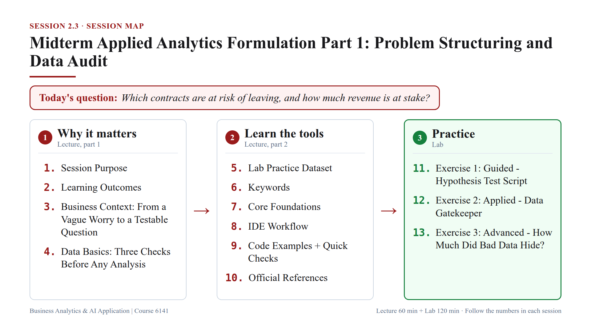

* **Lecture Presentation:** [Download Slides (PDF)](slides/session_02_03_lecture.pdf)
* **Reading (PDF):** [Download Reading (PDF)](handouts/session_02_03_reading.pdf): read before class
* **Schedule:** Week 7 (115/10/25 - 115/10/31) | In-person classes (1:2 Delivery Ratio: 60 Min Lecture + 120 Min Lab)

* **1. Session Purpose:**
  * An IT (Information Technology) services company holds 15 enterprise client contracts worth $10.7 million a year
  * The account director has a vague worry: "some clients are unhappy and may leave", but a worry is not something data can test
  * The account director asks: which contracts are at risk of leaving, and how much revenue is at stake? Today, you turn that worry into a testable question, check that the data can be trusted, and measure the starting point. This is step 1 of your midterm project

* **2. Expected Learning Outcomes (By the end of this session, you will be able to):**
  1. "What exactly should we test?": turn a vague business problem into a testable hypothesis (a clear statement that data can support or prove wrong)
  2. "Can we trust this data?": audit a dataset for missing values (`.isnull()`), duplicates (`.duplicated()`), and impossible values, such as a percentage above 100
  3. "How do we stop bad data automatically?": write `assert` checks (rules the data must pass) and handle an `AssertionError` with `try` / `except`

* **3. Business Context: From a Vague Worry to a Testable Question:**
  * Managers rarely hand you a clean question. A useful analysis moves through four steps:

    | Step | Example |
    |---|---|
    | Vague worry | "Some clients are unhappy and may leave." |
    | Business question | "Is poor service linked to clients at risk of leaving?" |
    | Testable hypothesis | "Accounts below 95% SLA compliance have more billing disputes and a higher retention risk than other accounts." |
    | Measure today (baseline) | "Revenue in High-risk accounts today: $930,000." |

  * SLA (Service Level Agreement): the service promise in a contract, such as "the system is available 99% of the time". SLA compliance is the share of that promise actually delivered.
  * Baseline: today's value of the measure you care about. Without it, nobody can prove later that an action improved anything.
  * **Midterm Project, Step 1 of 2: your Question Card.** Choose a business problem with a dataset you can audit (for example, any dataset from Sessions 1.3 to 2.2), and fill in five lines:
    1. Vague worry: what the manager is concerned about
    2. Business question: what decision the answer supports
    3. Hypothesis: one sentence the data can support or prove wrong
    4. Data and audit: the file you use, and the result of the three checks in section 4
    5. Baseline: one number that describes today
  * Bring your completed Question Card and your audit script to Session 2.4, where you present your findings.

* **4. Data Basics: Three Checks Before Any Analysis:**
  * Bad data produces confident but wrong answers ("garbage in, garbage out"). Run three checks before you analyze:

    | Check | Question | pandas |
    |---|---|---|
    | Completeness | Are any values missing? | `df.isnull().sum()` |
    | Uniqueness | Does each ID appear only once? | `df["Account_ID"].duplicated().sum()` |
    | Validity | Are all values possible? | `(df["SLA_Compliance_Pct"] > 100).sum()` |

  * `NaN` ("Not a Number") is how pandas shows an empty cell. `.isnull()` marks each `NaN` as `True`.
  * A rule for validity comes from business logic: a percentage must be between 0 and 100, and a contract value must be above 0.

* **5. Lab Practice Dataset:**
  * Two versions of the same 15 client contracts (company names are fictional):
    * Clean file: [data/session_02_03_dataset.csv](data/session_02_03_dataset.csv), 15 rows that pass every check. Use it for analysis.
    * Raw file: [data/session_02_03_raw.csv](data/session_02_03_raw.csv), 16 rows as they arrived from the billing system, with a few problems for you to find. Use it for auditing.
  * Columns (the same in both files):
    * `Account_ID`: Unique client account code (e.g., `ACC-301`).
    * `Enterprise_Client`: Client company name (Titan Tech, Beacon Health, Vanguard Retail, and others). One company can hold several accounts.
    * `Contract_Value_USD`: Yearly contract value in U.S. Dollars.
    * `SLA_Compliance_Pct`: Share of the service promise delivered, in percent.
    * `Billing_Discrepancy_Count`: Number of billing disputes (invoices the client challenged) during the contract.
    * `Client_Retention_Risk`: The account team's rating of how likely the client is to leave: `Low`, `Medium`, or `High`.

* **6. Keywords (Core Programming Concepts):**
  * `Hypothesis`:
    * What: one clear statement that data can support or prove wrong
    * Why: turns a vague worry into a test with a yes or no answer
  * `Exploratory Data Analysis (EDA)`:
    * What: a first look at the data with counts, averages, and charts before any formal test
    * Why: shows what the data can answer, and where it looks strange
  * `Data Audit`:
    * What: the three checks: completeness, uniqueness, and validity
    * Why: one bad row can change a total by millions
  * `Baseline`:
    * What: today's value of the measure you care about
    * Why: the starting point for proving any later improvement
  * `assert`:
    * What: a line that stops the script with an `AssertionError` when a rule is broken, such as `assert (df["Contract_Value_USD"] > 0).all()`
    * Why: bad data is caught at the door, before it reaches a report
  * `try` / `except`:
    * What: runs code in `try`; if a chosen error happens, the code in `except` runs instead of stopping the script
    * Why: the script can report the problem clearly and keep going

* **7. Core Programming & Computational Foundations:**
  * Counting `True` values:
    * A condition on a column gives one `True` / `False` per row
    * `.sum()` counts the `True` values, because Python treats `True` as 1 and `False` as 0
    * `df.isnull().sum().sum()`: the first `.sum()` counts per column, the second adds the columns together
  * `.all()` and `.any()`:
    * `.all()` is `True` only if every value is `True`; `.any()` is `True` if at least one is
    * `assert (df["Contract_Value_USD"] > 0).all()` therefore means "every contract value is above zero"
  * `assert` with a message:
    * `assert rule, "message"` shows your message in the `AssertionError`, so the reader knows which rule failed
  * `try` / `except`:
    * Put the checks inside `try:`, and handle a failure under `except AssertionError as error:`
    * `error` holds the message, so you can print or save it

* **8. Development Workflow in Google Antigravity IDE:**
  * `[1]` File Explorer: create your script with your name and the session code (for example, `Reacher_S23_demo_1.py`), and check both files are in `data/`.
  * `[2]` Code Editor: write a few lines, run, repeat. Small steps keep errors small.
  * `[3]` AI Agent Chat: on an error, capture the traceback (Python's error report) with `Win + Shift + S` (macOS: `Cmd + Shift + 4`), paste it with `Ctrl + V`, and ask why it failed.
  * `[4]` Terminal: run `python` followed by your script name. Return code `0` means the script finished with no errors.

* **9. Hands-On Coding Micro-Examples:**
  * Every example has three parts: **1. Input**, **2. Process**, and **3. Output**. Name each file with your own name and the session code, for example `Reacher_S23_demo_1.py` (pattern: `YourName_S23_demo_1.py`).
  * *Micro-Example 1 (Audit the Raw File):* `YourName_S23_demo_1.py`
    ```python
    # 1. Input: the raw file, as it arrived
    import pandas as pd
    raw = pd.read_csv("data/session_02_03_raw.csv")

    # 2. Process: the three checks, as counts
    missing_values = raw.isnull().sum().sum()
    duplicate_ids = raw["Account_ID"].duplicated().sum()
    sla_above_100 = (raw["SLA_Compliance_Pct"] > 100).sum()
    value_not_positive = (raw["Contract_Value_USD"] <= 0).sum()

    # 3. Output: one line per check
    print("Rows:", len(raw))
    print("Missing values:", missing_values)
    print("Duplicate account IDs:", duplicate_ids)
    print("SLA above 100%:", sla_above_100)
    print("Contract value of 0 or less:", value_not_positive)
    ```
    * `.duplicated()` marks a row `True` when its value already appeared in an earlier row, so the first copy is not counted.
    * Result: 16 rows, and each check finds `1` problem.
  * *Quick Check 1 (`.drop_duplicates()`):*
    * New tool: `raw.drop_duplicates()` returns the table without rows that exactly repeat an earlier row. Why: a copied row counts the same contract twice.
    * Task: add one line to part **3. Output**: `print("Rows after removing duplicates:", len(raw.________________()))`
    * Check: the Terminal shows `Rows after removing duplicates: 15`.
  * *Micro-Example 2 (Test the Hypothesis on the Clean File):* `YourName_S23_demo_2.py`
    ```python
    # 1. Input: the clean file
    import pandas as pd
    df = pd.read_csv("data/session_02_03_dataset.csv")

    # 2. Process: mark SLA breaches, then compare the two groups
    df["SLA_Breach"] = df["SLA_Compliance_Pct"] < 95.0
    comparison = df.groupby("SLA_Breach").agg(
        Accounts=("Account_ID", "count"),
        Avg_Disputes=("Billing_Discrepancy_Count", "mean"),
    ).round(2)

    # 3. Output: breach (True) vs no breach (False)
    print(comparison)
    ```
    * `SLA_Breach` is `True` for accounts below the 95% service promise.
    * Result: the 4 breached accounts average `4.75` billing disputes, against `0.64` for the other 11. The first half of the hypothesis is supported.
  * *Quick Check 2 (`pd.crosstab()`):*
    * New tool: `pd.crosstab(column_a, column_b)` counts the rows for every pair of values, such as breach yes or no against risk Low, Medium, or High. Why: tests the second half of the hypothesis in one table.
    * Task: add one line to part **3. Output**: `print(pd.________(df["SLA_Breach"], df["Client_Retention_Risk"]))`
    * Check: in the `True` row, `High` is `3` and `Medium` is `1`: 3 of the 4 breached accounts are rated High risk, and no non-breached account is.
  * *Micro-Example 3 (Measure the Baseline):* `YourName_S23_demo_3.py`
    ```python
    # 1. Input: the clean file
    import pandas as pd
    df = pd.read_csv("data/session_02_03_dataset.csv")

    # 2. Process: contract value by risk rating, and the High-risk share
    value_by_risk = df.groupby("Client_Retention_Risk")["Contract_Value_USD"].sum()
    high_risk_value = value_by_risk["High"]
    high_risk_share = high_risk_value / df["Contract_Value_USD"].sum() * 100

    # 3. Output: today's baseline
    print(value_by_risk)
    print("High-risk share of revenue (%):", round(high_risk_share, 1))
    ```
    * `df.groupby(...)["Contract_Value_USD"].sum()` sums one column per group. `value_by_risk["High"]` reads the value for the `High` group.
    * Result: `930000.0` of revenue sits in High-risk accounts, `8.7`% of the total.
  * *Quick Check 3 (f-string number format):*
    * New tool: `f"${value:,.0f}"` writes a number with thousands separators and no decimals, such as `$930,000`. Why: managers read money faster in this form.
    * Task: add one line to part **3. Output**: `print(f"Revenue at High risk: ${high_risk_value:___}")`
    * Check: the Terminal shows `Revenue at High risk: $930,000`.

* **10. Official Python Documentation & References:**
  * [Python Tutorial: Errors and Exceptions (`try` / `except`)](https://docs.python.org/3/tutorial/errors.html).
  * [Python Reference: The `assert` Statement](https://docs.python.org/3/reference/simple_stmts.html#the-assert-statement).
  * [Pandas User Guide: Working with Missing Data](https://pandas.pydata.org/docs/user_guide/missing_data.html).

* **11. Exercise 1: Guided Practice - Hypothesis Test Script:**
  * *Step 1: Open Script:* In Google Antigravity IDE, create a new script named `YourName_S23_hypothesis.py`, replacing `YourName` with your own name (for example, `Reacher_S23_hypothesis.py`).
  * *Step 2: Test Two Hypotheses and Measure the Baseline:*
    Type the following code:
    ```python
    # 1. Input: the clean file
    import pandas as pd
    df = pd.read_csv("data/session_02_03_dataset.csv")

    # 2. Process: two tests and one baseline
    # Hypothesis 1: higher-risk accounts have more billing disputes
    disputes_by_risk = (
        df.groupby("Client_Retention_Risk")["Billing_Discrepancy_Count"]
        .mean().round(2)
    )
    # Hypothesis 2: lower SLA compliance goes with more disputes
    sla_vs_disputes = df["SLA_Compliance_Pct"].corr(
        df["Billing_Discrepancy_Count"]
    )
    # Baseline: revenue in High-risk accounts today
    high_risk_value = df.loc[
        df["Client_Retention_Risk"] == "High", "Contract_Value_USD"
    ].sum()

    # 3. Output: a short report
    print("Hypothesis 1: average disputes by risk rating\n", disputes_by_risk)
    print(f"Hypothesis 2: correlation of SLA and disputes: {sla_vs_disputes:.3f}")
    print(f"Baseline: revenue at High risk: ${high_risk_value:,.0f}")
    ```
    * `df.loc[rows, "Column_Name"]` selects the rows and one column at the same time.
    * `{sla_vs_disputes:.3f}` shows the number with 3 decimals.
  * *Step 3: Interpret:* Write two comment lines at the end of the script: does each result support its hypothesis?
  * *Step 4: Execute in Terminal:* Run `python YourName_S23_hypothesis.py` in Panel `[4]` and confirm return code `0`.
  * *Success Check:* average disputes are `5.33` for High, `2.0` for Medium, and `0.25` for Low; the correlation is `-0.982` (lower SLA goes with more disputes); the baseline is `$930,000`. Both hypotheses are supported.

* **12. Exercise 2: Applied Practice - Data Gatekeeper:**
  * *Coding Challenge:* In `YourName_S23_practice.py`, write checks that stop bad data, then clean the raw file so it passes.
  * *Task 1 (Write the Rules):* Load `data/session_02_03_raw.csv`. Write three `assert` lines with messages:
    * `assert raw["SLA_Compliance_Pct"].between(0, 100).all(), "SLA must be between 0 and 100"`
    * `assert (raw["Contract_Value_USD"] > 0).all(), "Contract value must be above 0"`
    * `assert not raw["Account_ID"].duplicated().any(), "Account IDs must be unique"`
    * `.between(0, 100)` is `True` when a value is from 0 to 100; a missing value counts as `False`.
  * *Task 2 (Read the AssertionError & AI Diagnosis):* Run the script. It stops at the first rule with `AssertionError: SLA must be between 0 and 100`. Capture the traceback with `Win + Shift + S`, paste it into Panel `[3]` (AI Agent Chat) with `Ctrl + V`, and ask which rows break the rule.
  * *Task 3 (Clean, Re-check, Save):* Put the three `assert` lines inside `try:` and print the message under `except AssertionError as error:`. Then build `clean` from `raw`: remove duplicate rows with `.drop_duplicates()`, keep only rows where the SLA is between 0 and 100, and keep only rows where the contract value is above 0. Run the three checks again on `clean`, and save it to `data/contracts_clean.csv` with `index=False`.
  * *Success Check:* the first run prints `SLA must be between 0 and 100`; `clean` has `12` rows and passes all three checks; the script ends with return code `0`.

* **13. Exercise 3: Advanced Practice - How Much Did Bad Data Hide?:**
  * *Goal:* Show the account director, in numbers, how the raw file's problems distort the risk report, and list exactly which accounts the data team must fix.
  * *What you need:*
    * Files: `data/session_02_03_raw.csv` (with problems) and `data/session_02_03_dataset.csv` (the corrected version of the same contracts).
    * Script name: `YourName_S23_challenge.py`.
    * Tools you already know: the three checks, `groupby()`, `.sum()`, Boolean masks with `|`, `.loc[]`, `pd.DataFrame()`, and f-strings.
  * *Requirements (follow them in order):*
    1. Write a function `audit(table)` that returns a dictionary with four counts: `"missing"`, `"duplicate_ids"`, `"sla_out_of_range"` (SLA above 100), and `"value_not_positive"` (contract value of 0 or less).
    2. Call `audit()` on both files and print both dictionaries.
    3. Make a list of every `Account_ID` in the raw file that breaks at least one rule. Each account should appear only once, sorted from smallest to largest.
    4. For each file, sum `Contract_Value_USD` by `Client_Retention_Risk`. Put the two results side by side in one DataFrame with the columns `Raw_USD` and `Correct_USD`, and add `Difference_USD` = `Raw_USD` - `Correct_USD`.
    5. Print the table and one sentence that states the biggest distortion in plain words, using an f-string with thousands separators.
  * *New tools for this exercise:*
    * Defining a function: `def audit(table):` followed by indented lines, ending with `return {...}`. Calling `audit(raw)` runs those lines on `raw` and gives back the dictionary.
    * `|` means "or" for masks: `(rule_1) | (rule_2)` is `True` when at least one rule is `True`. `.isnull()` on one column marks its missing values.
    * Unique, sorted values: `sorted(set(raw.loc[mask, "Account_ID"]))`. `set()` keeps each value once; `sorted()` puts them in order.
    * Side-by-side columns: `pd.DataFrame({"Raw_USD": raw_sums, "Correct_USD": correct_sums})`, where both sums come from `groupby()`, lines up the values by risk rating.
  * *Hints:*
    * For requirement 3, build one mask that is `True` for a duplicate, a missing value, an SLA above 100, or a value of 0 or less. Use `raw.duplicated("Account_ID", keep=False)` so that both copies of a duplicated account are marked.
    * Print each intermediate result before you combine them.
  * *Self-Check (expected results):*
    * Raw file: `{"missing": 1, "duplicate_ids": 1, "sla_out_of_range": 1, "value_not_positive": 1}`; clean file: all four counts are `0`.
    * Accounts to fix: `['ACC-304', 'ACC-306', 'ACC-311', 'ACC-313']`.
    * Differences: `High` `-620000.0`, `Low` `1200000.0`, `Medium` `0.0`.
    * Business meaning: one negative typo (`ACC-313`) made High-risk revenue look like `$310,000` instead of `$930,000`, hiding two-thirds of the real risk, while one duplicated row added `$1,200,000` to Low risk. The data must be fixed before anyone acts on the risk report.

---

<a id="session-02-04"></a>
### Session 2.4: Midterm Analytics Pipeline Defense Part 2: Exploratory Findings and Executive Review

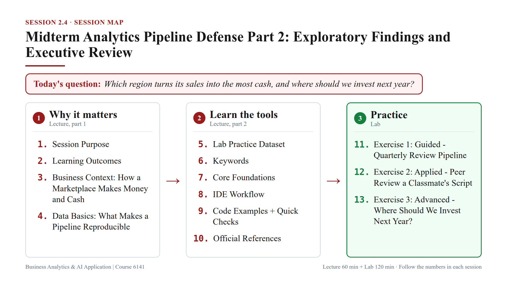

* **Lecture Presentation:** [Download Slides (PDF)](slides/session_02_04_lecture.pdf)
* **Reading (PDF):** [Download Reading (PDF)](handouts/session_02_04_reading.pdf): read before class
* **Schedule:** Week 8 (115/11/01 - 115/11/07) | In-person classes (1:2 Delivery Ratio: 60 Min Lecture + 120 Min Lab)

* **1. Session Purpose:**
  * An online marketplace earns a fee on every sale its sellers make, in three regions: North America, Europe, and Asia Pacific
  * Big sales are not the same as cash in the bank: the region that sells the most may not be the one that generates the most cash
  * The CFO (Chief Financial Officer) asks: which region turns its sales into the most cash, and where should we invest next year? Today, you answer with one script that anyone can rerun, and present your midterm findings in the same way

* **2. Expected Learning Outcomes (By the end of this session, you will be able to):**
  1. "Can someone else get the same numbers?": build a reproducible pipeline (one script that goes from the raw file to the final report with no manual steps), organized into functions
  2. "Which region turns sales into the most cash?": calculate revenue and the operating cash flow margin by region and quarter
  3. "How do I explain it to the CFO?": write findings as finding, evidence, and recommendation; review a classmate's script; and fix a `TypeError` (mixing text and numbers)

* **3. Business Context: How a Marketplace Makes Money and Cash:**
  * Four terms, one example (North America, 2024-Q1):

    | Term | Meaning | Example |
    |---|---|---|
    | GMV (Gross Merchandise Value) | the total value of everything sold on the platform | `145.2` USD M |
    | Take rate | the share of GMV the platform keeps as its fee | `12.5`% |
    | Revenue | GMV x take rate / 100: the platform's own income | `18.15` USD M |
    | OCF (Operating Cash Flow) | the cash the business actually generated after paying its operating costs | `5.6` USD M |

  * OCF margin = OCF / revenue x 100. It answers "of every dollar of revenue, how many cents became cash?" Example: `5.6 / 18.15 x 100 = 30.9`%.
  * **Midterm Project, Step 2 of 2: present your findings.** In a short presentation, walk through:
    1. Your Question Card from Session 2.3 (worry, question, hypothesis, data, baseline)
    2. Your audit result: what you checked and what you fixed
    3. Your findings, each written in three parts:
       * **Finding:** one sentence a manager can repeat. "North America turns the most revenue into cash."
       * **Evidence:** the number behind it. "Its OCF margin is 31.0%, against 24.7% in Europe and 18.5% in Asia Pacific."
       * **Recommendation:** what to do. "Study North America's cost structure before expanding in Asia Pacific."
    4. A live run of your script, from the raw file to the final report

* **4. Data Basics: What Makes a Pipeline Reproducible:**
  * A reproducible pipeline runs from top to bottom and produces the same numbers on any computer. It has four stages:

    | Stage | What it does | Example in today's script |
    |---|---|---|
    | Load | Read the raw file | `pd.read_csv("data/session_02_04_dataset.csv")` |
    | Check | Stop if the data breaks a rule | `assert (df["Gross_Merchandise_Value_USD_M"] > 0).all()` |
    | Calculate | Add the measures | revenue and OCF margin |
    | Report | Print and save the result | `summary.to_csv("data/region_summary.csv")` |

  * Three habits that make a script reproducible:
    * Use relative paths such as `data/...`, never paths that only exist on your computer, such as `C:/Users/Reacher/Desktop/...`
    * Calculate every number from the data; never type a result into the code by hand
    * Before presenting, delete your output files and run the script again from the start

* **5. Lab Practice Dataset:**
  * File Link: [data/session_02_04_dataset.csv](data/session_02_04_dataset.csv)
  * Audited 12-row quarterly marketplace dataset (fictional teaching data): 3 regions x 4 quarters, one row per region and quarter:
    * `Quarter_Code`: Reporting quarter, `2024-Q1` through `2024-Q4`.
    * `Market_Segment`: Region: `North_America`, `Europe`, or `Asia_Pacific`.
    * `Gross_Merchandise_Value_USD_M`: GMV (Gross Merchandise Value) in millions of U.S. Dollars.
    * `Platform_Take_Rate_Pct`: The platform's fee as a percentage of GMV.
    * `Operating_Cash_Flow_USD_M`: OCF (Operating Cash Flow) in millions of U.S. Dollars.

* **6. Keywords (Core Programming Concepts):**
  * `Reproducible Pipeline`:
    * What: one script that goes from the raw file to the final report, with no manual steps
    * Why: anyone can rerun it and check your numbers
  * `Function` (`def` / `return`):
    * What: a named block of code that takes inputs and gives back a result
    * Why: each pipeline stage gets a clear name, and you can reuse it
  * `Relative Path`:
    * What: a file path that starts from the project folder, such as `data/session_02_04_dataset.csv`
    * Why: works on every computer that has the project folder
  * `Data Type` and `TypeError`:
    * What: text (`str`) and numbers (`float`, `int`) are different types; `"Total: " + 204.3` raises a `TypeError`
    * Why: printing a result is where this mistake happens most
  * `Executive Finding`:
    * What: a finding, its evidence, and a recommendation
    * Why: managers act on clear statements backed by numbers, not on code
  * `Peer Review`:
    * What: a classmate checks your script against a short checklist
    * Why: a second reader catches mistakes the author no longer sees

* **7. Core Programming & Computational Foundations:**
  * Functions:
    * `def add_metrics(df):` starts a function; the indented lines below it are its body
    * `return df` hands the result back to the caller
    * Call it with `df = add_metrics(df)`. One function per pipeline stage keeps the script easy to follow
  * Docstrings:
    * A text in triple quotes on the first line of a function, such as `"""Add revenue and OCF margin."""`, says what the function does
    * Reviewers read it first; `help(add_metrics)` prints it
  * Mixing text and numbers:
    * `"Total: " + 204.3` raises `TypeError: can only concatenate str (not "float") to str`
    * Fix it with an f-string: `f"Total: {204.3}"`, or convert the number first: `"Total: " + str(204.3)`
  * Hard-coded numbers:
    * Typing `0.125` for the take rate assumes every row has the same fee; reading the column gives each row its own fee
    * A hard-coded number may give a believable result that is still wrong, which is easy to miss

* **8. Development Workflow in Google Antigravity IDE:**
  * `[1]` File Explorer: create your script with your name and the session code (for example, `Reacher_S24_demo_1.py`), and check the dataset is in `data/`.
  * `[2]` Code Editor: write a few lines, run, repeat. Small steps keep errors small.
  * `[3]` AI Agent Chat: on an error, capture the traceback (Python's error report) with `Win + Shift + S` (macOS: `Cmd + Shift + 4`), paste it with `Ctrl + V`, and ask why it failed.
  * `[4]` Terminal: run `python` followed by your script name. Return code `0` means the script finished with no errors.

* **9. Hands-On Coding Micro-Examples:**
  * Every example has three parts: **1. Input**, **2. Process**, and **3. Output**. Name each file with your own name and the session code, for example `Reacher_S24_demo_1.py` (pattern: `YourName_S24_demo_1.py`).
  * *Micro-Example 1 (From GMV to Cash, Row by Row):* `YourName_S24_demo_1.py`
    ```python
    # 1. Input: load the quarterly results
    import pandas as pd
    df = pd.read_csv("data/session_02_04_dataset.csv")

    # 2. Process: revenue, then OCF margin, for every row
    df["Revenue_USD_M"] = (
        df["Gross_Merchandise_Value_USD_M"] * df["Platform_Take_Rate_Pct"] / 100
    ).round(2)
    df["OCF_Margin_Pct"] = (
        df["Operating_Cash_Flow_USD_M"] / df["Revenue_USD_M"] * 100
    ).round(1)

    # 3. Output: the 3 rows with the lowest margin
    lowest = df.sort_values("OCF_Margin_Pct").head(3)
    print(lowest[["Quarter_Code", "Market_Segment", "OCF_Margin_Pct"]])
    ```
    * Each row gets its own take rate from the column, so no fee is typed into the code.
    * Result: the 3 lowest margins are all Asia Pacific: `15.0` (Q1), `16.8` (Q2), and `18.6` (Q3).
  * *Quick Check 1 (`.pivot_table()`):*
    * New tool: `df.pivot_table(index="A", columns="B", values="C")` makes a grid with one row per value of `A` and one column per value of `B`, like an Excel pivot table. Why: shows all 12 margins in one readable grid.
    * Task: add one line to part **3. Output**: `print(df.___________(index="Market_Segment", columns="Quarter_Code", values="OCF_Margin_Pct"))`
    * Check: the `Asia_Pacific` row reads `15.0`, `16.8`, `18.6`, `22.0`: its margin improved every quarter.
  * *Micro-Example 2 (The Same Work as a Pipeline of Functions):* `YourName_S24_demo_2.py`
    ```python
    # 1. Input: a function that loads and checks the raw file
    import pandas as pd

    def load_data(path):
        df = pd.read_csv(path)
        assert (df["Gross_Merchandise_Value_USD_M"] > 0).all(), "GMV must be above 0"
        return df

    # 2. Process: functions that add measures and summarize by region
    def add_metrics(df):
        df["Revenue_USD_M"] = (
            df["Gross_Merchandise_Value_USD_M"] * df["Platform_Take_Rate_Pct"] / 100
        ).round(2)
        return df

    def summarize(df):
        summary = df.groupby("Market_Segment").agg(
            Revenue_USD_M=("Revenue_USD_M", "sum"),
            OCF_USD_M=("Operating_Cash_Flow_USD_M", "sum"),
        )
        summary["OCF_Margin_Pct"] = (
            summary["OCF_USD_M"] / summary["Revenue_USD_M"] * 100
        ).round(1)
        return summary

    # 3. Output: run the stages in order, then print and save
    df = load_data("data/session_02_04_dataset.csv")
    df = add_metrics(df)
    summary = summarize(df)
    print(summary)
    summary.to_csv("data/region_summary.csv")
    ```
    * Each function does one stage, and the last 5 lines show the whole pipeline at a glance.
    * Result: Asia Pacific has the most revenue (`70.39`) but the lowest margin (`18.5`%); North America has the least revenue (`65.57`) but the highest margin (`31.0`%).
  * *Quick Check 2 (Docstring):*
    * New tool: a docstring, a text in triple quotes on the first line inside a function. `help(function_name)` prints it. Why: a reviewer learns what each stage does without reading its code.
    * Task: add one line directly under `def add_metrics(df):`, indented like the line below it: `"""Add revenue in USD M from GMV and the take rate."""`. Then add `help(add_metrics)` to part **3. Output**.
    * Check: the Terminal prints a help page that includes `Add revenue in USD M from GMV and the take rate.`
  * *Micro-Example 3 (Write the Findings for the CFO):* `YourName_S24_demo_3.py`
    ```python
    # 1. Input: load the data and build the region summary
    import pandas as pd
    df = pd.read_csv("data/session_02_04_dataset.csv")
    df["Revenue_USD_M"] = (
        df["Gross_Merchandise_Value_USD_M"] * df["Platform_Take_Rate_Pct"] / 100
    ).round(2)
    summary = df.groupby("Market_Segment").agg(
        Revenue_USD_M=("Revenue_USD_M", "sum"),
        OCF_USD_M=("Operating_Cash_Flow_USD_M", "sum"),
    )

    # 2. Process: margin, then the best region by margin
    summary["OCF_Margin_Pct"] = (
        summary["OCF_USD_M"] / summary["Revenue_USD_M"] * 100
    ).round(1)
    ranked = summary.sort_values("OCF_Margin_Pct", ascending=False)
    best_region = ranked.index[0]
    best_margin = ranked["OCF_Margin_Pct"].iloc[0]

    # 3. Output: finding, evidence, recommendation
    print(f"Finding: {best_region} turns the most revenue into cash.")
    print(f"Evidence: its OCF margin is {best_margin}%.")
    print("Recommendation: study its cost structure before expanding elsewhere.")
    ```
    * After `groupby()`, the region names are the row labels; `ranked.index[0]` reads the first label.
    * `.iloc[0]` reads the first value of a column by position.
  * *Quick Check 3 (`.idxmax()`):*
    * New tool: `column.idxmax()` returns the row label of the largest value, in one step. Why: finds "which region?" without sorting.
    * Task: add one line to part **3. Output**: `print("Most revenue:", summary["Revenue_USD_M"].______())`
    * Check: the Terminal shows `Most revenue: Asia_Pacific`. The region with the most revenue is not the one with the best margin.

* **10. Official Python Documentation & References:**
  * [Python Tutorial: Defining Functions](https://docs.python.org/3/tutorial/controlflow.html#defining-functions).
  * [PEP 257: Docstring Conventions](https://peps.python.org/pep-0257/).
  * [Pandas API Reference: `DataFrame.pivot_table`](https://pandas.pydata.org/docs/reference/api/pandas.DataFrame.pivot_table.html).
  * [Cookiecutter Data Science: A Logical, Reasonably Standardized Project Structure](https://drivendata.github.io/cookiecutter-data-science/).

* **11. Exercise 1: Guided Practice - Quarterly Review Pipeline:**
  * *Step 1: Open Script:* In Google Antigravity IDE, create a new script named `YourName_S24_defense.py`, replacing `YourName` with your own name (for example, `Reacher_S24_defense.py`).
  * *Step 2: Build the Quarterly Review:*
    Type the following code:
    ```python
    # 1. Input: load the quarterly results
    import pandas as pd
    df = pd.read_csv("data/session_02_04_dataset.csv")

    # 2. Process: revenue per row, then totals per quarter
    df["Revenue_USD_M"] = (
        df["Gross_Merchandise_Value_USD_M"] * df["Platform_Take_Rate_Pct"] / 100
    ).round(2)
    quarterly = df.groupby("Quarter_Code").agg(
        GMV_USD_M=("Gross_Merchandise_Value_USD_M", "sum"),
        Revenue_USD_M=("Revenue_USD_M", "sum"),
        OCF_USD_M=("Operating_Cash_Flow_USD_M", "sum"),
    )
    quarterly["OCF_Margin_Pct"] = (
        quarterly["OCF_USD_M"] / quarterly["Revenue_USD_M"] * 100
    ).round(1)

    # 3. Output: one row per quarter
    print("Quarterly review:\n", quarterly)
    ```
  * *Step 3: Write Two Findings:* Under the code, write two comment lines in the three-part form (finding, evidence, recommendation): one about the quarter with the highest GMV, and one about how the total OCF margin changed during the year.
  * *Step 4: Execute in Terminal:* Run `python YourName_S24_defense.py` in Panel `[4]` and confirm return code `0`.
  * *Success Check:* `2024-Q4` has the highest GMV (`524.4`) and OCF (`17.9`); Q2 has the lowest GMV (`312.4`). The total OCF margin is `23.7`% in Q1, `23.7`% in Q2, `24.6`% in Q3, and `25.8`% in Q4.

* **12. Exercise 2: Applied Practice - Peer Review a Classmate's Script:**
  * *Coding Challenge:* A classmate sends you this script for their midterm. Copy it into `YourName_S24_practice.py`, review it, and fix it.
    ```python
    # Classmate's script: this script has mistakes on purpose
    import pandas as pd
    df = pd.read_csv("data/session_02_04_dataset.csv")
    df["Revenue_USD_M"] = df["Gross_Merchandise_Value_USD_M"] * 0.125
    total_revenue = df["Revenue_USD_M"].sum()
    print("Total revenue (USD M): " + total_revenue)
    ```
  * *Task 1 (Run It & AI Diagnosis):* Run the script. It stops with `TypeError: can only concatenate str (not "numpy.float64") to str`. Capture the traceback with `Win + Shift + S`, paste it into Panel `[3]` (AI Agent Chat) with `Ctrl + V`, and ask why text and a number cannot be joined with `+`. (`numpy.float64` is the number type that pandas returns; it behaves like a normal `float`.)
  * *Task 2 (Fix the TypeError):* Change the last line to an f-string, rounding to 2 decimals: `f"Total revenue (USD M): {total_revenue:.2f}"`.
  * *Task 3 (Apply the Peer Review Checklist):* Check the script against these five questions, and fix every "no":
    1. Does it run from top to bottom without errors?
    2. Does it use a relative path (`data/...`)?
    3. Is every number calculated from the data, not typed in by hand?
    4. Are outputs labeled with units?
    5. Would a manager understand the printed result?
  * *Success Check:* the hard-coded `0.125` fails question 3, because each row has its own take rate. With `df["Platform_Take_Rate_Pct"] / 100`, the script prints `Total revenue (USD M): 204.31`. The hard-coded version prints `206.93`: a believable number that is wrong.

* **13. Exercise 3: Advanced Practice - Where Should We Invest Next Year?:**
  * *Goal:* Build the region report the CFO needs for next year's budget: size, cash efficiency, and trend for every region, plus a list of weak quarters.
  * *What you need:*
    * File: `data/session_02_04_dataset.csv` (described in **5. Lab Practice Dataset**).
    * Script name: `YourName_S24_challenge.py`.
    * Tools you already know: functions with `def` / `return`, `groupby()` + `.agg()`, `.pivot_table()`, `.loc[]`, `.sort_values()`, f-strings, and `.to_csv()`.
  * *Requirements (follow them in order):*
    1. Write `load_data(path)` that reads the file and checks with `assert` that GMV, take rate, and OCF are all above 0.
    2. Write `add_metrics(df)` that adds `Revenue_USD_M` (2 decimals) and `OCF_Margin_Pct` (1 decimal) to every row.
    3. Write `region_report(df)` that returns one row per region with `GMV_USD_M`, `Revenue_USD_M`, `OCF_USD_M` (sums), `OCF_Margin_Pct` (from the sums, 1 decimal), and `Margin_Change_Pts`: the region's Q4 margin minus its Q1 margin, in percentage points, 1 decimal.
    4. Write `weak_quarters(df, limit)` that returns the rows with `OCF_Margin_Pct` below `limit`, sorted from lowest to highest. Call it with `limit=20`.
    5. Sort the region report by `OCF_Margin_Pct`, highest first. Print it, print the weak quarters, and save the report to `data/region_investment_report.csv`.
    6. Print one recommendation line built with an f-string from the report's numbers (not typed in by hand).
  * *New tools for this exercise:*
    * Percentage points: the difference between two percentages. A margin moving from `15.0`% to `22.0`% rose by `7.0` percentage points (pts), not by 7%.
    * Reading one cell of a pivot table: `margins = df.pivot_table(index="Market_Segment", columns="Quarter_Code", values="OCF_Margin_Pct")`, then `margins["2024-Q4"] - margins["2024-Q1"]` gives the change for every region at once.
    * Adding a column that lines up by row label: `report["Margin_Change_Pts"] = (margins["2024-Q4"] - margins["2024-Q1"]).round(1)` works because both use the region names as row labels.
    * A function parameter with a value: `weak_quarters(df, limit=20)` passes `20` into `limit`.
  * *Hints:*
    * Build and print each function's result before you write the next function.
    * The margin of a region must come from its total OCF divided by its total revenue, not from averaging the 4 quarterly margins.
  * *Self-Check (expected results):*
    * Report order: `North_America` (margin `31.0`, change `+0.2` pts), `Europe` (`24.7`, `-1.1` pts), `Asia_Pacific` (`18.5`, `+7.0` pts).
    * Weak quarters (margin below 20%): `Asia_Pacific` in `2024-Q1` (`15.0`), `2024-Q2` (`16.8`), and `2024-Q3` (`18.6`).
    * Business meaning: Asia Pacific is the biggest region by GMV (`563.9`) and revenue, but the least cash-efficient, and also the fastest-improving (`+7.0` pts). North America is the cash engine. A sound recommendation: keep investing in Asia Pacific's growth, tied to a target such as reaching North America's cost structure, and protect North America's margin.

---

## Module 3: Artificial Intelligence, Machine Learning Fundamentals, and Scikit-Learn

Module 3 introduces managerial artificial intelligence and machine learning frameworks. Students explore how machine learning models generate enterprise value, prepare data through feature engineering, build predictive models using Scikit-Learn, and evaluate model trade-offs between precision, recall, and financial cost.

<a id="session-03-01"></a>
### Session 3.1: Foundations of Artificial Intelligence: Enterprise Value Creation and Decision Automation

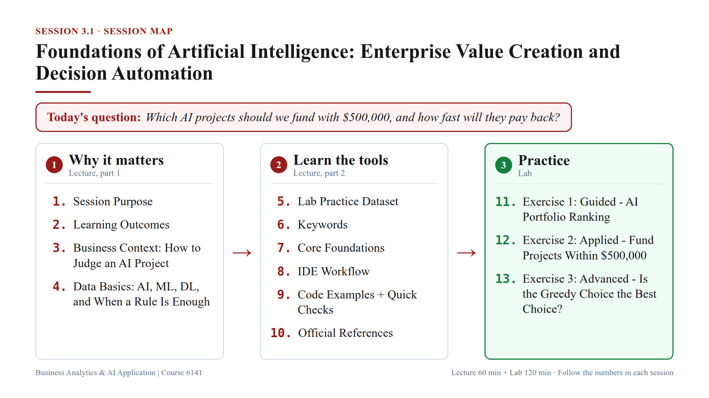

* **Lecture Presentation:** [Download Slides (PDF)](slides/session_03_01_lecture.pdf)
* **Reading (PDF):** [Download Reading (PDF)](handouts/session_03_01_reading.pdf): read before class
* **Schedule:** Week 9 (115/11/08 - 115/11/14) | In-person classes (1:2 Delivery Ratio: 60 Min Lecture + 120 Min Lab)

* **1. Session Purpose:**
  * Five departments have proposed 10 AI projects, costing between $80,000 and $220,000 each
  * The total request is $1.5 million, but this year's AI budget is only $500,000
  * The COO (Chief Operating Officer) asks: which AI projects should we fund with $500,000, and how fast will they pay back? Today, you learn what AI can and cannot do, and use Python to compare the proposals on the same financial terms

* **2. Expected Learning Outcomes (By the end of this session, you will be able to):**
  1. "Is this project really AI?": tell apart AI (Artificial Intelligence), ML (Machine Learning), and DL (Deep Learning), and decide when a simple rule is enough
  2. "Which projects pay back fastest?": calculate the payback period (months until the savings repay the cost) and the 3-year ROI (Return on Investment)
  3. "Which projects fit in $500,000?": allocate a fixed budget with a loop, and fix a `ZeroDivisionError` (dividing by zero)

* **3. Business Context: How to Judge an AI Project:**
  * Every AI proposal is an investment: money now, savings later. Five numbers make proposals comparable (example: `AI-PRJ-101`, Supply Chain):

    | Term | Meaning | Example |
    |---|---|---|
    | Implementation cost | one-time cost to build the system | `150,000` |
    | Running cost | yearly cost to keep it working (cloud computing, updates); here 15% of the build cost | `22,500` |
    | Net annual benefit | yearly savings minus the running cost | `294,000 - 22,500 = 271,500` |
    | Payback period | months until the benefit repays the build cost: cost / net benefit x 12 | `6.6` months |
    | 3-year ROI | (net benefit x 3 - cost) / cost x 100 | `443.0`% |

  * Savings are forecasts, not facts. Two habits keep forecasts honest: include running costs, and compare every project with the same formula.
  * Labor hours saved are not the same as money saved: hours only become savings if the freed time is used for other valuable work.

* **4. Data Basics: AI, ML, DL, and When a Rule Is Enough:**
  * Three nested ideas:

    | Term | What it is | Business example |
    |---|---|---|
    | AI (Artificial Intelligence) | any computer system that does a task we link to human thinking | a chatbot answering customers |
    | ML (Machine Learning) | AI that **learns a rule from past examples** instead of being told the rule | flagging likely fraud from past fraud cases |
    | DL (Deep Learning) | ML with many-layered neural networks, for images, sound, and text | reading scanned invoices |

  * Rule or ML? Ask how stable and clear the decision is:
    * **Use a rule** when the policy is fixed and written down: "sales tax is 5% of the price". A rule is cheaper, exact, and easy to explain.
    * **Use ML** when the pattern is complex or changes over time, and you have many past examples with known outcomes: "which invoices look like fraud?"
  * ML makes a prediction; a person or a business rule still decides what to do with it.

* **5. Lab Practice Dataset:**
  * File Link: [data/session_03_01_dataset.csv](data/session_03_01_dataset.csv)
  * Audited 10-row AI project proposal dataset (fictional teaching data), one row per proposal:
    * `Project_ID`: Proposal code (e.g., `AI-PRJ-101`).
    * `Department_Name`: Sponsoring department (Supply Chain, Customer Service, Marketing, Finance, Fraud Operations).
    * `Implementation_Cost_USD`: One-time build cost in U.S. Dollars.
    * `Annual_Labor_Hours_Saved_Count`: Staff hours the system is expected to save per year.
    * `Projected_Cost_Savings_USD`: Expected yearly savings in U.S. Dollars.
    * `Payback_Period_Months_Count`: The department's own payback estimate. It ignores running costs, so it is shorter than the payback you calculate today (for example, `6.1` against `6.6` months for `AI-PRJ-101`).

* **6. Keywords (Core Programming Concepts):**
  * `Artificial Intelligence (AI)`:
    * What: computer systems that do tasks we link to human thinking
    * Why: the umbrella term in every vendor pitch; ask which kind of AI is inside
  * `Machine Learning (ML)`:
    * What: a system that learns a decision rule from past examples
    * Why: handles patterns too complex to write down by hand
  * `Deep Learning (DL)`:
    * What: ML with many-layered neural networks
    * Why: needed for images, sound, and free text; costly to build and run
  * `Rule-Based System`:
    * What: code that follows rules a person wrote, such as `if amount > 250000:`
    * Why: the right choice when the policy is clear and fixed
  * `Payback Period`:
    * What: months until the net benefit repays the build cost
    * Why: shows how fast the money comes back
  * `ROI (Return on Investment)`:
    * What: total gain compared with the cost, in percent
    * Why: compares projects of different sizes on one scale

* **7. Core Programming & Computational Foundations:**
  * Learning a rule from examples:
    * A rule-based system uses a number a person chose, such as "flag invoices above 250,000"
    * A learning system tries many candidate numbers on past examples, counts the mistakes, and keeps the number with the fewest mistakes
    * That search is the core idea of all machine learning; Session 3.3 uses a library that does it at scale
  * Two kinds of division by zero:
    * Plain Python numbers: `150000.0 / 0.0` stops the script with `ZeroDivisionError: float division by zero`
    * pandas columns: dividing by a `0` gives `inf` (infinity) with **no error**, and an `inf` ranks above every real value when you sort
    * Check before you divide: `if annual_benefit > 0:`
  * Budget allocation with a loop (a "greedy" method):
    * Sort projects by value per dollar, then go down the list and fund each project that still fits in the budget
    * Simple and fast, but not always the best combination (Exercise 3 checks this)

* **8. Development Workflow in Google Antigravity IDE:**
  * `[1]` File Explorer: create your script with your name and the session code (for example, `Reacher_S31_demo_1.py`), and check the dataset is in `data/`.
  * `[2]` Code Editor: write a few lines, run, repeat. Small steps keep errors small.
  * `[3]` AI Agent Chat: on an error, capture the traceback (Python's error report) with `Win + Shift + S` (macOS: `Cmd + Shift + 4`), paste it with `Ctrl + V`, and ask why it failed.
  * `[4]` Terminal: run `python` followed by your script name. Return code `0` means the script finished with no errors.

* **9. Hands-On Coding Micro-Examples:**
  * Every example has three parts: **1. Input**, **2. Process**, and **3. Output**. Name each file with your own name and the session code, for example `Reacher_S31_demo_1.py` (pattern: `YourName_S31_demo_1.py`).
  * *Micro-Example 1 (Payback and ROI for Every Proposal):* `YourName_S31_demo_1.py`
    ```python
    # 1. Input: load the 10 proposals
    import pandas as pd
    df = pd.read_csv("data/session_03_01_dataset.csv")

    # 2. Process: net benefit, payback, and 3-year ROI
    df["Net_Annual_Benefit_USD"] = (
        df["Projected_Cost_Savings_USD"] - df["Implementation_Cost_USD"] * 0.15
    )
    df["Payback_Months"] = (
        df["Implementation_Cost_USD"] / df["Net_Annual_Benefit_USD"] * 12
    ).round(1)
    df["ROI_3yr_Pct"] = (
        (df["Net_Annual_Benefit_USD"] * 3 - df["Implementation_Cost_USD"])
        / df["Implementation_Cost_USD"] * 100
    ).round(1)

    # 3. Output: the 3 proposals with the highest ROI
    top3 = df.sort_values("ROI_3yr_Pct", ascending=False).head(3)
    print(top3[["Project_ID", "Department_Name", "Payback_Months", "ROI_3yr_Pct"]])
    ```
    * `* 0.15` is the yearly running cost: 15% of the build cost.
    * Result: the two Fraud Operations projects lead (`713.9`% and `705.3`%, payback `4.4` and `4.5` months), followed by `AI-PRJ-106` in Supply Chain (`445.6`%).
  * *Quick Check 1 (`.rank()`):*
    * New tool: `column.rank(ascending=False)` gives each row its place, 1 for the largest. Equal values share the average place, such as `4.5`. Why: a ranking column is easy to show in a decision memo.
    * Task: add one line at the end of part **2. Process**: `df["ROI_Rank"] = df["ROI_3yr_Pct"].____(ascending=False)`, then add `"ROI_Rank"` to the printed columns.
    * Check: `AI-PRJ-110` has rank `1.0` and `AI-PRJ-105` has rank `2.0`.
  * *Micro-Example 2 (A Fixed Rule vs a Rule Learned from Examples):* `YourName_S31_demo_2.py`
    ```python
    # 1. Input: 10 past invoices, checked by auditors (fictional)
    import pandas as pd
    past = pd.DataFrame({
        "Amount_USD": [120000, 180000, 210000, 240000, 260000,
                       300000, 330000, 410000, 450000, 520000],
        "Was_Fraud": [False] * 5 + [True] * 5,
    })

    # 2. Process: a rule a person chose vs a threshold learned from the data
    rule_flags = past["Amount_USD"] > 250000
    rule_mistakes = (rule_flags != past["Was_Fraud"]).sum()

    best_threshold, best_mistakes = None, len(past)
    for threshold in past["Amount_USD"]:
        flags = past["Amount_USD"] >= threshold
        mistakes = (flags != past["Was_Fraud"]).sum()
        if mistakes < best_mistakes:
            best_threshold, best_mistakes = threshold, mistakes

    # 3. Output: compare the mistakes
    print("Fixed rule (above 250,000) mistakes:", rule_mistakes)
    print("Learned threshold:", best_threshold, "mistakes:", best_mistakes)
    ```
    * `[False] * 5 + [True] * 5` builds a list of 5 `False` values followed by 5 `True` values.
    * `a, b = x, y` sets two variables in one line.
    * `!=` means "not equal": a mistake is a row where the flag and the auditors' answer differ.
    * Result: the fixed rule makes `1` mistake (it flags the honest `260000` invoice); the learned threshold is `300000` with `0` mistakes on these past invoices. Zero mistakes on old data does not promise zero mistakes on new data; Session 3.3 tests models on data they have not seen.
  * *Quick Check 2 (`.mean()` of True/False):*
    * New tool: `.mean()` on a `True` / `False` column gives the share of `True` values, because `True` counts as 1. Why: tells a manager what share of invoices a rule would send to review.
    * Task: add one line to part **3. Output**: `print("Share flagged by the fixed rule:", rule_flags.____())`
    * Check: the Terminal shows `Share flagged by the fixed rule: 0.6`, so 6 of 10 invoices would go to review.
  * *Micro-Example 3 (A Shortlist That Does Not Fit the Budget):* `YourName_S31_demo_3.py`
    ```python
    # 1. Input: load the proposals and add the payback period
    import pandas as pd
    df = pd.read_csv("data/session_03_01_dataset.csv")
    df["Net_Annual_Benefit_USD"] = (
        df["Projected_Cost_Savings_USD"] - df["Implementation_Cost_USD"] * 0.15
    )
    df["Payback_Months"] = (
        df["Implementation_Cost_USD"] / df["Net_Annual_Benefit_USD"] * 12
    ).round(1)

    # 2. Process: fast payback AND many hours saved
    shortlist = df[
        (df["Payback_Months"] <= 7.0)
        & (df["Annual_Labor_Hours_Saved_Count"] >= 4000)
    ]
    shortlist_cost = shortlist["Implementation_Cost_USD"].sum()

    # 3. Output: compare the shortlist with the budget
    print(shortlist[["Project_ID", "Department_Name", "Payback_Months"]])
    print(f"Shortlist cost: ${shortlist_cost:,.0f} against a budget of $500,000")
    ```
    * Result: 6 projects pass both rules, but together they cost `$1,095,000`, more than twice the budget. Good projects still have to compete; Exercises 2 and 3 choose among them.
  * *Quick Check 3 (`.isin()`):*
    * New tool: `column.isin([...])` is `True` when the value is in the list. Why: answers questions about a few named groups, such as "show only Finance and Fraud Operations".
    * Task: add one line to part **3. Output**: `print(len(df[df["Department_Name"].____(["Finance", "Fraud Operations"])]))`
    * Check: the Terminal shows `4`.

* **10. Official Python Documentation & References:**
  * [Scikit-Learn: Machine Learning in Python Official Overview](https://scikit-learn.org/stable/).
  * [Russell & Norvig: Artificial Intelligence: A Modern Approach (Reference Standards)](https://aima.cs.berkeley.edu/).
  * [Agrawal, Gans, Goldfarb: Prediction Machines: The Simple Economics of AI (Harvard Business Review Press)](https://www.predictionmachines.ai/).
  * [Python Library: `itertools.combinations`](https://docs.python.org/3/library/itertools.html#itertools.combinations).

* **11. Exercise 1: Guided Practice - AI Portfolio Ranking:**
  * *Step 1: Open Script:* In Google Antigravity IDE, create a new script named `YourName_S31_portfolio.py`, replacing `YourName` with your own name (for example, `Reacher_S31_portfolio.py`).
  * *Step 2: Rank the Portfolio and Compare Departments:*
    Type the following code:
    ```python
    # 1. Input: load the 10 proposals
    import pandas as pd
    df = pd.read_csv("data/session_03_01_dataset.csv")

    # 2. Process: net benefit and 3-year ROI, then the average by department
    df["Net_Annual_Benefit_USD"] = (
        df["Projected_Cost_Savings_USD"] - df["Implementation_Cost_USD"] * 0.15
    )
    df["ROI_3yr_Pct"] = (
        (df["Net_Annual_Benefit_USD"] * 3 - df["Implementation_Cost_USD"])
        / df["Implementation_Cost_USD"] * 100
    ).round(1)
    by_department = (
        df.groupby("Department_Name")["ROI_3yr_Pct"].mean().round(1)
        .sort_values(ascending=False)
    )

    # 3. Output: the full ranking and the department view
    ranked = df.sort_values("ROI_3yr_Pct", ascending=False)
    print(ranked[["Project_ID", "Department_Name", "ROI_3yr_Pct"]])
    print("\nAverage 3-year ROI by department:\n", by_department)
    ```
  * *Step 3: Interpret:* In two comment lines, explain why Fraud Operations ranks first, and which numbers you would ask the Marketing team to double-check.
  * *Step 4: Execute in Terminal:* Run `python YourName_S31_portfolio.py` in Panel `[4]` and confirm return code `0`.
  * *Success Check:* department averages are Fraud Operations `709.6`, Supply Chain `444.3`, Finance `440.2`, Customer Service `429.0`, and Marketing `342.3`. Fraud Operations saves the most money per dollar spent (about $2.8 of yearly savings per $1 of build cost).

* **12. Exercise 2: Applied Practice - Fund Projects Within $500,000:**
  * *Coding Challenge:* In `YourName_S31_practice.py`, fund projects in order of hours saved per dollar until the $500,000 budget runs out, then check a new proposal's payback safely.
  * *Task 1 (Greedy Allocation):*
    * Add `Hours_per_1000_USD` = `Annual_Labor_Hours_Saved_Count` / `Implementation_Cost_USD` x 1000, and sort by it from highest to lowest.
    * Start with `budget = 500000`, `spent = 0`, and `funded = []`.
    * Loop over the sorted rows with `for project, cost in zip(df["Project_ID"], df["Implementation_Cost_USD"]):`. If `spent + cost <= budget`, add the project to `funded` and add `cost` to `spent`.
    * `zip(a, b)` walks through two columns side by side, giving one pair of values per row.
    * Print the funded projects, the amount spent, and the total hours saved by the funded projects.
  * *Task 2 (Read the ZeroDivisionError & AI Diagnosis):* Write a function `payback_months(cost, annual_benefit)` that returns `cost / annual_benefit * 12`. Call it for a new proposal with no proven savings yet: `payback_months(50000.0, 0.0)`. The script stops with `ZeroDivisionError: float division by zero`. Capture the traceback with `Win + Shift + S`, paste it into Panel `[3]` (AI Agent Chat) with `Ctrl + V`, and ask why.
  * *Task 3 (Safe Division):* Change the function: if `annual_benefit <= 0`, return `None`; otherwise return the payback. When the result is `None`, print `"No payback: no proven savings"`.
  * *Success Check:* the loop funds `AI-PRJ-102`, `AI-PRJ-107`, `AI-PRJ-110`, and `AI-PRJ-103` for `$480,000` and `16,100` hours a year; `payback_months(50000.0, 0.0)` now prints `No payback: no proven savings`; return code `0`.

* **13. Exercise 3: Advanced Practice - Is the Greedy Choice the Best Choice?:**
  * *Goal:* Test the simple "most hours per dollar first" method from Exercise 2 against every possible combination of projects, and tell the COO whether the simple method left value on the table.
  * *What you need:*
    * File: `data/session_03_01_dataset.csv` (described in **5. Lab Practice Dataset**).
    * Script name: `YourName_S31_challenge.py`.
    * Your Exercise 2 result (`16,100` hours for `$480,000`).
    * Tools you already know: lists, `for` loops, `if`, `.sum()`, `.isin()`, and f-strings.
  * *Requirements (follow them in order):*
    1. List every possible group of projects: all groups of 1 project, of 2 projects, and so on, up to all 10.
    2. For each group, add up the build cost. Skip groups that cost more than `$500,000`.
    3. For the groups that fit, add up `Annual_Labor_Hours_Saved_Count`, and keep the group with the most hours. If two groups tie on hours, keep the cheaper one.
    4. Count how many groups you checked in total and how many fit the budget.
    5. Print the best group's project IDs, cost, and hours, then the difference in hours compared with the greedy result.
    6. Print a two-line memo for the COO: what to fund, and why the simple method was not enough.
  * *New tools for this exercise:*
    * `from itertools import combinations` loads a tool that lists groups. `combinations(["A", "B", "C"], 2)` gives `("A", "B")`, `("A", "C")`, and `("B", "C")`.
    * `for size in range(1, 11):` repeats with `size` = 1, 2, ..., 10; inside it, `for group in combinations(project_ids, size):` walks through every group of that size.
    * `list(group)` turns a group into a list, so you can use `df[df["Project_ID"].isin(list(group))]` to select its rows.
  * *Hints:*
    * Make `project_ids = list(df["Project_ID"])` first.
    * Keep the best result in three variables, `best_hours`, `best_cost`, and `best_group`, and update them inside the loop.
    * With 10 projects there are `1,023` groups, so the loop finishes in a few seconds.
  * *Self-Check (expected results):*
    * Groups checked: `1023`; groups that fit the budget: `163`.
    * Best group: `AI-PRJ-101`, `AI-PRJ-102`, `AI-PRJ-105`, `AI-PRJ-107`, costing `$495,000` and saving `16,900` hours a year.
    * That is `800` more hours than the greedy result. Business meaning: "most hours per dollar first" picked the cheap Marketing project `AI-PRJ-103` to fill the last gap, while a different mix used the budget better. With few options, checking every combination is cheap and finds the true best plan.

---

<a id="session-03-02"></a>
### Session 3.2: Advanced Data Analysis: Feature Engineering, Scaling, and Business Data Preprocessing

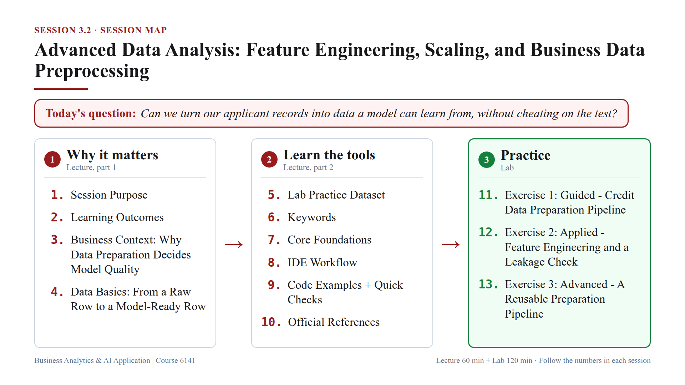

* **Lecture Presentation:** [Download Slides (PDF)](slides/session_03_02_lecture.pdf)
* **Reading (PDF):** [Download Reading (PDF)](handouts/session_03_02_reading.pdf): read before class
* **Schedule:** Week 10 (115/11/15 - 115/11/21) | In-person classes (1:2 Delivery Ratio: 60 Min Lecture + 120 Min Lab)

* **1. Session Purpose:**
  * A bank's credit team wants a model that predicts which loan applicants will default (fail to repay their loan)
  * Its applicant records mix text, gaps, and numbers on very different scales, such as an income of `65,000` next to a utilization of `24.5`
  * The credit risk manager asks: can we turn our applicant records into data a model can learn from, without cheating on the test? Today, you prepare the data step by step, so that Session 3.3 can train a model on it

* **2. Expected Learning Outcomes (By the end of this session, you will be able to):**
  1. "What do we predict, and from what?": split a table into features `X` (the inputs) and the target `y` (the answer to predict)
  2. "How do text and gaps become numbers?": fill missing values (imputation), turn text categories into 0/1 columns (one-hot encoding), and put numbers on a common scale (standardization)
  3. "How do we test honestly?": split the data into a training set and a test set before learning anything from it, so that no test information leaks into training (data leakage)

* **3. Business Context: Why Data Preparation Decides Model Quality:**
  * A model is only as good as the data it learns from ("garbage in, garbage out"). Data preparation usually takes more of a project's time than building the model itself.
  * A model reads only numbers, with no gaps. Our raw data breaks both rules:
    * `Education_Tier` is text (`Bachelor`, `Master`, `Doctorate`)
    * One income and one utilization value are missing
  * A model must be tested on applicants it has never seen, just as a student is tested on new exam questions, not on the practice questions. Otherwise the bank believes the model is better than it is, and approves risky loans.
  * Credit utilization: the share of an applicant's credit limit that is in use. `48.2`% means $48.20 of every $100 of available credit is borrowed.

* **4. Data Basics: From a Raw Row to a Model-Ready Row:**
  * Applicant `CLI-701`, before and after preparation:

    | Column | Raw value | Model-ready value | Step |
    |---|---|---|---|
    | `Age_Years_Count` | `45` | `0.41` | standardized |
    | `Annual_Income_USD` | `125000.0` | `0.44` | standardized |
    | `Credit_Utilization_Pct` | `48.2` | `0.82` | standardized |
    | `Education_Tier` | `Master` | `Education_Tier_Master` = `1`, `Education_Tier_Doctorate` = `0` | one-hot encoded |

  * The standardized values use the training rows' averages and spreads (Micro-Example 3). Micro-Example 3 also standardizes the 0/1 columns; Exercise 3 shows how to scale only the number columns.
  * **One-hot encoding:** one 0/1 column per category. With `drop_first=True`, the first category (`Bachelor`) gets no column: a row with `0` in both remaining columns is a Bachelor. Never code categories as `1`, `2`, `3`; that would tell the model a Doctorate is "three times" a Bachelor.
  * **Standardization:** `(value - average) / standard deviation`. The result says how many standard deviations a value is above (`+`) or below (`-`) the average, so income and utilization become comparable. Standard deviation measures how spread out a column is.
  * **Train/test split:** the model learns from the training set; the test set is kept aside and used once, at the end, to measure the model honestly.

* **5. Lab Practice Dataset:**
  * File Link: [data/session_03_02_dataset.csv](data/session_03_02_dataset.csv)
  * Audited 12-row loan applicant dataset (fictional teaching data), one row per applicant, with 2 missing values on purpose:
    * `Client_ID`: Applicant code (e.g., `CLI-701`). An ID, not a feature: it says nothing about the applicant.
    * `Age_Years_Count`: Age in years.
    * `Annual_Income_USD`: Yearly income in U.S. Dollars (missing for `CLI-707`).
    * `Credit_Utilization_Pct`: Share of the credit limit in use, in percent (missing for `CLI-709`).
    * `Education_Tier`: Highest education: `Bachelor`, `Master`, or `Doctorate`.
    * `Defaulted_Binary`: The target: `1` = defaulted, `0` = repaid. 3 of the 12 applicants defaulted.

* **6. Keywords (Core Programming Concepts):**
  * `Features (X)` and `Target (y)`:
    * What: `X` holds the input columns; `y` holds the outcome to predict
    * Why: every Scikit-Learn model expects this split
  * `Imputation`:
    * What: filling missing values, for example with the column's median (the middle value)
    * Why: models cannot learn from rows with gaps
  * `One-Hot Encoding`:
    * What: one 0/1 column per text category
    * Why: turns text into numbers without inventing an order
  * `Standardization`:
    * What: rescaling a column to an average of 0 and a standard deviation of 1
    * Why: stops large-unit columns, such as income, from drowning out small ones
  * `Train/Test Split`:
    * What: keeping some rows aside to test the model at the end
    * Why: the only honest measure of how the model will do on new applicants
  * `Data Leakage`:
    * What: information from the test set slipping into training
    * Why: makes a model look better than it really is

* **7. Core Programming & Computational Foundations:**
  * Scikit-Learn (`sklearn`) tools work in two steps:
    * `.fit(train_data)` **learns** numbers from the data, such as a column's median or average
    * `.transform(data)` **applies** what was learned to any data, training or test
    * `.fit_transform(train_data)` does both in one call, for the training data only
  * The leakage rule: split first, then `fit` on the training set only, then `transform` both sets.
    * `scaler.fit_transform(X_test)` is the classic mistake: the scaler learns the test set's own average, so the test rows no longer show how different they are from the training rows
  * `train_test_split(X, y, test_size=0.25, random_state=42, stratify=y)`:
    * `test_size=0.25` keeps 25% of the rows (here 3 of 12) for testing
    * `random_state=42` fixes the random shuffle, so everyone gets the same split
    * `stratify=y` keeps the same share of defaults in both sets
  * Calling `.transform()` before `.fit()` raises `NotFittedError`: the tool has nothing learned to apply yet.

* **8. Development Workflow in Google Antigravity IDE:**
  * `[1]` File Explorer: create your script with your name and the session code (for example, `Reacher_S32_demo_1.py`), and check the dataset is in `data/`.
  * `[2]` Code Editor: write a few lines, run, repeat. Small steps keep errors small.
  * `[3]` AI Agent Chat: on an error, capture the traceback (Python's error report) with `Win + Shift + S` (macOS: `Cmd + Shift + 4`), paste it with `Ctrl + V`, and ask why it failed.
  * `[4]` Terminal: run `python` followed by your script name. Return code `0` means the script finished with no errors. First time only: `pip install scikit-learn`.

* **9. Hands-On Coding Micro-Examples:**
  * Every example has three parts: **1. Input**, **2. Process**, and **3. Output**. Name each file with your own name and the session code, for example `Reacher_S32_demo_1.py` (pattern: `YourName_S32_demo_1.py`).
  * *Micro-Example 1 (Features, Target, and Gaps):* `YourName_S32_demo_1.py`
    ```python
    # 1. Input: load the applicants
    import pandas as pd
    df = pd.read_csv("data/session_03_02_dataset.csv")

    # 2. Process: inputs (X) and the answer to predict (y)
    X = df.drop(columns=["Client_ID", "Defaulted_Binary"])
    y = df["Defaulted_Binary"]

    # 3. Output: size, outcome counts, and missing values
    print("X shape (rows, columns):", X.shape)
    print("Defaults (1) and repaid (0):\n", y.value_counts())
    print("Missing values per column:\n", X.isnull().sum())
    ```
    * `df.drop(columns=[...])` returns the table without the listed columns. `Client_ID` goes because an ID carries no information about risk.
    * Result: `X` has 12 rows and 4 columns; 9 applicants repaid and 3 defaulted; income and utilization each have 1 missing value.
  * *Quick Check 1 (`value_counts(normalize=True)`):*
    * New tool: `.value_counts(normalize=True)` gives each value's share instead of its count. Why: the default rate is the first number a credit manager asks for.
    * Task: add one line to part **3. Output**: `print(y.value_counts(_________=True))`
    * Check: `0` has `0.75` and `1` has `0.25`: a 25% default rate.
  * *Micro-Example 2 (One-Hot Encoding):* `YourName_S32_demo_2.py`
    ```python
    # 1. Input: load the applicants and keep the features
    import pandas as pd
    df = pd.read_csv("data/session_03_02_dataset.csv")
    X = df.drop(columns=["Client_ID", "Defaulted_Binary"])

    # 2. Process: one 0/1 column per education level, except the first
    X_encoded = pd.get_dummies(X, columns=["Education_Tier"],
                               drop_first=True, dtype=float)

    # 3. Output: the new column names and two rows
    print(X_encoded.columns.tolist())
    print(X_encoded.head(2))
    ```
    * `pd.get_dummies()` replaces the text column with 0/1 columns; `dtype=float` writes them as `0.0` and `1.0`.
    * Result: `Education_Tier` becomes `Education_Tier_Doctorate` and `Education_Tier_Master`. Bachelor applicants have `0.0` in both.
  * *Quick Check 2 (`drop_first`):*
    * New tool: the `drop_first` setting. `True` leaves out the first category; `False` keeps a column for every category. Why: shows what "the first category is implied" means.
    * Task: in part **2. Process**, change `drop_first=True` to `drop_first=_____`.
    * Check: a third column, `Education_Tier_Bachelor`, appears, and each row has exactly one `1.0` among the three education columns. Change it back to `True` afterwards.
  * *Micro-Example 3 (Split First, Then Fill and Scale):* `YourName_S32_demo_3.py`
    ```python
    # 1. Input: load, encode, and split before learning anything
    import pandas as pd
    from sklearn.model_selection import train_test_split
    from sklearn.impute import SimpleImputer
    from sklearn.preprocessing import StandardScaler
    df = pd.read_csv("data/session_03_02_dataset.csv")
    X = pd.get_dummies(df.drop(columns=["Client_ID", "Defaulted_Binary"]),
                       columns=["Education_Tier"], drop_first=True, dtype=float)
    y = df["Defaulted_Binary"]
    X_train, X_test, y_train, y_test = train_test_split(
        X, y, test_size=0.25, random_state=42, stratify=y
    )

    # 2. Process: learn medians and scales from the training rows only
    imputer = SimpleImputer(strategy="median")
    X_train_filled = imputer.fit_transform(X_train)
    X_test_filled = imputer.transform(X_test)
    scaler = StandardScaler()
    X_train_scaled = scaler.fit_transform(X_train_filled)
    X_test_scaled = scaler.transform(X_test_filled)

    # 3. Output: sizes and the medians used to fill the gaps
    print("Train rows:", len(X_train), "| Test rows:", len(X_test))
    print("Medians learned from training rows:", imputer.statistics_.round(2).tolist())
    ```
    * `from sklearn.impute import SimpleImputer` loads the tool that fills gaps; `strategy="median"` fills them with each column's median.
    * `imputer.statistics_` holds the medians the imputer learned. The trailing `_` marks a value learned during `fit`. `.tolist()` prints the numbers as a plain list.
    * Result: 9 training rows and 3 test rows. The training medians are `38.0` (age), `96000.0` (income), and `33.15` (utilization).
  * *Quick Check 3 (`scaler.mean_`):*
    * New tool: `scaler.mean_` holds the column averages the scaler learned from the training rows. Why: shows exactly what "fit on the training set" means.
    * Task: add one line to part **3. Output**: `print("Averages learned by the scaler:", scaler._____.round(2).tolist())`
    * Check: the first three values are `40.44` (age), `106444.44` (income), and `35.82` (utilization).

* **10. Official Python Documentation & References:**
  * [Scikit-Learn Preprocessing Guide: StandardScaler and OneHotEncoder](https://scikit-learn.org/stable/modules/preprocessing.html).
  * [Scikit-Learn Imputation of Missing Values: SimpleImputer](https://scikit-learn.org/stable/modules/impute.html).
  * [Scikit-Learn Model Selection: train_test_split](https://scikit-learn.org/stable/modules/generated/sklearn.model_selection.train_test_split.html).
  * [Scikit-Learn: Common Pitfalls (Data Leakage)](https://scikit-learn.org/stable/common_pitfalls.html).

* **11. Exercise 1: Guided Practice - Credit Data Preparation Pipeline:**
  * *Step 1: Open Script:* In Google Antigravity IDE, create a new script named `YourName_S32_preprocessing.py`, replacing `YourName` with your own name (for example, `Reacher_S32_preprocessing.py`).
  * *Step 2: Build the Full Preparation Sequence:*
    Type the following code:
    ```python
    # 1. Input: load, encode, and split
    import pandas as pd
    from sklearn.model_selection import train_test_split
    from sklearn.impute import SimpleImputer
    from sklearn.preprocessing import StandardScaler
    df = pd.read_csv("data/session_03_02_dataset.csv")
    X = pd.get_dummies(df.drop(columns=["Client_ID", "Defaulted_Binary"]),
                       columns=["Education_Tier"], drop_first=True, dtype=float)
    y = df["Defaulted_Binary"]
    X_train, X_test, y_train, y_test = train_test_split(
        X, y, test_size=0.25, random_state=42, stratify=y
    )

    # 2. Process: fill, then scale; fit on training rows only
    imputer = SimpleImputer(strategy="median")
    scaler = StandardScaler()
    X_train_scaled = pd.DataFrame(
        scaler.fit_transform(imputer.fit_transform(X_train)), columns=X.columns
    )
    X_test_scaled = pd.DataFrame(
        scaler.transform(imputer.transform(X_test)), columns=X.columns
    )

    # 3. Output: check the training columns
    print("Training averages:\n", X_train_scaled.mean().round(2))
    print("Training spread:\n", X_train_scaled.std(ddof=0).round(2))
    print("Defaults in train:", y_train.sum(), "| in test:", y_test.sum())
    ```
    * `.std(ddof=0)` uses the same standard deviation formula as the scaler. pandas' default formula gives a slightly larger value (`1.06` here) for small tables.
  * *Step 3: Validate the Scaling:* Every training average should be `0.0` (a printed `-0.0` is the same as `0.0`) and every spread `1.0`.
  * *Step 4: Execute in Terminal:* Run `python YourName_S32_preprocessing.py` in Panel `[4]` and confirm return code `0`.
  * *Success Check:* 5 columns, each with average `0.0` and spread `1.0`; `2` defaults in the training set and `1` in the test set, thanks to `stratify=y`.

* **12. Exercise 2: Applied Practice - Feature Engineering and a Leakage Check:**
  * *Coding Challenge:* In `YourName_S32_practice.py`, add one engineered feature, then see with your own eyes what data leakage hides.
  * *Task 1 (Engineer a Feature):* Add `High_Utilization_Flag` = `1` when `Credit_Utilization_Pct` is above `50`, else `0`: `(df["Credit_Utilization_Pct"] > 50).astype(int)`. `.astype(int)` turns `True` / `False` into `1` / `0`. Print `pd.crosstab(df["High_Utilization_Flag"], df["Defaulted_Binary"])`.
  * *Task 2 (Read the NotFittedError & AI Diagnosis):* Starting from Micro-Example 3, create a new `StandardScaler()` and call `.transform(X_test_filled)` on it before any `.fit()`. The script stops with `NotFittedError: This StandardScaler instance is not fitted yet.` Capture the traceback with `Win + Shift + S`, paste it into Panel `[3]` (AI Agent Chat) with `Ctrl + V`, and ask what "fitted" means.
  * *Task 3 (See the Leakage):* Scale the test rows two ways and print the column averages of each, rounded to 2 decimals:
    * Correct: `scaler.transform(X_test_filled)`, with `scaler` fitted on the training rows
    * Leaky: `StandardScaler().fit_transform(X_test_filled)`
    * `array.mean(axis=0)` gives the average of each column of a Scikit-Learn result.
  * *Success Check:*
    * Task 1: the flag splits the applicants perfectly: all 3 flagged applicants defaulted and all 9 others repaid. With only 12 rows, treat a perfect pattern as a warning sign, not as proof.
    * Task 3: the correct averages are `0.74`, `0.73`, `0.57`, `0.27`, `0.71`, showing that the test applicants are older, earn more, and use more credit than the training applicants. The leaky averages are all `0.0`: the difference has disappeared.

* **13. Exercise 3: Advanced Practice - A Reusable Preparation Pipeline:**
  * *Goal:* Build one preparation object that handles numbers and text in one step, can be fitted on training rows and reused on any new applicant, and does not crash on a category it has never seen.
  * *What you need:*
    * File: `data/session_03_02_dataset.csv` (described in **5. Lab Practice Dataset**).
    * Script name: `YourName_S32_challenge.py`.
    * Tools you already know: `train_test_split` (same settings as Micro-Example 3), `SimpleImputer`, `StandardScaler`, and `.fit()` / `.transform()`.
  * *Requirements (follow them in order):*
    1. Split the raw features (before any encoding) and the target with `test_size=0.25`, `random_state=42`, and `stratify=y`.
    2. Define `numeric_cols = ["Age_Years_Count", "Annual_Income_USD", "Credit_Utilization_Pct"]` and `text_cols = ["Education_Tier"]`.
    3. Build a `Pipeline` for the numeric columns: fill with the median, then standardize.
    4. Combine it with a `OneHotEncoder(handle_unknown="ignore")` for the text column in one `ColumnTransformer`.
    5. Fit the combined object on the training rows only. Print the output column names, then the transformed test rows, rounded to 2 decimals.
    6. Transform one new applicant: age `36`, income missing (`None`), utilization `57.0`, education `"Associate"`. Print the result, rounded to 2 decimals.
    7. In a comment, explain what happened to the missing income and to the unseen education level.
  * *New tools for this exercise:*
    * `from sklearn.pipeline import Pipeline`: `Pipeline([("impute", SimpleImputer(strategy="median")), ("scale", StandardScaler())])` runs its steps in order, and fits them in order.
    * `from sklearn.compose import ColumnTransformer`: sends each group of columns to its own tool and joins the results side by side, for example:

      ```text
      ColumnTransformer([
          ("num", numeric_pipeline, numeric_cols),
          ("cat", OneHotEncoder(handle_unknown="ignore"), text_cols),
      ])
      ```
    * `from sklearn.preprocessing import OneHotEncoder`: the Scikit-Learn version of one-hot encoding. `handle_unknown="ignore"` writes `0` in every category column for a value it never saw, instead of raising an error.
    * `.get_feature_names_out()` returns the names of the output columns.
    * A one-row DataFrame for the new applicant: `pd.DataFrame({"Age_Years_Count": [36], "Annual_Income_USD": [None], "Credit_Utilization_Pct": [57.0], "Education_Tier": ["Associate"]})`.
  * *Hints:*
    * Wrap a result in `pd.DataFrame(result, columns=prep.get_feature_names_out())` to read it with column names.
    * Without `handle_unknown="ignore"`, the new applicant raises `ValueError: Found unknown categories ['Associate']`. Try it once to see why the setting matters.
  * *Self-Check (expected results):*
    * Output columns (6): `num__Age_Years_Count`, `num__Annual_Income_USD`, `num__Credit_Utilization_Pct`, `cat__Education_Tier_Bachelor`, `cat__Education_Tier_Doctorate`, `cat__Education_Tier_Master`.
    * Transformed test rows: shape `(3, 6)`; the second test row is the Doctorate applicant with `1.41`, `1.63`, `1.49`.
    * New applicant: `-0.4`, `-0.25`, `1.4`, then `0.0`, `0.0`, `0.0`. The missing income was filled with the training median (`96000.0`) before scaling, and the unseen `"Associate"` level became all zeros instead of crashing the script. Business meaning: the same object can now prepare every future application in one call, exactly as it prepared the training data.

---

<a id="session-03-03"></a>
### Session 3.3: Practical Machine Learning with Scikit-Learn: Model Training and Validation

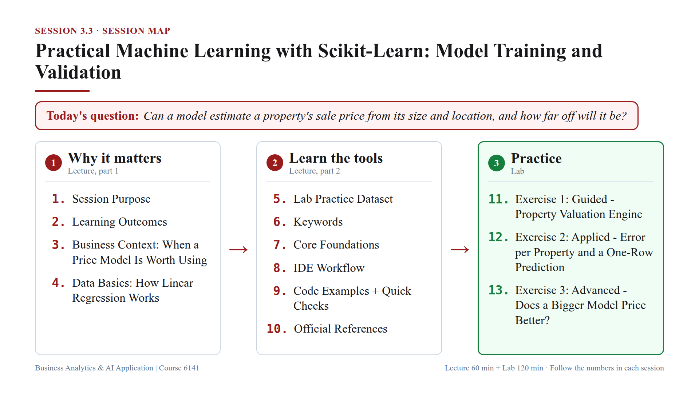

* **Lecture Presentation:** [Download Slides (PDF)](slides/session_03_03_lecture.pdf)
* **Reading (PDF):** [Download Reading (PDF)](handouts/session_03_03_reading.pdf): read before class
* **Schedule:** Week 11 (115/11/22 - 115/11/28) | In-person classes (1:2 Delivery Ratio: 60 Min Lecture + 120 Min Lab)

* **1. Session Purpose:**
  * A commercial property valuation firm prices office buildings by hand, which takes an expert several days per property
  * It has the sale records of 14 recent deals: size, number of rooms, distance to the city center, tax rate, and price
  * The valuation manager asks: can a model estimate a property's sale price from its size and location, and how far off will it be? Today, you train your first machine learning model and measure its error honestly

* **2. Expected Learning Outcomes (By the end of this session, you will be able to):**
  1. "Can a model learn prices from past deals?": train a linear regression model with Scikit-Learn's `.fit()` and read its coefficients (how much the price changes for one more unit of each feature)
  2. "How far off are the predictions?": measure the error with RMSE (Root Mean Squared Error) and MAE (Mean Absolute Error), and check stability with cross-validation (testing on several different splits)
  3. "What will this new building sell for?": predict the price of one new property, and fix the `ValueError` a one-row prediction often raises

* **3. Business Context: When a Price Model Is Worth Using:**
  * An estimate is useful if its typical error is small compared with the price. Our properties sell for about $513,000 on average, so a typical error of $10,000 (about 2%) is useful for a first quote, while a typical error of $100,000 would not be.
  * A model learns from past deals only. It should not be trusted far outside them, for example for a 10,000 square-foot tower when the largest past deal was 3,400 square feet.
  * Regression vs classification:
    * **Regression** predicts a number, such as a price. Today's model, linear regression, is one example.
    * **Classification** predicts a category, such as "fraud" or "not fraud". Logistic regression, used in Session 3.4, is one example.

* **4. Data Basics: How Linear Regression Works:**
  * Linear regression finds the best straight-line formula: `price = intercept + coefficient_1 x feature_1 + coefficient_2 x feature_2 + ...`. "Best" means the smallest total squared error on the training rows.
  * Reading a coefficient: the change in price for one more unit of that feature, **while the other features stay the same**. Example from Micro-Example 1: `+180.1` per square foot.
  * Coefficients can surprise you. On its own, distance rises with price (correlation `+0.98`), because the big buildings in our data are far from the center. Once size is in the model, each extra mile **lowers** the price by about $1,900: compared at the same size, a farther building is cheaper.
  * Three error measures, in plain words:

    | Measure | Meaning | Lower or higher is better? |
    |---|---|---|
    | MAE (Mean Absolute Error) | the average size of the errors, in dollars | lower |
    | RMSE (Root Mean Squared Error) | like MAE, but large errors count extra | lower |
    | R-squared | the share of the price differences the model explains, from 0 to 1 | higher |

* **5. Lab Practice Dataset:**
  * File Link: [data/session_03_03_dataset.csv](data/session_03_03_dataset.csv)
  * Audited 14-row commercial property sales dataset (fictional teaching data), one row per sale:
    * `Property_ID`: Sale code (e.g., `PROP-401`).
    * `Square_Feet_Units`: Usable floor area in square feet.
    * `Bedrooms_Count`: Number of separate rooms or office suites.
    * `Distance_To_CBD_Miles`: Distance to the CBD (Central Business District, the city's main business center), in miles.
    * `Local_Tax_Rate_Pct`: Local property tax rate, in percent.
    * `Sale_Price_USD`: The price the property sold for, in U.S. Dollars. This is the target.

* **6. Keywords (Core Programming Concepts):**
  * `Estimator` (`.fit()` / `.predict()`):
    * What: any Scikit-Learn model; `.fit(X, y)` learns from examples, `.predict(X)` makes predictions
    * Why: every model in the library uses the same two methods
  * `Linear Regression`:
    * What: a model that predicts a number with a straight-line formula
    * Why: simple, fast, and its coefficients are easy to explain to a manager
  * `Logistic Regression`:
    * What: a model that predicts the probability of a yes/no outcome
    * Why: the classification partner of linear regression (Session 3.4)
  * `RMSE` and `MAE`:
    * What: the typical prediction error, in the target's own unit (here, dollars)
    * Why: tells the manager how far off an estimate can be
  * `Cross-Validation`:
    * What: splitting the data into K parts and testing K times, each time on a different part
    * Why: one lucky split can make a model look better than it is
  * `Overfitting`:
    * What: a model that memorizes its training rows and does worse on new data
    * Why: the main risk when data is small; testing on unseen rows reveals it

* **7. Core Programming & Computational Foundations:**
  * The estimator pattern, in three lines:
    * `model = LinearRegression()` creates an empty model
    * `model.fit(X_train, y_train)` learns the coefficients
    * `model.predict(X_test)` returns one prediction per row
  * Learned values end with `_`: `model.coef_` (one coefficient per feature) and `model.intercept_` (the starting value).
  * The 2D rule: `.predict()` always expects a **table** (rows and columns), even for one property.
    * `model.predict([1500, 3, 5.0])` is a flat list (1D) and raises `ValueError: Expected 2D array, got 1D array instead`
    * Wrap one row in a DataFrame with the same column names: `pd.DataFrame([[1500, 3, 5.0]], columns=features)`
  * K-fold cross-validation with `cv=5`: the data is cut into 5 parts; the model is trained 5 times, each time tested on a different part, giving 5 scores. Their average is a steadier estimate than one split.

* **8. Development Workflow in Google Antigravity IDE:**
  * `[1]` File Explorer: create your script with your name and the session code (for example, `Reacher_S33_demo_1.py`), and check the dataset is in `data/`.
  * `[2]` Code Editor: write a few lines, run, repeat. Small steps keep errors small.
  * `[3]` AI Agent Chat: on an error, capture the traceback (Python's error report) with `Win + Shift + S` (macOS: `Cmd + Shift + 4`), paste it with `Ctrl + V`, and ask why it failed.
  * `[4]` Terminal: run `python` followed by your script name. Return code `0` means the script finished with no errors. First time only: `pip install scikit-learn`.

* **9. Hands-On Coding Micro-Examples:**
  * Every example has three parts: **1. Input**, **2. Process**, and **3. Output**. Name each file with your own name and the session code, for example `Reacher_S33_demo_1.py` (pattern: `YourName_S33_demo_1.py`).
  * *Micro-Example 1 (Train a Price Model):* `YourName_S33_demo_1.py`
    ```python
    # 1. Input: load the sales and split them
    import pandas as pd
    from sklearn.linear_model import LinearRegression
    from sklearn.model_selection import train_test_split
    df = pd.read_csv("data/session_03_03_dataset.csv")
    features = ["Square_Feet_Units", "Bedrooms_Count", "Distance_To_CBD_Miles"]
    X = df[features]
    y = df["Sale_Price_USD"]
    X_train, X_test, y_train, y_test = train_test_split(
        X, y, test_size=0.25, random_state=42
    )

    # 2. Process: learn the price formula from the training rows
    model = LinearRegression()
    model.fit(X_train, y_train)

    # 3. Output: the learned formula
    print("Intercept:", round(model.intercept_, 1))
    for name, coef in zip(features, model.coef_):
        print(f"{name}: {coef:,.1f}")
    ```
    * `test_size=0.25` keeps 4 of the 14 sales aside for testing.
    * Result: `Square_Feet_Units` `180.1` (about $180 per extra square foot), `Bedrooms_Count` `14,703.6` (about $14,700 per extra room), `Distance_To_CBD_Miles` `-1,915.8` (about $1,900 less per extra mile), and an intercept of `123568.1`.
  * *Quick Check 1 (`.score()`):*
    * New tool: `model.score(X_test, y_test)` returns R-squared on the test rows in one call. Why: a quick first check of how well the model explains prices it has not seen.
    * Task: add one line to part **3. Output**: `print("Test R-squared:", round(model._____(X_test, y_test), 3))`
    * Check: the Terminal shows `Test R-squared: 0.996`.
  * *Micro-Example 2 (Predict the Test Sales and Measure the Error):* `YourName_S33_demo_2.py`
    ```python
    # 1. Input: load, split, and train (same as Micro-Example 1)
    import numpy as np
    import pandas as pd
    from sklearn.linear_model import LinearRegression
    from sklearn.model_selection import train_test_split
    from sklearn.metrics import mean_squared_error
    df = pd.read_csv("data/session_03_03_dataset.csv")
    features = ["Square_Feet_Units", "Bedrooms_Count", "Distance_To_CBD_Miles"]
    X_train, X_test, y_train, y_test = train_test_split(
        df[features], df["Sale_Price_USD"], test_size=0.25, random_state=42
    )
    model = LinearRegression().fit(X_train, y_train)

    # 2. Process: predict the 4 test sales and compute the RMSE
    y_pred = model.predict(X_test)
    rmse = np.sqrt(mean_squared_error(y_test, y_pred))
    comparison = pd.DataFrame({
        "Property_ID": df.loc[X_test.index, "Property_ID"],
        "Actual_USD": y_test,
        "Predicted_USD": y_pred.round(0),
    })

    # 3. Output: actual vs predicted, then the typical error
    print(comparison)
    print(f"Test RMSE: ${rmse:,.0f}")
    ```
    * `mean_squared_error()` averages the squared errors; `np.sqrt()` (square root, from the NumPy library) brings the result back to dollars.
    * `df.loc[X_test.index, "Property_ID"]` finds the IDs of the test rows, because `train_test_split` keeps the original row labels.
    * Result: the 4 test properties are `PROP-409`, `PROP-411`, `PROP-400`, and `PROP-412`; the test RMSE is `$11,539`.
  * *Quick Check 2 (`mean_absolute_error()`):*
    * New tool: `mean_absolute_error(y_test, y_pred)` returns the average error size in dollars. Why: the easiest error number to explain: "on average, we are off by this much".
    * Task: change the import line to `from sklearn.metrics import mean_squared_error, mean_absolute_error`, then add one line to part **3. Output**: `print(f"Test MAE: ${___________________(y_test, y_pred):,.0f}")`
    * Check: the Terminal shows `Test MAE: $9,668`, lower than the RMSE because RMSE weighs the two larger errors (about $16,000 each) more heavily.
  * *Micro-Example 3 (Five Splits Instead of One):* `YourName_S33_demo_3.py`
    ```python
    # 1. Input: load the sales
    import pandas as pd
    from sklearn.linear_model import LinearRegression
    from sklearn.model_selection import cross_val_score
    df = pd.read_csv("data/session_03_03_dataset.csv")
    features = ["Square_Feet_Units", "Bedrooms_Count", "Distance_To_CBD_Miles"]

    # 2. Process: train and test 5 times, each time on a different part
    scores = cross_val_score(LinearRegression(), df[features],
                             df["Sale_Price_USD"], cv=5, scoring="r2")

    # 3. Output: the 5 scores and their average
    print("R-squared per fold:", scores.round(3).tolist())
    print(f"Average R-squared: {scores.mean():.3f}")
    ```
    * `cross_val_score()` does the splitting, training, and testing for you; a "fold" is one of the 5 parts.
    * Result: R-squared per fold `[0.994, 0.992, 0.999, 0.996, 0.999]`, average `0.996`. The model does well on every split, not just on a lucky one.
  * *Quick Check 3 (RMSE per fold):*
    * New tool: `scoring="neg_root_mean_squared_error"` makes `cross_val_score()` return the RMSE of each fold as a negative number (Scikit-Learn treats higher scores as better), so put a minus sign in front to read it. Why: shows the error in dollars for every fold.
    * Task: add two lines to part **3. Output**: `rmse = -cross_val_score(LinearRegression(), df[features], df["Sale_Price_USD"], cv=5, scoring="______________________________")` and `print(rmse.round(0).tolist())`
    * Check: `[7862.0, 15224.0, 4004.0, 8201.0, 3374.0]`. The error ranges from about $3,400 to $15,200 depending on which properties are tested.

* **10. Official Python Documentation & References:**
  * [Scikit-Learn: Linear Models (LinearRegression Documentation)](https://scikit-learn.org/stable/modules/linear_model.html).
  * [Scikit-Learn: Cross-Validation Metrics and Scoring](https://scikit-learn.org/stable/modules/cross_validation.html).
  * [Scikit-Learn: Regression Metrics (MAE, RMSE, R-squared)](https://scikit-learn.org/stable/modules/model_evaluation.html#regression-metrics).
  * [Gareth James et al.: An Introduction to Statistical Learning (ISLR with Applications in Python)](https://www.statlearning.com/).

* **11. Exercise 1: Guided Practice - Property Valuation Engine:**
  * *Step 1: Open Script:* In Google Antigravity IDE, create a new script named `YourName_S33_regression.py`, replacing `YourName` with your own name (for example, `Reacher_S33_regression.py`).
  * *Step 2: Train, Predict, and Evaluate:*
    Type the following code:
    ```python
    # 1. Input: load the sales and split them
    import numpy as np
    import pandas as pd
    from sklearn.linear_model import LinearRegression
    from sklearn.model_selection import train_test_split
    from sklearn.metrics import mean_squared_error, r2_score
    df = pd.read_csv("data/session_03_03_dataset.csv")
    features = ["Square_Feet_Units", "Bedrooms_Count", "Distance_To_CBD_Miles"]
    X_train, X_test, y_train, y_test = train_test_split(
        df[features], df["Sale_Price_USD"], test_size=0.25, random_state=42
    )

    # 2. Process: train, then predict the test sales
    reg = LinearRegression()
    reg.fit(X_train, y_train)
    y_pred = reg.predict(X_test)
    rmse = np.sqrt(mean_squared_error(y_test, y_pred))
    r2 = r2_score(y_test, y_pred)

    # 3. Output: the formula and the test error
    print("Coefficients:", dict(zip(features, reg.coef_.round(1).tolist())))
    print(f"Test RMSE: ${rmse:,.0f} | R-squared: {r2:.3f}")
    ```
  * *Step 3: Interpret for the Manager:* In three comment lines, explain each coefficient in plain words, using "while the other features stay the same".
  * *Step 4: Execute in Terminal:* Run `python YourName_S33_regression.py` in Panel `[4]` and confirm return code `0`.
  * *Success Check:* coefficients `180.1` (square feet), `14703.6` (rooms), and `-1915.8` (distance); `Test RMSE: $11,539 | R-squared: 0.996`. Each extra mile from the center lowers the price when size and rooms stay the same.

* **12. Exercise 2: Applied Practice - Error per Property and a One-Row Prediction:**
  * *Coding Challenge:* In `YourName_S33_practice.py`, extend Exercise 1 to show the error of each test property in percent, then price one new building.
  * *Task 1 (Percentage Error per Property):* Build a table with `Property_ID`, `Actual_USD`, `Predicted_USD` (rounded to whole dollars), and `Error_Pct` = absolute error / actual price x 100, rounded to 2 decimals. Use `abs(y_test - y_pred)` for the absolute error. Then print the average `Error_Pct`, called MAPE (Mean Absolute Percentage Error).
  * *Task 2 (Read the ValueError & AI Diagnosis):* Predict a new 1,500 square-foot property with 3 rooms, 5.0 miles from the center, by writing `reg.predict([1500, 3, 5.0])`. The script stops with `ValueError: Expected 2D array, got 1D array instead`. Capture the traceback with `Win + Shift + S`, paste it into Panel `[3]` (AI Agent Chat) with `Ctrl + V`, and ask what "2D" means.
  * *Task 3 (Fix the Shape):* Wrap the new property in a one-row DataFrame with the same column names: `new_property = pd.DataFrame([[1500, 3, 5.0]], columns=features)`, then predict and print the price with thousands separators.
  * *Success Check:*
    * Error per property: `PROP-409` `1.02`%, `PROP-411` `4.77`%, `PROP-400` `4.66`%, `PROP-412` `0.27`%; MAPE `2.68`%.
    * New property: about `$428,269`. The two smaller properties have the largest percentage errors, so the firm should check small-building quotes by hand.

* **13. Exercise 3: Advanced Practice - Does a Bigger Model Price Better?:**
  * *Goal:* The firm could collect more features for every quote, but collecting data costs money. Find out, with 5-fold cross-validation, whether extra features really reduce the pricing error.
  * *What you need:*
    * File: `data/session_03_03_dataset.csv` (described in **5. Lab Practice Dataset**).
    * Script name: `YourName_S33_challenge.py`.
    * Tools you already know: `LinearRegression`, `cross_val_score()` with `scoring="neg_root_mean_squared_error"` (Quick Check 3), dictionaries, `for` loops, and `pd.DataFrame()`.
  * *Requirements (follow them in order):*
    1. Define four candidate feature lists in a dictionary:
       * `"A: size only"`: `["Square_Feet_Units"]`
       * `"B: size + distance"`: `["Square_Feet_Units", "Distance_To_CBD_Miles"]`
       * `"C: size + rooms + distance"`: `["Square_Feet_Units", "Bedrooms_Count", "Distance_To_CBD_Miles"]`
       * `"D: all four"`: the three above plus `"Local_Tax_Rate_Pct"`
    2. For each candidate, run 5-fold cross-validation with `cv=5` and RMSE scoring, and record the average RMSE and the largest fold RMSE, both rounded to whole dollars, plus the number of features.
    3. Collect the results in one DataFrame with the columns `Model`, `Features`, `Avg_RMSE_USD`, and `Worst_Fold_RMSE_USD`, sorted by `Avg_RMSE_USD` from lowest to highest.
    4. Apply the firm's rule: choose the model with the lowest average RMSE, **unless** a model with fewer features is within `$500` of it; then choose the model with the fewest features among those within `$500`.
    5. Print the table and the chosen model with one sentence that explains the choice.
  * *New tools for this exercise:*
    * Looping over a dictionary: `for name, cols in candidates.items():` gives each key (`name`) and its value (`cols`) in turn.
    * Collecting rows: start with `rows = []`, append one dictionary per model, such as `rows.append({"Model": name, "Features": len(cols), ...})`, and finish with `pd.DataFrame(rows)`.
    * `.max()` on the fold results gives the worst fold.
  * *Hints:*
    * First print the 5 fold values of each model before you average them.
    * For the rule, first keep the rows with `Avg_RMSE_USD <= best + 500`, then sort them by `Features`.
  * *Self-Check (expected results):*
    * Average RMSE: C `$7,733`, B `$7,837`, A `$7,957`, D `$9,296`. Worst folds: C `$15,224`, B `$10,415`, A `$10,279`, D `$15,463`.
    * Within `$500` of the best (`$7,733`): C, B, and A. Chosen: **A: size only**.
    * Business meaning: in these 14 deals, adding rooms and distance cut the average error by only about $224, while adding the tax rate made it worse by about $1,563. The firm can quote from floor area alone and spend its data budget on collecting more deals instead.

---

<a id="session-03-04"></a>
### Session 3.4: Core Concepts of Machine Learning: Supervised vs. Unsupervised Learning and Evaluation Metrics

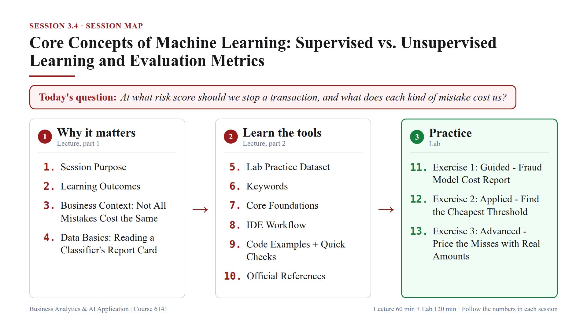

* **Lecture Presentation:** [Download Slides (PDF)](slides/session_03_04_lecture.pdf)
* **Reading (PDF):** [Download Reading (PDF)](handouts/session_03_04_reading.pdf): read before class
* **Schedule:** Week 12 (115/11/29 - 115/12/05) | In-person classes (1:2 Delivery Ratio: 60 Min Lecture + 120 Min Lab)

* **1. Session Purpose:**
  * A card issuer's fraud model gives every transaction a risk score from 1 to 100; above a cut-off score (the threshold), the transaction is held and the customer gets a verification text
  * The two possible mistakes have very different costs: a false alarm costs about $5 of checking, while a missed fraud costs the stolen money
  * The fraud operations manager asks: at what risk score should we stop a transaction, and what does each kind of mistake cost us? Today, you judge a model by business cost, not by a single accuracy number

* **2. Expected Learning Outcomes (By the end of this session, you will be able to):**
  1. "Which kind of learning fits this problem?": tell supervised learning (learning from examples with known answers) from unsupervised learning (finding groups without answers), and group transactions with K-Means
  2. "How good is the risk score, really?": read a confusion matrix (a 2x2 count of right and wrong decisions) and calculate precision, recall, and ROC-AUC
  3. "Where should we set the threshold?": choose the threshold with the lowest business cost, and fix the `ValueError` raised when scores are passed in place of 0/1 decisions

* **3. Business Context: Not All Mistakes Cost the Same:**
  * Every decision on a transaction lands in one of four boxes:

    | | Model says: fraud (hold it) | Model says: legitimate (let it pass) |
    |---|---|---|
    | **Really fraud** | TP (True Positive): fraud caught | FN (False Negative): fraud missed, the money is lost |
    | **Really legitimate** | FP (False Positive): false alarm, about $5 to check | TN (True Negative): normal purchase, no cost |

  * In our cost model, a missed fraud costs `$1,500` and a false alarm costs `$5`, so one miss costs as much as 300 false alarms.
  * The accuracy trap: if only 1% of transactions are fraud, a model that says "never fraud" is 99% accurate and catches nothing. Accuracy hides the costly mistakes.

* **4. Data Basics: Reading a Classifier's Report Card:**
  * Four measures, each answering one question:

    | Measure | Formula | Question it answers |
    |---|---|---|
    | Accuracy | (TP + TN) / all | What share of all decisions was right? |
    | Precision | TP / (TP + FP) | Of the transactions we held, what share was really fraud? |
    | Recall | TP / (TP + FN) | Of all the fraud, what share did we catch? |
    | ROC-AUC | area under the ROC curve, from 0.5 to 1.0 | How well does the score rank fraud above legitimate transactions, at every threshold? |

  * A higher threshold holds fewer transactions: fewer false alarms (higher precision) but more missed fraud (lower recall). The threshold moves this trade-off; the business cost decides where it should sit.
  * ROC-AUC (Area Under the Receiver Operating Characteristic Curve): `0.5` means the score ranks no better than a coin flip; `1.0` means every fraud scores above every legitimate transaction.
  * Supervised vs unsupervised:
    * **Supervised:** past examples come with the answer (`Actual_Fraud_Binary`), and the model learns to predict it. Today's risk score is a supervised model's output.
    * **Unsupervised:** no answer column; the method finds groups of similar rows by itself. K-Means is the most common example.

* **5. Lab Practice Dataset:**
  * File Link: [data/session_03_04_dataset.csv](data/session_03_04_dataset.csv)
  * Audited 16-row card transaction dataset (fictional teaching data), one row per transaction, checked afterwards by fraud investigators:
    * `Transaction_ID`: Transaction code (e.g., `F-TXN-8001`).
    * `Transaction_Amount_USD`: Purchase amount in U.S. Dollars.
    * `Foreign_IP_Flag`: `1` if the purchase came from a foreign IP (Internet Protocol) address, the network address of the device; `0` if domestic.
    * `Failed_Login_Attempts_Count`: Failed login attempts before the purchase.
    * `Cardholder_Risk_Score`: The fraud model's risk score, from 1 (safe) to 100 (very risky).
    * `Actual_Fraud_Binary`: The investigators' answer: `1` = fraud, `0` = legitimate. 7 of the 16 transactions were fraud.

* **6. Keywords (Core Programming Concepts):**
  * `Supervised vs Unsupervised Learning`:
    * What: learning with known answers vs finding groups without answers
    * Why: the first question to ask about any ML project
  * `Threshold`:
    * What: the cut-off score above which the model's answer becomes "yes"
    * Why: the business sets it, not the model
  * `Confusion Matrix`:
    * What: the 2x2 count of TP, FP, FN, and TN
    * Why: shows each kind of mistake separately, so each can be priced
  * `Precision` and `Recall`:
    * What: the share of holds that were fraud, and the share of fraud that was held
    * Why: the two sides of the trade-off a threshold controls
  * `ROC-AUC`:
    * What: one number for how well a score ranks positives above negatives
    * Why: compares scoring models before any threshold is chosen
  * `K-Means Clustering`:
    * What: an unsupervised method that splits rows into K groups of similar values
    * Why: finds customer or transaction segments when no labels exist

* **7. Core Programming & Computational Foundations:**
  * From scores to decisions: `(df["Cardholder_Risk_Score"] >= 70).astype(int)` turns each score into `1` (hold) or `0` (pass). Metrics such as `confusion_matrix()` need these 0/1 decisions.
  * Passing the raw scores instead raises `ValueError: Classification metrics can't handle a mix of binary and continuous targets`: the answers are 0/1, but the scores are continuous numbers.
  * `confusion_matrix(y_true, y_pred).ravel()` flattens the 2x2 table into four numbers in the order `tn, fp, fn, tp`, so `tn, fp, fn, tp = ...` names them in one line.
  * `roc_auc_score(y_true, scores)` is the exception: it takes the scores themselves, because it checks every threshold at once.
  * K-Means needs scaled features (Session 3.2): otherwise the dollar amount, with its large numbers, would decide the groups on its own.

* **8. Development Workflow in Google Antigravity IDE:**
  * `[1]` File Explorer: create your script with your name and the session code (for example, `Reacher_S34_demo_1.py`), and check the dataset is in `data/`.
  * `[2]` Code Editor: write a few lines, run, repeat. Small steps keep errors small.
  * `[3]` AI Agent Chat: on an error, capture the traceback (Python's error report) with `Win + Shift + S` (macOS: `Cmd + Shift + 4`), paste it with `Ctrl + V`, and ask why it failed.
  * `[4]` Terminal: run `python` followed by your script name. Return code `0` means the script finished with no errors. First time only: `pip install scikit-learn`.

* **9. Hands-On Coding Micro-Examples:**
  * Every example has three parts: **1. Input**, **2. Process**, and **3. Output**. Name each file with your own name and the session code, for example `Reacher_S34_demo_1.py` (pattern: `YourName_S34_demo_1.py`).
  * *Micro-Example 1 (Confusion Matrix at Threshold 70):* `YourName_S34_demo_1.py`
    ```python
    # 1. Input: the investigators' answers and the model's scores
    import pandas as pd
    from sklearn.metrics import confusion_matrix, precision_score, recall_score
    df = pd.read_csv("data/session_03_04_dataset.csv")
    y_true = df["Actual_Fraud_Binary"]

    # 2. Process: hold every transaction scoring 70 or more
    y_pred = (df["Cardholder_Risk_Score"] >= 70).astype(int)
    cm = confusion_matrix(y_true, y_pred)
    precision = precision_score(y_true, y_pred)
    recall = recall_score(y_true, y_pred)

    # 3. Output: the 2x2 table, then the two key measures
    print("Rows: really legitimate, really fraud | Columns: passed, held\n", cm)
    print(f"Precision: {precision:.3f} | Recall: {recall:.3f}")
    ```
    * `.astype(int)` turns `True` / `False` into `1` / `0`.
    * Result: `[[8 1] [0 7]]`: 8 legitimate passed, 1 false alarm (`F-TXN-8009`, score `71`), 0 frauds missed, 7 frauds held. Precision `0.875`, recall `1.000`.
  * *Quick Check 1 (`classification_report()`):*
    * New tool: `classification_report(y_true, y_pred)` prints precision, recall, and the F1-score (one number that balances precision and recall) for both classes, plus accuracy. Why: the full report card in one call.
    * Task: add `classification_report` to the import line, then add one line to part **3. Output**: `print(_____________________(y_true, y_pred))`
    * Check: the `accuracy` line shows `0.94`, and the row for class `1` shows precision `0.88` and recall `1.00`.
  * *Micro-Example 2 (ROC-AUC: Ranking Quality at Every Threshold):* `YourName_S34_demo_2.py`
    ```python
    # 1. Input: the answers and the scores
    import pandas as pd
    from sklearn.metrics import roc_auc_score
    df = pd.read_csv("data/session_03_04_dataset.csv")
    y_true = df["Actual_Fraud_Binary"]

    # 2. Process: AUC uses the scores directly, not 0/1 decisions
    auc = roc_auc_score(y_true, df["Cardholder_Risk_Score"])

    # 3. Output: compare the score ranges of the two groups
    print(f"ROC-AUC: {auc:.3f}")
    print(df.groupby("Actual_Fraud_Binary")["Cardholder_Risk_Score"].agg(["min", "max"]))
    ```
    * `.agg(["min", "max"])` returns the smallest and largest score in each group.
    * Result: ROC-AUC `1.000`. Every fraud scored between `74` and `92`, every legitimate transaction between `12` and `71`, so some threshold separates them perfectly. With only 16 transactions, treat this as encouraging, not as proof.
  * *Quick Check 2 (`accuracy_score()`):*
    * New tool: `accuracy_score(y_true, y_pred)` returns the share of correct decisions. Why: shows how a single accuracy number can look good while hiding the costly mistakes.
    * Task: add two lines to part **3. Output**: `from sklearn.metrics import accuracy_score` and `print(______________(y_true, (df["Cardholder_Risk_Score"] >= 90).astype(int)))`
    * Check: the Terminal shows `0.625`. At threshold 90, 62.5% of the decisions are right, yet 6 of the 7 frauds pass through.
  * *Micro-Example 3 (K-Means: Groups Without Answers):* `YourName_S34_demo_3.py`
    ```python
    # 1. Input: two features only; the fraud column is NOT used
    import pandas as pd
    from sklearn.cluster import KMeans
    from sklearn.preprocessing import StandardScaler
    df = pd.read_csv("data/session_03_04_dataset.csv")
    features = df[["Transaction_Amount_USD", "Cardholder_Risk_Score"]]

    # 2. Process: scale, then form 3 groups of similar transactions
    scaled = StandardScaler().fit_transform(features)
    kmeans = KMeans(n_clusters=3, random_state=42, n_init=10)
    df["Cluster_ID"] = kmeans.fit_predict(scaled)

    # 3. Output: the average profile of each group, and its fraud share
    profile = df.groupby("Cluster_ID")[
        ["Transaction_Amount_USD", "Cardholder_Risk_Score", "Actual_Fraud_Binary"]
    ].mean().round(1)
    print(profile)
    ```
    * `n_clusters=3` asks for 3 groups; `n_init=10` tries 10 starting points and keeps the best; `random_state=42` makes the result repeatable.
    * `.fit_predict()` learns the groups and returns each row's group number.
    * Result: one group of small, low-risk purchases (average `$52.2`, score `16.1`, `0.0` fraud), one of mid-size, higher-risk purchases (`$1,795.0`, `74.8`, `0.8` fraud), and one of large, high-risk purchases (`$3,587.5`, `88.5`, `1.0` fraud). K-Means never saw the fraud column, yet its groups line up with it.
  * *Quick Check 3 (`.size()`):*
    * New tool: `df.groupby("Column").size()` counts the rows in each group. Why: a segment's size matters as much as its profile.
    * Task: add one line to part **3. Output**: `print(df.groupby("Cluster_ID").____())`
    * Check: group sizes `4`, `8`, and `4`.

* **10. Official Python Documentation & References:**
  * [Scikit-Learn: Classification Metrics (Confusion Matrix, Precision-Recall)](https://scikit-learn.org/stable/modules/model_evaluation.html#classification-metrics).
  * [Scikit-Learn: Clustering (K-Means Algorithm Overview)](https://scikit-learn.org/stable/modules/clustering.html#k-means).
  * [Fawcett: An Introduction to ROC Analysis (Pattern Recognition Letters)](https://www.sciencedirect.com/science/article/pii/S016786550500303X).

* **11. Exercise 1: Guided Practice - Fraud Model Cost Report:**
  * *Step 1: Open Script:* In Google Antigravity IDE, create a new script named `YourName_S34_evaluation.py`, replacing `YourName` with your own name (for example, `Reacher_S34_evaluation.py`).
  * *Step 2: Count the Outcomes and Price the Mistakes:*
    Type the following code:
    ```python
    # 1. Input: the answers and the scores
    import pandas as pd
    from sklearn.metrics import confusion_matrix, precision_score, recall_score
    df = pd.read_csv("data/session_03_04_dataset.csv")
    y_true = df["Actual_Fraud_Binary"]

    # 2. Process: decisions at threshold 70, then the cost of the mistakes
    y_pred = (df["Cardholder_Risk_Score"] >= 70).astype(int)
    tn, fp, fn, tp = confusion_matrix(y_true, y_pred).ravel()
    false_alarm_cost = 5.0
    missed_fraud_cost = 1500.0
    total_cost = fp * false_alarm_cost + fn * missed_fraud_cost

    # 3. Output: counts, measures, and the cost
    print(f"TP={tp}, FP={fp}, FN={fn}, TN={tn}")
    print(f"Precision={precision_score(y_true, y_pred):.2f}, "
          f"Recall={recall_score(y_true, y_pred):.2f}")
    print(f"Cost of mistakes: ${total_cost:,.2f}")
    ```
    * Two strings written next to each other inside `print()` are joined into one; this keeps long lines readable.
  * *Step 3: Interpret:* In two comment lines, explain why one missed fraud costs as much as 300 false alarms, and what that means for where the threshold should sit.
  * *Step 4: Execute in Terminal:* Run `python YourName_S34_evaluation.py` in Panel `[4]` and confirm return code `0`.
  * *Success Check:* `TP=7, FP=1, FN=0, TN=8`; `Precision=0.88, Recall=1.00`; `Cost of mistakes: $5.00`.

* **12. Exercise 2: Applied Practice - Find the Cheapest Threshold:**
  * *Coding Challenge:* In `YourName_S34_practice.py`, test thresholds from 50 to 90 in steps of 5 and find the one with the lowest cost.
  * *Task 1 (Threshold Loop):* Loop with `for threshold in range(50, 95, 5):`. For each threshold, compute the decisions, `tn, fp, fn, tp`, and the cost (false alarm `$5`, missed fraud `$1,500`). Append one dictionary per threshold to a list, and turn the list into a DataFrame with `Threshold`, `TP`, `FP`, `FN`, `TN`, and `Cost_USD`. `range(50, 95, 5)` gives 50, 55, ..., 90; the stop value 95 itself is not included.
  * *Task 2 (Read the ValueError & AI Diagnosis):* Inside the loop, try `confusion_matrix(y_true, df["Cardholder_Risk_Score"] / 100)`, passing the scores instead of the decisions. The script stops with `ValueError: Classification metrics can't handle a mix of binary and continuous targets`. Capture the traceback with `Win + Shift + S`, paste it into Panel `[3]` (AI Agent Chat) with `Ctrl + V`, and ask how to turn scores into decisions.
  * *Task 3 (Choose and Save):* Fix the call with `(score >= threshold).astype(int)`. Choose the threshold with the lowest cost; if several tie, choose the highest of them, because it sends the fewest customers to verification on future transactions. Save the table to `data/fraud_threshold_costs.csv` with `index=False`.
  * *Success Check:* thresholds 50 to 70 cost `$5` (1 false alarm); 75 costs `$1,500`; 80 and 85 cost `$4,500`; 90 costs `$9,000`. Chosen threshold: `70`.

* **13. Exercise 3: Advanced Practice - Price the Misses with Real Amounts:**
  * *Goal:* The flat `$1,500` per missed fraud is a guess. Replace it with each missed transaction's real amount, test every possible threshold, and show the manager how much the guess was off.
  * *What you need:*
    * File: `data/session_03_04_dataset.csv` (described in **5. Lab Practice Dataset**).
    * Script name: `YourName_S34_challenge.py`.
    * Tools you already know: Boolean masks with `&` and `~` (Session 1.4), `.sum()`, `for` loops, `range()`, lists of dictionaries, and `pd.DataFrame()`.
  * *Requirements (follow them in order):*
    1. For every whole-number threshold from 1 to 100, mark the held transactions: `held = df["Cardholder_Risk_Score"] >= threshold`.
    2. Compute two costs for each threshold:
       * `Flat_Cost_USD`: false alarms x `$5` + missed frauds x `$1,500`
       * `Real_Cost_USD`: false alarms x `$5` + the **sum of `Transaction_Amount_USD`** of the missed frauds
    3. Put all 100 results in one DataFrame with `Threshold`, `False_Alarms`, `Missed_Frauds`, `Flat_Cost_USD`, and `Real_Cost_USD`.
    4. Print every threshold with the lowest `Real_Cost_USD`.
    5. Print the rows for thresholds `70`, `75`, `80`, and `90`, and add `Gap_USD` = `Real_Cost_USD` - `Flat_Cost_USD`.
    6. In two comment lines, recommend a threshold and explain why the flat guess is risky.
  * *New tools for this exercise:*
    * A false alarm is a held legitimate transaction: `held & (df["Actual_Fraud_Binary"] == 0)`. A missed fraud is a passed fraud: `~held & (df["Actual_Fraud_Binary"] == 1)`. `~` flips `True` and `False`.
    * Summing money over a mask: `df.loc[missed, "Transaction_Amount_USD"].sum()` adds up the amounts of the missed frauds only.
    * Selecting several rows by value: `results[results["Threshold"].isin([70, 75, 80, 90])]`.
  * *Hints:*
    * Inside the loop, compute the two masks first, then both costs, then append one dictionary.
    * `range(1, 101)` gives 1, 2, ..., 100.
  * *Self-Check (expected results):*
    * Lowest real cost: `$0` at thresholds `72`, `73`, and `74`: every fraud held and no false alarm.
    * Gaps: threshold 70: `$0` (`$5` both ways); 75: `$600` (`$1,500` flat vs `$2,100` real); 80: `$830` (`$4,500` vs `$5,330`); 90: `$6,480` (`$9,000` vs `$15,480`).
    * Business meaning: the missed frauds at high thresholds are the large ones, so the flat guess understates the loss more and more as the threshold rises. On these 16 past transactions the safest choice is `72` to `74`, but a perfect result on so few rows will not last; re-check the threshold every month on new investigated cases, and keep using real amounts in the cost.

---

## Module 4: Strategic AI Integration, Enterprise Decision-Making, and AI Governance

Module 4 focuses on executive deployment, decision integration, and risk management. Students examine how machine learning predictions translate into operational policies, explore dynamic pricing and churn mitigation algorithms, and evaluate ethical considerations including algorithmic bias, data privacy, and artificial intelligence governance.

<a id="session-04-01"></a>
### Session 4.1: Integration of Business Analytics and Enterprise AI Architecture: End-to-End Decision Systems

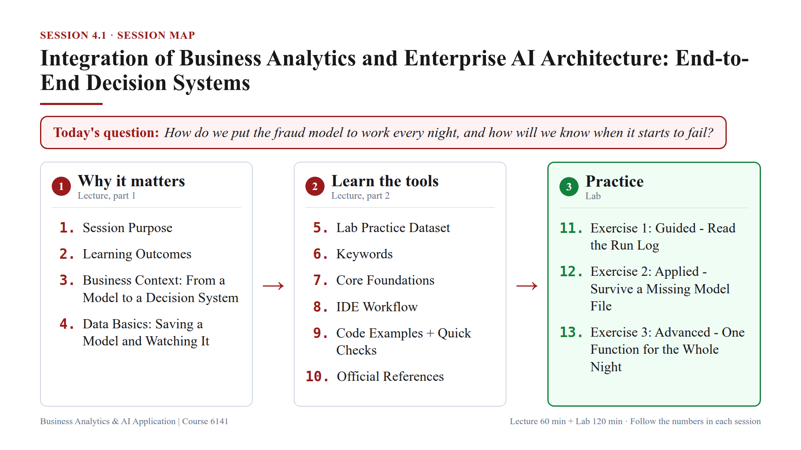

* **Lecture Presentation:** [Download Slides (PDF)](slides/session_04_01_lecture.pdf)
* **Reading (PDF):** [Download Reading (PDF)](handouts/session_04_01_reading.pdf): read before class
* **Schedule:** Week 13 (115/12/06 - 115/12/12) | In-person classes (1:2 Delivery Ratio: 60 Min Lecture + 120 Min Lab)

* **1. Session Purpose:**
  * A model that lives in an analyst's notebook creates no value; value comes only when its predictions trigger real actions, every day, without a person running the code
  * The card issuer from Session 3.4 wants its fraud model to score each night's transactions automatically and hold the risky ones
  * The head of operations asks: how do we put the fraud model to work every night, and how will we know when it starts to fail? Today, you save a trained model, reuse it on new data, and build the checks that warn you when the world changes

* **2. Expected Learning Outcomes (By the end of this session, you will be able to):**
  1. "How does a model get from training to daily use?": map an end-to-end decision system (data in, checks, model, action), and save and reload a model with `joblib`
  2. "Is new data still like the training data?": detect data drift (a change in the incoming data that makes a model less reliable) by comparing averages
  3. "What if something breaks at night?": monitor latency and accuracy from a run log, and handle a missing model file (`FileNotFoundError`) with a safe fallback

* **3. Business Context: From a Model to a Decision System:**
  * A decision system has four stages, run every night as one batch (a group of records processed together):

    | Stage | What happens | Example |
    |---|---|---|
    | Ingestion | collect the day's data | 120,000 card transactions |
    | Validation | check it before use | no missing values, all columns present |
    | Scoring | the model gives each record a probability | fraud probability from 0 to 1 |
    | Action | a business rule turns scores into actions | hold every transaction at 0.5 or above |

  * Batch vs real-time:
    * **Batch** scoring runs on a schedule, such as every night, for many records at once. It is cheaper, and fine when decisions can wait a few hours.
    * **Real-time** scoring answers one request within milliseconds, for example while a customer waits at the checkout. It is faster but costs more to build and run.
  * Models get worse over time, because customers and markets change. Two warning signs to watch:
    * **Data drift:** the new data no longer looks like the training data (for example, purchases are much larger in the holiday season)
    * **Performance decay:** accuracy on recent, checked cases falls

* **4. Data Basics: Saving a Model and Watching It:**
  * Training is slow and done rarely; scoring is fast and done often. So the trained model is **saved to a file** once, then **loaded** by the nightly job:
    * `joblib.dump(model, "models/fraud_model.joblib")` saves it
    * `joblib.load("models/fraud_model.joblib")` loads it back, ready to predict, with no retraining
  * A simple drift check compares each feature's average in the new batch with its average in the training data:
    * change in percent = (new average - training average) / training average x 100
    * Our rule: flag a feature when the change is more than 20% in either direction
  * A run log records every night's stages with their record counts and latency (how long a stage took, in milliseconds; 1,000 ms = 1 second). Rising latency or falling accuracy is an early warning.

* **5. Lab Practice Dataset:**
  * Three files (all fictional teaching data):
    * Training data: [data/session_03_04_dataset.csv](data/session_03_04_dataset.csv), the 16 investigated transactions from Session 3.4. The model uses `Transaction_Amount_USD`, `Foreign_IP_Flag`, and `Failed_Login_Attempts_Count` to predict `Actual_Fraud_Binary`.
    * New batch: [data/session_04_01_new_batch.csv](data/session_04_01_new_batch.csv), 8 new transactions from a holiday-season night, with the same three feature columns and no answer column.
    * Run log: [data/session_04_01_dataset.csv](data/session_04_01_dataset.csv), 20 rows: 5 nights x 4 stages.
  * Run log columns:
    * `Run_Date`: The night of the run, `2024-12-01` to `2024-12-05`.
    * `Pipeline_Stage`: `Ingestion`, `Validation`, `Scoring`, or `Action`.
    * `Records_Count`: Records processed by the stage. For `Action`, the number of held transactions.
    * `Latency_Ms`: Time the stage took, in milliseconds.
    * `Model_Accuracy`: Accuracy on that night's investigated cases. Filled only for the `Scoring` stage; empty (`NaN`) for the others.

* **6. Keywords (Core Programming Concepts):**
  * `End-to-End Decision System`:
    * What: ingestion, validation, scoring, and action joined into one automatic run
    * Why: turns predictions into business actions without manual steps
  * `Batch vs Real-Time Scoring`:
    * What: many records on a schedule vs one record on request
    * Why: the business deadline decides which one is worth its cost
  * `Model Persistence` (`joblib`):
    * What: saving a trained model to a file and loading it later
    * Why: train once, score every night
  * `Data Drift`:
    * What: new data that no longer looks like the training data
    * Why: a model is only reliable on data like the data it learned from
  * `Monitoring`:
    * What: tracking counts, latency, and accuracy for every run
    * Why: catches a failing system before customers do
  * `Fallback`:
    * What: a simple, safe rule used when the model is not available
    * Why: the business keeps running when something breaks

* **7. Core Programming & Computational Foundations:**
  * Folders for models:
    * `os.makedirs("models", exist_ok=True)` creates the `models` folder; `exist_ok=True` means "no error if it already exists"
    * `os.path.exists(path)` returns `True` if a file is there, so a script can check before loading
  * Probabilities instead of yes/no:
    * `model.predict_proba(X)` returns two columns per row: the probability of class `0` and of class `1`
    * `[:, 1]` takes the second column: here, the fraud probability
  * A `Pipeline` (from Session 3.2) saves the scaler and the model together, so the nightly job scales new data exactly as the training data was scaled.
  * Missing files: `joblib.load()` on a wrong path stops the script with `FileNotFoundError: [Errno 2] No such file or directory`. Check with `os.path.exists()` first, and switch to the fallback rule if the file is missing.

* **8. Development Workflow in Google Antigravity IDE:**
  * `[1]` File Explorer: create your script with your name and the session code (for example, `Reacher_S41_demo_1.py`), and check the three files are in `data/`. Micro-Example 1 creates a new `models/` folder; it appears here.
  * `[2]` Code Editor: write a few lines, run, repeat. Small steps keep errors small.
  * `[3]` AI Agent Chat: on an error, capture the traceback (Python's error report) with `Win + Shift + S` (macOS: `Cmd + Shift + 4`), paste it with `Ctrl + V`, and ask why it failed.
  * `[4]` Terminal: run `python` followed by your script name. Return code `0` means the script finished with no errors. First time only: `pip install scikit-learn joblib`.

* **9. Hands-On Coding Micro-Examples:**
  * Every example has three parts: **1. Input**, **2. Process**, and **3. Output**. Name each file with your own name and the session code, for example `Reacher_S41_demo_1.py` (pattern: `YourName_S41_demo_1.py`). Run Micro-Example 1 first: the other examples load the model it saves.
  * *Micro-Example 1 (Train Once, Save to a File):* `YourName_S41_demo_1.py`
    ```python
    # 1. Input: the investigated transactions from Session 3.4
    import os
    import joblib
    import pandas as pd
    from sklearn.pipeline import Pipeline
    from sklearn.preprocessing import StandardScaler
    from sklearn.linear_model import LogisticRegression
    train = pd.read_csv("data/session_03_04_dataset.csv")
    features = ["Transaction_Amount_USD", "Foreign_IP_Flag",
                "Failed_Login_Attempts_Count"]

    # 2. Process: scale + logistic regression, trained in one Pipeline
    model = Pipeline([
        ("scale", StandardScaler()),
        ("classify", LogisticRegression()),
    ])
    model.fit(train[features], train["Actual_Fraud_Binary"])

    # 3. Output: save the trained model as a file
    os.makedirs("models", exist_ok=True)
    joblib.dump(model, "models/fraud_model.joblib")
    print("Saved: models/fraud_model.joblib")
    print("Training accuracy:", model.score(train[features], train["Actual_Fraud_Binary"]))
    ```
    * `LogisticRegression()` predicts the probability of a yes/no outcome (Session 3.3 keywords).
    * Result: the model is saved, with a training accuracy of `0.9375` (15 of 16). It is measured on the training rows, so it is a ceiling, not an honest test.
  * *Quick Check 1 (`os.path.exists()`):*
    * New tool: `os.path.exists(path)` returns `True` if the file exists. Why: the nightly job should confirm the model is there before it starts.
    * Task: add one line to part **3. Output**: `print(os.path.______("models/fraud_model.joblib"))`
    * Check: the Terminal shows `True`.
  * *Micro-Example 2 (The Nightly Job: Load, Score, Decide):* `YourName_S41_demo_2.py`
    ```python
    # 1. Input: the saved model and tonight's new transactions
    import joblib
    import pandas as pd
    model = joblib.load("models/fraud_model.joblib")
    batch = pd.read_csv("data/session_04_01_new_batch.csv")
    features = ["Transaction_Amount_USD", "Foreign_IP_Flag",
                "Failed_Login_Attempts_Count"]

    # 2. Process: fraud probability, then the business rule (hold at 0.5 or above)
    batch["Fraud_Probability"] = model.predict_proba(batch[features])[:, 1].round(3)
    batch["Decision"] = "Pass"
    batch.loc[batch["Fraud_Probability"] >= 0.5, "Decision"] = "Hold"

    # 3. Output: print and save tonight's decisions
    print(batch[["Transaction_ID", "Fraud_Probability", "Decision"]])
    batch.to_csv("data/nightly_decisions.csv", index=False)
    ```
    * The model is loaded, not retrained: the script runs in a fraction of a second.
    * `batch.loc[mask, "Decision"] = "Hold"` changes only the selected rows (Session 1.3, Exercise 3).
    * Result: 4 transactions are held: `N-TXN-9001` (`0.862`), `N-TXN-9003` (`0.984`), `N-TXN-9005` (`0.789`), and `N-TXN-9007` (`0.965`).
  * *Quick Check 2 (Run date stamp):*
    * New tool: `from datetime import date` and `date.today()` give today's date. Why: every decision file must show when the decisions were made, for audits.
    * Task: add `from datetime import date` to part **1. Input**, and one line at the end of part **2. Process**: `batch["Run_Date"] = str(date._____())`
    * Check: the saved `data/nightly_decisions.csv` has a `Run_Date` column with today's date, written as `YYYY-MM-DD`.
  * *Micro-Example 3 (Drift Check: Does Tonight Look Like Training?):* `YourName_S41_demo_3.py`
    ```python
    # 1. Input: training data and tonight's batch
    import pandas as pd
    train = pd.read_csv("data/session_03_04_dataset.csv")
    batch = pd.read_csv("data/session_04_01_new_batch.csv")
    features = ["Transaction_Amount_USD", "Foreign_IP_Flag",
                "Failed_Login_Attempts_Count"]

    # 2. Process: compare the averages, feature by feature
    drift = pd.DataFrame({
        "Train_Avg": train[features].mean().round(2),
        "Batch_Avg": batch[features].mean().round(2),
    })
    drift["Change_Pct"] = (
        (drift["Batch_Avg"] - drift["Train_Avg"]) / drift["Train_Avg"] * 100
    ).round(1)
    drift["Drift_Flag"] = drift["Change_Pct"] > 20

    # 3. Output: the drift report
    print(drift)
    ```
    * Building a DataFrame from two `.mean()` results lines them up by column name.
    * Result: the average amount rose from `$1,371.72` to `$2,555.00` (`+86.3`%) and is flagged; foreign IP share (`0.0`%) and failed logins (`+12.2`%) are not. The model learned from smaller purchases, so its holiday-season scores need extra checking.
  * *Quick Check 3 (`.abs()`):*
    * New tool: `column.abs()` removes the minus sign. Why: a feature that **falls** by 30% has drifted too; `> 20` alone misses it.
    * Task: in part **2. Process**, change the flag line to `drift["Drift_Flag"] = drift["Change_Pct"].___() > 20`
    * Check: the flags do not change for tonight's batch, but a change of `-30.0` would now be flagged as well.

* **10. Official Python Documentation & References:**
  * [Scikit-Learn Model Persistence Guide (Joblib Documentation)](https://scikit-learn.org/stable/model_persistence.html).
  * [Python Library: `os.path` (Checking Files and Paths)](https://docs.python.org/3/library/os.path.html).
  * [MLflow Official Documentation: Open Source Platform for the Machine Learning Lifecycle](https://mlflow.org/docs/latest/index.html).
  * [Sculley et al.: Hidden Technical Debt in Machine Learning Systems (NeurIPS Standards)](https://papers.nips.cc/paper/5656-hidden-technical-debt-in-machine-learning-systems.pdf).

* **11. Exercise 1: Guided Practice - Read the Run Log:**
  * *Step 1: Open Script:* In Google Antigravity IDE, create a new script named `YourName_S41_monitoring.py`, replacing `YourName` with your own name (for example, `Reacher_S41_monitoring.py`).
  * *Step 2: Find the Nights That Need Attention:*
    Type the following code:
    ```python
    # 1. Input: the run log, 5 nights x 4 stages
    import pandas as pd
    log = pd.read_csv("data/session_04_01_dataset.csv")

    # 2. Process: health rules for the Scoring stage, then totals per night
    scoring = log[log["Pipeline_Stage"] == "Scoring"].copy()
    scoring["Alert"] = (
        (scoring["Latency_Ms"] > 900) | (scoring["Model_Accuracy"] < 0.93)
    )
    nightly = log.groupby("Run_Date").agg(
        Total_Latency_Ms=("Latency_Ms", "sum"),
        Transactions_In=("Records_Count", "first"),
    )

    # 3. Output: the Scoring stage per night, then the nightly totals
    print(scoring[["Run_Date", "Latency_Ms", "Model_Accuracy", "Alert"]])
    print(nightly)
    ```
    * `.copy()` makes `scoring` an independent table, so adding the `Alert` column does not touch `log`.
    * `|` means "or": a night is flagged if either rule is broken.
    * `"first"` in `.agg()` takes the first value of each group; here, the `Ingestion` row's count.
  * *Step 3: Interpret:* In two comment lines, describe the trend in latency and accuracy across the 5 nights, and what the team should do next.
  * *Step 4: Execute in Terminal:* Run `python YourName_S41_monitoring.py` in Panel `[4]` and confirm return code `0`.
  * *Success Check:* alerts on `2024-12-04` (latency `910`, accuracy `0.921`) and `2024-12-05` (`980`, `0.904`); total latency is `1470` ms on the first two nights, then rises every night to `1730` ms, while incoming transactions grow from `120000` to `138900`. Growing volume and falling accuracy together suggest drift: the model should be reviewed and possibly retrained.

* **12. Exercise 2: Applied Practice - Survive a Missing Model File:**
  * *Coding Challenge:* In `YourName_S41_practice.py`, make the nightly job keep working when the model file cannot be found.
  * *Task 1 (Read the FileNotFoundError & AI Diagnosis):* Starting from Micro-Example 2, change the path to `"models/fraud_modle.joblib"` (a typo). The script stops with `FileNotFoundError: [Errno 2] No such file or directory: 'models/fraud_modle.joblib'`. Capture the traceback with `Win + Shift + S`, paste it into Panel `[3]` (AI Agent Chat) with `Ctrl + V`, and ask how to check for a file before loading it.
  * *Task 2 (Add a Fallback Rule):* Store the path in a variable `model_path`. If `os.path.exists(model_path)`, load the model and decide as in Micro-Example 2, and set `method = "model"`. Otherwise, use the fallback rule: hold when `Foreign_IP_Flag == 1` **and** `Failed_Login_Attempts_Count >= 2`, and set `method = "fallback rule"`. Print which method was used.
  * *Task 3 (Compare):* Run the script once with the typo and once with the correct path. Print the held transaction IDs each time.
  * *Success Check:* with the typo, the fallback rule holds 3 transactions (`N-TXN-9001`, `N-TXN-9003`, `N-TXN-9007`); with the correct path, the model holds 4 (it also holds `N-TXN-9005`, a foreign purchase of `$3,900` with only 1 failed login). The script finishes with return code `0` both times: the fallback keeps the business safe, but it is weaker than the model, so the missing file must still be fixed quickly.

* **13. Exercise 3: Advanced Practice - One Function for the Whole Night:**
  * *Goal:* Combine everything into one function that the operations team could schedule to run every night: validate, check drift, score (or fall back), act, and report.
  * *What you need:*
    * Files: `data/session_03_04_dataset.csv` (training), `data/session_04_01_new_batch.csv` (tonight), and `models/fraud_model.joblib` (from Micro-Example 1).
    * Script name: `YourName_S41_challenge.py`.
    * Tools you already know: functions (Session 2.4), `assert` (Session 2.3), `os.path.exists()`, `joblib.load()`, `.predict_proba()`, the drift table from Micro-Example 3, and the fallback rule from Exercise 2.
  * *Requirements (follow them in order):*
    1. Write `run_nightly(batch_path, model_path, train_path)` that returns a dictionary summary.
    2. **Validation:** check with `assert` that the batch has the three feature columns and no missing values in them.
    3. **Drift:** compute the change in percent of each feature's average, as in Micro-Example 3, and collect the names of the features whose absolute change is above 20.
    4. **Scoring:** if the model file exists, hold transactions with a fraud probability of 0.5 or above; otherwise, use the fallback rule from Exercise 2.
    5. **Action:** save the batch with `Decision` and `Method` columns to `data/nightly_decisions.csv`.
    6. **Report:** return `{"records": ..., "held": ..., "method": ..., "drift_features": [...], "needs_review": ...}`, where `needs_review` is `True` if any feature drifted **or** the fallback was used.
    7. Call the function twice, once with the correct model path and once with a wrong path, and print both summaries.
  * *New tools for this exercise:*
    * Checking that columns exist: `set(features).issubset(batch.columns)` is `True` when every name in `features` is a column of `batch`.
    * A list of names from a Boolean column: `list(drift.index[drift["Drift_Flag"]])` keeps the row labels (feature names) where the flag is `True`.
    * Any `True` in a list: `len(drift_features) > 0`.
  * *Hints:*
    * Write and test each stage as a few lines first, then move them into the function.
    * Use `int(...)` around counts so the dictionary prints plain numbers.
  * *Self-Check (expected results):*
    * Correct path: `{"records": 8, "held": 4, "method": "model", "drift_features": ["Transaction_Amount_USD"], "needs_review": True}`.
    * Wrong path: `{"records": 8, "held": 3, "method": "fallback rule", "drift_features": ["Transaction_Amount_USD"], "needs_review": True}`.
    * Business meaning: even when the model runs, tonight still needs a person's review, because the amounts are far outside the training data. A decision system should report its own doubts, not just its decisions.

---

<a id="session-04-02"></a>
### Session 4.2: AI Applications in Business Decision-Making Part 1: Predictive Customer Analytics and Churn

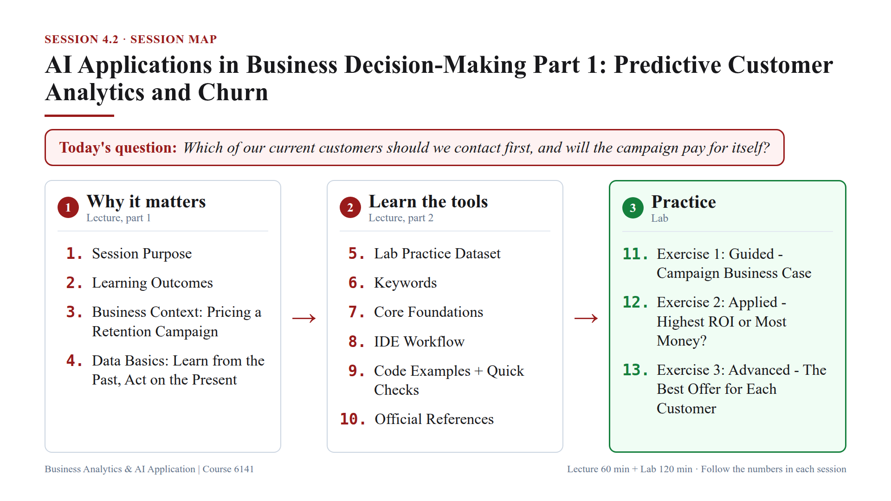

* **Lecture Presentation:** [Download Slides (PDF)](slides/session_04_02_lecture.pdf)
* **Reading (PDF):** [Download Reading (PDF)](handouts/session_04_02_reading.pdf): read before class
* **Schedule:** Week 14 (115/12/13 - 115/12/19) | In-person classes (1:2 Delivery Ratio: 60 Min Lecture + 120 Min Lab)

* **1. Session Purpose:**
  * A subscription telecom company loses customers every month to churn (customers cancelling their contract)
  * Its retention team can call customers or assign them an account manager, but every contact costs money, and calling customers who would stay anyway wastes it
  * The head of customer retention asks: which of our current customers should we contact first, and will the campaign pay for itself? Today, you turn churn predictions into revenue at risk and a campaign plan with a measurable return

* **2. Expected Learning Outcomes (By the end of this session, you will be able to):**
  1. "Who is likely to leave?": train a churn model on past customers and score current customers with a churn probability
  2. "How much money is at stake?": calculate revenue at risk (churn probability x yearly customer value) and rank customers by it
  3. "Will the campaign pay off?": calculate a campaign's expected net benefit and ROI (Return on Investment), choose who to target, and fix a `ValueError` caused by missing feature columns

* **3. Business Context: Pricing a Retention Campaign:**
  * Four ideas, one example (current customer `ACT-101`):

    | Term | Meaning | Example |
    |---|---|---|
    | Churn probability | the model's estimate that this customer leaves within 60 days | `0.876` |
    | Annual value | monthly fee x 12: one year of revenue from this customer | `$2,399.88` |
    | Revenue at risk | churn probability x annual value: the revenue we expect to lose | `$2,102.29` |
    | Expected saved revenue | revenue at risk x success rate of the campaign | `$2,102.29 x 0.40 = $840.92` |

  * CLV (Customer Lifetime Value) is the total value of a customer over the whole relationship, often several years. Today we use one year of value: simpler, and a cautious basis for spending decisions.
  * A campaign is worth it for a customer when expected saved revenue is larger than the contact cost. Contacting a customer who would stay anyway, or whose value is small, wastes budget.
  * Net benefit vs ROI: net benefit = saved revenue - cost, in dollars; ROI = net benefit / cost x 100, in percent. The plan with the highest ROI is not always the plan that earns the most money.

* **4. Data Basics: Learn from the Past, Act on the Present:**
  * Two groups of customers, two files:

    | File | Customers | Has the answer (`Churned`)? | Used to |
    |---|---|---|---|
    | History | 14 past customers | yes | train the model |
    | Active | 10 current customers | no, not yet known | score and target |

  * A retention campaign only makes sense for customers who have not left yet. So the model learns from the history and predicts for the active customers.
  * What drives churn in our history: after scaling, the model's coefficients are `-0.718` for tenure (longer customers stay), `+0.897` for support calls, and `+0.878` for usage drop (more calls and falling usage signal leaving).

* **5. Lab Practice Dataset:**
  * Two files (fictional teaching data):
    * History: [data/session_04_02_dataset.csv](data/session_04_02_dataset.csv), 14 past customers with their outcome; 5 of them churned.
    * Active: [data/session_04_02_active.csv](data/session_04_02_active.csv), 10 current customers with the same columns except the outcome.
  * Columns:
    * `Subscriber_ID`: Customer code (`SUB-...` in the history, `ACT-...` for active customers).
    * `Tenure_Months_Count`: Months as a customer.
    * `Monthly_Subscription_Fee_USD`: Monthly fee in U.S. Dollars.
    * `Customer_Support_Calls_Count`: Calls to customer support in the last 90 days.
    * `Usage_Drop_Last_30_Days_Pct`: How much the customer's use of the service fell in the last 30 days, in percent.
    * `Churned_Within_60_Days_Binary` (history only): `1` = left within 60 days, `0` = stayed.

* **6. Keywords (Core Programming Concepts):**
  * `Churn`:
    * What: customers ending their relationship with the company
    * Why: in subscription businesses, keeping a customer is usually cheaper than winning a new one
  * `Churn Probability`:
    * What: the model's estimate, from 0 to 1, that a customer will leave
    * Why: ranks customers by risk instead of treating everyone the same
  * `Revenue at Risk`:
    * What: churn probability x annual value
    * Why: turns a probability into dollars a manager can budget against
  * `Customer Lifetime Value (CLV)`:
    * What: the total value of a customer over the whole relationship
    * Why: decides how much a customer is worth saving
  * `Net Benefit` and `ROI`:
    * What: saved revenue minus cost (dollars), and net benefit divided by cost (percent)
    * Why: the two numbers a finance team asks for before approving a campaign
  * `Targeting Threshold`:
    * What: the minimum churn probability for a customer to be contacted
    * Why: sets the size and cost of the campaign

* **7. Core Programming & Computational Foundations:**
  * Train on one table, predict on another:
    * `model.fit(history[features], history[target])` learns from the past
    * `model.predict_proba(active[features])[:, 1]` scores the current customers
    * The active table must have **the same feature columns** as the history; a missing column raises `ValueError: The feature names should match those that were passed during fit.`
  * Expected values: multiply a probability by a dollar amount to get the amount you expect on average. Across many customers, these averages add up reliably even though each single customer either stays or leaves.
  * Inside a `Pipeline`, `model.named_steps["classify"]` reaches the logistic regression step, so you can read its coefficients with `.coef_`.
  * Comparing several options per row: compute one column per option, then use `.loc[]` with conditions to pick the best for each row.

* **8. Development Workflow in Google Antigravity IDE:**
  * `[1]` File Explorer: create your script with your name and the session code (for example, `Reacher_S42_demo_1.py`), and check both files are in `data/`.
  * `[2]` Code Editor: write a few lines, run, repeat. Small steps keep errors small.
  * `[3]` AI Agent Chat: on an error, capture the traceback (Python's error report) with `Win + Shift + S` (macOS: `Cmd + Shift + 4`), paste it with `Ctrl + V`, and ask why it failed.
  * `[4]` Terminal: run `python` followed by your script name. Return code `0` means the script finished with no errors.

* **9. Hands-On Coding Micro-Examples:**
  * Every example has three parts: **1. Input**, **2. Process**, and **3. Output**. Name each file with your own name and the session code, for example `Reacher_S42_demo_1.py` (pattern: `YourName_S42_demo_1.py`).
  * *Micro-Example 1 (Learn from the Past, Score the Present):* `YourName_S42_demo_1.py`
    ```python
    # 1. Input: past customers (with outcomes) and current customers
    import pandas as pd
    from sklearn.pipeline import Pipeline
    from sklearn.preprocessing import StandardScaler
    from sklearn.linear_model import LogisticRegression
    history = pd.read_csv("data/session_04_02_dataset.csv")
    active = pd.read_csv("data/session_04_02_active.csv")
    features = ["Tenure_Months_Count", "Customer_Support_Calls_Count",
                "Usage_Drop_Last_30_Days_Pct"]

    # 2. Process: train on history, then score the active customers
    model = Pipeline([
        ("scale", StandardScaler()),
        ("classify", LogisticRegression()),
    ])
    model.fit(history[features], history["Churned_Within_60_Days_Binary"])
    active["Churn_Probability"] = model.predict_proba(active[features])[:, 1].round(3)

    # 3. Output: the active customers, most at risk first
    print(active.sort_values("Churn_Probability", ascending=False)[
        ["Subscriber_ID", "Tenure_Months_Count", "Churn_Probability"]
    ])
    ```
    * The `Pipeline` scales the features and runs logistic regression in one object (Session 3.2 and 4.1).
    * Result: the three highest risks are `ACT-105` (`0.941`), `ACT-108` (`0.900`), and `ACT-101` (`0.876`), all customers of fewer than 8 months with many support calls and a big drop in usage.
  * *Quick Check 1 (`named_steps` and `.coef_`):*
    * New tool: `model.named_steps["classify"].coef_` returns the learned coefficients of the logistic regression inside the pipeline. Why: shows which signals push a customer toward leaving.
    * Task: add one line to part **3. Output**: `print(dict(zip(features, model.named_steps["classify"].____[0].round(3).tolist())))`
    * Check: tenure `-0.718`, support calls `0.897`, usage drop `0.878`. A negative coefficient lowers the churn probability; a positive one raises it.
  * *Micro-Example 2 (Revenue at Risk):* `YourName_S42_demo_2.py`
    ```python
    # 1. Input: train and score, as in Micro-Example 1
    import pandas as pd
    from sklearn.pipeline import Pipeline
    from sklearn.preprocessing import StandardScaler
    from sklearn.linear_model import LogisticRegression
    history = pd.read_csv("data/session_04_02_dataset.csv")
    active = pd.read_csv("data/session_04_02_active.csv")
    features = ["Tenure_Months_Count", "Customer_Support_Calls_Count",
                "Usage_Drop_Last_30_Days_Pct"]
    model = Pipeline([("scale", StandardScaler()),
                      ("classify", LogisticRegression())])
    model.fit(history[features], history["Churned_Within_60_Days_Binary"])
    active["Churn_Probability"] = model.predict_proba(active[features])[:, 1].round(3)

    # 2. Process: one year of value, and the part of it at risk
    active["Annual_Value_USD"] = (active["Monthly_Subscription_Fee_USD"] * 12).round(2)
    active["Revenue_At_Risk_USD"] = (
        active["Churn_Probability"] * active["Annual_Value_USD"]
    ).round(2)
    ranked = active.sort_values("Revenue_At_Risk_USD", ascending=False)

    # 3. Output: the ranking and the total
    print(ranked[["Subscriber_ID", "Churn_Probability", "Annual_Value_USD",
                  "Revenue_At_Risk_USD"]])
    print(f"Total revenue at risk: ${active['Revenue_At_Risk_USD'].sum():,.2f}")
    ```
    * Result: `ACT-101` leads (`$2,102.29`), although `ACT-105` has a higher churn probability: `ACT-101` pays twice as much per month. Total revenue at risk: `$7,659.53`.
  * *Quick Check 2 (`.cumsum()`):*
    * New tool: `column.cumsum()` gives a running total down the rows. Why: shows how much of the total risk the first few customers carry.
    * Task: add one line at the end of part **2. Process**: `ranked["Running_Total_USD"] = ranked["Revenue_At_Risk_USD"].______().round(2)`, and add `"Running_Total_USD"` to the printed columns.
    * Check: the third row shows `4851.27`: the top 3 customers carry 63% of the total risk.
  * *Micro-Example 3 (Assign a Campaign to Each Customer):* `YourName_S42_demo_3.py`
    ```python
    # 1. Input: train and score, as in Micro-Example 2
    import pandas as pd
    from sklearn.pipeline import Pipeline
    from sklearn.preprocessing import StandardScaler
    from sklearn.linear_model import LogisticRegression
    history = pd.read_csv("data/session_04_02_dataset.csv")
    active = pd.read_csv("data/session_04_02_active.csv")
    features = ["Tenure_Months_Count", "Customer_Support_Calls_Count",
                "Usage_Drop_Last_30_Days_Pct"]
    model = Pipeline([("scale", StandardScaler()),
                      ("classify", LogisticRegression())])
    model.fit(history[features], history["Churned_Within_60_Days_Binary"])
    active["Churn_Probability"] = model.predict_proba(active[features])[:, 1].round(3)
    active["Annual_Value_USD"] = (active["Monthly_Subscription_Fee_USD"] * 12).round(2)

    # 2. Process: rules from the cheapest to the most valuable campaign
    active["Campaign"] = "Newsletter"
    active.loc[active["Churn_Probability"] >= 0.4, "Campaign"] = "Retention_Call"
    active.loc[
        (active["Churn_Probability"] >= 0.7) & (active["Annual_Value_USD"] >= 1500),
        "Campaign",
    ] = "VIP_Account_Manager"

    # 3. Output: how many customers get each campaign
    print(active["Campaign"].value_counts())
    print(active[["Subscriber_ID", "Churn_Probability", "Campaign"]])
    ```
    * Later rules overwrite earlier ones, so the most valuable campaign is assigned last.
    * VIP (Very Important Person) account manager: a named staff member who looks after a high-value customer personally.
    * Result: `4` newsletters, `4` retention calls, and `2` VIP account managers (`ACT-101` and `ACT-108`).
  * *Quick Check 3 (`pd.cut()`):*
    * New tool: `pd.cut(column, bins=[0, 0.4, 0.7, 1.0], labels=["Low", "Medium", "High"])` puts each value into a band. Why: managers think in risk bands, not in decimals.
    * Task: add two lines to part **3. Output**: `active["Risk_Band"] = pd.___(active["Churn_Probability"], bins=[0, 0.4, 0.7, 1.0], labels=["Low", "Medium", "High"])` and `print(active["Risk_Band"].value_counts())`
    * Check: `Low` `4`, `Medium` `3`, `High` `3`.

* **10. Official Python Documentation & References:**
  * [Scikit-Learn Logistic Regression: predict_proba Documentation](https://scikit-learn.org/stable/modules/generated/sklearn.linear_model.LogisticRegression.html#sklearn.linear_model.LogisticRegression.predict_proba).
  * [Pandas API Reference: `pandas.cut`](https://pandas.pydata.org/docs/reference/api/pandas.cut.html).
  * [Fader & Hardie: Probability Models for Customer-Base Analysis (Wharton Marketing Standards)](https://www.brucehardie.com/papers/).

* **11. Exercise 1: Guided Practice - Campaign Business Case:**
  * *Step 1: Open Script:* In Google Antigravity IDE, create a new script named `YourName_S42_churn.py`, replacing `YourName` with your own name (for example, `Reacher_S42_churn.py`).
  * *Step 2: Price a Campaign for Customers at 0.5 or Above:*
    Type the following code:
    ```python
    # 1. Input: train on history, score the active customers
    import pandas as pd
    from sklearn.pipeline import Pipeline
    from sklearn.preprocessing import StandardScaler
    from sklearn.linear_model import LogisticRegression
    history = pd.read_csv("data/session_04_02_dataset.csv")
    active = pd.read_csv("data/session_04_02_active.csv")
    features = ["Tenure_Months_Count", "Customer_Support_Calls_Count",
                "Usage_Drop_Last_30_Days_Pct"]
    model = Pipeline([("scale", StandardScaler()),
                      ("classify", LogisticRegression())])
    model.fit(history[features], history["Churned_Within_60_Days_Binary"])
    active["Churn_Probability"] = model.predict_proba(active[features])[:, 1].round(3)
    active["Annual_Value_USD"] = (active["Monthly_Subscription_Fee_USD"] * 12).round(2)

    # 2. Process: target, then expected saved revenue, cost, net benefit, ROI
    success_rate = 0.40
    cost_per_contact = 75.0
    targeted = active[active["Churn_Probability"] >= 0.5]
    saved = (targeted["Churn_Probability"] * success_rate
             * targeted["Annual_Value_USD"]).sum()
    cost = len(targeted) * cost_per_contact
    net_benefit = saved - cost
    roi_pct = net_benefit / cost * 100

    # 3. Output: the business case
    print(f"Customers targeted: {len(targeted)}")
    print(f"Expected saved revenue: ${saved:,.2f}")
    print(f"Campaign cost: ${cost:,.2f}")
    print(f"Net benefit: ${net_benefit:,.2f} | ROI: {roi_pct:.1f}%")
    ```
    * Expected saved revenue multiplies three things per customer: the chance they would leave, the chance the call keeps them, and what they are worth.
  * *Step 3: Interpret:* In two comment lines, explain why we multiply by the churn probability instead of counting each targeted customer's full value.
  * *Step 4: Execute in Terminal:* Run `python YourName_S42_churn.py` in Panel `[4]` and confirm return code `0`.
  * *Success Check:* `4` customers targeted; expected saved revenue `$2,199.68`; cost `$300.00`; net benefit `$1,899.68`; ROI `633.2`%.

* **12. Exercise 2: Applied Practice - Highest ROI or Most Money?:**
  * *Coding Challenge:* In `YourName_S42_practice.py`, test targeting thresholds from 0.3 to 0.8 and compare the best ROI with the best net benefit.
  * *Task 1 (Threshold Loop):* For each threshold in `[0.3, 0.4, 0.5, 0.6, 0.7, 0.8]`, repeat the business case from Exercise 1 and collect `Threshold`, `Targeted`, `Saved_USD`, `Cost_USD`, `Net_Benefit_USD`, and `ROI_Pct` in one DataFrame.
  * *Task 2 (Read the ValueError & AI Diagnosis):* Score the active customers with only two features by mistake: `model.predict_proba(active[["Tenure_Months_Count", "Customer_Support_Calls_Count"]])`. The script stops with `ValueError: The feature names should match those that were passed during fit.` Capture the traceback with `Win + Shift + S`, paste it into Panel `[3]` (AI Agent Chat) with `Ctrl + V`, and ask why the model needs the same columns it was trained on.
  * *Task 3 (Two Recommendations):* Fix the scoring, then print two lines: the threshold with the highest `ROI_Pct`, and the threshold with the highest `Net_Benefit_USD`. If thresholds tie, report the higher threshold, since it contacts fewer customers.
  * *Success Check:* highest ROI: threshold `0.8` (`762.4`%, 3 customers, net `$1,715.51`); highest net benefit: threshold `0.4` (`$2,387.07`, 6 customers, ROI `530.5`%). The broader campaign earns `$671.56` more, at a lower ROI. If the budget allows, net benefit is what adds to profit.

* **13. Exercise 3: Advanced Practice - The Best Offer for Each Customer:**
  * *Goal:* Stop using one threshold for everyone. For each current customer, choose the offer with the highest expected net value, or no offer at all, and show the retention head how much more this earns than the best threshold plan from Exercise 2.
  * *What you need:*
    * Files: `data/session_04_02_dataset.csv` (history) and `data/session_04_02_active.csv` (active customers).
    * Script name: `YourName_S42_challenge.py`.
    * Tools you already know: the trained pipeline and churn probabilities (Micro-Example 1), annual value (Micro-Example 2), `.loc[]` with conditions, `.value_counts()`, and `.sum()`.
  * *Requirements (follow them in order):*
    1. Score the 10 active customers and add `Annual_Value_USD`, as in Micro-Example 2.
    2. Two possible offers:
       * **Call:** costs `$75`, keeps 40% of the customers who would otherwise leave
       * **VIP** (an account manager): costs `$250`, keeps 60%
    3. For each customer, compute `Call_Net` = churn probability x 0.40 x annual value - 75, and `VIP_Net` = churn probability x 0.60 x annual value - 250, both rounded to 2 decimals.
    4. Set `Best_Offer`:
       * `"VIP"` if `VIP_Net` is above 0 and above `Call_Net`
       * otherwise `"Call"` if `Call_Net` is above 0
       * otherwise `"None"`
    5. Add `Expected_Net_USD`: the net value of the chosen offer, or `0` for `"None"`.
    6. Print each customer's ID, churn probability, annual value, both net values, best offer, and expected net. Then print the count per offer, the total expected net, and the difference from Exercise 2's best net benefit (`$2,387.07`).
  * *New tools for this exercise:*
    * Ordered rules with `.loc[]`: set the default first (`active["Best_Offer"] = "None"`), then overwrite with `"Call"`, then with `"VIP"`. The conditions in step 4 must be written so that the last rule wins only when it should.
    * Copying values row by row from another column: `active.loc[mask, "Expected_Net_USD"] = active.loc[mask, "Call_Net"]`.
  * *Hints:*
    * Start `Expected_Net_USD` at `0.0` for every customer.
    * Check one customer by hand first, such as `ACT-101`: `0.876 x 0.60 x 2399.88 - 250 = 1011.38`.
  * *Self-Check (expected results):*
    * Offers: VIP for `ACT-101`, `ACT-105`, `ACT-108`, and `ACT-110`; Call for `ACT-103`, `ACT-104`, and `ACT-107`; None for `ACT-102`, `ACT-106`, and `ACT-109`.
    * Total expected net value: `$2,951.44`, which is `$564.37` more than the best threshold plan.
    * Business meaning: matching the offer to the customer beats any single threshold. `ACT-104` has only a `0.214` churn probability but a high annual value, so even a call is worth it, while the expensive VIP offer pays only for valuable, high-risk customers such as `ACT-110`.

---

<a id="session-04-03"></a>
### Session 4.3: AI Applications in Business Decision-Making Part 2: Pricing Optimization and Revenue Management

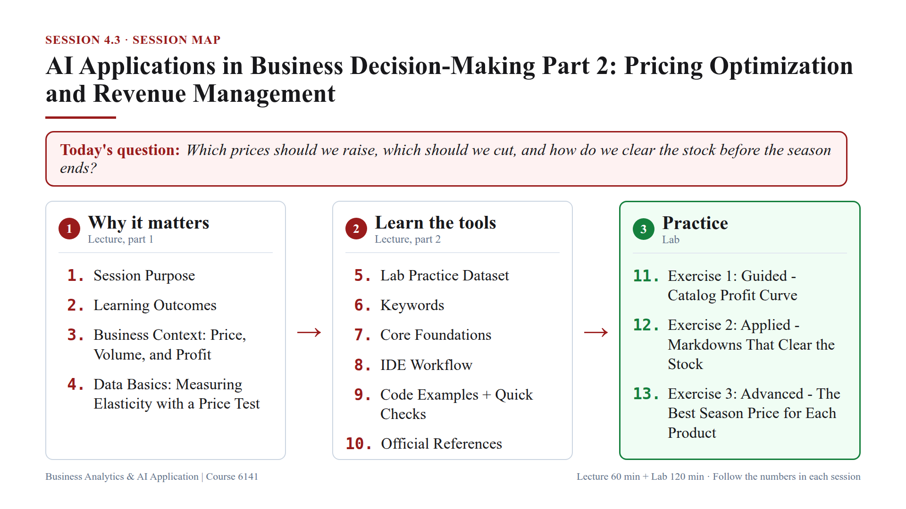

* **Lecture Presentation:** [Download Slides (PDF)](slides/session_04_03_lecture.pdf)
* **Reading (PDF):** [Download Reading (PDF)](handouts/session_04_03_reading.pdf): read before class
* **Schedule:** Week 15 (115/12/20 - 115/12/26) | In-person classes (1:2 Delivery Ratio: 60 Min Lecture + 120 Min Lab)

* **1. Session Purpose:**
  * An online retailer sells 12 seasonal products; the season ends in 12 days, and stock left after that must be sold off cheaply
  * Prices were set by gut feeling: some may be too low (leaving profit on the table), others too high (leaving stock unsold)
  * The pricing manager asks: which prices should we raise, which should we cut, and how do we clear the stock before the season ends? Today, you measure how customers react to price and simulate profit before changing a single price

* **2. Expected Learning Outcomes (By the end of this session, you will be able to):**
  1. "How strongly do customers react to price?": estimate the price elasticity of demand (the % change in units sold for a 1% change in price) from a price test
  2. "Would a price change raise profit?": simulate units, revenue, and gross profit for several price changes before making them
  3. "How do we clear the stock in time?": calculate the price cut each product needs to sell out before the season ends, and fix a `SyntaxError` (an unclosed bracket)

* **3. Business Context: Price, Volume, and Profit:**
  * A lower price sells more units but earns less on each one; a higher price earns more per unit but sells fewer. Profit depends on both:

    | Term | Meaning | Example (`PRD-200`) |
    |---|---|---|
    | Unit margin | price - unit cost | `$49.99 - $22.50 = $27.49` |
    | Gross margin % | unit margin / price x 100 | `55.0`% |
    | Daily gross profit | unit margin x daily units | `$27.49 x 32 = $879.68` |
    | Days of stock | inventory / daily units | `450 / 32 = 14.1` days |

  * Price elasticity of demand (PED): if elasticity is `-1.5`, a 1% price increase loses about 1.5% of units. When elasticity is between `0` and `-1`, customers barely react; below `-1`, they react strongly.
  * The goal is profit, not revenue: a cut can raise revenue and still lower profit, because each extra unit brings in less margin.
  * Seasonal stock: units left at the season's end lose most of their value. Our retailer sells leftovers to a liquidator (a company that buys surplus stock) for 40% of their unit cost, a loss of 60% of the cost on every unsold unit.

* **4. Data Basics: Measuring Elasticity with a Price Test:**
  * To measure how customers react, the retailer changed the price of `PRD-202` once a week for 5 weeks and recorded daily units sold:

    | Week | Price | Daily units |
    |---|---|---|
    | 1 | `$59.99` | `27.9` |
    | 3 | `$69.99` | `22.0` |
    | 5 | `$79.99` | `18.1` |

  * Elasticity is the slope of a straight line through `log(units)` against `log(price)`. A logarithm (log) turns percentage changes into differences, so the slope reads directly as "% change in units for a 1% change in price".
  * `np.polyfit(x, y, 1)` fits that straight line and returns its slope and intercept. Result: elasticity `-1.51`.
  * Using elasticity for a small price change: new units = old units x (1 + elasticity x price change). For `+5%`: `1 + (-1.51 x 0.05) = 0.9245`, so about 7.6% fewer units. This straight-line rule is an approximation that works for changes of up to about 20%.

* **5. Lab Practice Dataset:**
  * Two files (fictional teaching data):
    * Catalog: [data/session_04_03_dataset.csv](data/session_04_03_dataset.csv), 12 products, one row per product.
    * Price test: [data/session_04_03_price_test.csv](data/session_04_03_price_test.csv), 5 weeks of tested prices for `PRD-202`.
  * Catalog columns:
    * `Product_ID`: Product code (e.g., `PRD-201`).
    * `Current_Price_USD`: Our current price in U.S. Dollars.
    * `Competitor_Price_USD`: The main competitor's price for the same product.
    * `Inventory_Units_Count`: Units in stock.
    * `Historical_Daily_Sales_Units`: Average units sold per day at the current price.
    * `Unit_Cost_USD`: What one unit costs us, delivered to the warehouse.
  * Price test columns: `Test_Week` (1 to 5), `Product_ID`, `Test_Price_USD`, and `Avg_Daily_Units` (average units sold per day that week).

* **6. Keywords (Core Programming Concepts):**
  * `Price Elasticity of Demand (PED)`:
    * What: the % change in units sold for a 1% change in price
    * Why: tells you whether a price rise loses a few customers or many
  * `Unit Margin` and `Gross Profit`:
    * What: price minus unit cost, and unit margin times units sold
    * Why: the measure a pricing decision should maximize
  * `Price Simulation`:
    * What: computing units and profit for several possible prices before choosing one
    * Why: test a decision on paper, not on real customers
  * `Days of Stock`:
    * What: inventory divided by daily sales
    * Why: shows which products will not sell out in time
  * `Markdown`:
    * What: a planned price cut to sell stock faster
    * Why: a smaller, earlier cut usually loses less than a fire sale at the end
  * `Salvage Value`:
    * What: what leftover stock is still worth after the season
    * Why: decides how costly it is to be left with unsold units

* **7. Core Programming & Computational Foundations:**
  * Logs and straight lines:
    * `np.log(column)` takes the natural logarithm of every value (NumPy works on whole columns, like pandas)
    * `slope, intercept = np.polyfit(x, y, 1)` fits a straight line; the `1` means "a line" (a polynomial of degree 1)
  * Simulating with a function: write the profit calculation once as `simulate(price_change)` and call it for every price change, so every scenario uses exactly the same formula.
  * Finding the best key in a dictionary: `max(results, key=results.get)` returns the key whose value is largest.
  * Brackets must close: a line such as `(1 + df["Price_Change_Pct"] / 100` without its `)` raises `SyntaxError: '(' was never closed`. Python reports the line where the bracket opened. Count every `(` and `[` against its partner.

* **8. Development Workflow in Google Antigravity IDE:**
  * `[1]` File Explorer: create your script with your name and the session code (for example, `Reacher_S43_demo_1.py`), and check both files are in `data/`.
  * `[2]` Code Editor: write a few lines, run, repeat. Small steps keep errors small. The editor highlights matching brackets when you place the cursor next to one.
  * `[3]` AI Agent Chat: on an error, capture the traceback (Python's error report) with `Win + Shift + S` (macOS: `Cmd + Shift + 4`), paste it with `Ctrl + V`, and ask why it failed.
  * `[4]` Terminal: run `python` followed by your script name. Return code `0` means the script finished with no errors.

* **9. Hands-On Coding Micro-Examples:**
  * Every example has three parts: **1. Input**, **2. Process**, and **3. Output**. Name each file with your own name and the session code, for example `Reacher_S43_demo_1.py` (pattern: `YourName_S43_demo_1.py`).
  * *Micro-Example 1 (Estimate Elasticity from the Price Test):* `YourName_S43_demo_1.py`
    ```python
    # 1. Input: 5 weeks of tested prices for PRD-202
    import numpy as np
    import pandas as pd
    test = pd.read_csv("data/session_04_03_price_test.csv")

    # 2. Process: a straight line through log(units) against log(price)
    slope, intercept = np.polyfit(np.log(test["Test_Price_USD"]),
                                  np.log(test["Avg_Daily_Units"]), 1)
    elasticity = round(slope, 2)

    # 3. Output: the elasticity and what it means
    print("Price elasticity of demand:", elasticity)
    print(f"A 1% price rise loses about {abs(elasticity)}% of units sold.")
    ```
    * `abs()` removes the minus sign for the sentence.
    * Result: elasticity `-1.51`. Customers react strongly: a 10% price rise loses about 15% of units.
  * *Quick Check 1 (`.pct_change()`):*
    * New tool: `column.pct_change()` gives the change from the previous row, as a share (`0.08` = 8%). Why: shows the week-to-week reactions behind the single slope.
    * Task: add one line to part **3. Output**: `print((test[["Test_Price_USD", "Avg_Daily_Units"]].__________() * 100).round(1))`
    * Check: the second row shows `8.3` (price up 8.3%) and `-12.5` (units down 12.5%). The first row is `NaN`, because week 1 has no previous week.
  * *Micro-Example 2 (Simulate Profit for Several Price Changes):* `YourName_S43_demo_2.py`
    ```python
    # 1. Input: the catalog and the elasticity from Micro-Example 1
    import pandas as pd
    df = pd.read_csv("data/session_04_03_dataset.csv")
    elasticity = -1.51

    # 2. Process: one function, used for every price change
    def simulate(price_change):
        price = df["Current_Price_USD"] * (1 + price_change)
        units = df["Historical_Daily_Sales_Units"] * (1 + elasticity * price_change)
        return round(((price - df["Unit_Cost_USD"]) * units).sum(), 2)

    profit_curve = {}
    for change in [-0.10, -0.05, 0.0, 0.05, 0.10]:
        profit_curve[f"{change * 100:+.0f}%"] = simulate(change)

    # 3. Output: daily gross profit for the whole catalog at each change
    for label, profit in profit_curve.items():
        print(f"{label}: ${profit:,.2f}")
    ```
    * `f"{change * 100:+.0f}%"` writes a change such as `0.05` as `+5%`; the `+` shows the sign even for positive numbers.
    * Result: `-10%` `$6,881.85`, `-5%` `$7,163.83`, `+0%` `$7,342.85`, `+5%` `$7,418.90`, `+10%` `$7,391.98`. Raising every price by 5% adds about `$76` of profit per day, even though about 7.6% fewer units are sold.
  * *Quick Check 2 (`max(..., key=...)`):*
    * New tool: `max(profit_curve, key=profit_curve.get)` returns the label with the highest profit. Why: finds the best scenario without reading the list by eye.
    * Task: add one line to part **3. Output**: `print("Best change:", ___(profit_curve, key=profit_curve.get))`
    * Check: the Terminal shows `Best change: +5%`.
  * *Micro-Example 3 (Which Products Will Not Sell Out in 12 Days?):* `YourName_S43_demo_3.py`
    ```python
    # 1. Input: the catalog
    import pandas as pd
    df = pd.read_csv("data/session_04_03_dataset.csv")
    season_days = 12

    # 2. Process: days of stock and our price gap to the competitor
    df["Days_Of_Stock"] = (
        df["Inventory_Units_Count"] / df["Historical_Daily_Sales_Units"]
    ).round(1)
    df["Price_Gap_Pct"] = (
        (df["Current_Price_USD"] - df["Competitor_Price_USD"])
        / df["Competitor_Price_USD"] * 100
    ).round(1)
    at_risk = df[df["Days_Of_Stock"] > season_days]

    # 3. Output: the products that need action
    print(at_risk[["Product_ID", "Days_Of_Stock", "Price_Gap_Pct"]])
    ```
    * A negative `Price_Gap_Pct` means we are cheaper than the competitor; a positive one, more expensive.
    * Result: 6 products would still have stock after 12 days: `PRD-200` (`14.1` days), `PRD-201` (`13.6`), `PRD-202` (`13.2`), `PRD-209` (`13.0`), `PRD-210` (`12.5`), and `PRD-211` (`13.3`). `PRD-201`, `PRD-209`, and `PRD-211` are also more expensive than the competitor.
  * *Quick Check 3 (`np.where()`):*
    * New tool: `np.where(condition, value_if_true, value_if_false)` fills a whole column with one of two values. Why: a one-line alternative to setting a default and overwriting it with `.loc[]`.
    * Task: add `import numpy as np` to part **1. Input**, and one line at the end of part **2. Process**: `df["Action"] = np._____(df["Days_Of_Stock"] > season_days, "Markdown", "Keep")`. Then print `df["Action"].value_counts()`.
    * Check: `Keep` `6`, `Markdown` `6`.

* **10. Official Python Documentation & References:**
  * [NumPy API Reference: `numpy.polyfit`](https://numpy.org/doc/stable/reference/generated/numpy.polyfit.html).
  * [NumPy API Reference: `numpy.where`](https://numpy.org/doc/stable/reference/generated/numpy.where.html).
  * [Phillips: Pricing and Revenue Optimization (Stanford Business Books)](https://www.sup.org/books/title/?id=7234).
  * [Talluri & van Ryzin: The Theory and Practice of Revenue Management (Springer Standards)](https://link.springer.com/book/10.1007/b139000).

* **11. Exercise 1: Guided Practice - Catalog Profit Curve:**
  * *Step 1: Open Script:* In Google Antigravity IDE, create a new script named `YourName_S43_pricing.py`, replacing `YourName` with your own name (for example, `Reacher_S43_pricing.py`).
  * *Step 2: Simulate a Wider Range of Price Changes:*
    Type the following code:
    ```python
    # 1. Input: the catalog and the measured elasticity
    import pandas as pd
    df = pd.read_csv("data/session_04_03_dataset.csv")
    elasticity = -1.51

    # 2. Process: today's unit economics, then a profit curve from -15% to +15%
    df["Unit_Margin_USD"] = df["Current_Price_USD"] - df["Unit_Cost_USD"]
    df["Gross_Margin_Pct"] = (df["Unit_Margin_USD"] / df["Current_Price_USD"] * 100).round(1)
    rows = []
    for change in [-0.15, -0.10, -0.05, 0.0, 0.05, 0.10, 0.15]:
        price = df["Current_Price_USD"] * (1 + change)
        units = df["Historical_Daily_Sales_Units"] * (1 + elasticity * change)
        rows.append({
            "Price_Change_Pct": round(change * 100),
            "Daily_Units": round(units.sum(), 1),
            "Daily_Revenue_USD": round((price * units).sum(), 2),
            "Daily_Gross_Profit_USD": round(((price - df["Unit_Cost_USD"]) * units).sum(), 2),
        })
    curve = pd.DataFrame(rows)

    # 3. Output: margins today, then the curve
    print("Gross margin % by product:", df["Gross_Margin_Pct"].tolist())
    print(curve)
    ```
  * *Step 3: Interpret:* In two comment lines, explain why the price change with the highest revenue is not the one with the highest profit.
  * *Step 4: Execute in Terminal:* Run `python YourName_S43_pricing.py` in Panel `[4]` and confirm return code `0`.
  * *Success Check:* gross margins range from `52.5`% to `55.0`%. Gross profit peaks at `+5` (`$7,418.90`), while revenue is highest at `-15` (`$14,218.32`): the change that brings in the most money is not the one that keeps the most. Cutting prices by 15% sells the most units but earns the least profit (`$6,496.89`).

* **12. Exercise 2: Applied Practice - Markdowns That Clear the Stock:**
  * *Coding Challenge:* In `YourName_S43_practice.py`, calculate the price cut each at-risk product needs to sell out in 12 days.
  * *Task 1 (Required Price Change):* For the products with more than 12 days of stock (Micro-Example 3):
    * `Required_Daily_Units` = `Inventory_Units_Count` / 12
    * `Price_Change_Pct` = (`Required_Daily_Units` / `Historical_Daily_Sales_Units` - 1) / elasticity x 100, rounded to 1 decimal. It is negative: a cut.
    * This reverses the rule in section 4: if units must rise by a given share, the price must change by that share divided by the elasticity.
  * *Task 2 (Read the SyntaxError & AI Diagnosis):* Write the new price line with a missing bracket: `df["New_Price_USD"] = df["Current_Price_USD"] * (1 + df["Price_Change_Pct"] / 100`. Run the script; Python stops before running anything with `SyntaxError: '(' was never closed`. Capture the message with `Win + Shift + S`, paste it into Panel `[3]` (AI Agent Chat) with `Ctrl + V`, and ask where the bracket is missing.
  * *Task 3 (Fix and Export):* Close the bracket, round `New_Price_USD` to 2 decimals, and save `Product_ID`, `Current_Price_USD`, `Price_Change_Pct`, and `New_Price_USD` for the at-risk products to `data/markdown_plan.csv` with `index=False`.
  * *Success Check:* price changes: `PRD-200` `-11.4`%, `PRD-201` `-8.7`%, `PRD-202` `-6.5`%, `PRD-209` `-5.5`%, `PRD-210` `-2.8`%, and `PRD-211` `-7.4`%. The deepest cut goes to the product with the most stock left relative to its sales, not to the most expensive one.

* **13. Exercise 3: Advanced Practice - The Best Season Price for Each Product:**
  * *Goal:* Find, for each product, the price that earns the most over the 12-day season, counting the loss on any stock left over. Some prices may go up and some down. Show the manager how much the plan adds compared with keeping today's prices.
  * *What you need:*
    * File: `data/session_04_03_dataset.csv` (described in **5. Lab Practice Dataset**).
    * Script name: `YourName_S43_challenge.py`.
    * Tools you already know: functions, `for` loops over rows and price changes, `min()`, `max()`, lists of dictionaries, and `pd.DataFrame()`.
  * *Rules of the season:*
    * Season length: `12` days; elasticity: `-1.51`; daily units at a new price: units x (1 + elasticity x change).
    * Units sold in the season: the smaller of (daily units x 12) and the inventory: you cannot sell stock you do not have.
    * Unsold units go to a liquidator at 40% of unit cost, a loss of `0.6 x unit cost` each.
    * Season profit = (price - unit cost) x units sold - 0.6 x unit cost x unsold units.
  * *Requirements (follow them in order):*
    1. Write `season_profit(price, unit_cost, daily_units, inventory)` that returns the season profit, following the rules above.
    2. For each product, try the price changes `-20%`, `-15%`, `-10%`, `-5%`, `0%`, `+5%`, `+10%`, `+15%`, and `+20%`. Round each new price to 2 decimals before you use it.
    3. Keep, for each product, the change with the highest season profit, and also record the season profit at `0%` (today's price).
    4. Build one DataFrame with `Product_ID`, `Best_Change_Pct`, `Best_Price_USD`, `Best_Season_Profit_USD`, and `Current_Season_Profit_USD`, profits rounded to 2 decimals.
    5. Print the table, the total of both profit columns, and the difference.
    6. Count how many products get a price cut, how many a price rise, and how many keep today's price.
  * *New tools for this exercise:*
    * Looping over rows with `for _, row in df.iterrows():`. Each `row` behaves like a small dictionary: `row["Unit_Cost_USD"]`. The `_` holds the row label, which we do not need.
    * `min(a, b)` returns the smaller of two numbers.
  * *Hints:*
    * Test `season_profit()` on `PRD-200` at `0%` first: it should return about `9665.16`, because 66 units are left over.
    * Inside the product loop, keep the best result so far in two variables and update them when a change earns more.
  * *Self-Check (expected results):*
    * Best changes: cuts for `PRD-200` (`-10`%), `PRD-201`, `PRD-202`, `PRD-209`, and `PRD-211` (`-5`% each); rises of `+5`% for `PRD-203`, `PRD-205`, `PRD-206`, and `PRD-208`; no change for `PRD-204`, `PRD-207`, and `PRD-210`.
    * Total season profit: `$85,969.93` with the plan against `$83,590.57` at today's prices: `$2,379.36` more.
    * Business meaning: one rule for all products leaves money behind. Products with too much stock need a cut to avoid leftover losses; products that will sell out anyway can carry a higher price. Note that for `PRD-210`, a cut that clears all stock earns less than keeping the price and selling 2 leftover units to the liquidator.

---

<a id="session-04-04"></a>
### Session 4.4: Ethical Considerations in Artificial Intelligence: Algorithmic Bias, Regulatory Compliance, and AI Governance

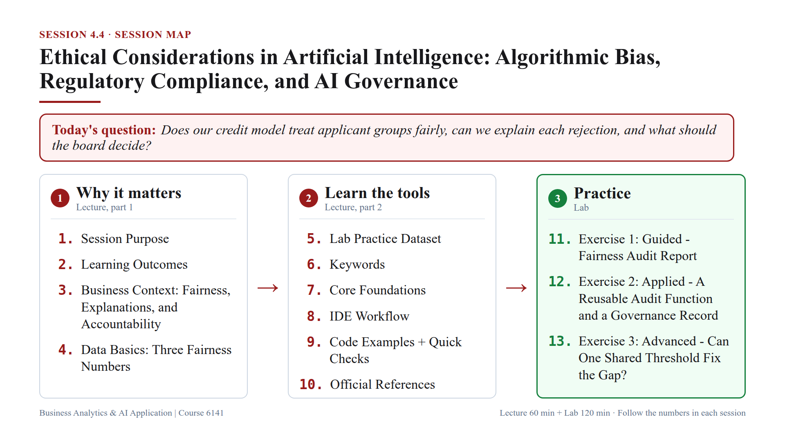

* **Lecture Presentation:** [Download Slides (PDF)](slides/session_04_04_lecture.pdf)
* **Reading (PDF):** [Download Reading (PDF)](handouts/session_04_04_reading.pdf): read before class
* **Schedule:** Week 16 (115/12/27 - 116/01/02) | In-person classes (1:2 Delivery Ratio: 60 Min Lecture + 120 Min Lab)

* **1. Session Purpose:**
  * A consumer lender approves loan applications automatically when its model's approval score is `0.70` or higher
  * Before the model's annual review, the board's risk committee must confirm that it treats applicant groups fairly and that every rejection can be explained to the applicant
  * The chief risk officer asks: does our credit model treat applicant groups fairly, can we explain each rejection, and what should the board decide? Today, you audit the model for fairness, explain its decisions, and prepare the facts the board needs

* **2. Expected Learning Outcomes (By the end of this session, you will be able to):**
  1. "Are the groups treated alike?": measure approval rates by group and the disparate impact ratio, and test it against the four-fifths rule
  2. "Why was this applicant rejected?": explain each decision with feature contributions (how much each feature pushed the score up or down)
  3. "What should the board decide?": compare one shared threshold's fairness and risk, write a governance record, and fix a `NameError` caused by a variable that only exists inside a function

* **3. Business Context: Fairness, Explanations, and Accountability:**
  * A model learns patterns from past data. If the past was unfair, for example because some groups had less access to credit, the model can repeat that unfairness at scale, without anyone intending it.
  * Two kinds of unfair treatment:
    * **Disparate treatment:** using a person's group directly in the decision, such as a different threshold for each group. In lending, this is prohibited in many countries, including under the US Equal Credit Opportunity Act (ECOA).
    * **Disparate impact:** a rule that treats everyone the same on paper, but approves one group far less often. It is a warning sign that must be investigated and justified.
  * The four-fifths rule: if one group's approval rate is less than 80% (four-fifths) of the most-approved group's rate, the gap needs review. It comes from US employment guidelines (1978) and is widely borrowed as a first screening test. Failing it is a reason to investigate, not proof of discrimination.
  * Explanations are required: US lenders must give rejected applicants the main reasons (an adverse action notice), and the EU AI Act (European Union Artificial Intelligence Act) treats credit scoring of people as high-risk, with duties for documentation, human oversight, and transparency.
  * Governance: the board stays accountable for automated decisions. It needs a written record of what was tested, what was found, and who decided what.

* **4. Data Basics: Three Fairness Numbers:**
  * Approval rate of a group = approved applicants in the group / all applicants in the group.
  * Disparate impact ratio = the lower group's approval rate / the higher group's approval rate. `1.0` means equal rates; below `0.80` fails the four-fifths rule.
  * Feature contribution (for a model that adds up features, like linear regression) = coefficient x (applicant's value - average value). A negative contribution pulled the score down. For such a model, this number is also the feature's SHAP value (SHapley Additive exPlanations, a widely used explanation method).
  * Our approval scores come from a model whose formula we were not given. We fit a linear regression that copies it from the scores (a surrogate model) and explain that copy. It reproduces the scores well (`R-squared` `0.975`), so its explanations are trustworthy for this model.

* **5. Lab Practice Dataset:**
  * File Link: [data/session_04_04_dataset.csv](data/session_04_04_dataset.csv)
  * Audited 16-row loan application dataset (fictional teaching data), one row per applicant, 8 in each group:
    * `Applicant_ID`: Applicant code (e.g., `APP-6001`).
    * `Demographic_Group`: An anonymized protected group, `Group_A` or `Group_B`. A protected group is defined by a characteristic such as race, sex, or age that the law forbids using against an applicant. The model does not use this column; auditors use it only to test fairness.
    * `Credit_Score_Count`: Credit score from a credit bureau (a company that records how people repay debts); higher is better.
    * `Debt_To_Income_Pct`: Monthly debt payments as a share of monthly income (DTI); lower is safer.
    * `Algorithmic_Approval_Score`: The model's score from 0 to 1; approved at `0.70` or higher.
    * `Adverse_Action_Notice_Flag`: `1` if the applicant was rejected and must receive an adverse action notice, else `0`.

* **6. Keywords (Core Programming Concepts):**
  * `Disparate Impact`:
    * What: a rule that approves one group much less often than another, even though it never uses the group
    * Why: the most common way bias enters automated decisions
  * `Disparate Impact Ratio` and the `Four-Fifths Rule`:
    * What: the lower approval rate divided by the higher one, tested against `0.80`
    * Why: a simple, widely used first test of fairness
  * `Disparate Treatment`:
    * What: deciding differently because of a person's group
    * Why: prohibited in lending in many countries, so it can never be the fix
  * `Explainability` (feature contributions, SHAP):
    * What: showing how much each feature pushed a decision up or down
    * Why: applicants, regulators, and managers need reasons, not just scores
  * `Surrogate Model`:
    * What: a simple model fitted to copy a model whose formula is hidden
    * Why: makes a hidden model explainable, as long as the copy is accurate
  * `AI Governance`:
    * What: the rules, records, and people that keep AI decisions accountable
    * Why: the board, not the model, answers for the decisions

* **7. Core Programming & Computational Foundations:**
  * The average of a 0/1 column is the share of `1`s, so `df.groupby("Demographic_Group")["Approved"].mean()` gives each group's approval rate in one line.
  * Feature contributions for every applicant at once: `(df[features] - df[features].mean()) * model.coef_`. pandas subtracts each column's average and multiplies each column by its own coefficient.
  * `.idxmin(axis=1)` looks across the columns of each row and returns the column name with the smallest value, here the feature that pulled the score down the most.
  * Variable scope: a variable created inside a function exists only inside it. Using it outside raises `NameError: name 'ratio' is not defined`. To use a result outside, `return` it and store it: `ratio = approval_audit(df, 0.70)`.

* **8. Development Workflow in Google Antigravity IDE:**
  * `[1]` File Explorer: create your script with your name and the session code (for example, `Reacher_S44_demo_1.py`), and check the dataset is in `data/`.
  * `[2]` Code Editor: write a few lines, run, repeat. Small steps keep errors small.
  * `[3]` AI Agent Chat: on an error, capture the traceback (Python's error report) with `Win + Shift + S` (macOS: `Cmd + Shift + 4`), paste it with `Ctrl + V`, and ask why it failed.
  * `[4]` Terminal: run `python` followed by your script name. Return code `0` means the script finished with no errors.

* **9. Hands-On Coding Micro-Examples:**
  * Every example has three parts: **1. Input**, **2. Process**, and **3. Output**. Name each file with your own name and the session code, for example `Reacher_S44_demo_1.py` (pattern: `YourName_S44_demo_1.py`).
  * *Micro-Example 1 (Approval Rates and the Four-Fifths Rule):* `YourName_S44_demo_1.py`
    ```python
    # 1. Input: the 16 applications
    import pandas as pd
    df = pd.read_csv("data/session_04_04_dataset.csv")

    # 2. Process: decisions at 0.70, approval rate per group, and the ratio
    df["Approved"] = (df["Algorithmic_Approval_Score"] >= 0.70).astype(int)
    rates = df.groupby("Demographic_Group")["Approved"].mean()
    ratio = rates.min() / rates.max()

    # 3. Output: rates, ratio, and the four-fifths test
    print(rates)
    print(f"Disparate impact ratio: {ratio:.3f}")
    print("Passes the four-fifths rule:", ratio >= 0.80)
    ```
    * `rates.min() / rates.max()` divides the lower approval rate by the higher one, whichever group that is.
    * Result: Group A `0.875` (7 of 8), Group B `0.25` (2 of 8); ratio `0.286`. The model fails the four-fifths rule by a wide margin: the gap must be investigated.
  * *Quick Check 1 (`.map()`):*
    * New tool: `column.map({1: "Approved", 0: "Rejected"})` replaces each value using a dictionary. Why: tables for the board should use words, not codes.
    * Task: add two lines to part **3. Output**: `df["Decision"] = df["Approved"].___({1: "Approved", 0: "Rejected"})` and `print(pd.crosstab(df["Demographic_Group"], df["Decision"]))`
    * Check: Group A: `7` approved, `1` rejected; Group B: `2` approved, `6` rejected.
  * *Micro-Example 2 (Where Does the Gap Come From?):* `YourName_S44_demo_2.py`
    ```python
    # 1. Input: the 16 applications
    import pandas as pd
    df = pd.read_csv("data/session_04_04_dataset.csv")

    # 2. Process: average features and score by group
    profile = df.groupby("Demographic_Group")[
        ["Credit_Score_Count", "Debt_To_Income_Pct", "Algorithmic_Approval_Score"]
    ].mean().round(2)

    # 3. Output: the two group profiles
    print(profile)
    ```
    * Result: Group A averages a credit score of `730.62` and a DTI of `26.58`%; Group B averages `670.00` and `36.05`%. The model never sees the group, but the groups differ on the features it uses, so the approval gap follows.
    * The audit question is therefore not only "is the model biased?" but also "do these feature differences reflect real repayment risk, or past unequal access to credit?" Data alone cannot answer that; people must investigate.
  * *Quick Check 2 (`.T`):*
    * New tool: `table.T` flips a table so that rows become columns. Why: with many measures and few groups, the flipped table is easier to read in a report.
    * Task: in part **3. Output**, change the line to `print(profile._)`
    * Check: the measures are now rows and `Group_A` and `Group_B` are the two columns.
  * *Micro-Example 3 (Explain Each Decision):* `YourName_S44_demo_3.py`
    ```python
    # 1. Input: the 16 applications and the two features
    import pandas as pd
    from sklearn.linear_model import LinearRegression
    df = pd.read_csv("data/session_04_04_dataset.csv")
    features = ["Credit_Score_Count", "Debt_To_Income_Pct"]

    # 2. Process: copy the score with a linear model, then contributions
    surrogate = LinearRegression().fit(df[features], df["Algorithmic_Approval_Score"])
    contributions = (df[features] - df[features].mean()) * surrogate.coef_
    contributions.columns = ["Credit_Score_Effect", "Debt_Ratio_Effect"]
    report = pd.concat([df[["Applicant_ID", "Algorithmic_Approval_Score"]],
                        contributions.round(3)], axis=1)

    # 3. Output: how well the copy fits, then the explanations
    print("Surrogate R-squared:", round(surrogate.score(df[features], df["Algorithmic_Approval_Score"]), 3))
    print(report[df["Algorithmic_Approval_Score"] < 0.70])
    ```
    * `pd.concat([...], axis=1)` places tables side by side, matching rows by their labels.
    * Result: R-squared `0.975`. Every rejected applicant has negative effects; for example `APP-6007`: credit score `-0.176`, debt ratio `-0.073`. The low credit score is the main reason in each case.
  * *Quick Check 3 (`.idxmin(axis=1)`):*
    * New tool: `contributions.idxmin(axis=1)` returns, for each row, the column with the most negative value. Why: that column is the main reason to print on the adverse action notice.
    * Task: add one line at the end of part **2. Process**: `report["Main_Reason"] = contributions.______(axis=1)`
    * Check: the rejected applicants all show `Credit_Score_Effect` as the main reason.

* **10. Official Python Documentation & References:**
  * [European Commission: Regulatory Framework for Artificial Intelligence (EU AI Act)](https://digital-strategy.ec.europa.eu/en/policies/regulatory-framework-ai).
  * [US Consumer Financial Protection Bureau: Equal Credit Opportunity Act (Regulation B)](https://www.consumerfinance.gov/rules-policy/regulations/1002/).
  * [Fairlearn: A Python Toolkit for Assessing and Improving Fairness in AI](https://fairlearn.org/).
  * [Barocas, Hardt, Narayanan: Fairness and Machine Learning: Limitations and Opportunities](https://fairmlbook.org/).

* **11. Exercise 1: Guided Practice - Fairness Audit Report:**
  * *Step 1: Open Script:* In Google Antigravity IDE, create a new script named `YourName_S44_governance.py`, replacing `YourName` with your own name (for example, `Reacher_S44_governance.py`).
  * *Step 2: Audit the Current Threshold:*
    Type the following code:
    ```python
    # 1. Input: the 16 applications
    import pandas as pd
    df = pd.read_csv("data/session_04_04_dataset.csv")

    # 2. Process: decisions, rates, ratio, and a check of the notice flags
    df["Approved"] = (df["Algorithmic_Approval_Score"] >= 0.70).astype(int)
    rates = df.groupby("Demographic_Group")["Approved"].mean()
    ratio = rates.min() / rates.max()
    notices_match = ((1 - df["Approved"]) == df["Adverse_Action_Notice_Flag"]).all()

    # 3. Output: the audit findings
    print(f"Group A approval: {rates['Group_A'] * 100:.1f}% | "
          f"Group B approval: {rates['Group_B'] * 100:.1f}%")
    print(f"Disparate impact ratio: {ratio:.3f}")
    if ratio < 0.80:
        print("ALERT: fails the four-fifths rule; investigate before the next review.")
    else:
        print("Passes the four-fifths rule.")
    print("Every rejected applicant is flagged for a notice:", notices_match)
    ```
    * `1 - df["Approved"]` turns approved (`1`) into `0` and rejected (`0`) into `1`, matching the notice flag.
  * *Step 3: Interpret:* In two comment lines, explain why failing the four-fifths rule calls for an investigation, and why it does not by itself prove the model discriminates.
  * *Step 4: Execute in Terminal:* Run `python YourName_S44_governance.py` in Panel `[4]` and confirm return code `0`.
  * *Success Check:* `Group A approval: 87.5% | Group B approval: 25.0%`; ratio `0.286`; the alert line prints; `Every rejected applicant is flagged for a notice: True`.

* **12. Exercise 2: Applied Practice - A Reusable Audit Function and a Governance Record:**
  * *Coding Challenge:* In `YourName_S44_practice.py`, turn the audit into a function and save a governance record for the board.
  * *Task 1 (Audit Function):* Write `approval_audit(df, threshold)` that computes the approval rates and `ratio` at any threshold, exactly as in Exercise 1.
  * *Task 2 (Read the NameError & AI Diagnosis):* Call `approval_audit(df, 0.70)`, then write `print(ratio)` on the next line, outside the function. The script stops with `NameError: name 'ratio' is not defined`. Capture the traceback with `Win + Shift + S`, paste it into Panel `[3]` (AI Agent Chat) with `Ctrl + V`, and ask why a variable made inside a function cannot be seen outside it.
  * *Task 3 (Return, Record, Save):* Make the function end with `return rates, ratio`, and call it as `rates, ratio = approval_audit(df, 0.70)`. Build a one-row governance record with `pd.DataFrame([{...}])` and the keys `Model`, `Threshold`, `Group_A_Rate`, `Group_B_Rate`, `Disparate_Impact_Ratio`, `Passes_Four_Fifths`, and `Status`, where `Model` is `"Credit_Approval_Model_v1"` and `Status` is `"Board review required"` if the test fails. Save it to `data/board_ai_governance_audit.csv` with `index=False`, and print a 3-bullet memo to the board risk committee: finding, evidence, and requested decision.
  * *Success Check:* the record shows `Group_A_Rate` `0.875`, `Group_B_Rate` `0.25`, `Disparate_Impact_Ratio` `0.286`, `Passes_Four_Fifths` `False`, and `Status` `Board review required`; the script ends with return code `0`.

* **13. Exercise 3: Advanced Practice - Can One Shared Threshold Fix the Gap?:**
  * *Goal:* A different threshold for each group would be disparate treatment, so it is not an option. Test whether a **single threshold for everyone** can pass the four-fifths rule, and what it would cost in credit risk. Prepare the trade-off for the board.
  * *What you need:*
    * File: `data/session_04_04_dataset.csv` (described in **5. Lab Practice Dataset**).
    * Script name: `YourName_S44_challenge.py`.
    * Tools you already know: your `approval_audit()` function from Exercise 2, `for` loops, lists of dictionaries, `pd.DataFrame()`, and Boolean masks.
  * *Requirements (follow them in order):*
    1. For each shared threshold in `[0.45, 0.50, 0.55, 0.60, 0.65, 0.70, 0.75, 0.80, 0.85]`, compute: the number approved, the approval rate of each group, the disparate impact ratio (rounded to 3 decimals), and `Risky_Approvals`: approved applicants with a DTI above `35`%, the lender's usual risk limit.
    2. Collect the results in one DataFrame with the columns `Threshold`, `Approved`, `Group_A_Rate`, `Group_B_Rate`, `DI_Ratio`, and `Risky_Approvals`.
    3. Find the **highest** threshold that passes the four-fifths rule, and report its `Risky_Approvals`.
    4. Find the **highest** threshold that passes the four-fifths rule **and** has `0` risky approvals. If there is none, print that clearly.
    5. Write three comment lines for the board: what the threshold can and cannot fix, and two other actions the board could request instead.
  * *New tools for this exercise:*
    * Combining two masks: `approved & (df["Debt_To_Income_Pct"] > 35)` is `True` for applicants who are approved **and** above the risk limit; `.sum()` counts them.
    * Filtering a results table with two conditions: `results[(results["DI_Ratio"] >= 0.80) & (results["Risky_Approvals"] == 0)]`. An empty result has `len()` of `0`.
    * Guarding a division: if a group has no approvals at all, its rate is `0`, and the ratio is `0`; check `rates.max() > 0` before dividing.
  * *Hints:*
    * Reuse `approval_audit()` inside the loop, so every threshold is tested the same way.
    * Print the full table before answering requirements 3 and 4; the pattern is easier to see.
  * *Self-Check (expected results):*
    * Ratios: `0.45` `1.000`, `0.50` `0.875`, `0.55` `0.625`, `0.60` `0.500`, `0.65` `0.250`, `0.70` `0.286`, and `0.000` from `0.75` upward.
    * Highest passing threshold: `0.50`, with 15 of 16 applicants approved and `3` risky approvals (DTI above 35%).
    * No threshold passes the rule with `0` risky approvals.
    * Business meaning: moving one threshold either fails the fairness test or approves applicants above the lender's risk limit. The threshold cannot fix the gap, because the gap comes from the features themselves. The board should instead ask for an investigation of the features (do credit scores and DTI measure real repayment risk equally well for both groups?), consider additional data such as rent and utility payment history, and require human review of rejected applications near the threshold, with every decision documented.
