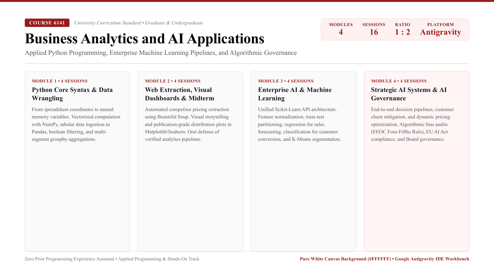

# Business Analytics and AI Application (Course 6141)

## Course Overview

Students in this course will develop a comprehensive understanding of business analytics and artificial intelligence fundamentals, covering topics such as business requirement analysis, data collection, and machine learning. Designed specifically for undergraduate and Master of Business Administration (MBA) students with zero prior programming background, this course emphasizes intuitive, evidence-based reasoning over abstract theoretical complexity.

Through hands-on exercises, students gain operational proficiency in Python programming, progressing from core syntax to intermediate techniques essential for enterprise data projects. Students acquire data manipulation skills using foundational libraries including NumPy and Pandas for data cleaning, aggregation, and financial visualization. They also master automated web data extraction techniques using HyperText Markup Language (HTML), Cascading Style Sheets (CSS), and Beautiful Soup to collect public competitor intelligence. 

With an introduction to modern machine learning tools through Scikit-Learn, participants learn to implement, interpret, and evaluate predictive models. Ethical considerations in artificial intelligence projects, algorithmic risk management, and governance frameworks are examined to ensure the responsible application of these analytical technologies.

## Development Environment and AI Error Protocol

All sessions use Google Antigravity IDE with four workspace panels: `[1] File Explorer`, `[2] Code Editor`, `[3] AI Agent Chat`, and `[4] Integrated Terminal`. When an error occurs, students identify the error type in Panel `[4]`, capture the traceback with `Windows Key + Shift + S` or `Command + Shift + 4`, paste it into Panel `[3]`, review the explanation, apply the verified fix in Panel `[2]`, and confirm an error-free execution with return code 0. Session 1.1 provides the complete orientation; every later lab applies the same workflow.

If you cannot yet install Python packages, use the Terminal, or read an error message, work through the [Python Setup Clinic (PDF)](python_setup_clinic.pdf) ([web version](python_setup_clinic.md)): a self-study guide for Mac and Windows with 10 exercises, ending with running a TensorFlow image classifier. Submit the exercises as homework with the [Word template](python_setup_clinic_homework.docx). Everyone uses Python 3.13 (Intel Mac: 3.12): TensorFlow does not yet support Python 3.14 or 3.15.

## Table of Contents

* **Module 1: Foundations of Business Analytics and Python Programming**
  * [Session 1.1: Business Analytics Architecture, Google Antigravity IDE Initialization, and Core Arithmetic](#session-01-01)
  * [Session 1.2: Essential Python Syntax Completion: Control Flow, Collections, and Business Automation](#session-01-02)
  * [Session 1.3: Tabular Data Wrangling Part 1: NumPy Arrays, Pandas DataFrames, and CSV Ingestion](#session-01-03)
  * [Session 1.4: Tabular Data Wrangling Part 2: Advanced Filtering, Multi-Segment GroupBy, and Financial Auditing](#session-01-04)
* **Module 2: Web Data Extraction, Visual Dashboards, and Midterm Milestone**
  * [Session 2.1: Web Data Extraction: Scraping Financial and Competitor Intelligence with Beautiful Soup](#session-02-01)
  * [Session 2.2: Business Data Visualization: Exploratory Plotting and Executive Dashboards](#session-02-02)
  * [Session 2.3: Midterm Applied Analytics Formulation Part 1: Problem Structuring and Data Audit](#session-02-03)
  * [Session 2.4: Midterm Analytics Pipeline Defense Part 2: Exploratory Findings and Executive Review](#session-02-04)
* **Module 3: Artificial Intelligence, Machine Learning Fundamentals, and Scikit-Learn**
  * [Session 3.1: Foundations of Artificial Intelligence: Rules, Machine Learning, and Learning from Examples](#session-03-01)
  * [Session 3.2: Preparing Data for Machine Learning: Features, Text, Gaps, Scales, and a Fair Test](#session-03-02)
  * [Session 3.3: Training and Testing a Prediction Model: Fit, Predict, Measure the Error, and Cross-Validate](#session-03-03)
  * [Session 3.4: Classifying and Grouping: Supervised vs. Unsupervised Learning, Thresholds, Precision, and Recall](#session-03-04)
* **Module 4: Strategic AI Integration, Enterprise Decision-Making, and AI Governance**
  * [Session 4.1: Putting a Model to Work: Save It, Score Every Night, Watch for Drift, and Fall Back Safely](#session-04-01)
  * [Session 4.2: Turning Predictions into Money: Profit at Risk, Net Benefit, ROI, and the Best Offer](#session-04-02)
  * [Session 4.3: Setting Prices with Data: Price Elasticity, Profit Simulation, and Clearing Stock Before a Deadline](#session-04-03)
  * [Session 4.4: Is the AI Fair? Auditing a Screening Tool: Group Rates, the Four-Fifths Rule, Explanations, and Governance](#session-04-04)

---

## Module 1: Foundations of Business Analytics and Python Programming

Module 1 establishes the computational foundation for business students. Students learn to translate executive business questions into structured quantitative workflows, set up a standardized Python execution environment, master variables and arithmetic for commercial metrics, control program flow, and inspect tabular corporate filings using Pandas.

<a id="session-01-01"></a>
### Session 1.1: Business Analytics Architecture, Google Antigravity IDE Initialization, and Core Arithmetic

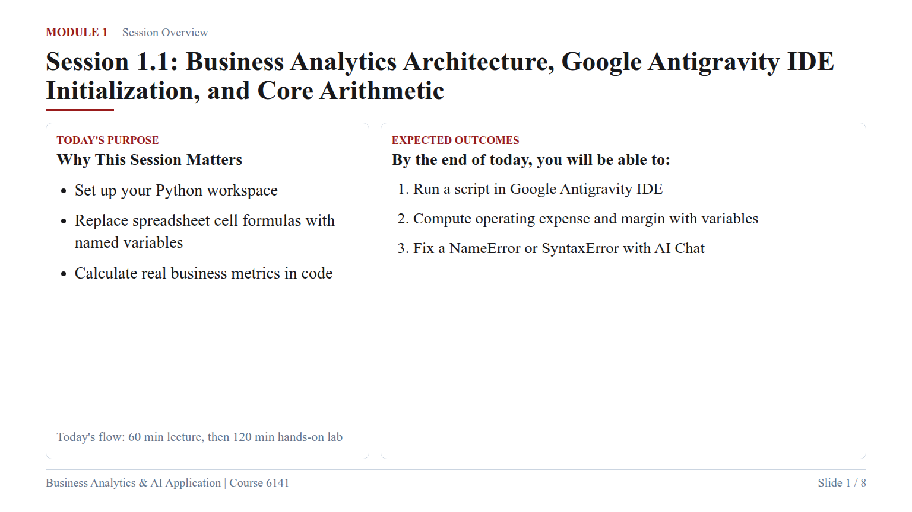

* **Lecture Presentation:** [Download Slides (PDF)](slides/session_01_01_lecture.pdf)
* **Reading (PDF):** [Download Reading (PDF)](handouts/session_01_01_reading.pdf): read before class
* **Schedule:** Week 1 (115/09/13 - 115/09/19) | In-person classes (1:2 Delivery Ratio: 60 Min Lecture + 120 Min Lab)

* **Session Purpose:**
  * Set up your Python workspace
  * Replace spreadsheet cell formulas with named variables
  * Calculate real business metrics in code
* **Expected Learning Outcomes (By the end of this session, you will be able to):**
  1. Run a script in Google Antigravity IDE
  2. Compute operating expense and margin with variables
  3. Fix a NameError or SyntaxError with AI Chat

* **Keywords (Core Programming Concepts):**
  * `Python Interpreter`: The computational engine that reads Python source code and executes instructions sequentially line-by-line in real time without requiring compilation.
  * `Variable Assignment`: Storing data in computer memory using an assignment operator (`=`) and an intuitive descriptive label (such as `net_sales = 574785.0`), replacing fragile cell coordinates like `C13`.
  * `Primitive Data Types`: The foundational categories of information processed by Python: whole numbers (`int`), decimal numbers (`float`), and text strings (`str`).
  * `Traceback & Exception`: The automatic diagnostic navigation report generated by Python when an instruction violates a syntax or runtime rule, pinpointing the exact file and line number.
  * `Integrated Development Environment (IDE)`: A unified software workstation (Google Antigravity IDE) providing an editor, execution terminal, file explorer, and integrated AI assistant in a single interface.

* **Core Programming & Computational Foundations:**
  * Sequential Execution & Program State: Python executes code strictly line-by-line from top to bottom. Unlike spreadsheets where formulas across sheets can trigger circular reference loops, Python code maintains a clear, linear flow where each statement computes or alters memory state sequentially.
  * Cell Coordinate Formulas vs. Descriptive Variables: Transitioning from Excel spatial grid thinking (such as `=C13-E13`) to self-documenting computational recipes (`operating_expense = net_sales - operating_income`). Code variables retain clear business meaning and eliminate silent formula drift.
  * Interpreter Diagnostics & Traceback Mechanics: Python acts as an interactive assistant. When a syntax or naming rule is violated, Python pauses and outputs a Traceback pointing to the exact line number and cause, turning errors into immediate learning signals rather than system failures.

* **Hands-On Coding Micro-Examples:**
  * *Micro-Example 1 (Variable Arithmetic):* Defining commercial numbers (`net_sales = 574785.0`, `operating_income = 36852.0`) and calculating Operating Expense and Operating Margin Percentage with standard math operators (`-`, `/`, `*`).
  * *Micro-Example 2 (Dynamic Parameter Reusability):* Changing a single baseline assumption (such as revising sales tax or discounting prices by 5%) and observing how Python recalculates all downstream figures instantaneously without manual cell dragging.
  * *Micro-Example 3 (Traceback Troubleshooting & AI Fix):* Creating an intentional variable typo (`netsales` instead of `net_sales`), observing the `NameError` in the terminal, capturing it with `Windows Key + Shift + S`, and pasting into the AI chat to verify how the co-pilot identifies the typo and supplies the correction.

* **Lab Practice Dataset:**
  * File Link: [data/session_01_01_dataset.csv](data/session_01_01_dataset.csv)
  * Simple 4-row tabular financial dataset used to verify calculations:
    * `Segment_Name`: North America, International, AWS, Consolidated Total.
    * `Net_Sales_USD_M`: Revenue in millions of U.S. Dollars.
    * `Operating_Income_USD_M`: Operating income in millions of U.S. Dollars.

* **Official Python Documentation & References:**
  * [Python 3.12 Official Tutorial: Using Python as an Interactive Calculator](https://docs.python.org/3/tutorial/introduction.html#using-python-as-a-calculator).
  * [PEP 8: Style Guide for Python Code (Readability and Variable Naming Standards)](https://peps.python.org/pep-0008/).
  * [Google Antigravity IDE Quickstart: Workspace Panels and AI Pair Programming](https://antigravity.google/docs).

* **Integrated Development Environment Architecture (Google Antigravity IDE):**
  * Students use Google Antigravity IDE, a modern AI-powered development environment designed for business analytics, financial modeling, and collaborative data science.
  
  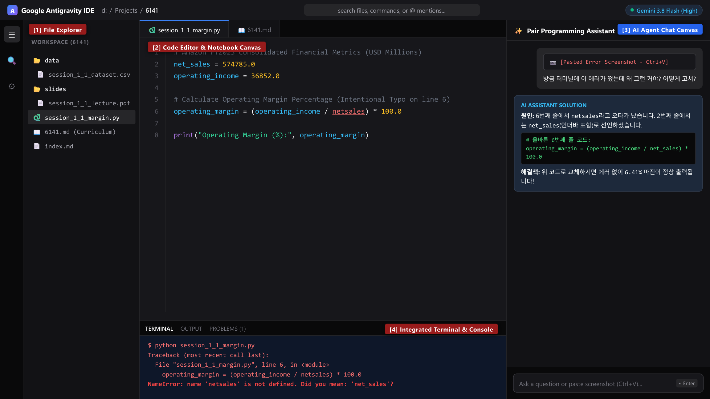

  * **The 4 Workspace Panels:**
    * `[1] File Explorer (Left Panel):` Workspace file hierarchy. Used to organize corporate datasets (`data/`), slide decks (`slides/`), Python scripts (`.py`), and curriculum documentation (`.md`).
    * `[2] Code Editor & Notebook Canvas (Center Top):` Primary workspace for writing Python code, defining financial variables, and executing arithmetic business formulas.
    * `[3] AI Agent Chat Canvas (Right Panel):` An interactive AI pair-programming assistant powered by Gemini. Students paste code snippets or error screenshots directly into this window to receive plain-English root cause explanations and verified code corrections.
    * `[4] Integrated Terminal & Console (Center Bottom):` Command line interface running the Python execution kernel. Displays script output results and detailed system error tracebacks.

  * **AI Error Diagnosis Protocol (Capture and Resolve in Seconds):**
    * *Zero Fear Principle:* In Python, an error is not a system failure or a test penalty. It is simply a diagnostic navigation clue (Traceback) showing the exact line number and rule violation.
    * *Step A (Identify):* When code execution stops, look at the last line in Panel `[4]` (Terminal), which names the error type (e.g., `NameError`, `SyntaxError`, `TypeError`).
    * *Step B (Capture):* Take a fast screen capture of the error message using `Windows Key + Shift + S` (Windows) or `Command + Shift + 4` (macOS).
    * *Step C (Paste & Prompt):* Click inside Panel `[3]` (AI Agent Chat), press `Ctrl + V` to attach the captured image, and ask: *"Why did this error happen, and what is the exact corrected code?"*
    * *Step D (Apply):* Review the AI explanation, understand the typo or missing parenthesis, and copy the verified fix back into Panel `[2]`.

* **Step-by-Step Lab Protocol (Exercise 1: Foundational Practice):**
  * *Step 1: Open Environment & Dataset:* Launch Google Antigravity IDE. Place `data/session_01_01_dataset.csv` in your working directory and open the raw file via Panel `[1]` (File Explorer) to observe comma-separated tabular records.
  * *Step 2: Inspect Primary Sources & Financial Terminology:* Confirm against Note 15 of Amazon's Form 10-K that Consolidated Net Sales for FY2023 equaled `$574,785` million and Operating Income equaled `$36,852` million.
  * *Step 3: Define Variables and Execute First Python Calculations:*
    In your first Python notebook cell, type the following arithmetic statements and run the cell:
    ```python
    # Amazon Consolidated Financial Metrics for FY2023 (in USD Millions)
    net_sales = 574785.0
    operating_income = 36852.0

    # Calculate Operating Expenses
    operating_expense = net_sales - operating_income

    # Calculate Operating Margin Percentage
    operating_margin_pct = (operating_income / net_sales) * 100.0

    print("Operating Expense (USD M):", operating_expense)
    print("Operating Margin (%):", round(operating_margin_pct, 2))
    ```
  * *Step 4: Bridge Excel Spreadsheet Mechanics to Python Code:*
    * In Microsoft Excel, if `Net_Sales` is in cell `C13` (`574785.00`) and `Operating_Income` is in cell `E13` (`36852.00`), the expense formula in cell `D13` is `=C13-E13`, and the margin formula in cell `F13` is `=(E13/C13)*100`.
    * Notice that Python variable assignment (`operating_income / net_sales`) performs the identical mathematical operation as cell references, but uses memorable descriptive English words instead of abstract grid coordinates like `E13`.
  * *Step 5: Compare Segment Profitability:*
    Execute a comparative calculation for Amazon Web Services (AWS) in FY2023:
    ```python
    aws_sales = 90757.0
    aws_income = 24631.0
    aws_margin_pct = (aws_income / aws_sales) * 100.0
    print("AWS Operating Margin (%):", round(aws_margin_pct, 2))
    ```
    Confirm that the AWS operating margin (`27.14%`) is over four times higher than the consolidated corporate operating margin (`6.41%`), demonstrating how cloud infrastructure drives corporate operating cash flow.

* **Step-by-Step Applied Coding Practice (Exercise 2+: Hands-On Programming & Debugging):**
  * *Coding Challenge:* In Google Antigravity IDE, create a new script named `session_1_1_practice.py` to calculate financial metrics across multiple business units and practice error debugging.
  * *Task 1 (Segment Margin Calculation):* Define variables for Amazon Web Services (AWS) using FY2023 figures (`aws_sales = 90757.0`, `aws_income = 24631.0`). Compute `aws_margin_pct` and print the formatted result with `round(..., 2)`.
  * *Task 2 (Intentional Syntax Error & AI Diagnosis):* Deliberately omit the closing parenthesis in your `print()` statement (e.g., `print("AWS Margin:", round(aws_margin_pct, 2)`). Run the script in Panel `[4]` (Terminal), observe the `SyntaxError`, capture the terminal message using `Windows Key + Shift + S`, paste it into Panel `[3]` (AI Agent Chat) with `Ctrl + V`, and verify the AI's explanation and fix.
  * *Task 3 (Multi-Unit Comparison Output):* Combine consolidated and cloud margin calculations into a single clean script that prints both metrics formatted with labels. Verify that the script executes with return code 0.

---

<a id="session-01-02"></a>
### Session 1.2: Essential Python Syntax Completion: Control Flow, Collections, and Business Automation

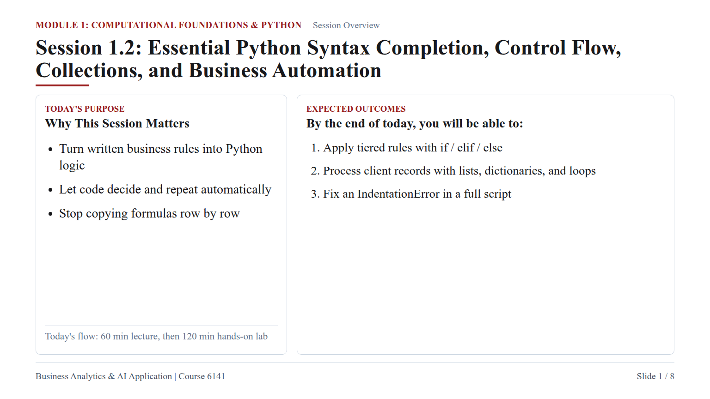

* **Lecture Presentation:** [Download Slides (PDF)](slides/session_01_02_lecture.pdf)
* **Reading (PDF):** [Download Reading (PDF)](handouts/session_01_02_reading.pdf): read before class
* **Schedule:** Week 2 (115/09/20 - 115/09/26) | In-person classes (1:2 Delivery Ratio: 60 Min Lecture + 120 Min Lab)

* **Session Purpose:**
  * Turn written business rules into Python logic
  * Let code decide and repeat automatically
  * Stop copying formulas row by row
* **Expected Learning Outcomes (By the end of this session, you will be able to):**
  1. Apply tiered rules with if / elif / else
  2. Process client records with lists, dictionaries, and loops
  3. Fix an IndentationError in a full script

* **Keywords (Core Programming Concepts):**
  * `Boolean Expression`: A logical comparison that evaluates strictly to `True` or `False`, used by computers to test commercial conditions (such as `annual_spend >= 50000.0`).
  * `Conditional Branching (else)`: Directing code execution down distinct logical pathways depending on operational thresholds, eliminating complex spreadsheet nested logic.
  * `List Collection`: An ordered, mutable sequence of business records enclosed in square brackets (e.g., `daily_orders = [120, 85, 94, 142]`), indexed sequentially starting from zero.
  * `Dictionary Collection`: A key-value associative data structure enclosed in curly braces (e.g., `{"client_id": "CUST-101", "annual_spend_USD": 145000.0}`), enabling instant data retrieval by descriptive business keys rather than numeric indices.
  * `Definite Iteration (for loop)`: A programmatic control structure that automatically iterates over every record in a collection, executing identical business rules across thousands of entries in milliseconds.

* **Core Programming & Computational Foundations:**
  * Eliminating Fragile Nested Spreadsheets: In Excel, multi-tier decision policies require nested formulas such as `=IF(C2>100000, "Platinum", IF(C2>50000, "Gold", IF(C2>20000, "Silver", "Standard")))`. These formulas quickly become unreadable, impossible to audit, and vulnerable to formula drift. In Python, conditional branching (`if-elif-else`) structures business rules into clean vertical indentation blocks that mirror managerial decision trees.
  * Deterministic Repetition over Human Fatigue: When processing transactional ledgers with thousands of rows, human analysts experience fatigue, eye strain, and copy-paste errors. A Python `for` loop executes repetitive calculations across 10 records or 1,000,000 records with identical mathematical precision and zero cognitive degradation.
  * Real-World Entity Modeling with Dictionaries: Modeling complex commercial entities as structured computational objects. A single customer account is captured as a dictionary of labeled attributes (name, industry, spend, risk score), while an enterprise client portfolio is structured as an iterable list of dictionaries.
  * Indentation as Syntax Structure (The Whitespace Discipline): Unlike older programming languages that use curly brackets `{}` or `BEGIN/END` tokens, Python enforces clean code formatting through whitespace indentation (4 spaces). An `IndentationError` occurs when code blocks are misaligned, serving as an automated guardrail for code readability.

* **Hands-On Coding Micro-Examples:**
  * *Micro-Example 1 (Conditional Customer Tiering):*
    Evaluating client annual spend to determine customer loyalty tiers and discount rates:
    ```python
    annual_spend = 82000.0

    if annual_spend >= 100000.0:
        tier = "Platinum"
        discount_rate = 0.15
    elif annual_spend >= 50000.0:
        tier = "Gold"
        discount_rate = 0.10
    elif annual_spend >= 20000.0:
        tier = "Silver"
        discount_rate = 0.05
    else:
        tier = "Standard"
        discount_rate = 0.0

    print(f"Customer Tier: {tier} | Approved Discount: {discount_rate * 100:.0f}%")
    ```
  * *Micro-Example 2 (Iterative Revenue Accumulation):*
    Looping through a list of daily store sales to calculate cumulative revenue and average daily performance:
    ```python
    daily_sales = [4200.0, 5100.0, 3900.0, 6200.0, 7800.0, 8400.0, 4900.0]
    total_revenue = 0.0

    for sale in daily_sales:
        total_revenue += sale

    avg_daily_sales = total_revenue / len(daily_sales)
    print("Total Weekly Revenue (USD):", round(total_revenue, 2))
    print("Average Daily Sales (USD):", round(avg_daily_sales, 2))
    ```
  * *Micro-Example 3 (Dictionary Client Profile & Safe Retrieval):*
    Storing commercial account attributes in a dictionary and computing available credit limits:
    ```python
    client = {
        "client_id": "CUST-104",
        "company_name": "Apex Logistics",
        "annual_spend_USD": 215000.0,
        "credit_limit_USD": 75000.0,
        "outstanding_balance_USD": 23400.0
    }

    available_credit = client["credit_limit_USD"] - client["outstanding_balance_USD"]
    print(f"{client['company_name']} Available Credit: ${available_credit:,.2f}")
    ```

* **Lab Practice Dataset:**
  * File Link: [data/session_01_02_dataset.csv](data/session_01_02_dataset.csv)
  * Standard 10-row commercial client dataset used for batch automation and loop exercises:
    * `Customer_ID`: Unique client identification code (e.g., `CUST-101`).
    * `Industry_Segment`: Commercial vertical (Retail, Technology, Healthcare, Finance, Manufacturing).
    * `Annual_Spend_USD`: Total historical purchase volume in U.S. Dollars.
    * `Order_Count`: Total orders completed in the fiscal year.
    * `Avg_Order_Value_USD`: Average transaction size in U.S. Dollars.
    * `Payment_Terms_Days_Count`: Invoiced credit settlement period (30, 60, 90 days).
    * `Risk_Score_Count`: Internal risk assessment index (1 to 100).

* **Official Python Documentation & References:**
  * [Python 3.12 Official Tutorial: More Control Flow Tools (if Statements and for Loops)](https://docs.python.org/3/tutorial/controlflow.html).
  * [Python 3.12 Official Tutorial: Data Structures (Lists, Dictionaries, and Tuples)](https://docs.python.org/3/tutorial/datastructures.html).
  * [PEP 8: Style Guide for Python Code (Indentation and Whitespace Standards)](https://peps.python.org/pep-0008/#indentation).

* **Step-by-Step Lab Protocol (Exercise 1: Guided Practice - Client Portfolio Automation):**
  * *Step 1: Create Practice File:* Launch Google Antigravity IDE and create a new script named `session_1_2_automation.py` in your working directory.
  * *Step 2: Build a Client Portfolio List:*
    Define an iterable list of customer dictionaries containing audited client records from `data/session_01_02_dataset.csv`:
    ```python
    clients = [
        {"id": "CUST-101", "segment": "Retail", "spend": 145000.0, "risk": 15},
        {"id": "CUST-102", "segment": "Technology", "spend": 82000.0, "risk": 22},
        {"id": "CUST-103", "segment": "Healthcare", "spend": 31000.0, "risk": 38},
        {"id": "CUST-104", "segment": "Finance", "spend": 215000.0, "risk": 12},
        {"id": "CUST-105", "segment": "Manufacturing", "spend": 64000.0, "risk": 45}
    ]
    ```
  * *Step 3: Automate Tier Assignment and Credit Multiplier via for Loop:*
    Write a `for` loop that iterates over each client, applies conditional branching based on `spend`, and computes an approved credit limit:
    ```python
    for c in clients:
        # Tiering logic based on annual purchase volume
        if c["spend"] >= 100000.0 and c["risk"] < 30:
            c["tier"] = "Platinum"
            c["credit_limit"] = c["spend"] * 0.40
        elif c["spend"] >= 50000.0 and c["risk"] < 50:
            c["tier"] = "Gold"
            c["credit_limit"] = c["spend"] * 0.25
        else:
            c["tier"] = "Standard"
            c["credit_limit"] = c["spend"] * 0.10

        print(f"Client {c['id']} ({c['segment']}): Tier={c['tier']} | Credit Limit=${c['credit_limit']:,.2f}")
    ```
  * *Step 4: Execute and Verify Output in Terminal:*
    Run the script in Panel `[4]` (Terminal) using `$ python session_1_2_automation.py`. Confirm that all 5 client accounts are evaluated and printed with proper credit limits.

* **Step-by-Step Applied Coding Practice (Exercise 2+: Hands-On Programming & AI Debugging):**
  * *Coding Challenge:* In Google Antigravity IDE, create a new script named `session_1_2_practice.py` to automate a multi-tier commercial commission payout pipeline.
  * *Task 1 (Tiered Commission Functionality):*
    A sales team records quarterly sales volumes: `sales_reps = [{"name": "Alice", "revenue": 142000.0}, {"name": "Bob", "revenue": 68000.0}, {"name": "Charlie", "revenue": 35000.0}]`. Write a loop calculating commission payouts: `12%` for revenue over `$100,000`, `8%` for revenue between `$50,000` and `$100,000`, and `5%` for revenue below `$50,000`.
  * *Task 2 (Deliberate IndentationError & AI Diagnosis):*
    Intentionally misalign one line inside the `if` block (e.g., adding 2 extra spaces or removing indentation). Run the script in Panel `[4]` (Terminal), observe the red `IndentationError: unexpected indent`, capture the terminal traceback with `Windows Key + Shift + S`, paste the image into Panel `[3]` (AI Agent Chat) with `Ctrl + V`, and review how the AI explains whitespace alignment.
  * *Task 3 (Dictionary Summary Output):*
    Correct the indentation, append the calculated `commission_payout` back into each rep's dictionary, and print a formatted compensation summary with zero syntax errors. Verify that the script terminates with return code 0.


<a id="session-01-03"></a>
### Session 1.3: Tabular Data Wrangling Part 1: NumPy Arrays, Pandas DataFrames, and CSV Ingestion

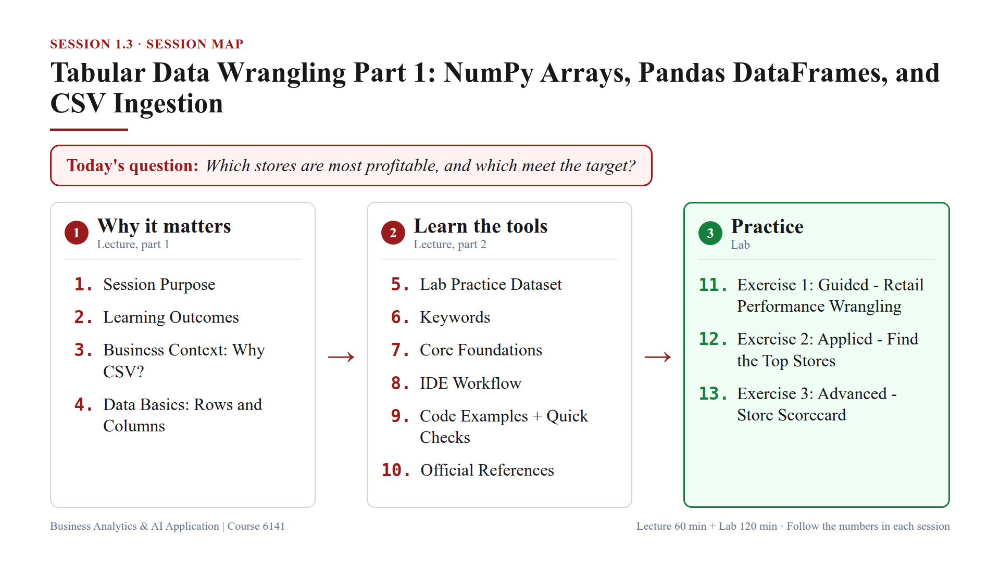

* **Lecture Presentation:** [Download Slides (PDF)](slides/session_01_03_lecture.pdf)
* **Reading (PDF):** [Download Reading (PDF)](handouts/session_01_03_reading.pdf): read before class
* **Schedule:** Week 3 (115/09/27 - 115/10/03) | In-person classes (1:2 Delivery Ratio: 60 Min Lecture + 120 Min Lab)

* **1. Session Purpose:**
  * Business systems (sales registers, accounting, customer databases, Excel) share tables as Comma-Separated Values (CSV) files
  * Our case: a retail chain exports monthly results for its 12 stores as a CSV file
  * Each row holds one store's sales, costs, visitors, and customer rating
  * Your manager asks: which stores are most profitable, and which meet the target? Today, Python answers these questions for every store at once

* **2. Expected Learning Outcomes (By the end of this session, you will be able to):**
  1. "Did the store data load correctly?": read and inspect a `DataFrame` (a table in Python, like one Excel sheet)
  2. "What is each store's profit margin?": create new columns with vectorized math (one formula runs on every row at once)
  3. "Which stores meet our target?": filter rows with `.loc[]` (keep rows that match a condition) and fix a `KeyError` (the column name does not exist)

* **3. Business Context: Why CSV?**
  * Where business data comes from: sales registers, the accounting system, the customer database, and Excel reports. Each system can export its tables as one shared file.
  * `.xlsx` (Excel file) vs `.csv` (CSV file):

    | | `.xlsx` Excel file | `.csv` CSV file |
    |---|---|---|
    | Format | Packed format | Plain text |
    | What you need to open it | A spreadsheet program such as Excel | Almost anything: Notepad, Excel, Google Sheets, Python `pandas`, AI assistants |
    | Opened in Notepad | Unreadable symbols (starts with `PK`) | Readable: `Store_ID,Region_Name,Monthly_Sales_USD` |

  * Trade-off: CSV keeps only values, with no formulas and no formatting.

* **4. Data Basics: Rows and Columns:**
  * **Row** (read across): one record. Here, all the facts about one store, such as row `1` = everything about `STR-1001`.
  * **Column** (read down): one type of information for every store, such as `Monthly_Sales_USD`. In pandas, one column is a `Series`.
  * **Cell:** one value where a row and a column meet, such as `185000.0`.
  * Size of a table: `df.shape` returns `(12, 6)` = 12 rows, 6 columns. Row labels (the `index`) start at `0`, not 1.

* **5. Lab Practice Dataset:**
  * File Link: [data/session_01_03_dataset.csv](data/session_01_03_dataset.csv)
  * Audited 12-row commercial store dataset used for vector arithmetic and filtering:
    * `Store_ID`: Unique retail location code (e.g., `STR-1001`).
    * `Region_Name`: Geographic division (East, West, North, South).
    * `Monthly_Sales_USD`: Gross store revenue in U.S. Dollars.
    * `Operating_Cost_USD`: Monthly operational store overhead in U.S. Dollars.
    * `Customer_Footfall_Count`: Total monthly foot traffic count.
    * `Customer_Satisfaction_Score`: Customer review rating (1.0 to 5.0 scale).

* **6. Keywords (Core Programming Concepts):**
  * `pandas` and `NumPy`:
    * What: free Python libraries for tables (`pandas`) and fast number arrays (`NumPy`)
    * Why: they sort, filter, and calculate tables of any size
  * `CSV file` and `pd.read_csv()`:
    * What: a plain-text table where commas separate values; `pd.read_csv()` loads it
    * Why: most business systems export data as CSV
  * `DataFrame`:
    * What: a whole table in Python, with row labels and column names
    * Why: it is the main object you clean, calculate, and filter
  * `Series`:
    * What: one column of a DataFrame, such as `df["Monthly_Sales_USD"]`
    * Why: most calculations work column by column
  * `Vectorized Computation`:
    * What: one formula applied to every row at once, with no loop
    * Why: fast, and nothing to drag down row by row
  * `.loc[]` vs `.iloc[]`:
    * What: `.loc[]` selects by label or condition; `.iloc[]` selects by position number
    * Why: pull out exactly the rows a question needs
    * Example: `df.loc[df["Region_Name"] == "West"]` keeps the West rows; `df.iloc[0:2]` keeps rows 0 and 1 (`0:2` starts at 0 and stops **before** 2)

* **7. Core Programming & Computational Foundations:**
  * **7.1 Columns, not cells: one formula for every row**
    * *The idea:* In Excel, a formula lives in one cell. To calculate the margin of 12 stores, you type the formula once and drag it down, which creates 12 separate copies, one per row. In pandas, a calculation is written once for a whole column, and pandas applies it to every row at the same time. This is called vectorized computation: the formula works on the whole column (a "vector" of values) instead of cell by cell.
    * *See it on real data:* operating margin for the first 3 stores.

      | | Excel | pandas |
      |---|---|---|
      | What you write | `=(C2-D2)/C2*100` in `E2`, then drag down to `E13` | `df["Operating_Margin_Pct"] = (df["Monthly_Sales_USD"] - df["Operating_Cost_USD"]) / df["Monthly_Sales_USD"] * 100` |
      | How many formulas exist | 12, one per row | 1, for the whole column |
      | `STR-1000` | `30.99` | `30.985915` |
      | `STR-1001` | `34.05` | `34.054054` |
      | `STR-1002` | `27.55` | `27.551020` |

    * *Common mistake (in Excel):* someone types a number over `E5`, for example to "fix" a value for a meeting. That row's formula is gone, the cell still looks normal, and next month's report is wrong without any warning sign that catches the eye. In pandas there is no per-row copy to overwrite: the next run recalculates every row from the data.
    * *More examples:*

      | Code | Result | What it tells you |
      |---|---|---|
      | `df["Monthly_Sales_USD"] - df["Operating_Cost_USD"]` | `44000.0` for `STR-1000` | operating profit for every store |
      | `df["Monthly_Sales_USD"] / df["Customer_Footfall_Count"]` | `11.45` for `STR-1000` | sales per visitor: what an average visitor spends |
      | `df["Operating_Cost_USD"] / df["Monthly_Sales_USD"] * 100` | `69.01` for `STR-1000` | cost as a share of sales, in percent |
      | `df["Monthly_Sales_USD"] * 1.05` | `149100.0` for `STR-1000` | a "what if sales grew 5%?" scenario |
      | `df["Monthly_Sales_USD"] / 1000` | `142.0` for `STR-1000` | sales in thousands, easier to read in a report |

    * *Remember:* write the rule once for the column; pandas applies it to every row.
  * **7.2 Inside a DataFrame: index, columns, and values**
    * *The idea:* A DataFrame has three parts, like a labeled spreadsheet:
      * the **index**: one label per row, shown at the left. By default the labels are `0, 1, 2, ...`, counting from `0`, not `1`;
      * the **columns**: one name per column, shown at the top, such as `Store_ID`;
      * the **values**: the data itself, stored as a NumPy array (a fast block of numbers that pandas uses underneath).
    * *See it on real data:* the first 3 rows as pandas prints them.

      ```text
         Store_ID Region_Name  Monthly_Sales_USD  ...
      0  STR-1000        East           142000.0  ...
      1  STR-1001        West           185000.0  ...
      2  STR-1002       North            98000.0  ...
      ```

      The `0`, `1`, `2` on the left are the index, not data. `STR-1001` is in the row labeled `1`, which is the **second** row.
    * *One column vs a smaller table:* `df["Store_ID"]` (single brackets) returns one column, a `Series`. `df[["Store_ID", "Region_Name"]]` (double brackets: a list inside the brackets) returns a smaller `DataFrame` with the listed columns.
    * *Common mistake:* counting rows from 1. In Python, the first row has position `0`, so "the third row" is position `2`.
    * *More examples:*

      | Code | Result | What it tells you |
      |---|---|---|
      | `type(df["Store_ID"])` | `Series` | single brackets give one column |
      | `df[["Store_ID", "Region_Name"]].shape` | `(12, 2)` | double brackets give a smaller table: 12 rows, 2 columns |
      | `df.columns.tolist()` | `['Store_ID', 'Region_Name', ...]` | the exact column names, to copy instead of typing |
      | `df.index.tolist()` | `[0, 1, 2, ..., 11]` | the row labels start at `0` |
      | `len(df)` | `12` | the number of rows |
      | `df.loc[0, "Store_ID"]` | `'STR-1000'` | one value: row label `0`, column `Store_ID` |

    * *Remember:* index on the left, column names on top, values in between; counting starts at `0`.
  * **7.3 Data types: every column has exactly one type**
    * *The idea:* pandas gives each column one data type (`dtype`), and every value in that column follows it. The type decides what you can do with the column: you can add numbers, but not text.

      | `dtype` | Meaning | Columns in our data |
      |---|---|---|
      | `float64` | decimal numbers | `Monthly_Sales_USD`, `Operating_Cost_USD`, `Customer_Satisfaction_Score` |
      | `int64` | whole numbers | `Customer_Footfall_Count` |
      | `str` | text (older pandas versions show `object`) | `Store_ID`, `Region_Name` |

    * *Why it matters:* if a number is typed with a comma, such as `"1,200"`, pandas cannot read it as a number, so the whole column becomes text. Adding text joins the pieces instead of summing them: a column with `"1,200"` and `"800"` "sums" to `"1,200800"`, not `2000`. In Excel the same value would sit in its cell as text and be quietly skipped by `SUM`.
    * *How to catch it:* run `df.dtypes` right after loading. A sales column showing `str` instead of `float64` means some values were stored as text.
    * *More examples:*

      | Code | Result | What it tells you |
      |---|---|---|
      | `df["Monthly_Sales_USD"].sum()` | `1829000.0` | a number column adds up as numbers |
      | `df["Region_Name"].head(3).sum()` | `'EastWestNorth'` | a text column "adds up" by joining the words |
      | `pd.Series(["1,200", "800"]).sum()` | `'1,200800'` | numbers stored as text are joined, not summed |
      | `pd.Series(["1,200", "800"]).str.replace(",", "").astype(float).sum()` | `2000.0` | remove the comma, convert to `float`, and the sum is right |
      | `df["Customer_Footfall_Count"].mean()` | `13075.0` | an `int64` column works for averages too |

    * *Remember:* check the types first; a number column must show `float64` or `int64`.
  * **7.4 Check before you calculate: four inspection tools**
    * *The idea:* A professional analyst never calculates on data they have not looked at. Four commands answer the first questions about any new file:

      | Command | Question it answers | Result for our file |
      |---|---|---|
      | `df.shape` | How big is the table? | `(12, 6)`: 12 rows, 6 columns |
      | `df.head(3)` | What do the first rows look like? | `STR-1000`, `STR-1001`, `STR-1002` |
      | `df.info()` | What are the types, and are values missing? | `12 non-null` in every column: no gaps |
      | `df.describe()` | What are the typical, smallest, and largest values? | sales: mean `152416.67`, min `89000.0`, max `225000.0` |

    * *Common mistake:* `df.shape` has no brackets, because it is a stored value (an attribute). `df.head()` and `df.info()` do have brackets, because they are actions (methods). Writing `df.shape()` raises `TypeError: 'tuple' object is not callable`.
    * *More examples:*

      | Code | Result | What it tells you |
      |---|---|---|
      | `df["Region_Name"].value_counts()` | `East 3`, `West 3`, `North 3`, `South 3` | how many stores each region has |
      | `df.isnull().sum().sum()` | `0` | the number of empty cells in the whole table |
      | `df["Customer_Satisfaction_Score"].min()` | `3.8` | the lowest rating |
      | `df["Customer_Satisfaction_Score"].max()` | `4.9` | the highest rating |
      | `df["Customer_Satisfaction_Score"].mean()` | `4.35` (rounded) | the average rating |

    * *Remember:* shape, head, info, describe: look first, calculate second.
  * **7.5 Picking rows: by label with `.loc[]`, by position with `.iloc[]`**
    * *The idea:* There are two ways to point at a row. `.loc[]` uses the **label** in the index, or a condition. `.iloc[]` uses the **position**, counting from `0`. On a freshly loaded file the labels and positions are the same, so the two look alike. They differ as soon as the rows are reordered.
    * *See it on real data:* sort the stores by sales, from lowest to highest. The row order changes, but every row keeps its label.

      | Request | Meaning | Result |
      |---|---|---|
      | `sorted_df.loc[1, "Store_ID"]` | the row whose label is `1` | `STR-1001`, wherever it now sits |
      | `sorted_df.iloc[0]["Store_ID"]` | whatever row is now first | `STR-1006`, the lowest sales |

    * *Filtering with `.loc[]`:* `.loc[]` also accepts a condition, such as `df.loc[df["Region_Name"] == "West"]`, and keeps only the rows where the condition is `True`. This is the form you will use most.
    * *Common mistake:* misspelling a column name. `df["Monthly_Sale_USD"]` (missing `s`) raises `KeyError: 'Monthly_Sale_USD'`: pandas looked for a column with that exact name and found none. Copy column names from `df.columns` instead of typing them.
    * *More examples:*

      | Code | Result | What it tells you |
      |---|---|---|
      | `df.loc[df["Region_Name"] == "East", "Store_ID"]` | `STR-1000`, `STR-1004`, `STR-1008` | the East stores: a condition plus one column |
      | `df.loc[df["Customer_Satisfaction_Score"] >= 4.5, "Store_ID"]` | `STR-1001`, `STR-1004`, `STR-1005`, `STR-1008`, `STR-1011` | the 5 best-rated stores |
      | `df.iloc[0]["Store_ID"]` | `'STR-1000'` | the first row |
      | `df.iloc[-1]["Store_ID"]` | `'STR-1011'` | `-1` means the last row |
      | `df.iloc[0:3]["Store_ID"]` | `STR-1000`, `STR-1001`, `STR-1002` | rows at positions 0, 1, 2 (stops before 3) |
      | `df.loc[2, "Region_Name"]` | `'North'` | row label `2`, column by name |
      | `df.iloc[2, 1]` | `'North'` | the same cell by position: row 2, column 1 |

    * *Remember:* `.loc[]` = label or condition; `.iloc[]` = position from `0`.

* **8. Development Workflow in Google Antigravity IDE:**

  

  * `[1]` File Explorer: create your script with your name and the session code (for example, `Reacher_S13_demo_1.py`), and check the dataset is in `data/`.
  * `[2]` Code Editor: write a few lines, run, repeat. Small steps keep errors small.
  * `[3]` AI Agent Chat: on an error, capture the traceback (Python's error report) with `Win + Shift + S` (macOS: `Cmd + Shift + 4`), paste it with `Ctrl + V`, and ask why it failed.
  * `[4]` Terminal: run `python` followed by your script name. Return code `0` means the script finished with no errors.

* **9. Hands-On Coding Micro-Examples:**
  * Every example has three parts: **1. Input** (load the data), **2. Process** (calculate or select), and **3. Output** (print the result).
  * Name each file with your own name and the session code, for example `Reacher_S13_demo_1.py` (pattern: `YourName_S13_demo_1.py`).
  * *Micro-Example 1 (Load a CSV File and Inspect It):* `YourName_S13_demo_1.py`
    ```python
    # 1. Input: load the tool and the data
    import pandas as pd
    df = pd.read_csv("data/session_01_03_dataset.csv")

    # 2. Process: measure the table and take a preview
    dimensions = df.shape
    column_types = df.dtypes
    preview = df.head(3)

    # 3. Output: show the results
    print("Dataset Dimensions (Rows, Columns):", dimensions)
    print("Column Data Types:\n", column_types)
    print(preview)
    ```
    * *How it works, line by line:*
      * `import pandas as pd` loads the pandas library and gives it the short name `pd`, so every pandas tool can be written as `pd.something`.
      * `pd.read_csv(...)` opens the CSV file, reads the first line as column names, and stores the table in a variable named `df` (short for DataFrame). The path `data/...` starts from the project folder.
      * `df.shape`, `df.dtypes`, and `df.head(3)` measure the table, list each column's type, and copy the first 3 rows. Each result is stored in its own variable, so part 3 can print it.
      * `print()` shows a result in the Terminal. A script that calculates without printing shows nothing at all.
    * *Read the output:*

      ```text
      Dataset Dimensions (Rows, Columns): (12, 6)
      Column Data Types:
       Store_ID                           str
      Region_Name                        str
      Monthly_Sales_USD              float64
      ...
         Store_ID Region_Name  ...  Customer_Footfall_Count  Customer_Satisfaction_Score
      0  STR-1000        East  ...                    12400                          4.2
      ```

      * `(12, 6)` means 12 rows (stores) and 6 columns, as expected for this file.
      * The money columns are `float64` (numbers), so you can calculate with them.
      * The `...` in the preview is not missing data: pandas hides middle columns when the table is wider than the Terminal.
  * *Quick Check 1 (`.tail()`):*
    * New tool: `.tail(n)` shows the last `n` rows. Why: new records are often added at the bottom.
    * Task: in part **2. Process**, change `preview = df.head(3)` to `preview = df.____(3)` so it shows the last 3 rows.
    * Check: the preview shows index `9`, `10`, `11` (`STR-1009`, `STR-1010`, `STR-1011`).
  * *Micro-Example 2 (Calculate New Columns Without a Loop):* `YourName_S13_demo_2.py`
    ```python
    # 1. Input: load the store data
    import pandas as pd
    df = pd.read_csv("data/session_01_03_dataset.csv")

    # 2. Process: profit and margin for every store at once
    df["Operating_Profit_USD"] = (
        df["Monthly_Sales_USD"] - df["Operating_Cost_USD"]
    )
    df["Operating_Margin_Pct"] = (
        df["Operating_Profit_USD"] / df["Monthly_Sales_USD"] * 100.0
    )

    # 3. Output: show the first three stores
    print(df[["Store_ID", "Monthly_Sales_USD",
              "Operating_Margin_Pct"]].head(3))
    ```
    * *How it works, line by line:*
      * `df["Monthly_Sales_USD"] - df["Operating_Cost_USD"]` subtracts two columns. pandas lines them up row by row, so each store's cost is subtracted from that same store's sales (section 7.1).
      * `df["Operating_Profit_USD"] = ...` stores the result as a new column. If the name does not exist yet, pandas adds it at the right end of the table.
      * The second calculation uses the new profit column straight away: profit / sales x 100.
      * The round brackets around each calculation only let the formula continue on the next line; they do not change the result.
      * `df[["Store_ID", "Monthly_Sales_USD", "Operating_Margin_Pct"]]` (double brackets) keeps just those 3 columns, and `.head(3)` keeps the first 3 rows.
    * *Read the output:*

      ```text
         Store_ID  Monthly_Sales_USD  Operating_Margin_Pct
      0  STR-1000           142000.0             30.985915
      1  STR-1001           185000.0             34.054054
      2  STR-1002            98000.0             27.551020
      ```

      * `STR-1000`: `(142000 - 98000) / 142000 x 100 = 30.99`%. Of every $100 of sales, about $31 is left as operating profit.
      * `STR-1002` sells the least and also keeps the smallest share as profit (`27.55`%).
      * The long decimals are correct but hard to read; Quick Check 2 rounds them.
  * *Quick Check 2 (`.round()`):*
    * New tool: `.round(n)` rounds every number in a column to `n` decimal places. Why: long decimals such as `30.985915` are hard to read in a report.
    * Task: add one line at the end of part **2. Process**: `df["Operating_Margin_Pct"] = df["Operating_Margin_Pct"].____(1)`
    * Check: the margins print as `31.0`, `34.1`, and `27.6`.
  * *Micro-Example 3 (Filter Rows and Fill Missing Values):* `YourName_S13_demo_3.py`
    ```python
    # 1. Input: load the store data
    import pandas as pd
    df = pd.read_csv("data/session_01_03_dataset.csv")

    # 2. Process: keep West stores with sales of $150,000+
    west_high_sales = df.loc[
        (df["Region_Name"] == "West")
        & (df["Monthly_Sales_USD"] >= 150000.0)
    ]
    #    then fill missing satisfaction scores with the median
    median_score = df["Customer_Satisfaction_Score"].median()
    df["Customer_Satisfaction_Score"] = (
        df["Customer_Satisfaction_Score"].fillna(median_score)
    )

    # 3. Output: show the filtered stores and the median
    print(west_high_sales[["Store_ID", "Monthly_Sales_USD"]])
    print("Median Satisfaction Score Imputed:", median_score)
    ```
    * *How it works, line by line:*
      * `(df["Region_Name"] == "West")` checks every row and gives `True` for West stores and `False` for the others. Note the double `==`: it compares, while a single `=` stores a value.
      * `(df["Monthly_Sales_USD"] >= 150000.0)` gives `True` for stores selling $150,000 or more.
      * `&` combines the two answers row by row: a row is `True` only if both are `True`. Each condition sits in its own brackets so that Python compares first and combines second.
      * `df.loc[...]` keeps the `True` rows and stores them in `west_high_sales`; the original `df` is not changed.
      * `.median()` finds the middle value of the satisfaction scores: half the stores score higher, half lower. `.fillna(median_score)` puts that value into any empty cell (`NaN`, "Not a Number").
    * *Read the output:*

      ```text
         Store_ID  Monthly_Sales_USD
      1  STR-1001           185000.0
      5  STR-1005           175000.0
      9  STR-1009           160000.0
      Median Satisfaction Score Imputed: 4.35
      ```

      * All 3 West stores sell $150,000 or more, so all 3 pass. With a higher limit, such as $170,000, only 2 would. The index labels `1`, `5`, `9` show where each store sat in the original table: filtering keeps the labels.
      * The median of the 12 scores is `4.35`. This dataset has no empty scores, so `.fillna()` changes nothing today, but the same line protects the script when next month's file has gaps.
  * *Quick Check 3 (`len()`):*
    * New tool: `len()` counts items; for a DataFrame, it returns the number of rows. Why: it answers "how many?" questions in one step. Example: `len(df)` returns `12`.
    * Task: add one line to part **3. Output**: `print("Stores found:", ___(west_high_sales))`
    * Check: the Terminal shows `Stores found: 3`.

* **10. Official Python Documentation & References:**
  * [Pandas Official Documentation: 10 Minutes to Pandas](https://pandas.pydata.org/docs/user_guide/10min.html).
  * [Pandas Official Guide: Indexing and Selecting Data (.loc and .iloc)](https://pandas.pydata.org/docs/user_guide/indexing.html).
  * [NumPy Official Documentation: NumPy Quickstart Tutorial](https://numpy.org/doc/stable/user/quickstart.html).

* **11. Exercise 1: Guided Practice - Retail Performance Wrangling:**
  * *Step 1: Open Workspace:* In Google Antigravity IDE, create a new script named `YourName_S13_wrangling.py`, replacing `YourName` with your own name (for example, `Reacher_S13_wrangling.py`). Verify that `data/session_01_03_dataset.csv` is present in Panel `[1]`.
  * *Step 2: Load, Calculate, and Summarize:*
    Type the following Python statements:
    ```python
    # 1. Input: load the store data
    import pandas as pd
    df = pd.read_csv("data/session_01_03_dataset.csv")

    # 2. Process: add profit and margin columns, then summarize
    df["Operating_Profit_USD"] = (
        df["Monthly_Sales_USD"] - df["Operating_Cost_USD"]
    )
    df["Operating_Margin_Pct"] = (
        df["Operating_Profit_USD"] / df["Monthly_Sales_USD"] * 100.0
    )
    summary = df.describe()

    # 3. Output: show summary statistics for sales and margin
    print("Descriptive Financial Statistics:\n",
          summary[["Monthly_Sales_USD", "Operating_Margin_Pct"]])
    ```
    * `.describe()` returns summary statistics: count, mean, standard deviation, min, max, and quartiles.
  * *Step 3: Compare Excel Mechanics with Pandas:*
    * In Excel, you type `=(C2-D2)/C2*100` in cell `E2` and drag it down, so every row gets its own copy of the formula. If someone types a number over `E5`, that row is wrong, and the mistake is easy to miss.
    * In Pandas, one line of `df["Operating_Margin_Pct"]` code covers every row, so there is no copy to overwrite.
  * *Step 4: Execute in Terminal:*
    Run the script via Panel `[4]` (Terminal) using `python YourName_S13_wrangling.py`. Confirm that the summary statistics are printed.

* **12. Exercise 2: Applied Practice - Find the Top Stores:**
  * *Coding Challenge:* In `YourName_S13_practice.py`, find the top stores: `Operating_Margin_Pct >= 30.0` and `Customer_Satisfaction_Score >= 4.5`.
  * *Task 1 (Targeted Filtering):* Use `.loc[]` to select the qualified stores and output only `Store_ID`, `Region_Name`, and `Operating_Margin_Pct`.
  * *Task 2 (Deliberate KeyError & AI Diagnosis):* Deliberately misspell a column name (e.g., `df["Monthly_Sale_USD"]` instead of `"Monthly_Sales_USD"`). Read the `KeyError` (the column name does not exist), capture the traceback with `Win + Shift + S`, paste it into Panel `[3]` (AI Agent Chat) with `Ctrl + V`, and review the AI's explanation.
  * *Task 3 (Clean CSV Export):* Correct the column name, then sort with `.sort_values()`; add `ascending=False` for the highest margin first. Save the table with `.to_csv()` to `data/top_performing_stores.csv`.
  * *Success Check:* the result has 5 stores, led by `STR-1011` (South, 36.89%), and the script ends with return code `0`.

* **13. Exercise 3: Advanced Practice - Store Scorecard:**
  * *Goal:* Build a one-page scorecard that sorts all 12 stores into three tiers, so the regional manager can see at a glance which stores to reward and which to watch.
  * *What you need:*
    * File: `data/session_01_03_dataset.csv` (12 rows, described in **5. Lab Practice Dataset**).
    * Script name: `YourName_S13_challenge.py`.
    * Tools you already know: `pd.read_csv()`, column math, `.round()`, `&`, `.loc[]`, `.sort_values()`, `len()`, and `.to_csv()`.
  * *Requirements (follow them in order):*
    1. Add `Operating_Profit_USD` = `Monthly_Sales_USD` - `Operating_Cost_USD`.
    2. Add `Operating_Margin_Pct` = `Operating_Profit_USD` / `Monthly_Sales_USD` x 100, rounded to 1 decimal place.
    3. Add `Sales_per_Visitor_USD` = `Monthly_Sales_USD` / `Customer_Footfall_Count`, rounded to 2 decimal places. It shows how much an average visitor spends.
    4. Add a `Tier` column using these rules, in this order:
       * Every store starts as `"Standard"`.
       * `"Gold"`: `Operating_Margin_Pct >= 33.0` **and** `Customer_Satisfaction_Score >= 4.5`.
       * `"Watch"`: `Operating_Margin_Pct < 30.0`.
    5. Print how many stores are in each tier, one line per tier, for example `Gold stores: 4`.
    6. Print all 12 stores sorted by `Operating_Margin_Pct`, highest first, showing only `Store_ID`, `Region_Name`, `Operating_Margin_Pct`, `Sales_per_Visitor_USD`, `Customer_Satisfaction_Score`, and `Tier`.
    7. Save the same sorted table to `data/store_scorecard.csv` without row labels.
    8. Answer in a comment at the end of your script: which tier holds the store with the highest `Sales_per_Visitor_USD`, and what does that tell the manager?
  * *New tool for this exercise: set a value for selected rows only:*
    * `df["Tier"] = "Standard"` writes one value into every row of a new column.
    * `df.loc[mask, "Tier"] = "Gold"` changes only the rows where `mask` is `True`. `mask` is a condition like the one in Micro-Example 3, with each part wrapped in `( )` and joined with `&`.
  * *Hints:*
    * To count a tier, filter first, then use `len()`: `len(df.loc[df["Tier"] == "Gold"])`.
    * Pass a list of column names to `df[[ ... ]]` to keep only the columns you need.
  * *Self-Check (expected results):*
    * `Gold stores: 4` (`STR-1011`, `STR-1004`, `STR-1008`, `STR-1001`), `Watch stores: 5`, `Standard stores: 3`.
    * The first row of the sorted table is `STR-1011` (South, `36.9`), and the last row is `STR-1006` (North, `23.6`).
    * The highest `Sales_per_Visitor_USD` is `STR-1002` (`11.95`), a **Watch** store with a margin of `27.6`. High spending per visitor does not guarantee a high profit margin.

---

<a id="session-01-04"></a>
### Session 1.4: Tabular Data Wrangling Part 2: Advanced Filtering, Multi-Segment GroupBy, and Financial Auditing

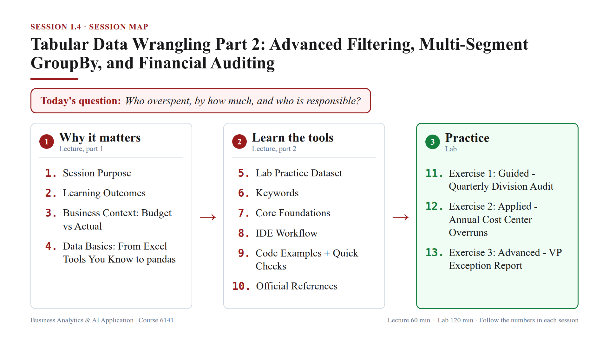

* **Lecture Presentation:** [Download Slides (PDF)](slides/session_01_04_lecture.pdf)
* **Reading (PDF):** [Download Reading (PDF)](handouts/session_01_04_reading.pdf): read before class
* **Schedule:** Week 4 (115/10/04 - 115/10/10) | In-person classes (1:2 Delivery Ratio: 60 Min Lecture + 120 Min Lab)

* **1. Session Purpose:**
  * Each division gets a spending budget every quarter, and finance compares it with what was actually spent
  * Our case: 4 divisions x 4 quarters = 16 rows in one CSV file
  * The finance director asks: who overspent, by how much, and who is responsible? Today, Python answers this for the whole year at once

* **2. Expected Learning Outcomes (By the end of this session, you will be able to):**
  1. "Which quarters went over budget?": filter rows with a Boolean mask (a `True`/`False` value for every row) and `&`
  2. "How much did each division overspend this year?": summarize groups with `groupby()` (split rows into groups, like an Excel pivot table, which is a summary table with one row per group) and `.agg()`
  3. "Who is responsible?": join tables with `pd.merge()` (join two tables on a shared column, like Excel's `VLOOKUP` formula, which looks up a value in another table) and fix a `KeyError`

* **3. Business Context: Budget vs Actual:**
  * Four terms, one example (Consumer division, Q1):

    | Term | Meaning | Example |
    |---|---|---|
    | Budget | planned spending | `780,000` |
    | Actual | real spending | `810,000` |
    | Variance | Actual - Budget | `+30,000` |
    | Variance % | Variance / Budget x 100 | `+3.85%` |

  * Positive variance = overspent; negative variance = under budget.
  * Cost center: the accounting code a division's spending is charged to, such as `CC-202` for Consumer. Each cost center has a responsible VP (Vice President).
  * Company rule in our data: a quarter is flagged (`Audit_Status` = `Variance_Flag`) when the variance is more than 2%.
  * Consumer division by quarter: Q1 `+3.85%` (flagged), Q2 `+1.92%` (over, within the rule), Q3 `+5.77%` (flagged), Q4 `-0.64%` (under budget).

* **4. Data Basics: From Excel Tools You Know to pandas:**
  * Three Excel tools, in one line each:
    * **Filter:** hides the rows that do not match a rule, such as showing only the Consumer division.
    * **Pivot Table:** summarizes a large table by group. For example, put `Division_Name` in Rows and `Actual_Expense_USD` in Values to get total spending per division: 4 rows instead of 16.
    * **`VLOOKUP`:** a formula that looks up a value, such as a cost center code, in another table and returns a value from the same row, such as the VP's name. You tell it which column to return by number (for example, the 2nd column).
  * The same three jobs in pandas:
    * Filter -> Boolean mask `df[mask]`: the rule is written in code, so it repeats exactly next quarter.
    * Pivot Table -> `df.groupby().agg()`: one line; run it again when new data arrives.
    * `VLOOKUP` -> `pd.merge()`: `VLOOKUP` returns a column by number; `pd.merge()` matches rows by column name, such as `Cost_Center_Code`.

* **5. Lab Practice Dataset:**
  * File Link: [data/session_01_04_dataset.csv](data/session_01_04_dataset.csv)
  * Audited 16-row quarterly budget dataset (4 divisions x 4 quarters; each row is one division's spending in one quarter):
    * `Transaction_ID`: Unique record identifier (e.g., `TXN-5001`).
    * `Division_Name`: Operating business unit (Cloud, Consumer, Enterprise, Logistics).
    * `Cost_Center_Code`: Accounting cost center (CC-101, CC-202, CC-303, CC-404).
    * `Fiscal_Quarter`: Financial reporting quarter (Q1, Q2, Q3, Q4).
    * `Budget_Expense_USD`: Authorized spending budget in U.S. Dollars.
    * `Actual_Expense_USD`: Realized expenditure in U.S. Dollars.
    * `Audit_Status`: Internal audit classification (`Verified`, or `Variance_Flag` when spending is more than 2% over budget).

* **6. Keywords (Core Programming Concepts):**
  * `Boolean Mask`:
    * What: one `True` or `False` per row
    * Why: picks exactly the rows that meet a rule
  * `&` `|` `~`:
    * What: "and", "or", "not" for masks
    * Why: Python's `and` / `or` fail on whole columns
  * `Split-Apply-Combine`:
    * What: split rows into groups, calculate each group, combine the results
    * Why: the idea behind every pivot table
  * `groupby()` + `.agg()`:
    * What: `groupby()` splits; `.agg()` sums, counts, or averages each group
    * Why: yearly totals per division in one step
  * `pd.merge()`:
    * What: joins two tables row by row
    * Why: adds facts from another table, such as the VP's name, with no copy-paste
  * `Key Column`:
    * What: a column both tables share, such as `Cost_Center_Code`
    * Why: tells pandas which rows belong together

* **7. Core Programming & Computational Foundations:**
  * **7.1 Combining rules: `&`, not `and`**
    * *The idea:* A rule on a column, such as `df["Division_Name"] == "Consumer"`, does not give one answer. It gives one `True` or `False` **for every row**: a whole column of answers, called a Boolean mask. To combine two rules, Python must compare the two columns row by row: row 1 with row 1, row 2 with row 2, and so on. pandas uses `&` ("and"), `|` ("or"), and `~` ("not") for this row-by-row work.
    * *See it on real data:* the first 4 rows of our dataset.

      | Row | Division | `is_consumer` | `is_over` | Both true (`&`) | Either true (or) |
      |---|---|---|---|---|---|
      | `TXN-5000` | Cloud | `False` | `False` | `False` | `False` |
      | `TXN-5001` | Consumer | `True` | `True` | `True` | `True` |
      | `TXN-5002` | Enterprise | `False` | `False` | `False` | `False` |
      | `TXN-5003` | Logistics | `False` | `True` | `False` | `True` |

      Here `is_consumer = df["Division_Name"] == "Consumer"` and `is_over = df["Actual_Expense_USD"] > df["Budget_Expense_USD"]`. With `is_consumer & is_over`, a row is kept only when **both** columns say `True` (`TXN-5001`). With `is_consumer | is_over`, one `True` is enough (`TXN-5001` and `TXN-5003`).
    * *Common mistake 1, using `and`:* Python's own `and` can only judge one `True` or `False` at a time. Given a whole column, it does not know whether you mean "all rows", "any row", or "row by row", so it stops with `ValueError: The truth value of a Series is ambiguous`. "Ambiguous" means "it could mean several things".
    * *Common mistake 2, missing brackets:* Python works out `&` **before** `==` and `>`. So in `df["Division_Name"] == "Consumer" & df["Actual_Expense_USD"] > df["Budget_Expense_USD"]`, it first tries `"Consumer" & df["Actual_Expense_USD"]`, which makes no sense, and raises a `TypeError`. Brackets force the right order: `(df["Division_Name"] == "Consumer") & (df["Actual_Expense_USD"] > df["Budget_Expense_USD"])`.
    * In these examples, `is_over = df["Actual_Expense_USD"] > df["Budget_Expense_USD"]`.
    * *More examples:*

      | Code | Result | What it tells you |
      |---|---|---|
      | `(df["Division_Name"] == "Logistics") & is_over` | `Q1`, `Q3` | the Logistics quarters that overspent |
      | `(df["Fiscal_Quarter"] == "Q4") & is_over` | `Enterprise` | only one division overspent in Q4 |
      | `(df["Audit_Status"] == "Variance_Flag") & (df["Fiscal_Quarter"] == "Q3")` | `TXN-5008`, `TXN-5009`, `TXN-5011` | the flagged quarters in Q3 |
      | `(~is_over).sum()` | `8` | `~` flips the rule: 8 quarters stayed within budget |
      | `df["Division_Name"].isin(["Cloud", "Enterprise"]).sum()` | `8` | `.isin()` is a short way to write "Cloud or Enterprise" |

    * *Remember:* one rule gives one `True` / `False` per row; combine rules with `&`, `|`, or `~`, and put each rule in its own brackets.
  * **7.2 Split-apply-combine: how `groupby()` builds a summary**
    * *The idea:* Most management questions are about groups: "How much did **each division** spend?" Answering them always takes the same three steps, whether in an Excel pivot table or in pandas:
      1. **Split** the rows into groups, one per division.
      2. **Apply** a calculation inside each group, such as a sum.
      3. **Combine** the answers into a new, smaller table with one row per group.
    * *See it on real data:* the Consumer division's 4 quarterly rows go into one group, and `"sum"` adds them up:

      | Step | Consumer division |
      |---|---|
      | Split | Q1 `810000.0`, Q2 `795000.0`, Q3 `825000.0`, Q4 `775000.0` |
      | Apply (`"sum"`) | `810000.0 + 795000.0 + 825000.0 + 775000.0 = 3205000.0` |
      | Combine | one row: `Consumer` `3205000.0` |

      The same steps run for Cloud, Enterprise, and Logistics at the same time, so the 16 rows become 4: Cloud `1785000.0`, Consumer `3205000.0`, Enterprise `1280000.0`, Logistics `2468000.0`.
    * *What you choose:* the column to split by (`groupby("Division_Name")`), the column to calculate on, and the calculation: `"sum"` for totals, `"mean"` for averages, `"count"` for how many rows, `"max"` for the largest value.
    * *More examples:*

      | Code | Result | What it tells you |
      |---|---|---|
      | `df.groupby("Fiscal_Quarter")["Actual_Expense_USD"].sum()` | Q1 `2185000.0`, Q2 `2171000.0`, Q3 `2235000.0`, Q4 `2147000.0` | total spending per quarter: Q3 was the most expensive |
      | `df.groupby("Division_Name")["Transaction_ID"].count()` | `4` for each division | a quick check that no quarter is missing |
      | `df.groupby("Cost_Center_Code")["Actual_Expense_USD"].max()` | `CC-202` `825000.0` (largest) | the most expensive quarter of each cost center |
      | `df.groupby("Audit_Status")["Transaction_ID"].count()` | `Variance_Flag` `6`, `Verified` `10` | how many quarters were flagged |

    * *Remember:* `groupby()` does the split, `.agg()` does the apply, and pandas does the combine for you.
  * **7.3 Joining tables: match by name, not by position**
    * *The idea:* Information often sits in two tables: spending in one, the responsible VP in another. Joining means bringing the matching row from the second table next to each row of the first, using a column that both share: the key column, here `Cost_Center_Code`.
    * *Why Excel's `VLOOKUP` is fragile:* `VLOOKUP` is told to return "the 2nd column" of the lookup table. If someone later inserts a new column, such as `Region`, the 2nd column is now `Region`, and every formula quietly returns a region instead of a VP name. No error appears, so the mistake is easy to miss.
    * *Why `pd.merge()` is safer:* `pd.merge(spending, vp_info, on="Cost_Center_Code")` matches rows by the **name** of the key column and brings over every other column by name. Moving or inserting columns changes nothing.
    * In these examples, `ledger = pd.merge(df, vp_info, on="Cost_Center_Code", how="left")`, as in Micro-Example 3, and `vp_renamed` is `vp_info` with its key column renamed to `CostCenter`.
    * *More examples:*

      | Code | Result | What it tells you |
      |---|---|---|
      | `ledger.shape` | `(16, 8)` | still 16 rows; one new column, `VP_Lead`, added (7 + 1) |
      | `ledger.loc[ledger["Division_Name"] == "Logistics", "VP_Lead"]` | `David Kim` in all 4 rows | one VP row is matched to every quarter of that cost center |
      | `pd.merge(df, vp_renamed, on="Cost_Center_Code")` | `KeyError: 'Cost_Center_Code'` | `vp_renamed` calls the key `CostCenter`: the names must match exactly |

    * *Remember:* name the key column with `on=`; the key must have exactly the same name and the same values in both tables.
  * **7.4 What happens to rows with no match: `how="left"` vs `how="inner"`**
    * *The idea:* Sometimes a row in the main table has no partner in the other table, for example a new cost center that has not been given a VP yet. The `how=` setting decides what happens to that row.
    * *See it on an example:* suppose our spending table also had a new cost center, `CC-505`, which is not in `vp_info`:

      | `Cost_Center_Code` | `Variance_USD` | `VP_Lead` with `how="left"` | with `how="inner"` |
      |---|---|---|---|
      | `CC-202` | `85000.0` | Marcus Vance | Marcus Vance |
      | `CC-404` | `28000.0` | David Kim | David Kim |
      | `CC-505` | `5000.0` | `NaN` (empty) | row removed |

      `NaN` stands for "Not a Number", pandas' mark for a missing value.
    * *Why it matters:* with `how="inner"`, the `CC-505` overspend silently disappears from the report, and nobody is asked to explain it. With `how="left"`, the row stays and the empty `VP_Lead` tells you that someone must be assigned.
    * In these examples, `vp_3_rows` is `vp_info` without the `CC-404` row (as if Logistics had no VP yet), and `merged` is the result of the left merge.
    * *More examples:*

      | Code | Result | What it tells you |
      |---|---|---|
      | `pd.merge(df, vp_3_rows, on="Cost_Center_Code", how="left")` | `16` rows, `4` with `NaN` in `VP_Lead` | `vp_3_rows` lacks `CC-404`: its 4 quarters stay, with no VP |
      | `pd.merge(df, vp_3_rows, on="Cost_Center_Code", how="inner")` | `12` rows | the 4 Logistics quarters silently disappear |
      | `merged["VP_Lead"].isnull().sum()` | `4` | count the gaps after a left merge |

    * *Remember:* use `how="left"` when every row of your main table must stay in the report, then look for `NaN` to find the gaps.

* **8. Development Workflow in Google Antigravity IDE:**
  * `[1]` File Explorer: create your script with your name and the session code (for example, `Reacher_S14_demo_1.py`), and check the dataset is in `data/`.
  * `[2]` Code Editor: write a few lines, run, repeat. Small steps keep errors small.
  * `[3]` AI Agent Chat: on an error, capture the traceback (Python's error report) with `Win + Shift + S` (macOS: `Cmd + Shift + 4`), paste it with `Ctrl + V`, and ask why it failed.
  * `[4]` Terminal: run `python` followed by your script name. Return code `0` means the script finished with no errors.

* **9. Hands-On Coding Micro-Examples:**
  * Every example has three parts: **1. Input**, **2. Process**, and **3. Output**. Name each file with your own name and the session code, for example `Reacher_S14_demo_1.py` (pattern: `YourName_S14_demo_1.py`).
  * *Micro-Example 1 (Find Overspending with a Boolean Mask):* `YourName_S14_demo_1.py`
    ```python
    # 1. Input: load the quarterly budget data
    import pandas as pd
    df = pd.read_csv("data/session_01_04_dataset.csv")

    # 2. Process: Consumer quarters that spent more than budget
    mask = (
        (df["Division_Name"] == "Consumer")
        & (df["Actual_Expense_USD"] > df["Budget_Expense_USD"])
    )
    overruns = df[mask]

    # 3. Output: count and list them
    print("Consumer overrun quarters:", len(overruns))
    print(overruns[["Fiscal_Quarter", "Budget_Expense_USD",
                    "Actual_Expense_USD"]])
    ```
    * *How it works, line by line:*
      * `(df["Division_Name"] == "Consumer")` gives one `True` / `False` per row: `True` for the 4 Consumer rows.
      * `(df["Actual_Expense_USD"] > df["Budget_Expense_USD"])` compares the two money columns row by row: `True` where a quarter spent more than planned.
      * `&` keeps `True` only where both are `True` (section 7.1). The result, `mask`, is a column of 16 `True` / `False` values. Naming it makes the rule easy to read and reuse.
      * `df[mask]` keeps the rows where `mask` is `True` and stores them in `overruns`.
      * `len(overruns)` counts those rows.
    * *Read the output:*

      ```text
      Consumer overrun quarters: 3
        Fiscal_Quarter  Budget_Expense_USD  Actual_Expense_USD
      1             Q1            780000.0            810000.0
      5             Q2            780000.0            795000.0
      9             Q3            780000.0            825000.0
      ```

      * The Consumer division overspent in 3 of its 4 quarters; only Q4 (`775000.0`) stayed within the `780000.0` budget.
      * Q3 has the largest overrun: `825000 - 780000 = 45000`, or `5.77`% over budget.
      * The labels `1`, `5`, `9` are the original row positions in the 16-row file.
  * *Quick Check 1 (`~`):*
    * New tool: `~` (not) turns every `True` into `False`, and every `False` into `True`. Why: find the opposite group, such as quarters that stayed within budget.
    * Task: in part **2. Process**, change `& (df["Actual_Expense_USD"] > df["Budget_Expense_USD"])` to `& _(df["Actual_Expense_USD"] > df["Budget_Expense_USD"])`.
    * Check: the script prints `Consumer overrun quarters: 1`, and the table shows `Q4` (budget `780000.0`, actual `775000.0`). The label still says "overrun", since only the rule changed.
  * *Micro-Example 2 (Total Each Division with `groupby()`):* `YourName_S14_demo_2.py`
    ```python
    # 1. Input: load the quarterly budget data
    import pandas as pd
    df = pd.read_csv("data/session_01_04_dataset.csv")

    # 2. Process: yearly totals for each division
    div_summary = df.groupby("Division_Name").agg(
        Total_Budget_USD=("Budget_Expense_USD", "sum"),
        Total_Actual_USD=("Actual_Expense_USD", "sum"),
        Quarters=("Transaction_ID", "count"),
    )
    div_summary["Variance_USD"] = (
        div_summary["Total_Actual_USD"]
        - div_summary["Total_Budget_USD"]
    )

    # 3. Output: one row per division
    print(div_summary[["Total_Actual_USD", "Variance_USD"]])
    ```
    * *How it works, line by line:*
      * `df.groupby("Division_Name")` splits the 16 rows into 4 groups, one per division (section 7.2).
      * Inside `.agg(...)`, each line has the form `New_Name=("Source_Column", "calculation")`. For example, `Total_Budget_USD=("Budget_Expense_USD", "sum")` adds up the budget of each division and calls the result `Total_Budget_USD`.
      * `Quarters=("Transaction_ID", "count")` counts the rows in each group; it is a quick check that every division has 4 quarters.
      * The next line subtracts two of the new columns to get each division's yearly variance.
    * *Read the output:*

      ```text
                     Total_Actual_USD  Variance_USD
      Division_Name
      Cloud                 1785000.0      -15000.0
      Consumer              3205000.0       85000.0
      Enterprise            1280000.0           0.0
      Logistics             2468000.0       28000.0
      ```

      * The division names are now the row labels: `groupby()` turns the group names into the index.
      * Consumer overspent by `85000.0` for the year and Logistics by `28000.0`; Enterprise spent exactly its budget; Cloud stayed `15000.0` under.
      * Consumer had one quarter under budget, yet it is still the largest yearly overspender: quarterly flags and yearly totals answer different questions.
  * *Quick Check 2 (`.sort_values()`):*
    * New tool: `.sort_values()` reorders rows by one column; `ascending=False` puts the largest first. Why: the director reads the biggest overspender first.
    * Task: add one line at the end of part **2. Process**: `div_summary = div_summary.___________("Variance_USD", ascending=False)`
    * Check: the first row is `Consumer` (`85000.0`), then `Logistics` (`28000.0`).
  * *Micro-Example 3 (Add VP Names with `pd.merge()`):* `YourName_S14_demo_3.py` (VP names are fictional)
    ```python
    # 1. Input: budget data and a VP list (fictional names)
    import pandas as pd
    df = pd.read_csv("data/session_01_04_dataset.csv")
    vp_info = pd.DataFrame({
        "Cost_Center_Code": ["CC-101", "CC-202", "CC-303", "CC-404"],
        "VP_Lead": ["Sarah Chen", "Marcus Vance",
                    "Elena Rostova", "David Kim"],
    })

    # 2. Process: add VP names, then flag spending over budget
    ledger = pd.merge(df, vp_info, on="Cost_Center_Code", how="left")
    ledger["Over_Budget"] = (
        ledger["Actual_Expense_USD"] > ledger["Budget_Expense_USD"]
    )

    # 3. Output: show the first three rows
    print(ledger[["Transaction_ID", "VP_Lead", "Over_Budget"]].head(3))
    ```
    * *How it works, line by line:*
      * `pd.DataFrame({...})` builds a small table directly in code. Inside the curly brackets, each column name is followed by its list of values, in row order. The two lists must have the same length (here 4).
      * `pd.merge(df, vp_info, on="Cost_Center_Code", how="left")` takes each of the 16 rows of `df`, looks up its cost center in `vp_info`, and adds the matching `VP_Lead` (section 7.3). `how="left"` keeps every row of `df`, even one with no match (section 7.4).
      * `ledger["Actual_Expense_USD"] > ledger["Budget_Expense_USD"]` compares row by row and stores `True` / `False` in a new `Over_Budget` column.
    * *Read the output:*

      ```text
        Transaction_ID        VP_Lead  Over_Budget
      0       TXN-5000     Sarah Chen        False
      1       TXN-5001   Marcus Vance         True
      2       TXN-5002  Elena Rostova        False
      ```

      * Every row now carries the name of the person responsible for that spending; no VP name was copied by hand.
      * `TXN-5001` (Consumer, Q1) is over budget, and Marcus Vance is accountable for it.
      * The table still has 16 rows; `.head(3)` only shows the first 3.
  * *Quick Check 3 (`.value_counts()`):*
    * New tool: `.value_counts()` counts how often each value appears in a column. Why: answers "how many quarters were over budget?" in one line.
    * Task: add one line to part **3. Output**: `print(ledger["Over_Budget"].____________())`
    * Check: the Terminal shows `False 8` and `True 8`: half of the 16 quarters went over budget.

* **10. Official Python Documentation & References:**
  * [Pandas User Guide: GroupBy: Split-Apply-Combine](https://pandas.pydata.org/docs/user_guide/groupby.html).
  * [Pandas User Guide: Merge, Join, Concatenate and Compare](https://pandas.pydata.org/docs/user_guide/merging.html).
  * [Python PEP 8: Guidelines for Line Breaks around Binary Operators](https://peps.python.org/pep-0008/#should-a-line-break-before-or-after-a-binary-operator).

* **11. Exercise 1: Guided Practice - Quarterly Division Audit:**
  * *Step 1: Open Script:* In Google Antigravity IDE, create a new script named `YourName_S14_audit.py`, replacing `YourName` with your own name (for example, `Reacher_S14_audit.py`).
  * *Step 2: Group by Division and Quarter:*
    Type the following code:
    ```python
    # 1. Input: load the quarterly budget data
    import pandas as pd
    df = pd.read_csv("data/session_01_04_dataset.csv")

    # 2. Process: variance per row, then group by two columns
    df["Variance_USD"] = df["Actual_Expense_USD"] - df["Budget_Expense_USD"]
    df["Variance_Pct"] = df["Variance_USD"] / df["Budget_Expense_USD"] * 100.0
    quarterly_audit = df.groupby(["Division_Name", "Fiscal_Quarter"]).agg(
        Total_Actual=("Actual_Expense_USD", "sum"),
        Total_Variance=("Variance_USD", "sum"),
        Mean_Variance_Pct=("Variance_Pct", "mean"),
    )

    # 3. Output: one row per division and quarter
    print("Quarterly Division Audit Summary:\n", quarterly_audit)
    ```
    * Grouping by a list of two columns gives one row per division and quarter: 16 rows, labeled by both values.
  * *Step 3: Verify Output Integrity:*
    Confirm that quarters with overruns show positive `Total_Variance` values. 8 of the 16 rows should be positive.
  * *Step 4: Execute in Terminal:*
    Run the script via Panel `[4]` (Terminal) using `python YourName_S14_audit.py` and confirm return code `0`.

* **12. Exercise 2: Applied Practice - Annual Cost Center Overruns:**
  * *Coding Challenge:* In `YourName_S14_practice.py`, find the cost centers that overspent for the whole year.
  * *Task 1 (Annual Cost Center Aggregation):* Group the data by `Cost_Center_Code`, sum budget and actual spending, compute the yearly variance %, and keep cost centers more than `1.0`% over budget.
  * *Task 2 (Deliberate KeyError & AI Diagnosis):* Merge the result with `vp_info` (from Micro-Example 3), but type `on="Cost_Center"` on purpose. Read the `KeyError` (the column name does not exist), capture the traceback with `Win + Shift + S`, paste it into Panel `[3]` (AI Agent Chat) with `Ctrl + V`, and review the AI's explanation of join keys.
  * *Task 3 (Audit Brief Output):* Fix the key to `on="Cost_Center_Code"`, then print the cost center, the VP, and the overrun in USD.
  * *Success Check:* 2 cost centers: `CC-202` (Marcus Vance, `85000.0`, 2.72%) and `CC-404` (David Kim, `28000.0`, 1.15%); the script ends with return code `0`.

* **13. Exercise 3: Advanced Practice - VP Exception Report:**
  * *Goal:* Build an exception report that tells the finance director which VPs must explain their spending. A VP is escalated when the cost center has repeated flagged quarters **and** overspent for the whole year.
  * *What you need:*
    * File: `data/session_01_04_dataset.csv` (16 rows, described in **5. Lab Practice Dataset**).
    * The `vp_info` table from Micro-Example 3 (VP names are fictional).
    * Script name: `YourName_S14_challenge.py`.
    * Tools you already know: Boolean masks, `groupby()` + `.agg()`, `pd.merge()`, `.sort_values()`, and `.to_csv()`.
  * *Requirements (follow them in order):*
    1. Add `Variance_USD` = `Actual_Expense_USD` - `Budget_Expense_USD` and `Variance_Pct` = `Variance_USD` / `Budget_Expense_USD` x 100, rounded to 2 decimal places.
    2. Add `My_Flag` = `True` when `Variance_Pct > 2.0`. Check your rule: count the rows where `My_Flag` disagrees with `Audit_Status == "Variance_Flag"`. The count must be `0`.
    3. **Flagged summary:** keep only the flagged rows, then group by `Cost_Center_Code` and compute `Flagged_Quarters` (count of rows), `Flagged_Overrun_USD` (sum of `Variance_USD`), and `Worst_Variance_Pct` (largest `Variance_Pct`).
    4. **Yearly summary:** using all 16 rows, group by `Cost_Center_Code`, sum budget and actual spending, and compute `Year_Variance_Pct` = (actual - budget) / budget x 100, rounded to 2 decimal places.
    5. Start from `vp_info` and merge in the yearly summary, then the flagged summary, both with `on="Cost_Center_Code"` and `how="left"`. If a cost center had no flagged quarter, its empty values must become `0`.
    6. Add `Escalate` = `True` when `Flagged_Quarters >= 2` **and** `Year_Variance_Pct > 1.0`.
    7. Sort by `Flagged_Overrun_USD`, then by `Worst_Variance_Pct`, both largest first. Print the table and save it to `data/vp_exception_report.csv` without row labels.
  * *New tools for this exercise:*
    * `.reset_index()`: after `groupby()`, the group names (here, the cost center codes) become the row labels. `.reset_index()` turns them back into a normal column, so you can merge on `Cost_Center_Code`.
    * `.fillna(0)`: replaces empty values (`NaN`) with `0`, for example `report["Flagged_Quarters"] = report["Flagged_Quarters"].fillna(0)`.
    * Sorting by two columns: `.sort_values(["Flagged_Overrun_USD", "Worst_Variance_Pct"], ascending=False)`. The second column only decides ties in the first.
    * `"max"` inside `.agg()` returns the largest value in each group, just as `"sum"` returns the total.
  * *Hints:*
    * Build the two summaries as two separate tables first, print each one, and only then merge.
    * `(df["My_Flag"] != (df["Audit_Status"] == "Variance_Flag")).sum()` counts disagreements, because each `True` counts as 1.
  * *Self-Check (expected results):*
    * Rule check: `0` disagreements; 6 of the 16 quarters are flagged.
    * Table order: `CC-202` Marcus Vance (2 flagged, `75000.0`, worst `5.77`), `CC-404` David Kim (2, `45000.0`, `4.92`), `CC-303` Elena Rostova (1, `10000.0`, `3.12`), `CC-101` Sarah Chen (1, `10000.0`, `2.22`).
    * `Escalate` is `True` only for Marcus Vance (`Year_Variance_Pct` `2.72`) and David Kim (`1.15`). Elena Rostova and Sarah Chen each had one flagged quarter but finished the year at or under budget.

---

## Module 2: Web Data Extraction, Visual Dashboards, and Midterm Milestone

Module 2 shifts focus from internal corporate records to external market intelligence and visual storytelling. Students learn to extract public competitor price data using web scrapers, construct publication-grade business charts, and present audited exploratory findings during the midterm milestone.

<a id="session-02-01"></a>
### Session 2.1: Web Data Extraction: Scraping Financial and Competitor Intelligence with Beautiful Soup

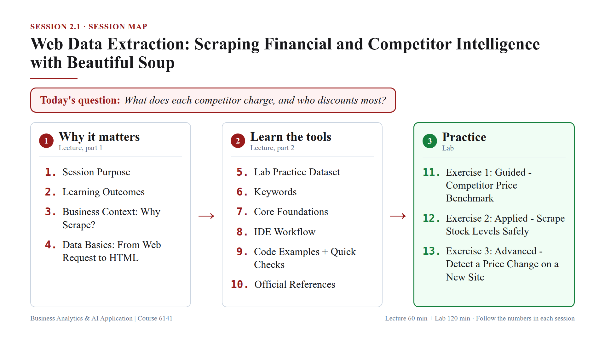

* **Lecture Presentation:** [Download Slides (PDF)](slides/session_02_01_lecture.pdf)
* **Reading (PDF):** [Download Reading (PDF)](handouts/session_02_01_reading.pdf): read before class
* **Schedule:** Week 5 (115/10/11 - 115/10/17) | In-person classes (1:2 Delivery Ratio: 60 Min Lecture + 120 Min Lab)

* **1. Session Purpose:**
  * Our pricing team watches 3 competitor websites, where prices sit on web pages, not in CSV files
  * Copying hundreds of prices by hand is slow and error-prone
  * The pricing manager asks: what does each competitor charge, and who discounts most? Today, Python reads a web page and turns it into a table

* **2. Expected Learning Outcomes (By the end of this session, you will be able to):**
  1. "How does a web page reach my computer?": explain an HTTP (HyperText Transfer Protocol) GET request and read HTML (HyperText Markup Language: the text with tags that describes a web page)
  2. "What is BetaMart charging?": extract prices with Beautiful Soup (a Python library that reads HTML) and CSS (Cascading Style Sheets) selectors (an address for tags, such as `.price`)
  3. "What if a product has no stock tag?": handle a missing tag (the search returns `None`, meaning nothing found) and fix an `AttributeError`

* **3. Business Context: Why Scrape?**
  * By hand: open each competitor page, copy each price into Excel, and do it all again tomorrow. 3 sites x 100 products = 300 copy-pastes a day, with typos.
  * With a Python script: read every product on the page in seconds, get the same result every run, and run it again every morning. The output is a clean table, ready for pandas.
  * Rules of the road (scrape responsibly):
    * Public pages only, never behind a login
    * Check the site's `robots.txt` and terms of use. `robots.txt` is a short public file on a website (for example, `betamart.example/robots.txt`) that lists which pages automated scripts may and may not read.
    * Pause between requests, for example `time.sleep(2)` (wait 2 seconds), so the site is not overloaded
    * Name your script in the request. The User-Agent is a short label sent with every request that tells the site who is asking.

* **4. Data Basics: From Web Request to HTML:**
  * 1. Your browser or Python script sends an HTTP GET request: "send me this page".
  * 2. The web server answers with the page as HTML text.
  * The browser draws that text as a page for people; Python reads the text itself. In the example below, `data-sku` stores the product's SKU (Stock Keeping Unit), the store's product code:

    ```html
    <div class="product" data-sku="SKU-801">
      <h3 class="name">Office Desk Chair</h3>
      <span class="price">$49.50</span>
      <span class="stock">120 units</span>
    </div>
    ```

* **5. Lab Practice Dataset:**
  * Saved web page: [data/session_02_01_catalog.html](data/session_02_01_catalog.html), a fictional BetaMart catalog page with 4 product cards (SKU-807 has no stock tag).
  * File Link: [data/session_02_01_dataset.csv](data/session_02_01_dataset.csv)
  * Audited 12-row competitor pricing dataset compiled from automated extraction (competitor names are fictional):
    * `Product_SKU`: Stock Keeping Unit, the product code (e.g., `SKU-801`).
    * `Competitor_Name`: Competitor (AlphaRetail, BetaMart, GammaGlobal).
    * `Category_Name`: Merchandise category (Electronics, Office Supplies, Hardware, Appliances).
    * `List_Price_USD`: Extracted competitor catalog price in U.S. Dollars.
    * `Promotion_Discount_Pct`: Advertised promotional markdown percentage.
    * `Stock_Availability_Units`: Available warehouse stock units.

* **6. Keywords (Core Programming Concepts):**
  * `HTTP GET`:
    * What: a request, using the HyperText Transfer Protocol (HTTP), that asks a web server for a page
    * Why: every page your browser or script reads starts with one
  * `HTML Tag`:
    * What: a label around content, such as `<span class="price">`
    * Why: tags tell you where each price or name sits
  * `DOM Tree`:
    * What: Document Object Model: tags nested inside tags, like folders
    * Why: one product card holds its name, price, and stock
  * `Beautiful Soup (bs4)`:
    * What: a Python library that reads HTML into a searchable tree
    * Why: find tags by name or class in one line
  * `CSS Selector`:
    * What: a short address for tags: `.price` = class "price"
    * Why: `.select()` / `.select_one()` use it to pick tags
  * `Ethical Scraping`:
    * What: follow `robots.txt`, pause between requests, stay on public pages
    * Why: protects the website and your company

* **7. Core Programming & Computational Foundations:**
  * **7.1 A web page is text with tags, not a table**
    * *The idea:* When you open a web page, your browser receives a long piece of text written in HTML and draws it as a page. The prices you see are inside that text, wrapped in tags such as `<span class="price">$49.50</span>`. A tag has three parts: an opening tag (`<span ...>`), the content (`$49.50`), and a closing tag (`</span>`). The `class="price"` part is a label that the website's designers put on the tag, and it is what we use to find it.
    * *See it on real data:* one product card from our saved BetaMart page.

      ```text
      <div class="product" data-sku="SKU-801">
        <h3 class="name">Office Desk Chair</h3>
        <span class="price">$49.50</span>
        <span class="stock">120 units</span>
      </div>
      ```

      | What we want | Where it is in the HTML |
      |---|---|
      | Product code | the `data-sku` setting of the `div` tag: `SKU-801` |
      | Name | inside the `h3` tag with class `name`: `Office Desk Chair` |
      | Price | inside the `span` tag with class `price`: `$49.50` |
      | Stock | inside the `span` tag with class `stock`: `120 units` |

    * *More examples:*

      | Code | Result | What it tells you |
      |---|---|---|
      | `<h3 class="name">Office Desk Chair</h3>` | tag `h3`, class `name`, content `Office Desk Chair` | the product name |
      | `<span class="stock">120 units</span>` | tag `span`, class `stock`, content `120 units` | the stock level, as text |
      | `<div class="product" data-sku="SKU-801">` | tag `div`, class `product`, setting `data-sku` | the card that holds one product; its code is a setting, not content |
      | `<h1>BetaMart Weekly Prices</h1>` | tag `h1`, no class, content `BetaMart Weekly Prices` | the page heading |

    * *Remember:* scraping means finding the right tags and taking the text inside them.
  * **7.2 Tags inside tags: the DOM tree**
    * *The idea:* Tags are nested: the `div` card contains the name, price, and stock tags, just as a folder contains files. This nesting is called the DOM tree (Document Object Model). Beautiful Soup reads the HTML text and builds this tree, so you can ask for "the price tag inside this card" instead of searching through raw text.
    * *Why nesting matters:* our page has 4 cards, and each one has its own price. If you search the whole page for `.price`, you get all 4 prices. If you first take one card and then search inside it, you get exactly that card's price, already paired with the right name.
    * *See it on real data:*

      | Search | Result |
      |---|---|
      | `soup.select(".price")` (whole page) | 4 tags: `$49.50`, `$320.00`, `$429.00`, `$195.00` |
      | `card.select_one(".price")` (one card) | 1 tag: `$49.50`, for `SKU-801` only |

    * *More examples:*

      | Code | Result | What it tells you |
      |---|---|---|
      | `soup.select(".stock")` | 3 tags: `120 units`, `38 units`, `15 units` | whole page: only 3, because one card has no stock tag |
      | `soup.select(".product")[1].find("h3").text` | `Wireless Router` | the name inside the second card (position `1`) |
      | `soup.select(".product")[3]["data-sku"]` | `SKU-810` | the code of the fourth card |
      | `soup.select_one(".product .stock").text` | `120 units` | a space in a selector means "inside": a stock tag inside a product card |

    * *Remember:* loop over the cards, then search inside each card; that keeps every value with its own product.
  * **7.3 Four ways to find tags**

    | Method | Finds | Returns | Example |
    |---|---|---|---|
    | `.find("h3")` | the first tag with that name | one tag | `Office Desk Chair` |
    | `.find_all("h3")` | every tag with that name | a list of tags | 4 product names |
    | `.select_one(".price")` | the first tag matching a CSS selector | one tag | `$49.50` |
    | `.select(".price")` | every tag matching a CSS selector | a list of tags | 4 prices |

    * *The idea:* `find` methods search by tag name; `select` methods use CSS selectors (Cascading Style Sheets), the same short addresses web designers use: `.price` means "class `price`", and `div.product` means "a `div` tag with class `product`".
    * *Getting the content:* a tag is not yet text. `.text` takes the words inside it (`"$49.50"`), and `tag["data-sku"]` reads a setting written inside the opening tag (`"SKU-801"`). `.strip()` removes spaces and line breaks around the text.
    * *More examples:*

      | Code | Result | What it tells you |
      |---|---|---|
      | `soup.find("span").text` | `$49.50` | the first `span` on the page happens to be a price |
      | `len(soup.find_all("span"))` | `7` | 4 price tags + 3 stock tags |
      | `len(soup.select("div.product"))` | `4` | the number of product cards |
      | `soup.select_one(".discount")` | `None` | no tag on the page has the class `discount` |
      | `soup.h1.text` | `BetaMart Weekly Prices` | a short way to get the first tag of a kind |

    * *Remember:* one tag: `find` / `select_one`; all tags: `find_all` / `select`; then `.text` for the words.
  * **7.4 Text is not a number yet**
    * *The idea:* Everything scraped is text, even prices. `"$49.50"` cannot be added or averaged. Two steps turn it into a number: remove the dollar sign with `.replace("$", "")`, which gives `"49.50"`, then convert it with `float()`, which gives `49.5`.
    * *Common mistake:* forgetting the conversion. Text "added" together is joined, not summed, and `float("$49.50")` with the `$` still there raises `ValueError: could not convert string to float`.
    * *More examples:*

      | Code | Result | What it tells you |
      |---|---|---|
      | `float("320.00")` | `320.0` | clean text converts directly |
      | `float("$1,299.99".replace("$", "").replace(",", ""))` | `1299.99` | remove every symbol first: the `$` and the thousands comma |
      | `int("120 units".split()[0])` | `120` | `.split()` cuts the text at spaces; `[0]` takes the first piece, `"120"` |
      | `"49.5" + "10"` | `'49.510'` | text is joined, not added |
      | `float("49.5") + 10` | `59.5` | after conversion, the math works |

    * *Remember:* clean the text first, then `float()`.
  * **7.5 Select by class name, not by position**
    * *The idea:* You could tell a script "take the 2nd tag in each card". That works until the website adds something, such as a red "SALE" badge before the price; then the 2nd tag is the badge and the script quietly collects the word "SALE". Selecting by class name (`.price`) follows the label, not the position, so it keeps working when the layout changes.
    * *More examples:* the same card before and after the website adds a "SALE" badge in front of the price.

      | Code | Before the badge | After the badge | What it tells you |
      |---|---|---|---|
      | `card.find_all("span")[0].text` | `$49.50` | `SALE` | "the first `span`" now points at the badge |
      | `card.select_one(".price").text` | `$49.50` | `$44.50` | the class name still finds the price |

    * *Remember:* use class names; still recheck the script whenever the site is redesigned, because class names can change too.
  * **7.6 When a tag is missing: `None`**
    * *The idea:* Real pages are irregular. On our page, the card for `SKU-807` has no stock tag. When `.select_one(".stock")` finds nothing, it returns `None`, Python's word for "nothing". Asking for the text of nothing, `None.text`, stops the script with `AttributeError: 'NoneType' object has no attribute 'text'`.
    * *The fix:* store the result first, check it, then read it:

      ```text
      stock_tag = card.select_one(".stock")
      if stock_tag is not None:
          stock = stock_tag.text.strip()
      else:
          stock = "not shown"
      ```

    * *More examples:*

      | Code | Result | What it tells you |
      |---|---|---|
      | `soup.select(".product")[2].select_one(".stock")` | `None` | the third card (`SKU-807`) has no stock tag |
      | `[c["data-sku"] for c in soup.select(".product") if c.select_one(".stock") is None]` | `['SKU-807']` | list every card with a missing stock tag |
      | `soup.select(".product")[0].select_one(".stock").text` | `120 units` | the first card has one, so `.text` works |

    * *Remember:* any tag might be missing; check for `None` before you read `.text`.

* **8. Development Workflow in Google Antigravity IDE:**
  * `[1]` File Explorer: create your script with your name and the session code (for example, `Reacher_S21_demo_1.py`), and check the files are in `data/`.
  * `[2]` Code Editor: write a few lines, run, repeat. Small steps keep errors small.
  * `[3]` AI Agent Chat: on an error, capture the traceback (Python's error report) with `Win + Shift + S` (macOS: `Cmd + Shift + 4`), paste it with `Ctrl + V`, and ask why it failed.
  * `[4]` Terminal: run `python` followed by your script name. Return code `0` means the script finished with no errors. First time only: `pip install beautifulsoup4`.

* **9. Hands-On Coding Micro-Examples:**
  * Every example has three parts: **1. Input**, **2. Process**, and **3. Output**. Name each file with your own name and the session code, for example `Reacher_S21_demo_1.py` (pattern: `YourName_S21_demo_1.py`).
  * First time only: install Beautiful Soup in the Terminal with `pip install beautifulsoup4`.
  * The examples read a saved copy of a fictional competitor page, `data/session_02_01_catalog.html`, so they work the same in class without internet access. On a live site, `requests.get(url).text` returns the same kind of HTML text.
  * *Micro-Example 1 (Read a Web Page with Beautiful Soup):* `YourName_S21_demo_1.py`
    ```python
    # 1. Input: read the saved web page (HTML text)
    from bs4 import BeautifulSoup
    html_text = open("data/session_02_01_catalog.html").read()

    # 2. Process: build the tree, then find the first product name
    soup = BeautifulSoup(html_text, "html.parser")
    first_name = soup.find("h3").text

    # 3. Output: show what we found
    print("Page title:", soup.title.text)
    print("First product:", first_name)
    ```
    * *How it works, line by line:*
      * `from bs4 import BeautifulSoup` loads Beautiful Soup. The library is installed as `beautifulsoup4` but imported as `bs4`.
      * `open("data/...html").read()` opens the saved page and reads the whole file as one long piece of text, stored in `html_text`. On a live website, `requests.get(url).text` would give you the same kind of text.
      * `BeautifulSoup(html_text, "html.parser")` reads that text and builds the DOM tree (section 7.2), stored in `soup`. `"html.parser"` is the HTML reader that comes with Python.
      * `soup.find("h3")` returns the first `h3` tag on the page, and `.text` takes the words inside it.
      * `soup.title.text` reads the page's title, the text shown on the browser tab.
    * *Read the output:*

      ```text
      Page title: BetaMart Online Catalog (fictional)
      First product: Office Desk Chair
      ```

      * The title confirms that the script read the right page.
      * Only one name is printed, because `.find()` stops at the first match; Quick Check 1 counts all of them.
  * *Quick Check 1 (`.find_all()`):*
    * New tool: `.find_all()` returns every matching tag as a list; `.find()` returns only the first. Why: count how many products the page shows.
    * Task: add one line to part **3. Output**: `print("Products on page:", len(soup.________("h3")))`
    * Check: the Terminal shows `Products on page: 4`.
  * *Micro-Example 2 (Turn Product Cards into Rows):* `YourName_S21_demo_2.py`
    ```python
    # 1. Input: read and parse the saved web page
    from bs4 import BeautifulSoup
    html_text = open("data/session_02_01_catalog.html").read()
    soup = BeautifulSoup(html_text, "html.parser")

    # 2. Process: one dictionary per product card
    products = []
    for card in soup.select(".product"):
        price_text = card.select_one(".price").text
        products.append({
            "sku": card["data-sku"],
            "name": card.select_one(".name").text.strip(),
            "price_usd": float(price_text.replace("$", "")),
        })

    # 3. Output: one line per product
    for item in products:
        print(item)
    ```
    * *How it works, line by line:*
      * `products = []` starts an empty list that will collect one dictionary per product.
      * `for card in soup.select(".product"):` repeats the indented lines once for each product card; on each pass, `card` is one card (section 7.2).
      * `card.select_one(".price").text` finds the price tag **inside this card** and takes its text, such as `"$49.50"`.
      * `products.append({...})` adds one dictionary to the list. A dictionary pairs names with values: `"sku"` with `card["data-sku"]`, `"name"` with the cleaned name, and `"price_usd"` with the price as a number.
      * `float(price_text.replace("$", ""))` removes the dollar sign and converts the text to a number (section 7.4).
      * The last loop prints each dictionary on its own line.
    * *Read the output:*

      ```text
      {'sku': 'SKU-801', 'name': 'Office Desk Chair', 'price_usd': 49.5}
      {'sku': 'SKU-804', 'name': 'Wireless Router', 'price_usd': 320.0}
      {'sku': 'SKU-807', 'name': 'Compact Refrigerator', 'price_usd': 429.0}
      {'sku': 'SKU-810', 'name': 'Cordless Drill', 'price_usd': 195.0}
      ```

      * 4 cards became 4 rows, each with its code, name, and price kept together.
      * `49.5` has no quotation marks: it is now a number. `pd.DataFrame(products)` would turn this list straight into a table with columns `sku`, `name`, and `price_usd`.
  * *Quick Check 2 (`.get_text(strip=True)`):*
    * New tool: `.get_text(strip=True)` returns the words inside a tag, with spaces and line breaks removed from both ends. Why: one call does the work of `.text.strip()`.
    * Task: in part **2. Process**, change `"name": card.select_one(".name").text.strip(),` to `"name": card.select_one(".name").________(strip=True),`
    * Check: the output does not change; the first line is still `{'sku': 'SKU-801', 'name': 'Office Desk Chair', 'price_usd': 49.5}`.
  * *Micro-Example 3 (From Scraped Prices to a Comparison Table):* `YourName_S21_demo_3.py`
    ```python
    # 1. Input: prices already scraped from 3 competitor sites
    import pandas as pd
    df = pd.read_csv("data/session_02_01_dataset.csv")

    # 2. Process: price after the advertised discount
    df["Effective_Price_USD"] = (
        df["List_Price_USD"] * (1 - df["Promotion_Discount_Pct"] / 100)
    ).round(2)
    electronics = df.loc[df["Category_Name"] == "Electronics"]

    # 3. Output: compare competitors, then save the table
    print(electronics[["Competitor_Name", "List_Price_USD",
                       "Effective_Price_USD"]])
    electronics.to_csv("data/electronics_prices.csv", index=False)
    ```
    * *How it works, line by line:*
      * The CSV holds prices already scraped from 3 competitor sites, one row per product.
      * `df["List_Price_USD"] * (1 - df["Promotion_Discount_Pct"] / 100)` calculates the price a customer actually pays after the advertised discount, for all 12 rows at once. Example: `299.99 x (1 - 10 / 100) = 269.99`.
      * `.round(2)` keeps 2 decimals, as for money.
      * `df.loc[df["Category_Name"] == "Electronics"]` keeps the 3 Electronics rows, one per competitor.
      * `electronics.to_csv("data/electronics_prices.csv", index=False)` saves those rows as a new CSV file; `index=False` leaves out the row labels, which are not data.
    * *Read the output:*

      ```text
        Competitor_Name  List_Price_USD  Effective_Price_USD
      0     AlphaRetail          299.99               269.99
      4        BetaMart          320.00               281.60
      8     GammaGlobal          310.00               263.50
      ```

      * AlphaRetail has the lowest list price, but GammaGlobal is cheapest after its 15% discount (`263.50`).
      * A comparison on list prices alone would pick the wrong competitor: always compare the price the customer actually pays.
  * *Quick Check 3 (`.min()`):*
    * New tool: `.min()` returns the smallest value in a column; `.max()` returns the largest. Why: answers "what is the lowest competitor price?" in one step.
    * Task: add two lines to part **3. Output**: `lowest = electronics["Effective_Price_USD"].___()` and `print("Lowest price:", lowest)`
    * Check: the Terminal shows `Lowest price: 263.5` (GammaGlobal).

* **10. Official Python Documentation & References:**
  * [Beautiful Soup 4 Official Documentation](https://beautiful-soup-4.readthedocs.io/en/latest/).
  * [Requests: HTTP for Humans Official Documentation](https://requests.readthedocs.io/en/latest/).
  * [World Wide Web Consortium (W3C) HTML5 Standards](https://www.w3.org/TR/html52/).

* **11. Exercise 1: Guided Practice - Competitor Price Benchmark:**
  * *Step 1: Open Script:* In Google Antigravity IDE, create a new script named `YourName_S21_benchmark.py`, replacing `YourName` with your own name (for example, `Reacher_S21_benchmark.py`).
  * *Step 2: Benchmark Competitors by Category:*
    Type the following code:
    ```python
    # 1. Input: prices scraped from 3 competitor sites
    import pandas as pd
    df = pd.read_csv("data/session_02_01_dataset.csv")

    # 2. Process: effective price, then average by category and competitor
    df["Effective_Price_USD"] = (
        df["List_Price_USD"] * (1 - df["Promotion_Discount_Pct"] / 100)
    ).round(2)
    benchmark = df.groupby(["Category_Name", "Competitor_Name"]).agg(
        Avg_Discount_Pct=("Promotion_Discount_Pct", "mean"),
        Avg_Effective_Price=("Effective_Price_USD", "mean"),
    )

    # 3. Output: one row per category and competitor
    print("Competitor Category Pricing Benchmark:\n", benchmark)
    ```
  * *Step 3: Analyze Business Insights:*
    In Electronics and Hardware, find the competitor with the deepest discount and the competitor with the lowest effective price. Are they the same?
  * *Step 4: Execute in Terminal:*
    Run `python YourName_S21_benchmark.py` in Panel `[4]` (Terminal) and confirm return code `0`.
  * *Success Check:* Electronics: GammaGlobal has both the deepest discount (15%) and the lowest price (`263.5`). Hardware: GammaGlobal has the deepest discount (15%), but AlphaRetail has the lowest price (`157.5`). The deepest discount is not always the lowest price.

* **12. Exercise 2: Applied Practice - Scrape Stock Levels Safely:**
  * *Coding Challenge:* In `YourName_S21_practice.py`, extend Micro-Example 2 so each row also has the stock level.
  * *Task 1 (Add the Stock Field):* Inside the loop, add `"stock": card.select_one(".stock").text.strip()` to the dictionary.
  * *Task 2 (Read the AttributeError & AI Diagnosis):* Run the script. The SKU-807 card has no stock tag, so `.select_one(".stock")` returns `None` and Python stops with `AttributeError: 'NoneType' object has no attribute 'text'`. Capture the traceback with `Win + Shift + S`, paste it into Panel `[3]` (AI Agent Chat) with `Ctrl + V`, and review the AI's explanation.
  * *Task 3 (Safe Extraction and Export):* Save the tag first with `stock_tag = card.select_one(".stock")`. If `stock_tag is not None`, use `stock_tag.text.strip()`; else use `"not shown"`. Save the table with `pd.DataFrame(products).to_csv("data/competitor_price_audit.csv", index=False)`.
  * *Success Check:* the CSV file has 4 rows, SKU-807 shows `not shown`, and the script ends with return code `0`.

* **13. Exercise 3: Advanced Practice - Detect a Price Change on a New Site:**
  * *Goal:* Scrape a second competitor page that uses **different tags**, compare it with last week's data in the CSV, and report which product's discount changed.
  * *What you need:*
    * Saved web page: [data/session_02_01_gamma.html](data/session_02_01_gamma.html), a fictional GammaGlobal page with 4 products.
    * Last week's data: `data/session_02_01_dataset.csv` (use only the rows where `Competitor_Name` is `"GammaGlobal"`).
    * Script name: `YourName_S21_challenge.py`.
    * Tools you already know: `BeautifulSoup`, `.select()`, `.select_one()`, `None` checks, `float()`, `pd.DataFrame()`, `pd.merge()`, and `.to_csv()`.
  * *How the GammaGlobal page is built (open the file in the Code Editor to see it):*
    * Each product is an `li` tag with class `item`, and its SKU is stored in `data-sku`.
    * The product name is in a tag with class `title`.
    * Every product has a `list-price` tag, such as `$189.00`.
    * A product **on sale** also has a `sale-price` tag. A product without a sale has **no** `sale-price` tag.
  * *Requirements (follow them in order):*
    1. For each product, collect `sku`, `name`, `List_Price_Web` (the list price as a number), and `Current_Price_Web`: the sale price if the `sale-price` tag exists, otherwise the list price.
    2. Add `Discount_Pct_Web` = (`List_Price_Web` - `Current_Price_Web`) / `List_Price_Web` x 100, rounded to 1 decimal place.
    3. Turn the list into a DataFrame. Merge it with the GammaGlobal rows of the CSV, matching `sku` on the web side with `Product_SKU` on the CSV side.
    4. Add `Discount_Changed` = `True` when `Discount_Pct_Web` is not equal to `Promotion_Discount_Pct`.
    5. Print `sku`, `name`, `Current_Price_Web`, `Discount_Pct_Web`, `Promotion_Discount_Pct`, and `Discount_Changed`, then save the table to `data/gamma_price_check.csv` without row labels.
    6. Print one summary line, for example `Products with a changed discount: 1`.
  * *New tools for this exercise:*
    * `.select(".item")` works for any class name; only the name changes from the BetaMart page (`.product`) to this page (`.item`).
    * Merging when the key columns have **different names**: `pd.merge(web_df, gamma_df, left_on="sku", right_on="Product_SKU", how="left")`. `left_on` names the key in the first table and `right_on` the key in the second.
    * `!=` means "not equal". On two columns, it gives one `True` / `False` per row.
  * *Hints:*
    * Read the sale tag first with `sale_tag = card.select_one(".sale-price")`, then use `if sale_tag is not None:` to choose the current price.
    * Filter the CSV before merging: `gamma_df = df.loc[df["Competitor_Name"] == "GammaGlobal"]`.
  * *Self-Check (expected results):*
    * Current prices on the page: `SKU-802` `160.65`, `SKU-805` `45.0` (no sale tag), `SKU-808` `263.5`, `SKU-811` `391.0`.
    * Only `SKU-811` (Electric Oven) changed: the web shows `15.0`% off, while last week's CSV says `10.0`%.
    * Summary line: `Products with a changed discount: 1`. Business meaning: GammaGlobal deepened its oven discount this week, so our pricing team should review our appliance prices.

---

<a id="session-02-02"></a>
### Session 2.2: Business Data Visualization: Exploratory Plotting and Executive Dashboards

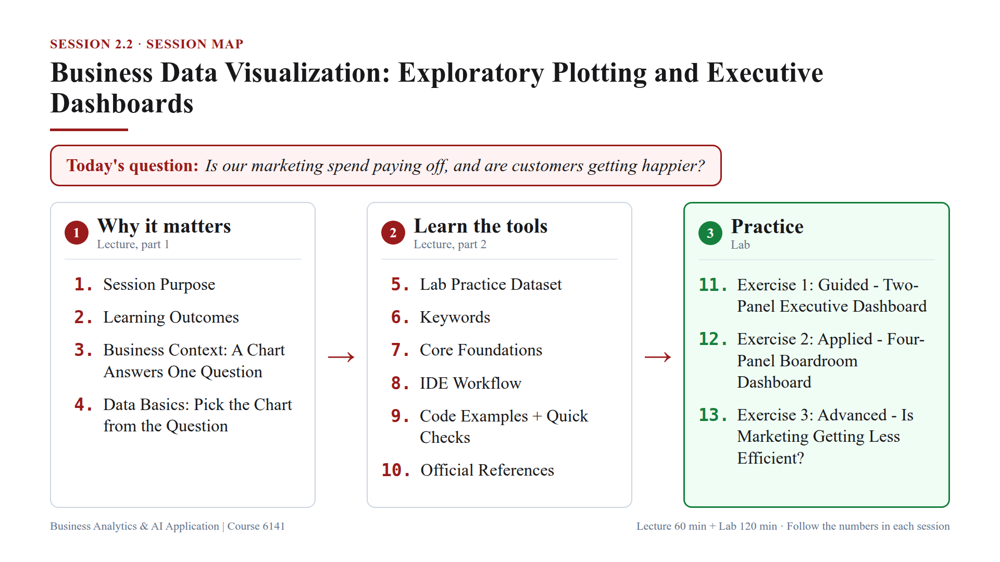

* **Lecture Presentation:** [Download Slides (PDF)](slides/session_02_02_lecture.pdf)
* **Reading (PDF):** [Download Reading (PDF)](handouts/session_02_02_reading.pdf): read before class
* **Schedule:** Week 6 (115/10/18 - 115/10/24) | In-person classes (1:2 Delivery Ratio: 60 Min Lecture + 120 Min Lab)

* **1. Session Purpose:**
  * The marketing team keeps 12 months of results in one table: revenue, marketing spend, cost per new customer, and customer loyalty
  * Executives often have only a minute or two per chart, and a table of 72 numbers hides the trend
  * The CMO (Chief Marketing Officer) asks: is our marketing spend paying off, and are customers getting happier? Today, Python turns the table into charts that answer this at a glance

* **2. Expected Learning Outcomes (By the end of this session, you will be able to):**
  1. "Is revenue growing month by month?": draw a line chart with Matplotlib (Python's main charting library) using `fig, ax = plt.subplots()` (`fig` is the whole image; `ax` is one chart inside it)
  2. "In which months did we spend the most on marketing?": draw a bar chart with Seaborn (a library built on Matplotlib for quick, clean statistical charts)
  3. "Which numbers move together?": read a correlation heatmap (a colored grid of correlations, each from -1 to +1), and fix an `IndexError` in a 2x2 dashboard

* **3. Business Context: A Chart Answers One Question:**
  * A table makes the reader hunt for the pattern; a chart shows it. In our table, revenue rises from `12.4` to `25.8` (USD millions), but the jump in November and December is easy to miss among 72 numbers.
  * Five rules for charts that executives trust:
    * One message per chart, and the title states it, for example "Revenue More Than Doubled from Jan to Dec"
    * Label every axis with its unit, such as "USD M" (millions of U.S. Dollars)
    * Bar charts start at zero; a cut-off axis makes small differences look huge
    * No 3D effects or decoration; every mark on the chart should carry data
    * Use colors that still work in black-and-white print and for color-blind readers

* **4. Data Basics: Pick the Chart from the Question:**

  | Business question | Chart | Python |
  |---|---|---|
  | How does a number change over time? | Line chart | `ax.plot()` |
  | Which category is biggest? | Bar chart | `sns.barplot()` or `ax.bar()` |
  | Do two numbers move together? | Scatter plot | `ax.scatter()` |
  | Which of many numbers move together? | Correlation heatmap | `sns.heatmap()` |

  * **Correlation** measures how closely two columns move together, on a scale from -1 to +1:
    * `+1`: when one goes up, the other always goes up
    * `0`: no straight-line pattern
    * `-1`: when one goes up, the other always goes down
  * Correlation is not causation. In our data, marketing spend and revenue have a correlation of `0.996`, but both also simply grew through the year. A high correlation alone does not prove that the spending caused the revenue.

* **5. Lab Practice Dataset:**
  * File Link: [data/session_02_02_dataset.csv](data/session_02_02_dataset.csv)
  * Audited 12-row monthly performance dataset (fictional teaching data), one row per month:
    * `Month_Index`: Month number, 1 to 12.
    * `Month_Name`: Three-letter month name, `Jan` through `Dec`.
    * `Organic_Revenue_USD_M`: Organic revenue in millions of U.S. Dollars. "Organic" means revenue from the company's own operations, not from buying other companies.
    * `Paid_Marketing_Spend_USD_M`: Paid advertising spend in millions of U.S. Dollars.
    * `Customer_Acquisition_Cost_USD`: CAC (Customer Acquisition Cost): the average marketing cost to win one new customer, in U.S. Dollars.
    * `Net_Promoter_Score`: NPS (Net Promoter Score): a customer loyalty score from -100 to +100, based on how likely customers are to recommend the company. Our values range from `58` to `74`.

* **6. Keywords (Core Programming Concepts):**
  * `Matplotlib` and `Seaborn`:
    * What: Python charting libraries; Seaborn adds quick, clean statistical charts on top of Matplotlib
    * Why: they turn a DataFrame into a chart image with a few lines of code
  * `Figure` and `Axes`:
    * What: the `Figure` is the whole image; each `Axes` is one chart inside it
    * Why: you draw on a specific `Axes`, so a dashboard can hold several charts
  * `Line Chart`:
    * What: points joined in time order
    * Why: shows trends, such as monthly revenue
  * `Bar Chart`:
    * What: one bar per category; the bar length is the value
    * Why: compares sizes, such as spend by month
  * `Scatter Plot`:
    * What: one dot per row, with one column on each axis
    * Why: shows whether two numbers move together
  * `Correlation Heatmap`:
    * What: a grid of correlations, colored from -1 to +1
    * Why: spots which of many numbers move together, in one picture

* **7. Core Programming & Computational Foundations:**
  * **7.1 Figure and Axes: the canvas and the charts on it**
    * *The idea:* Matplotlib draws in two layers. The **Figure** is the whole image, like a blank sheet of paper. An **Axes** is one chart drawn on that sheet, with its own x-axis, y-axis, title, and data. One Figure can hold one Axes or many. `fig, ax = plt.subplots()` creates both at once and gives you a name for each, so every later instruction says exactly which chart it changes.
    * *See it on real data:* the revenue chart in Micro-Example 1.

      | Instruction | Goes to | Effect |
      |---|---|---|
      | `fig, ax = plt.subplots(figsize=(10, 5))` | creates both | a 10 x 5 inch image with one chart area |
      | `ax.plot(df["Month_Name"], df["Organic_Revenue_USD_M"])` | the chart | draws 12 points joined by a line |
      | `ax.set_title("Revenue More Than Doubled from Jan to Dec")` | the chart | the chart's title |
      | `ax.set_ylabel("Organic Revenue (USD M)")` | the chart | the y-axis label |
      | `fig.savefig("data/revenue_trend.png")` | the whole image | writes the image to a file |

    * *Common mistake:* mixing the two styles. Many online examples write `plt.plot()` and `plt.title()`, which draw on "whatever chart is active". With several charts, that is often the wrong one. Always draw on a named `ax`.
    * *More examples:*

      | Code | Result | What it tells you |
      |---|---|---|
      | `fig, ax = plt.subplots()` | one `Figure`, one `Axes` | the most common start for one chart |
      | `fig, (ax1, ax2) = plt.subplots(1, 2)` | 2 charts side by side | 1 row, 2 columns; each gets its own name |
      | `fig, axes = plt.subplots(2, 2)` | `axes.shape` is `(2, 2)` | 4 charts, stored as a 2 x 2 table |
      | `len(axes.flatten())` | `4` | `.flatten()` lines the 4 charts up in one row, for a loop |
      | `ax.set_xlabel("")` | no x-axis label | remove a label that adds nothing |

    * *Remember:* the Figure is the page; each Axes is a chart; draw on a named `ax`.
  * **7.2 Choose the chart from the question**
    * *The idea:* Each chart type answers one kind of question well. Start from the question the manager asks, then pick the chart; do not start from the chart you like.

      | Question | Chart | Example from our data |
      |---|---|---|
      | How does a number change over time? | line (`ax.plot()`) | revenue from Jan (`12.4`) to Dec (`25.8`) |
      | Which category is biggest? | bar (`sns.barplot()`, `ax.bar()`) | marketing spend peaks in Dec (`6.4`) |
      | Do two numbers move together? | scatter (`ax.scatter()`) | cost per new customer vs loyalty |
      | Which of many numbers move together? | heatmap (`sns.heatmap()`) | all 4 measures at once |

    * *Common mistake:* a line chart for categories that have no order (such as regions), or a pie chart with many slices. A line suggests a trend from one point to the next; it only makes sense when the x-axis has an order, such as months.
    * *More examples:*

      | Question | Best chart | Why |
      |---|---|---|
      | Did revenue grow every month? | line | the eye follows the slope from month to month |
      | Which 3 months had the most spend? | bar, sorted | lengths are easy to compare |
      | Does a higher CAC go with a higher NPS? | scatter | one dot per month shows the pattern |
      | Is any measure moving against the others? | heatmap | a blue cell would stand out among red ones |

    * *Remember:* question first, chart second.
  * **7.3 Correlation: how closely two columns move together**
    * *The idea:* The correlation of two columns is one number from `-1` to `+1`. Near `+1`, when one goes up the other goes up too; near `-1`, when one goes up the other goes down; near `0`, there is no straight-line pattern. `df["A"].corr(df["B"])` computes it for two columns, and `df[cols].corr()` for every pair at once.
    * *See it on real data:*

      | Pair of columns | Correlation | Meaning |
      |---|---|---|
      | marketing spend and revenue | `0.996` | they rose almost perfectly together |
      | month number and revenue | `0.946` | revenue grew through the year |
      | CAC and NPS | `0.976` | months with costlier customers also had happier customers |
      | month number and revenue per marketing dollar | `-0.95` | each dollar of marketing brought in less as the year went on |

    * *Common mistake:* reading correlation as cause. Spend and revenue both grew month by month, so they correlate strongly, but the data cannot tell whether the spend **caused** the revenue, or whether both simply followed the holiday season.
    * *More examples:*

      | Code | Result | What it tells you |
      |---|---|---|
      | `pd.Series([1, 2, 3]).corr(pd.Series([2, 4, 6]))` | `1.0` | a perfect straight-line rise |
      | `pd.Series(range(1, 13)).corr(-pd.Series(range(1, 13)))` | `-1.0` | a perfect opposite movement |
      | `df["Month_Index"].corr(df["Net_Promoter_Score"])` | `0.963` | loyalty also rose through the year |
      | `df[cols].corr()` | a 4 x 4 table | every pair at once; the diagonal is always `1.0` |

    * *Remember:* correlation measures moving together, not cause and effect.
  * **7.4 Saving a chart: size and sharpness**
    * *The idea:* `fig.savefig(file, dpi=...)` writes the chart to an image file. The final size in pixels is the figure size in inches times the dpi (dots per inch). More dots mean a sharper image and a larger file.
    * *See it on real data:* a `figsize=(10, 5)` chart saved three ways.

      | `dpi` | Image size in pixels | Good for |
      |---|---|---|
      | `100` | 1000 x 500 | a quick look |
      | `150` | 1500 x 750 | screens and slides |
      | `300` | 3000 x 1500 | printed reports |

    * *Other settings:* `bbox_inches="tight"` trims empty white borders. The file type follows the name: `.png` for images, `.pdf` for documents that stay sharp at any zoom.
    * *Common mistake:* calling `plt.savefig()` after `plt.show()`. In many setups, showing the chart clears it, so the saved file is empty. Save first.
    * *More examples:*

      | Settings | Result | What it tells you |
      |---|---|---|
      | `figsize=(6, 4)`, `dpi=100` | 600 x 400 pixels | a small image for a quick check |
      | `figsize=(6, 4)`, `dpi=300` | 1800 x 1200 pixels | the same chart, sharp enough for print |
      | `figsize=(10, 5)`, `dpi=150`, `bbox_inches="tight"` | 1233 x 674 pixels | smaller than 1500 x 750, because the empty border was trimmed |
      | `fig.savefig("data/chart.pdf")` | a PDF file | stays sharp at any zoom, good for reports |

    * *Remember:* inches x dpi = pixels; save before you show.
  * **7.5 Grids of charts: rows and columns start at `0`**
    * *The idea:* `fig, axes = plt.subplots(2, 2)` makes 4 charts, and `axes` is a small table of them with 2 rows and 2 columns. You reach one chart with its row number and column number, both counted from `0`, just like `.iloc[]` in Session 1.3.

      | Position | Code |
      |---|---|
      | top left | `axes[0, 0]` |
      | top right | `axes[0, 1]` |
      | bottom left | `axes[1, 0]` |
      | bottom right | `axes[1, 1]` |

    * *Common mistake:* `axes[2]` asks for a third row, which does not exist, so Python stops with `IndexError: index 2 is out of bounds for axis 0 with size 2`. "Axis 0" means the rows; "size 2" means there are only rows `0` and `1`.
    * *Spacing:* `plt.tight_layout()` moves the charts apart so that titles and axis labels do not overlap.
    * *More examples:*

      | Code | Result | What it tells you |
      |---|---|---|
      | `axes[1, 0]` | bottom-left chart | row 1 (second row), column 0 (first column) |
      | `axes[-1, -1]` | bottom-right chart | `-1` means "the last", for rows and columns alike |
      | `axes.flatten()[2]` | bottom-left chart | after flattening, the charts are numbered 0 to 3, row by row |
      | `fig, axes = plt.subplots(3, 1)` | `axes.shape` is `(3,)` | one column of 3 charts: now `axes[2]` exists |
      | `axes[2]` with a 2 x 2 grid | `IndexError` | there is no third row |

    * *Remember:* `axes[row, column]`, both from `0`.
  * **7.6 Honest charts: bars start at zero**
    * *The idea:* A bar's length is read as its size. If the y-axis starts above zero, the bars are cut off and small differences look huge.
    * *See it on real data:* marketing spend in Oct (`4.1`) and Nov (`5.2`).

      | y-axis starts at | Nov bar compared with Oct bar | What a reader believes |
      |---|---|---|
      | `0` | `1.27` times as long | Nov spend was about a quarter higher (true) |
      | `4.0` | `12.0` times as long | Nov spend was 12 times higher (false) |

    * *Other rules:* one message per chart, stated in the title; every axis labeled with its unit; no 3D effects; colors that still work in black-and-white print.
    * *More examples:*

      | Chart | What the reader sees | Honest? |
      |---|---|---|
      | Jan (`2.1`) vs Dec (`6.4`), axis from `0` | Dec bar `3.05` times as long | true: spend tripled |
      | the same, axis from `2.0` | Dec bar `44.0` times as long | false: the cut axis exaggerates fifteenfold |
      | revenue line chart, axis from `12` | the line fills the chart | acceptable: a line shows change, not size, so its axis need not start at `0` |
      | a 3D bar chart | bars at the back look smaller | avoid 3D: depth distorts the lengths |

    * *Remember:* if the axis is cut, the bar chart lies.

* **8. Development Workflow in Google Antigravity IDE:**
  * `[1]` File Explorer: create your script with your name and the session code (for example, `Reacher_S22_demo_1.py`), and check the dataset is in `data/`. Saved charts appear here as `.png` files; click one to open it.
  * `[2]` Code Editor: write a few lines, run, repeat. Small steps keep errors small.
  * `[3]` AI Agent Chat: on an error, capture the traceback (Python's error report) with `Win + Shift + S` (macOS: `Cmd + Shift + 4`), paste it with `Ctrl + V`, and ask why it failed.
  * `[4]` Terminal: run `python` followed by your script name. Return code `0` means the script finished with no errors. First time only: `pip install matplotlib seaborn`.

* **9. Hands-On Coding Micro-Examples:**
  * Every example has three parts: **1. Input**, **2. Process**, and **3. Output**. Name each file with your own name and the session code, for example `Reacher_S22_demo_1.py` (pattern: `YourName_S22_demo_1.py`).
  * The examples save each chart as a `.png` file in `data/`. Open the file in Panel `[1]` to see the chart.
  * *Micro-Example 1 (Line Chart: Revenue Trend):* `YourName_S22_demo_1.py`
    ```python
    # 1. Input: load the monthly results
    import pandas as pd
    import matplotlib.pyplot as plt
    df = pd.read_csv("data/session_02_02_dataset.csv")

    # 2. Process: one figure with one chart, revenue by month
    fig, ax = plt.subplots(figsize=(10, 5))
    ax.plot(df["Month_Name"], df["Organic_Revenue_USD_M"],
            color="#991B1B", marker="o")
    ax.set_title("Revenue More Than Doubled from Jan to Dec")
    ax.set_ylabel("Organic Revenue (USD M)")

    # 3. Output: save the chart as an image file
    fig.savefig("data/revenue_trend.png", dpi=150, bbox_inches="tight")
    print("Saved: data/revenue_trend.png")
    ```
    * *How it works, line by line:*
      * `import matplotlib.pyplot as plt` loads Matplotlib's charting tools under the short name `plt`.
      * `plt.subplots(figsize=(10, 5))` creates the Figure (10 inches wide, 5 tall) and one Axes, named `fig` and `ax` (section 7.1).
      * `ax.plot(x, y, color="#991B1B", marker="o")` draws the line: month names along the x-axis, revenue up the y-axis. `color` is a color code (`#991B1B` is a dark red) and `marker="o"` puts a dot on each month.
      * `ax.set_title(...)` writes the message of the chart, not just its topic: a reader knows the conclusion before looking at the line.
      * `fig.savefig(..., dpi=150, bbox_inches="tight")` writes a 1500 x 750 pixel image and trims the white border (section 7.4).
    * *Read the output:*

      ```text
      Saved: data/revenue_trend.png
      ```

      * The Terminal only confirms the file; the chart itself is in `data/revenue_trend.png`. Open it from Panel `[1]`.
      * The line climbs from `12.4` in Jan to `25.8` in Dec, `2.08` times higher, with the steepest rise in Nov and Dec.
  * *Quick Check 1 (`ax.grid()`):*
    * New tool: `ax.grid(True, linestyle=":")` adds light dotted guide lines behind the chart. Why: readers can line up a point with its value on the axis.
    * Task: add one line at the end of part **2. Process**: `ax.____(True, linestyle=":")`
    * Check: open `data/revenue_trend.png`; dotted grid lines now sit behind the revenue line.
  * *Micro-Example 2 (Bar Chart: Marketing Spend by Month):* `YourName_S22_demo_2.py`
    ```python
    # 1. Input: load the monthly results
    import pandas as pd
    import matplotlib.pyplot as plt
    import seaborn as sns
    df = pd.read_csv("data/session_02_02_dataset.csv")

    # 2. Process: one bar per month
    fig, ax = plt.subplots(figsize=(10, 4))
    sns.barplot(data=df, x="Month_Name", y="Paid_Marketing_Spend_USD_M",
                color="#475569", ax=ax)
    ax.set_title("Marketing Spend Peaks in November and December")
    ax.set_xlabel("")
    ax.set_ylabel("Paid Marketing Spend (USD M)")

    # 3. Output: save the chart
    fig.savefig("data/marketing_spend_bar.png", dpi=150, bbox_inches="tight")
    print("Saved: data/marketing_spend_bar.png")
    ```
    * *How it works, line by line:*
      * `import seaborn as sns` loads Seaborn, which draws common statistical charts with less code than Matplotlib alone.
      * `sns.barplot(data=df, x="Month_Name", y="Paid_Marketing_Spend_USD_M", ...)` reads the columns by name from the DataFrame and draws one bar per month. `ax=ax` tells Seaborn to draw on our named chart.
      * Seaborn's bars start at zero, so their lengths can be compared honestly (section 7.6).
      * `ax.set_xlabel("")` removes the automatic x-axis label (`Month_Name`), because the month names already explain the axis.
    * *Read the output:*

      ```text
      Saved: data/marketing_spend_bar.png
      ```

      * In the image, the bars grow through the year, and the last two are clearly the tallest: Nov `5.2` and Dec `6.4`, against `2.1` in Jan.
      * The title states this finding, so the chart can go straight into a report.
  * *Quick Check 2 (`.nlargest()`):*
    * New tool: `df.nlargest(3, "Column_Name")` returns the 3 rows with the largest values in that column. Why: confirms the chart's message with exact numbers.
    * Task: add one line to part **3. Output**: `print(df.________(3, "Paid_Marketing_Spend_USD_M")[["Month_Name", "Paid_Marketing_Spend_USD_M"]])`
    * Check: the Terminal lists `Dec` (`6.4`), `Nov` (`5.2`), and `Oct` (`4.1`).
  * *Micro-Example 3 (Correlation Heatmap):* `YourName_S22_demo_3.py`
    ```python
    # 1. Input: load the monthly results
    import pandas as pd
    import matplotlib.pyplot as plt
    import seaborn as sns
    df = pd.read_csv("data/session_02_02_dataset.csv")

    # 2. Process: correlation between every pair of 4 columns
    cols = ["Organic_Revenue_USD_M", "Paid_Marketing_Spend_USD_M",
            "Customer_Acquisition_Cost_USD", "Net_Promoter_Score"]
    corr = df[cols].corr().round(2)
    fig, ax = plt.subplots(figsize=(8, 6))
    sns.heatmap(corr, annot=True, cmap="RdBu_r", vmin=-1, vmax=1, ax=ax)
    ax.set_title("All Four Measures Rose Together in 2024")

    # 3. Output: print the numbers, then save the chart
    print(corr)
    fig.savefig("data/kpi_correlation_heatmap.png", dpi=150,
                bbox_inches="tight")
    ```
    * *How it works, line by line:*
      * `cols = [...]` lists the 4 measures to compare. A list keeps the code short and makes it easy to add a column later.
      * `df[cols].corr()` computes the correlation of every pair, a 4 x 4 table (section 7.3). `.round(2)` keeps 2 decimals.
      * `sns.heatmap(corr, annot=True, cmap="RdBu_r", vmin=-1, vmax=1, ax=ax)` colors each cell: red for positive, blue for negative, white near zero. `annot=True` writes the number in each cell, and `vmin` / `vmax` fix the color scale from `-1` to `+1`, so a pale cell really means a weak correlation.
      * `print(corr)` shows the same numbers in the Terminal.
    * *Read the output:*

      ```text
                                     Organic_Revenue_USD_M  ...  Net_Promoter_Score
      Organic_Revenue_USD_M                           1.00  ...                0.98
      Paid_Marketing_Spend_USD_M                      1.00  ...                0.97
      Customer_Acquisition_Cost_USD                   1.00  ...                0.98
      Net_Promoter_Score                              0.98  ...                1.00
      ```

      * The `...` hides middle columns that do not fit the Terminal width; the image shows all 16 cells.
      * Every value is between `0.97` and `1.00`: all four measures rose together through the year, so the heatmap is almost entirely dark red.
      * This is a reminder of section 7.3: when everything grows over time, everything correlates, and correlation alone cannot say what caused what.
  * *Quick Check 3 (`.corr()` on two columns):*
    * New tool: `column_a.corr(column_b)` returns one correlation number for two columns. Why: answers a single question without a whole heatmap.
    * Task: add one line to part **3. Output**: `print(round(df["Paid_Marketing_Spend_USD_M"].____(df["Organic_Revenue_USD_M"]), 3))`
    * Check: the Terminal shows `0.996`.

* **10. Official Python Documentation & References:**
  * [Matplotlib Official Documentation: User Guide](https://matplotlib.org/stable/users/index.html).
  * [Seaborn Official Documentation: Statistical Data Visualization](https://seaborn.pydata.org/).
  * [Edward Tufte: The Visual Display of Quantitative Information (Principles of Information Design)](https://www.edwardtufte.com/tufte/books_vdqi).

* **11. Exercise 1: Guided Practice - Two-Panel Executive Dashboard:**
  * *Step 1: Open Script:* In Google Antigravity IDE, create a new script named `YourName_S22_dashboard.py`, replacing `YourName` with your own name (for example, `Reacher_S22_dashboard.py`).
  * *Step 2: Build Two Charts Side by Side:*
    Type the following code:
    ```python
    # 1. Input: load the monthly results
    import pandas as pd
    import matplotlib.pyplot as plt
    df = pd.read_csv("data/session_02_02_dataset.csv")

    # 2. Process: one figure, two charts side by side
    fig, (ax1, ax2) = plt.subplots(1, 2, figsize=(14, 5))

    # Left chart: revenue trend
    ax1.plot(df["Month_Name"], df["Organic_Revenue_USD_M"],
             color="#991B1B", marker="s", linewidth=2)
    ax1.set_title("Monthly Revenue (USD M)")
    ax1.grid(True, linestyle=":")

    # Right chart: cost per new customer vs customer loyalty
    ax2.scatter(df["Customer_Acquisition_Cost_USD"],
                df["Net_Promoter_Score"], color="#1E293B", s=80)
    ax2.set_title("Loyalty (NPS) vs Cost per New Customer (CAC)")
    ax2.set_xlabel("CAC (USD)")
    ax2.set_ylabel("Net Promoter Score")
    ax2.grid(True, linestyle=":")

    # 3. Output: save the dashboard
    plt.tight_layout()
    fig.savefig("data/executive_dashboard_2panel.png", dpi=200)
    print("Dashboard saved: data/executive_dashboard_2panel.png")
    ```
    * `plt.subplots(1, 2)` makes 1 row with 2 charts, and `(ax1, ax2)` names them left and right.
    * `ax.scatter(x, y)` draws one dot per month; `s=80` sets the dot size.
  * *Step 3: Inspect Output:* Open `data/executive_dashboard_2panel.png` in Panel `[1]` and check that titles and axis labels do not overlap.
  * *Step 4: Execute in Terminal:* Run `python YourName_S22_dashboard.py` in Panel `[4]` and confirm return code `0`.
  * *Success Check:* the image has 2 charts. The right chart's dots climb from bottom-left to top-right: months with a higher cost per new customer also had higher loyalty, which matches their correlation of `0.98`.

* **12. Exercise 2: Applied Practice - Four-Panel Boardroom Dashboard:**
  * *Coding Challenge:* In `YourName_S22_practice.py`, build a 2x2 dashboard with 4 charts: revenue trend (line), marketing spend by month (bar), cost per new customer by month (line), and the correlation heatmap.
  * *Task 1 (2x2 Layout):* Create the grid with `fig, axes = plt.subplots(2, 2, figsize=(16, 10))`. Draw each chart on its own position: `axes[0, 0]`, `axes[0, 1]`, `axes[1, 0]`, and `axes[1, 1]`. Pass `ax=axes[1, 1]` to `sns.heatmap()`.
  * *Task 2 (Deliberate IndexError & AI Diagnosis):* Change one position to `axes[2].plot(...)`. Run the script and read `IndexError: index 2 is out of bounds for axis 0 with size 2`. Capture the traceback with `Win + Shift + S`, paste it into Panel `[3]` (AI Agent Chat) with `Ctrl + V`, and review the AI's explanation of row and column numbers.
  * *Task 3 (Fix and Export):* Fix the position, call `plt.tight_layout()`, and save the dashboard to `data/boardroom_dashboard.png` with `dpi=300`.
  * *Success Check:* `data/boardroom_dashboard.png` shows 4 charts with no overlapping titles, and the script ends with return code `0`.

* **13. Exercise 3: Advanced Practice - Is Marketing Getting Less Efficient?:**
  * *Goal:* Answer the CMO's question with a new measure and one honest chart: does each marketing dollar still bring in as much revenue at the end of the year as at the start?
  * *What you need:*
    * File: `data/session_02_02_dataset.csv` (described in **5. Lab Practice Dataset**).
    * Script name: `YourName_S22_challenge.py`.
    * Tools you already know: column math, `.round()`, `.mean()`, `.sort_values()`, a `for` loop with `if` / `else` (Session 1.2), `fig, ax = plt.subplots()`, and `fig.savefig()`.
  * *Requirements (follow them in order):*
    1. Add `Revenue_per_Marketing_USD` = `Organic_Revenue_USD_M` / `Paid_Marketing_Spend_USD_M`, rounded to 2 decimal places. It shows how many dollars of revenue came with each dollar of paid marketing in that month.
    2. Compute the 12-month average of that column and round it to 2 decimal places.
    3. Build a list of 12 colors with a `for` loop: `"#991B1B"` (red) for months **below** the average, `"#94A3B8"` (grey) for all others.
    4. Draw a bar chart with `ax.bar()`: month names on the x-axis, `Revenue_per_Marketing_USD` as the bar heights, and your color list.
    5. Add a dashed horizontal line at the average, then a title that states your finding and a y-axis label with its unit ("USD of revenue per USD of marketing").
    6. Save the chart to `data/marketing_efficiency.png` with `dpi=150`.
    7. Print the average, then the best and the worst month with their values.
  * *New tools for this exercise:*
    * `ax.bar(x_values, heights, color=color_list)`: Matplotlib's own bar chart. When `color` is a list, bar 1 gets color 1, bar 2 gets color 2, and so on.
    * `ax.axhline(y=5.08, linestyle="--", color="black")`: draws a horizontal line across the chart at height `y`, useful for marking an average or a target.
    * Building a list in a loop: start with `colors = []`, then `colors.append("#991B1B")` adds one item to the end.
  * *Hints:*
    * Loop over the column itself: `for value in df["Revenue_per_Marketing_USD"]:`.
    * For the best and worst month, sort the DataFrame by the new column and read the first and last rows, for example with `.head(1)` and `.tail(1)`.
  * *Self-Check (expected results):*
    * Average: `5.08`. Best month: `Jan` (`5.9`). Worst month: `Dec` (`4.03`).
    * The 6 red bars are `Jul` through `Dec`: every month in the second half of the year is below average.
    * Business meaning: spending rose faster than revenue. Revenue doubled, but each marketing dollar brought in about 32% less revenue in December than in January, and the cost per new customer rose from `48.5` to `68.0`. The CMO should ask whether the November and December campaigns were worth their extra cost.

---

<a id="session-02-03"></a>
### Session 2.3: Midterm Applied Analytics Formulation Part 1: Problem Structuring and Data Audit

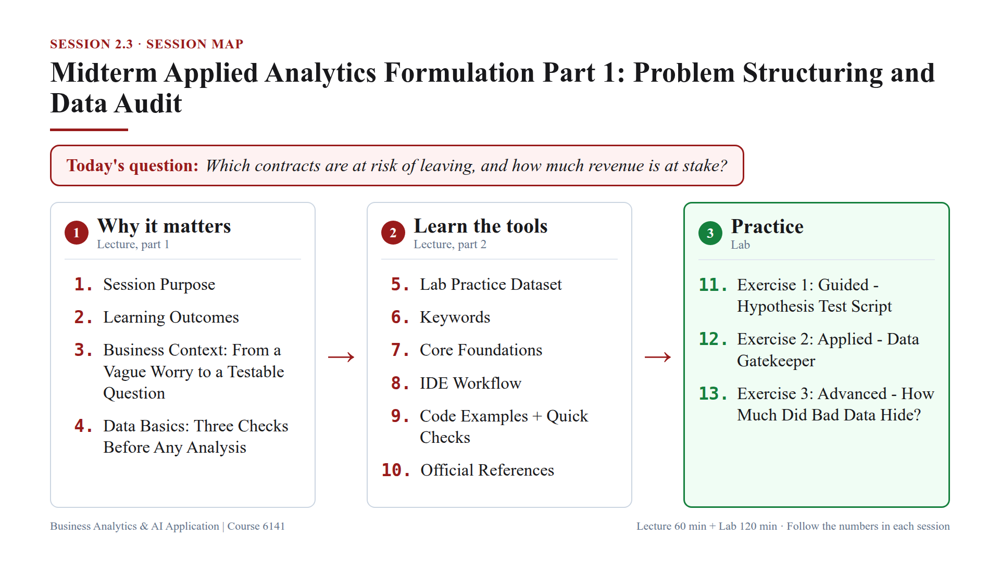

* **Lecture Presentation:** [Download Slides (PDF)](slides/session_02_03_lecture.pdf)
* **Reading (PDF):** [Download Reading (PDF)](handouts/session_02_03_reading.pdf): read before class
* **Schedule:** Week 7 (115/10/25 - 115/10/31) | In-person classes (1:2 Delivery Ratio: 60 Min Lecture + 120 Min Lab)

* **1. Session Purpose:**
  * An IT (Information Technology) services company holds 15 enterprise client contracts worth $10.7 million a year
  * The account director has a vague worry: "some clients are unhappy and may leave", but a worry is not something data can test
  * The account director asks: which contracts are at risk of leaving, and how much revenue is at stake? Today, you turn that worry into a testable question, check that the data can be trusted, and measure the starting point. This is step 1 of your midterm project

* **2. Expected Learning Outcomes (By the end of this session, you will be able to):**
  1. "What exactly should we test?": turn a vague business problem into a testable hypothesis (a clear statement that data can support or prove wrong)
  2. "Can we trust this data?": audit a dataset for missing values (`.isnull()`), duplicates (`.duplicated()`), and impossible values, such as a percentage above 100
  3. "How do we stop bad data automatically?": write `assert` checks (rules the data must pass) and handle an `AssertionError` with `try` / `except`

* **3. Business Context: From a Vague Worry to a Testable Question:**
  * Managers rarely hand you a clean question. A useful analysis moves through four steps:

    | Step | Example |
    |---|---|
    | Vague worry | "Some clients are unhappy and may leave." |
    | Business question | "Is poor service linked to clients at risk of leaving?" |
    | Testable hypothesis | "Accounts below 95% SLA compliance have more billing disputes and a higher retention risk than other accounts." |
    | Measure today (baseline) | "Revenue in High-risk accounts today: $930,000." |

  * SLA (Service Level Agreement): the service promise in a contract, such as "the system is available 99% of the time". SLA compliance is the share of that promise actually delivered.
  * Baseline: today's value of the measure you care about. Without it, nobody can prove later that an action improved anything.
  * **Midterm Project, Step 1 of 2: your Question Card.** Choose a business problem with a dataset you can audit (for example, any dataset from Sessions 1.3 to 2.2), and fill in five lines:
    1. Vague worry: what the manager is concerned about
    2. Business question: what decision the answer supports
    3. Hypothesis: one sentence the data can support or prove wrong
    4. Data and audit: the file you use, and the result of the three checks in section 4
    5. Baseline: one number that describes today
  * Bring your completed Question Card and your audit script to Session 2.4, where you present your findings.

* **4. Data Basics: Three Checks Before Any Analysis:**
  * Bad data produces confident but wrong answers ("garbage in, garbage out"). Run three checks before you analyze:

    | Check | Question | pandas |
    |---|---|---|
    | Completeness | Are any values missing? | `df.isnull().sum()` |
    | Uniqueness | Does each ID appear only once? | `df["Account_ID"].duplicated().sum()` |
    | Validity | Are all values possible? | `(df["SLA_Compliance_Pct"] > 100).sum()` |

  * `NaN` ("Not a Number") is how pandas shows an empty cell. `.isnull()` marks each `NaN` as `True`.
  * A rule for validity comes from business logic: a percentage must be between 0 and 100, and a contract value must be above 0.

* **5. Lab Practice Dataset:**
  * Two versions of the same 15 client contracts (company names are fictional):
    * Clean file: [data/session_02_03_dataset.csv](data/session_02_03_dataset.csv), 15 rows that pass every check. Use it for analysis.
    * Raw file: [data/session_02_03_raw.csv](data/session_02_03_raw.csv), 16 rows as they arrived from the billing system, with a few problems for you to find. Use it for auditing.
  * Columns (the same in both files):
    * `Account_ID`: Unique client account code (e.g., `ACC-301`).
    * `Enterprise_Client`: Client company name (Titan Tech, Beacon Health, Vanguard Retail, and others). One company can hold several accounts.
    * `Contract_Value_USD`: Yearly contract value in U.S. Dollars.
    * `SLA_Compliance_Pct`: Share of the service promise delivered, in percent.
    * `Billing_Discrepancy_Count`: Number of billing disputes (invoices the client challenged) during the contract.
    * `Client_Retention_Risk`: The account team's rating of how likely the client is to leave: `Low`, `Medium`, or `High`.

* **6. Keywords (Core Programming Concepts):**
  * `Hypothesis`:
    * What: one clear statement that data can support or prove wrong
    * Why: turns a vague worry into a test with a yes or no answer
  * `Exploratory Data Analysis (EDA)`:
    * What: a first look at the data with counts, averages, and charts before any formal test
    * Why: shows what the data can answer, and where it looks strange
  * `Data Audit`:
    * What: the three checks: completeness, uniqueness, and validity
    * Why: one bad row can change a total by millions
  * `Baseline`:
    * What: today's value of the measure you care about
    * Why: the starting point for proving any later improvement
  * `assert`:
    * What: a line that stops the script with an `AssertionError` when a rule is broken, such as `assert (df["Contract_Value_USD"] > 0).all()`
    * Why: bad data is caught at the door, before it reaches a report
  * `try` / `except`:
    * What: runs code in `try`; if a chosen error happens, the code in `except` runs instead of stopping the script
    * Why: the script can report the problem clearly and keep going

* **7. Core Programming & Computational Foundations:**
  * **7.1 From a worry to a hypothesis you can test**
    * *The idea:* A hypothesis is one sentence that data can support or prove wrong. A useful hypothesis names what you measure, the groups you compare, and the difference you expect. "Some clients are unhappy" cannot be tested; "accounts below 95% SLA compliance have more billing disputes than the others" can, because the data has a column for each part.
    * *See it on real data:*

      | Part of the hypothesis | In our data |
      |---|---|
      | What is measured | `Billing_Discrepancy_Count` |
      | The two groups | SLA below 95% (`4` accounts) vs 95% or above (`11` accounts) |
      | The expected difference | the first group has more disputes |
      | The result | `4.75` vs `0.64` disputes on average: supported |

    * *Common mistake:* a hypothesis that cannot fail, such as "service quality matters". If no result could ever prove it wrong, it does not help anyone decide.
    * *More examples:*

      | Vague worry | Testable hypothesis | Column needed |
      |---|---|---|
      | "Our big clients are risky." | Accounts above $800,000 have a higher share of High risk ratings. | `Contract_Value_USD`, `Client_Retention_Risk` |
      | "Billing is a mess." | Accounts with 3 or more disputes are rated Medium or High risk. | `Billing_Discrepancy_Count`, `Client_Retention_Risk` |
      | "Service is slipping." | High-risk accounts have a lower average SLA than Low-risk accounts. | `SLA_Compliance_Pct`, `Client_Retention_Risk` |

      In our data, the third one is supported (High-risk accounts average `90.97`% SLA, Low-risk `98.84`%), while the first is not: none of the 6 accounts above $800,000 is rated High risk. A hypothesis that turns out wrong is still useful: it rules out a wrong explanation.
    * *Remember:* a good hypothesis names the measure, the groups, and the expected difference.
  * **7.2 The three data checks**
    * *The idea:* Before any analysis, check that the data is complete (no missing values), unique (no record counted twice), and valid (every value is possible). Each check is a rule on a column that gives `True` / `False` per row; `.sum()` counts the `True` values, because Python counts `True` as 1.
    * *See it on real data:* the raw file (16 rows).

      | Check | Code | Result | The problem |
      |---|---|---|---|
      | Completeness | `raw.isnull().sum().sum()` | `1` | `ACC-306` has no SLA value |
      | Uniqueness | `raw["Account_ID"].duplicated().sum()` | `1` | `ACC-304` appears twice |
      | Validity | `(raw["SLA_Compliance_Pct"] > 100).sum()` | `1` | `ACC-311` shows `105.0`% |
      | Validity | `(raw["Contract_Value_USD"] <= 0).sum()` | `1` | `ACC-313` has a negative value |

    * *Why it matters:* these 4 small problems change the totals. The raw file adds up to `$11,290,000` of contracts; the corrected file to `$10,710,000`. The average SLA looks like `97.45`% in the raw file but is really `96.48`%.
    * *Common mistake:* `.duplicated()` marks only the **second** copy as `True`. To see both copies of `ACC-304`, use `raw.duplicated("Account_ID", keep=False)`.
    * *More examples:*

      | Code | Result | What it tells you |
      |---|---|---|
      | `raw.isnull().sum()` | `1` in `SLA_Compliance_Pct`, `0` elsewhere | which column has the gap |
      | `raw.loc[raw["SLA_Compliance_Pct"].isnull(), "Account_ID"]` | `ACC-306` | which account has the gap |
      | `raw["Account_ID"].is_unique` | `False` | a one-word answer to "are the IDs unique?" |
      | `raw.loc[raw["SLA_Compliance_Pct"] > 100, "Account_ID"]` | `ACC-311` | which account has an impossible percentage |
      | `(~raw["SLA_Compliance_Pct"].between(0, 100)).sum()` | `2` | `.between()` treats a missing value as outside the range too |

    * *Remember:* complete, unique, valid; check all three before you calculate.
  * **7.3 Rules the data must pass: `assert`**
    * *The idea:* `assert rule, "message"` checks a rule. If the rule is `True`, nothing happens and the script continues. If it is `False`, the script stops with an `AssertionError` that shows your message. Rules turn your data checks into a gate: bad data cannot reach the report unnoticed.
    * *See it on real data:*

      | Code | On the raw file | On the clean file |
      |---|---|---|
      | `assert (df["Contract_Value_USD"] > 0).all(), "Contract value must be above 0"` | stops: `AssertionError: Contract value must be above 0` | passes |
      | `assert df["Account_ID"].is_unique, "Account IDs must be unique"` | stops | passes |

    * *`.all()` and `.any()`:* a rule on a column gives many `True` / `False` values, but `assert` needs one answer. `.all()` is `True` only if every value is `True`; `.any()` is `True` if at least one is.
    * *Common mistake:* leaving out the message. `assert rule` alone stops with an empty `AssertionError`, and the reader has to guess which rule failed.
    * *More examples:*

      | Rule | On the raw file | On the clean file |
      |---|---|---|
      | `assert (df["SLA_Compliance_Pct"] <= 100).all()` | fails (`105.0`, and a missing value counts as `False`) | passes |
      | `assert len(df) == 15` | fails (16 rows) | passes |
      | `assert df["Client_Retention_Risk"].isin(["Low", "Medium", "High"]).all()` | passes | passes |
      | `assert not df.isnull().any().any()` | fails (1 gap) | passes |

    * *Remember:* one `assert` per rule, always with a message.
  * **7.4 Handling a failure: `try` / `except`**
    * *The idea:* Sometimes you want the script to report the problem and keep going, for example to finish a cleaning step. Put the risky lines under `try:`. If an `AssertionError` happens, Python jumps to the lines under `except AssertionError as error:` instead of stopping, and `error` holds the message.

      ```text
      try:
          assert (raw["Contract_Value_USD"] > 0).all(), "Contract value must be above 0"
      except AssertionError as error:
          print("Data problem:", error)
      ```

      On the raw file this prints `Data problem: Contract value must be above 0`, and the script continues.
    * *Common mistake:* catching every error with a bare `except:`. It also hides typos and real bugs. Name the error you expect.
    * *More examples:*

      | Code inside `try:` | Error raised | The matching `except` line |
      |---|---|---|
      | `int("abc")` | `ValueError: invalid literal for int() with base 10: 'abc'` | `except ValueError:` |
      | `df["Missing"]` | `KeyError: 'Missing'` | `except KeyError:` |
      | `1 / 0` | `ZeroDivisionError: division by zero` | `except ZeroDivisionError:` |
      | `assert False, "Bad data"` | `AssertionError: Bad data` | `except AssertionError:` |

    * *Remember:* `try` the check, `except` the expected error, and report it clearly.
  * **7.5 The baseline: today's number**
    * *The idea:* A baseline is the value of your measure today. It is the starting point that any later improvement is compared with. Without it, nobody can prove that an action worked.
    * *See it on real data:*

      | Baseline | Value today |
      |---|---|
      | Revenue in High-risk accounts | `$930,000` |
      | Share of all revenue at High risk | `8.7`% |
      | Accounts below 95% SLA | `4` of `15` (`26.7`%) |
      | Billing disputes in total | `26` |

      If the company improves service next quarter and the High-risk revenue falls to, say, $500,000, the baseline shows the size of the improvement.
    * *Common mistake:* measuring the baseline on raw data. With the raw file, High-risk revenue looks like `$310,000` (a negative typo hides `$620,000`): any later "improvement" would be measured from a false start.
    * *More examples:*

      | Code | Result | What it tells you |
      |---|---|---|
      | `df["SLA_Compliance_Pct"].mean()` | `96.48` | average service level today |
      | `df["Billing_Discrepancy_Count"].mean()` | `1.73` | average disputes per account |
      | `len(df[df["Client_Retention_Risk"] == "High"])` | `3` | accounts rated High risk |
      | share of revenue in Low-risk accounts | `72.5`% | the safe part of the portfolio |

    * *Remember:* audit first, then record the baseline.

* **8. Development Workflow in Google Antigravity IDE:**
  * `[1]` File Explorer: create your script with your name and the session code (for example, `Reacher_S23_demo_1.py`), and check both files are in `data/`.
  * `[2]` Code Editor: write a few lines, run, repeat. Small steps keep errors small.
  * `[3]` AI Agent Chat: on an error, capture the traceback (Python's error report) with `Win + Shift + S` (macOS: `Cmd + Shift + 4`), paste it with `Ctrl + V`, and ask why it failed.
  * `[4]` Terminal: run `python` followed by your script name. Return code `0` means the script finished with no errors.

* **9. Hands-On Coding Micro-Examples:**
  * Every example has three parts: **1. Input**, **2. Process**, and **3. Output**. Name each file with your own name and the session code, for example `Reacher_S23_demo_1.py` (pattern: `YourName_S23_demo_1.py`).
  * *Micro-Example 1 (Audit the Raw File):* `YourName_S23_demo_1.py`
    ```python
    # 1. Input: the raw file, as it arrived
    import pandas as pd
    raw = pd.read_csv("data/session_02_03_raw.csv")

    # 2. Process: the three checks, as counts
    missing_values = raw.isnull().sum().sum()
    duplicate_ids = raw["Account_ID"].duplicated().sum()
    sla_above_100 = (raw["SLA_Compliance_Pct"] > 100).sum()
    value_not_positive = (raw["Contract_Value_USD"] <= 0).sum()

    # 3. Output: one line per check
    print("Rows:", len(raw))
    print("Missing values:", missing_values)
    print("Duplicate account IDs:", duplicate_ids)
    print("SLA above 100%:", sla_above_100)
    print("Contract value of 0 or less:", value_not_positive)
    ```
    * *How it works, line by line:*
      * The script reads the **raw** file, as it came from the billing system, before anything is cleaned.
      * `raw.isnull()` marks every empty cell `True`. The first `.sum()` counts per column, and the second adds the columns together (section 7.2).
      * `raw["Account_ID"].duplicated()` marks a row `True` when its ID already appeared above; `.sum()` counts them.
      * `(raw["SLA_Compliance_Pct"] > 100)` and `(raw["Contract_Value_USD"] <= 0)` mark impossible values; `.sum()` counts them.
      * Part 3 prints one line per check, so the report reads like a checklist.
    * *Read the output:*

      ```text
      Rows: 16
      Missing values: 1
      Duplicate account IDs: 1
      SLA above 100%: 1
      Contract value of 0 or less: 1
      ```

      * The file has 16 rows, but only 15 real contracts: one row is a copy.
      * Each check finds exactly 1 problem, 4 in total. Section 7.2 shows which accounts they are.
      * None of these problems raises an error by itself: the file loads normally. Only the checks reveal them.
  * *Quick Check 1 (`.drop_duplicates()`):*
    * New tool: `raw.drop_duplicates()` returns the table without rows that exactly repeat an earlier row. Why: a copied row counts the same contract twice.
    * Task: add one line to part **3. Output**: `print("Rows after removing duplicates:", len(raw.________________()))`
    * Check: the Terminal shows `Rows after removing duplicates: 15`.
  * *Micro-Example 2 (Test the Hypothesis on the Clean File):* `YourName_S23_demo_2.py`
    ```python
    # 1. Input: the clean file
    import pandas as pd
    df = pd.read_csv("data/session_02_03_dataset.csv")

    # 2. Process: mark SLA breaches, then compare the two groups
    df["SLA_Breach"] = df["SLA_Compliance_Pct"] < 95.0
    comparison = df.groupby("SLA_Breach").agg(
        Accounts=("Account_ID", "count"),
        Avg_Disputes=("Billing_Discrepancy_Count", "mean"),
    ).round(2)

    # 3. Output: breach (True) vs no breach (False)
    print(comparison)
    ```
    * *How it works, line by line:*
      * The script reads the **clean** file: analysis is done on data that passed the checks.
      * `df["SLA_Compliance_Pct"] < 95.0` marks each account `True` (breach) or `False`, and stores the result as a new column, `SLA_Breach`.
      * `df.groupby("SLA_Breach")` splits the accounts into the 2 groups (Session 1.4). `.agg()` counts the accounts and averages the disputes in each group.
      * `.round(2)` keeps 2 decimals.
    * *Read the output:*

      ```text
                  Accounts  Avg_Disputes
      SLA_Breach
      False             11          0.64
      True               4          4.75
      ```

      * The 4 accounts below the 95% promise average `4.75` billing disputes; the other 11 average `0.64`, about 7 times fewer.
      * The first part of the hypothesis is supported: poor service and billing disputes go together. Quick Check 2 tests the second part, the link with retention risk.
  * *Quick Check 2 (`pd.crosstab()`):*
    * New tool: `pd.crosstab(column_a, column_b)` counts the rows for every pair of values, such as breach yes or no against risk Low, Medium, or High. Why: tests the second half of the hypothesis in one table.
    * Task: add one line to part **3. Output**: `print(pd.________(df["SLA_Breach"], df["Client_Retention_Risk"]))`
    * Check: in the `True` row, `High` is `3` and `Medium` is `1`: 3 of the 4 breached accounts are rated High risk, and no non-breached account is.
  * *Micro-Example 3 (Measure the Baseline):* `YourName_S23_demo_3.py`
    ```python
    # 1. Input: the clean file
    import pandas as pd
    df = pd.read_csv("data/session_02_03_dataset.csv")

    # 2. Process: contract value by risk rating, and the High-risk share
    value_by_risk = df.groupby("Client_Retention_Risk")["Contract_Value_USD"].sum()
    high_risk_value = value_by_risk["High"]
    high_risk_share = high_risk_value / df["Contract_Value_USD"].sum() * 100

    # 3. Output: today's baseline
    print(value_by_risk)
    print("High-risk share of revenue (%):", round(high_risk_share, 1))
    ```
    * *How it works, line by line:*
      * `df.groupby("Client_Retention_Risk")["Contract_Value_USD"].sum()` adds up contract value for each risk rating. Choosing one column after `groupby()` gives a simple list of totals instead of a table.
      * `value_by_risk["High"]` reads one value from that list, by its label.
      * The share divides the High-risk total by all contract value and multiplies by 100.
    * *Read the output:*

      ```text
      Client_Retention_Risk
      High       930000.0
      Low       7770000.0
      Medium    2010000.0
      Name: Contract_Value_USD, dtype: float64
      High-risk share of revenue (%): 8.7
      ```

      * `$930,000` a year, `8.7`% of revenue, sits in accounts rated High risk. This is the baseline (section 7.5).
      * Most revenue (`$7,770,000`) is in Low-risk accounts, so the business is not in immediate danger, but the 3 High-risk accounts are where action pays off first.
      * The last line of the list, `Name: ... dtype: float64`, is pandas describing the list: its name and its type. It is not data.
  * *Quick Check 3 (f-string number format):*
    * New tool: `f"${value:,.0f}"` writes a number with thousands separators and no decimals, such as `$930,000`. Why: managers read money faster in this form.
    * Task: add one line to part **3. Output**: `print(f"Revenue at High risk: ${high_risk_value:___}")`
    * Check: the Terminal shows `Revenue at High risk: $930,000`.

* **10. Official Python Documentation & References:**
  * [Python Tutorial: Errors and Exceptions (`try` / `except`)](https://docs.python.org/3/tutorial/errors.html).
  * [Python Reference: The `assert` Statement](https://docs.python.org/3/reference/simple_stmts.html#the-assert-statement).
  * [Pandas User Guide: Working with Missing Data](https://pandas.pydata.org/docs/user_guide/missing_data.html).

* **11. Exercise 1: Guided Practice - Hypothesis Test Script:**
  * *Step 1: Open Script:* In Google Antigravity IDE, create a new script named `YourName_S23_hypothesis.py`, replacing `YourName` with your own name (for example, `Reacher_S23_hypothesis.py`).
  * *Step 2: Test Two Hypotheses and Measure the Baseline:*
    Type the following code:
    ```python
    # 1. Input: the clean file
    import pandas as pd
    df = pd.read_csv("data/session_02_03_dataset.csv")

    # 2. Process: two tests and one baseline
    # Hypothesis 1: higher-risk accounts have more billing disputes
    disputes_by_risk = (
        df.groupby("Client_Retention_Risk")["Billing_Discrepancy_Count"]
        .mean().round(2)
    )
    # Hypothesis 2: lower SLA compliance goes with more disputes
    sla_vs_disputes = df["SLA_Compliance_Pct"].corr(
        df["Billing_Discrepancy_Count"]
    )
    # Baseline: revenue in High-risk accounts today
    high_risk_value = df.loc[
        df["Client_Retention_Risk"] == "High", "Contract_Value_USD"
    ].sum()

    # 3. Output: a short report
    print("Hypothesis 1: average disputes by risk rating\n", disputes_by_risk)
    print(f"Hypothesis 2: correlation of SLA and disputes: {sla_vs_disputes:.3f}")
    print(f"Baseline: revenue at High risk: ${high_risk_value:,.0f}")
    ```
    * `df.loc[rows, "Column_Name"]` selects the rows and one column at the same time.
    * `{sla_vs_disputes:.3f}` shows the number with 3 decimals.
  * *Step 3: Interpret:* Write two comment lines at the end of the script: does each result support its hypothesis?
  * *Step 4: Execute in Terminal:* Run `python YourName_S23_hypothesis.py` in Panel `[4]` and confirm return code `0`.
  * *Success Check:* average disputes are `5.33` for High, `2.0` for Medium, and `0.25` for Low; the correlation is `-0.982` (lower SLA goes with more disputes); the baseline is `$930,000`. Both hypotheses are supported.

* **12. Exercise 2: Applied Practice - Data Gatekeeper:**
  * *Coding Challenge:* In `YourName_S23_practice.py`, write checks that stop bad data, then clean the raw file so it passes.
  * *Task 1 (Write the Rules):* Load `data/session_02_03_raw.csv`. Write three `assert` lines with messages:
    * `assert raw["SLA_Compliance_Pct"].between(0, 100).all(), "SLA must be between 0 and 100"`
    * `assert (raw["Contract_Value_USD"] > 0).all(), "Contract value must be above 0"`
    * `assert not raw["Account_ID"].duplicated().any(), "Account IDs must be unique"`
    * `.between(0, 100)` is `True` when a value is from 0 to 100; a missing value counts as `False`.
  * *Task 2 (Read the AssertionError & AI Diagnosis):* Run the script. It stops at the first rule with `AssertionError: SLA must be between 0 and 100`. Capture the traceback with `Win + Shift + S`, paste it into Panel `[3]` (AI Agent Chat) with `Ctrl + V`, and ask which rows break the rule.
  * *Task 3 (Clean, Re-check, Save):* Put the three `assert` lines inside `try:` and print the message under `except AssertionError as error:`. Then build `clean` from `raw`: remove duplicate rows with `.drop_duplicates()`, keep only rows where the SLA is between 0 and 100, and keep only rows where the contract value is above 0. Run the three checks again on `clean`, and save it to `data/contracts_clean.csv` with `index=False`.
  * *Success Check:* the first run prints `SLA must be between 0 and 100`; `clean` has `12` rows and passes all three checks; the script ends with return code `0`.

* **13. Exercise 3: Advanced Practice - How Much Did Bad Data Hide?:**
  * *Goal:* Show the account director, in numbers, how the raw file's problems distort the risk report, and list exactly which accounts the data team must fix.
  * *What you need:*
    * Files: `data/session_02_03_raw.csv` (with problems) and `data/session_02_03_dataset.csv` (the corrected version of the same contracts).
    * Script name: `YourName_S23_challenge.py`.
    * Tools you already know: the three checks, `groupby()`, `.sum()`, Boolean masks with `|`, `.loc[]`, `pd.DataFrame()`, and f-strings.
  * *Requirements (follow them in order):*
    1. Write a function `audit(table)` that returns a dictionary with four counts: `"missing"`, `"duplicate_ids"`, `"sla_out_of_range"` (SLA above 100), and `"value_not_positive"` (contract value of 0 or less).
    2. Call `audit()` on both files and print both dictionaries.
    3. Make a list of every `Account_ID` in the raw file that breaks at least one rule. Each account should appear only once, sorted from smallest to largest.
    4. For each file, sum `Contract_Value_USD` by `Client_Retention_Risk`. Put the two results side by side in one DataFrame with the columns `Raw_USD` and `Correct_USD`, and add `Difference_USD` = `Raw_USD` - `Correct_USD`.
    5. Print the table and one sentence that states the biggest distortion in plain words, using an f-string with thousands separators.
  * *New tools for this exercise:*
    * Defining a function: `def audit(table):` followed by indented lines, ending with `return {...}`. Calling `audit(raw)` runs those lines on `raw` and gives back the dictionary.
    * `|` means "or" for masks: `(rule_1) | (rule_2)` is `True` when at least one rule is `True`. `.isnull()` on one column marks its missing values.
    * Unique, sorted values: `sorted(set(raw.loc[mask, "Account_ID"]))`. `set()` keeps each value once; `sorted()` puts them in order.
    * Side-by-side columns: `pd.DataFrame({"Raw_USD": raw_sums, "Correct_USD": correct_sums})`, where both sums come from `groupby()`, lines up the values by risk rating.
  * *Hints:*
    * For requirement 3, build one mask that is `True` for a duplicate, a missing value, an SLA above 100, or a value of 0 or less. Use `raw.duplicated("Account_ID", keep=False)` so that both copies of a duplicated account are marked.
    * Print each intermediate result before you combine them.
  * *Self-Check (expected results):*
    * Raw file: `{"missing": 1, "duplicate_ids": 1, "sla_out_of_range": 1, "value_not_positive": 1}`; clean file: all four counts are `0`.
    * Accounts to fix: `['ACC-304', 'ACC-306', 'ACC-311', 'ACC-313']`.
    * Differences: `High` `-620000.0`, `Low` `1200000.0`, `Medium` `0.0`.
    * Business meaning: one negative typo (`ACC-313`) made High-risk revenue look like `$310,000` instead of `$930,000`, hiding two-thirds of the real risk, while one duplicated row added `$1,200,000` to Low risk. The data must be fixed before anyone acts on the risk report.

---

<a id="session-02-04"></a>
### Session 2.4: Midterm Analytics Pipeline Defense Part 2: Exploratory Findings and Executive Review

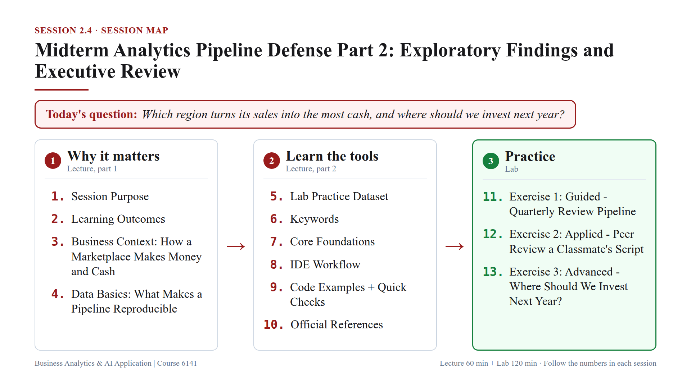

* **Lecture Presentation:** [Download Slides (PDF)](slides/session_02_04_lecture.pdf)
* **Reading (PDF):** [Download Reading (PDF)](handouts/session_02_04_reading.pdf): read before class
* **Schedule:** Week 8 (115/11/01 - 115/11/07) | In-person classes (1:2 Delivery Ratio: 60 Min Lecture + 120 Min Lab)

* **1. Session Purpose:**
  * An online marketplace earns a fee on every sale its sellers make, in three regions: North America, Europe, and Asia Pacific
  * Big sales are not the same as cash in the bank: the region that sells the most may not be the one that generates the most cash
  * The CFO (Chief Financial Officer) asks: which region turns its sales into the most cash, and where should we invest next year? Today, you answer with one script that anyone can rerun, and present your midterm findings in the same way

* **2. Expected Learning Outcomes (By the end of this session, you will be able to):**
  1. "Can someone else get the same numbers?": build a reproducible pipeline (one script that goes from the raw file to the final report with no manual steps), organized into functions
  2. "Which region turns sales into the most cash?": calculate revenue and the operating cash flow margin by region and quarter
  3. "How do I explain it to the CFO?": write findings as finding, evidence, and recommendation; review a classmate's script; and fix a `TypeError` (mixing text and numbers)

* **3. Business Context: How a Marketplace Makes Money and Cash:**
  * Four terms, one example (North America, 2024-Q1):

    | Term | Meaning | Example |
    |---|---|---|
    | GMV (Gross Merchandise Value) | the total value of everything sold on the platform | `145.2` USD M |
    | Take rate | the share of GMV the platform keeps as its fee | `12.5`% |
    | Revenue | GMV x take rate / 100: the platform's own income | `18.15` USD M |
    | OCF (Operating Cash Flow) | the cash the business actually generated after paying its operating costs | `5.6` USD M |

  * OCF margin = OCF / revenue x 100. It answers "of every dollar of revenue, how many cents became cash?" Example: `5.6 / 18.15 x 100 = 30.9`%.
  * **Midterm Project, Step 2 of 2: present your findings.** In a short presentation, walk through:
    1. Your Question Card from Session 2.3 (worry, question, hypothesis, data, baseline)
    2. Your audit result: what you checked and what you fixed
    3. Your findings, each written in three parts:
       * **Finding:** one sentence a manager can repeat. "North America turns the most revenue into cash."
       * **Evidence:** the number behind it. "Its OCF margin is 31.0%, against 24.7% in Europe and 18.5% in Asia Pacific."
       * **Recommendation:** what to do. "Study North America's cost structure before expanding in Asia Pacific."
    4. A live run of your script, from the raw file to the final report

* **4. Data Basics: What Makes a Pipeline Reproducible:**
  * A reproducible pipeline runs from top to bottom and produces the same numbers on any computer. It has four stages:

    | Stage | What it does | Example in today's script |
    |---|---|---|
    | Load | Read the raw file | `pd.read_csv("data/session_02_04_dataset.csv")` |
    | Check | Stop if the data breaks a rule | `assert (df["Gross_Merchandise_Value_USD_M"] > 0).all()` |
    | Calculate | Add the measures | revenue and OCF margin |
    | Report | Print and save the result | `summary.to_csv("data/region_summary.csv")` |

  * Three habits that make a script reproducible:
    * Use relative paths such as `data/...`, never paths that only exist on your computer, such as `C:/Users/Reacher/Desktop/...`
    * Calculate every number from the data; never type a result into the code by hand
    * Before presenting, delete your output files and run the script again from the start

* **5. Lab Practice Dataset:**
  * File Link: [data/session_02_04_dataset.csv](data/session_02_04_dataset.csv)
  * Audited 12-row quarterly marketplace dataset (fictional teaching data): 3 regions x 4 quarters, one row per region and quarter:
    * `Quarter_Code`: Reporting quarter, `2024-Q1` through `2024-Q4`.
    * `Market_Segment`: Region: `North_America`, `Europe`, or `Asia_Pacific`.
    * `Gross_Merchandise_Value_USD_M`: GMV (Gross Merchandise Value) in millions of U.S. Dollars.
    * `Platform_Take_Rate_Pct`: The platform's fee as a percentage of GMV.
    * `Operating_Cash_Flow_USD_M`: OCF (Operating Cash Flow) in millions of U.S. Dollars.

* **6. Keywords (Core Programming Concepts):**
  * `Reproducible Pipeline`:
    * What: one script that goes from the raw file to the final report, with no manual steps
    * Why: anyone can rerun it and check your numbers
  * `Function` (`def` / `return`):
    * What: a named block of code that takes inputs and gives back a result
    * Why: each pipeline stage gets a clear name, and you can reuse it
  * `Relative Path`:
    * What: a file path that starts from the project folder, such as `data/session_02_04_dataset.csv`
    * Why: works on every computer that has the project folder
  * `Data Type` and `TypeError`:
    * What: text (`str`) and numbers (`float`, `int`) are different types; `"Total: " + 204.3` raises a `TypeError`
    * Why: printing a result is where this mistake happens most
  * `Executive Finding`:
    * What: a finding, its evidence, and a recommendation
    * Why: managers act on clear statements backed by numbers, not on code
  * `Peer Review`:
    * What: a classmate checks your script against a short checklist
    * Why: a second reader catches mistakes the author no longer sees

* **7. Core Programming & Computational Foundations:**
  * **7.1 Functions: name a step, then reuse it**
    * *The idea:* A function is a named block of code. You give it inputs (parameters), it does its work, and `return` hands back the result. Once a step is a function, you can run it again with one line, on any data, and a reader can understand the pipeline from the function names alone.

      ```text
      def revenue_usd_m(gmv, take_rate_pct):
          return gmv * take_rate_pct / 100
      ```

      `def` starts the function, the name follows, then the parameters in brackets and a colon. The indented lines are the body.
    * *See it on real data:*

      | Call | Result | What happened |
      |---|---|---|
      | `revenue_usd_m(145.2, 12.5)` | `18.15` | North America, Q1: `145.2 x 12.5 / 100` |
      | `revenue_usd_m(160.8, 13.0)` | `20.9` (rounded) | North America, Q4: same function, new inputs |
      | `revenue_usd_m(df["Gross_Merchandise_Value_USD_M"], df["Platform_Take_Rate_Pct"])` | 12 values | the same function works on whole columns |

    * *Common mistake 1, forgetting `return`:* a function without `return` gives back `None`, Python's "nothing". The calculation happens, but the result is thrown away.
    * *Common mistake 2, using an inside name outside:* a variable created inside a function exists only there. After `def f(x): y = x * 2`, the line `print(y)` outside the function raises `NameError: name 'y' is not defined`. Use `return y` and store the result: `y = f(3)`.
    * *More examples:*

      | Function | Call | Result |
      |---|---|---|
      | `def ocf_margin(ocf, revenue): return round(ocf / revenue * 100, 1)` | `ocf_margin(5.6, 18.15)` | `30.9` |
      | `def load_data(path): return pd.read_csv(path)` | `load_data("data/session_02_04_dataset.csv")` | the 12-row DataFrame |
      | `def is_weak(margin, limit=20): return margin < limit` | `is_weak(18.6)` | `True`; `limit` uses its default value, `20` |
      | the same | `is_weak(18.6, limit=15)` | `False`; a different limit passed in |

    * *Remember:* `def` to define, `return` to hand back, and store the result when you call it.
  * **7.2 A reproducible pipeline: load, check, calculate, report**
    * *The idea:* A pipeline is one script that goes from the raw file to the final report with no manual step in between. "Reproducible" means anyone can run it again, on any computer, and get exactly the same numbers. That is what lets a manager trust your midterm results.

      | Stage | Function in Micro-Example 2 | Why it is separate |
      |---|---|---|
      | Load and check | `load_data(path)` | bad data stops here, before any number is calculated |
      | Calculate | `add_metrics(df)` | one place for every formula |
      | Summarize | `summarize(df)` | the table the manager reads |
      | Report | `print(summary)` and `.to_csv()` | the result on screen and in a file |

    * *Three habits:* use relative paths such as `data/...` (a path like `C:/Users/Reacher/Desktop/...` only exists on one computer); calculate every number from the data, never type a result by hand; before you present, delete the output files and run the script again from the top.
    * *Common mistake:* running cells or lines out of order while developing, so the script works on your screen but fails when run from the start. The test of a pipeline is a clean run, top to bottom.
    * *More examples:*

      | Path or habit | Works on | Verdict |
      |---|---|---|
      | `"data/session_02_04_dataset.csv"` | every computer with the project folder | relative path: use this |
      | `"C:/Users/Reacher/Desktop/data.csv"` | only Reacher's computer | absolute path: breaks for everyone else |
      | a total typed into the code as `204.3` | only until the data changes | hard-coded result: calculate it instead |
      | output files left from an earlier run | hides missing steps | delete outputs, then rerun from the top |

    * *Remember:* one script, top to bottom, same numbers every time.
  * **7.3 Text and numbers do not mix: `TypeError`**
    * *The idea:* Python keeps text (`str`) and numbers (`int`, `float`) apart. `+` adds two numbers or joins two texts, but it refuses to combine a text with a number, because it cannot know whether you want to add or to join.
    * *See it on real data:*

      | Code | Result |
      |---|---|
      | `"Total: " + 204.3` | `TypeError: can only concatenate str (not "float") to str` |
      | `"Rows: " + len(df)` | `TypeError: can only concatenate str (not "int") to str` |
      | `"Total: " + str(204.3)` | `Total: 204.3` |
      | `f"Total: {204.3}"` | `Total: 204.3` |

      "Concatenate" means "join texts together".
    * *Formatting numbers inside f-strings:* after the value, a colon and a format code control how the number looks.

      | Code | Result | Format |
      |---|---|---|
      | `f"{204.3049:.2f}"` | `204.30` | 2 decimals |
      | `f"{1234567.8:,.0f}"` | `1,234,568` | thousands separators, no decimals |
      | `f"{0.2467:.1%}"` | `24.7%` | a share shown as a percentage |

    * *More examples:*

      | Code | Result | What it tells you |
      |---|---|---|
      | `str(12) + " stores"` | `12 stores` | convert the number to text first |
      | `f"{12} rows"` | `12 rows` | an f-string converts for you |
      | `"Q" + str(4)` | `Q4` | build a label from text and a number |
      | `int("12") + 1` | `13` | convert text to a number before adding |
      | `float("18.15") * 2` | `36.3` | decimal text becomes a `float` |
      | `"5" * 3` | `555` | a surprise: text times a number repeats the text |

    * *Remember:* put numbers into text with an f-string, and format them for the reader.
  * **7.4 Hard-coded numbers: believable but wrong**
    * *The idea:* A hard-coded number is a value typed directly into the code, such as `0.125` for the take rate. It is risky because it looks reasonable and produces believable results, even when the real values differ from row to row.
    * *See it on real data:* revenue for the year, by region, with the real take rate of each row vs a fixed `12.5`%.

      | Region | With each row's take rate | With a fixed `0.125` | Error |
      |---|---|---|---|
      | North America | `65.57` | `67.16` | `+1.59` |
      | Europe | `68.34` | `69.28` | `+0.94` |
      | Asia Pacific | `70.39` | `70.49` | `+0.10` |

      Our take rates range from `10.5`% to `13.5`%, so no single number is right. Nothing in the output warns you: the error is easy to miss.
    * *More examples:*

      | What you need | From the data | The hard-coded risk |
      |---|---|---|
      | total revenue for the year | `204.31` | `206.92` with a fixed `0.125` |
      | number of quarters | `len(df)` reads `12` | typing `12` breaks when a 13th row arrives |
      | list of regions | `df["Market_Segment"].unique()` | a typed list misses a new region |
      | a business rule | `MARGIN_LIMIT = 20` at the top of the script | a named rule is visible and easy to change |

    * *Remember:* read every input from the data; type a number into code only when it is a rule, and give it a name, such as `MARGIN_LIMIT = 20`.
  * **7.5 Writing findings for managers**
    * *The idea:* Managers act on clear statements, not on code. Write each finding in three parts: the **finding** (one sentence a manager can repeat), the **evidence** (the number behind it), and the **recommendation** (what to do).
    * *See it on real data:*

      | Part | Weak version | Strong version |
      |---|---|---|
      | Finding | "Margins vary by region." | "North America turns the most revenue into cash." |
      | Evidence | "See the table." | "Its OCF margin is 31.0%, against 24.7% in Europe and 18.5% in Asia Pacific." |
      | Recommendation | "Look into it." | "Study North America's cost structure before expanding in Asia Pacific." |

    * *Common mistake:* averaging percentages. The 4 quarterly margins of Asia Pacific average `18.1`%, but its true margin for the year, total OCF / total revenue, is `18.5`%. Always compute a group's ratio from its totals.
    * *More examples:*

      | Finding | Evidence | Recommendation |
      |---|---|---|
      | Europe has a mid-level cash margin. | `24.7`%, between North America and Asia Pacific | Keep Europe's investment level unchanged. |
      | Asia Pacific is improving fast. | its margin rose from `15.0`% in Q1 to `22.0`% in Q4: `+7.0` points | Keep investing, with a margin target for next year. |
      | Q4 was the strongest quarter. | GMV `524.4` and OCF `17.9`, both the year's highest | Plan capacity for next year's Q4 peak. |

    * *Remember:* finding, evidence, recommendation, and every number from the data.

* **8. Development Workflow in Google Antigravity IDE:**
  * `[1]` File Explorer: create your script with your name and the session code (for example, `Reacher_S24_demo_1.py`), and check the dataset is in `data/`.
  * `[2]` Code Editor: write a few lines, run, repeat. Small steps keep errors small.
  * `[3]` AI Agent Chat: on an error, capture the traceback (Python's error report) with `Win + Shift + S` (macOS: `Cmd + Shift + 4`), paste it with `Ctrl + V`, and ask why it failed.
  * `[4]` Terminal: run `python` followed by your script name. Return code `0` means the script finished with no errors.

* **9. Hands-On Coding Micro-Examples:**
  * Every example has three parts: **1. Input**, **2. Process**, and **3. Output**. Name each file with your own name and the session code, for example `Reacher_S24_demo_1.py` (pattern: `YourName_S24_demo_1.py`).
  * *Micro-Example 1 (From GMV to Cash, Row by Row):* `YourName_S24_demo_1.py`
    ```python
    # 1. Input: load the quarterly results
    import pandas as pd
    df = pd.read_csv("data/session_02_04_dataset.csv")

    # 2. Process: revenue, then OCF margin, for every row
    df["Revenue_USD_M"] = (
        df["Gross_Merchandise_Value_USD_M"] * df["Platform_Take_Rate_Pct"] / 100
    ).round(2)
    df["OCF_Margin_Pct"] = (
        df["Operating_Cash_Flow_USD_M"] / df["Revenue_USD_M"] * 100
    ).round(1)

    # 3. Output: the 3 rows with the lowest margin
    lowest = df.sort_values("OCF_Margin_Pct").head(3)
    print(lowest[["Quarter_Code", "Market_Segment", "OCF_Margin_Pct"]])
    ```
    * *How it works, line by line:*
      * The first calculation multiplies each row's GMV by that row's take rate and divides by 100: revenue in USD millions. No take rate is typed by hand (section 7.4).
      * The second divides each row's OCF by its revenue: the OCF margin, the share of revenue that became cash. `.round(1)` keeps 1 decimal.
      * `df.sort_values("OCF_Margin_Pct")` orders the rows from the lowest margin to the highest, and `.head(3)` keeps the 3 lowest.
    * *Read the output:*

      ```text
        Quarter_Code Market_Segment  OCF_Margin_Pct
      8      2024-Q1   Asia_Pacific            15.0
      5      2024-Q2   Asia_Pacific            16.8
      2      2024-Q3   Asia_Pacific            18.6
      ```

      * The 3 weakest quarters all belong to Asia Pacific: in Q1, only `15.0` cents of every revenue dollar became cash.
      * The margins rise from Q1 to Q3: Asia Pacific is weak but improving. Quick Check 1 shows Q4 too.
  * *Quick Check 1 (`.pivot_table()`):*
    * New tool: `df.pivot_table(index="A", columns="B", values="C")` makes a grid with one row per value of `A` and one column per value of `B`, like an Excel pivot table. Why: shows all 12 margins in one readable grid.
    * Task: add one line to part **3. Output**: `print(df.___________(index="Market_Segment", columns="Quarter_Code", values="OCF_Margin_Pct"))`
    * Check: the `Asia_Pacific` row reads `15.0`, `16.8`, `18.6`, `22.0`: its margin improved every quarter.
  * *Micro-Example 2 (The Same Work as a Pipeline of Functions):* `YourName_S24_demo_2.py`
    ```python
    # 1. Input: a function that loads and checks the raw file
    import pandas as pd

    def load_data(path):
        df = pd.read_csv(path)
        assert (df["Gross_Merchandise_Value_USD_M"] > 0).all(), "GMV must be above 0"
        return df

    # 2. Process: functions that add measures and summarize by region
    def add_metrics(df):
        df["Revenue_USD_M"] = (
            df["Gross_Merchandise_Value_USD_M"] * df["Platform_Take_Rate_Pct"] / 100
        ).round(2)
        return df

    def summarize(df):
        summary = df.groupby("Market_Segment").agg(
            Revenue_USD_M=("Revenue_USD_M", "sum"),
            OCF_USD_M=("Operating_Cash_Flow_USD_M", "sum"),
        )
        summary["OCF_Margin_Pct"] = (
            summary["OCF_USD_M"] / summary["Revenue_USD_M"] * 100
        ).round(1)
        return summary

    # 3. Output: run the stages in order, then print and save
    df = load_data("data/session_02_04_dataset.csv")
    df = add_metrics(df)
    summary = summarize(df)
    print(summary)
    summary.to_csv("data/region_summary.csv")
    ```
    * *How it works, line by line:*
      * `load_data(path)` reads the file and checks with `assert` that every GMV is above 0; bad data stops the pipeline here (section 7.2).
      * `add_metrics(df)` adds the revenue column and returns the table.
      * `summarize(df)` groups by region, sums revenue and OCF, and computes each region's margin **from its totals** (section 7.5).
      * The last 5 lines run the stages in order. Read them alone and you know what the whole script does: load, add metrics, summarize, print, save.
      * `summary.to_csv("data/region_summary.csv")` saves the result so the numbers can be checked later.
    * *Read the output:*

      ```text
                      Revenue_USD_M  OCF_USD_M  OCF_Margin_Pct
      Market_Segment
      Asia_Pacific            70.39       13.0            18.5
      Europe                  68.34       16.9            24.7
      North_America           65.57       20.3            31.0
      ```

      * Asia Pacific earns the most revenue (`70.39`) but keeps the least as cash (`18.5`%).
      * North America earns the least revenue (`65.57`) but generates the most cash (`20.3`), with a margin of `31.0`%.
      * Bigger is not the same as better: the CFO's question needs both columns.
  * *Quick Check 2 (Docstring):*
    * New tool: a docstring, a text in triple quotes on the first line inside a function. `help(function_name)` prints it. Why: a reviewer learns what each stage does without reading its code.
    * Task: add one line directly under `def add_metrics(df):`, indented like the line below it: `"""Add revenue in USD M from GMV and the take rate."""`. Then add `help(add_metrics)` to part **3. Output**.
    * Check: the Terminal prints a help page that includes `Add revenue in USD M from GMV and the take rate.`
  * *Micro-Example 3 (Write the Findings for the CFO):* `YourName_S24_demo_3.py`
    ```python
    # 1. Input: load the data and build the region summary
    import pandas as pd
    df = pd.read_csv("data/session_02_04_dataset.csv")
    df["Revenue_USD_M"] = (
        df["Gross_Merchandise_Value_USD_M"] * df["Platform_Take_Rate_Pct"] / 100
    ).round(2)
    summary = df.groupby("Market_Segment").agg(
        Revenue_USD_M=("Revenue_USD_M", "sum"),
        OCF_USD_M=("Operating_Cash_Flow_USD_M", "sum"),
    )

    # 2. Process: margin, then the best region by margin
    summary["OCF_Margin_Pct"] = (
        summary["OCF_USD_M"] / summary["Revenue_USD_M"] * 100
    ).round(1)
    ranked = summary.sort_values("OCF_Margin_Pct", ascending=False)
    best_region = ranked.index[0]
    best_margin = ranked["OCF_Margin_Pct"].iloc[0]

    # 3. Output: finding, evidence, recommendation
    print(f"Finding: {best_region} turns the most revenue into cash.")
    print(f"Evidence: its OCF margin is {best_margin}%.")
    print("Recommendation: study its cost structure before expanding elsewhere.")
    ```
    * *How it works, line by line:*
      * Part 1 rebuilds the region summary, as in Micro-Example 2.
      * `summary.sort_values("OCF_Margin_Pct", ascending=False)` puts the best margin first.
      * `ranked.index[0]` reads the first row label, here the name of the best region. After `groupby()`, the region names are the row labels.
      * `ranked["OCF_Margin_Pct"].iloc[0]` reads the first value of the margin column by position.
      * The three `print()` lines write the finding, the evidence, and the recommendation (section 7.5), with the numbers filled in by f-strings.
    * *Read the output:*

      ```text
      Finding: North_America turns the most revenue into cash.
      Evidence: its OCF margin is 31.0%.
      Recommendation: study its cost structure before expanding elsewhere.
      ```

      * The region and the margin come from the data, not from typing: if next year's file changes, the sentence changes with it.
      * The recommendation line is still written by a person. The script supplies the evidence; the judgement stays with the analyst.
  * *Quick Check 3 (`.idxmax()`):*
    * New tool: `column.idxmax()` returns the row label of the largest value, in one step. Why: finds "which region?" without sorting.
    * Task: add one line to part **3. Output**: `print("Most revenue:", summary["Revenue_USD_M"].______())`
    * Check: the Terminal shows `Most revenue: Asia_Pacific`. The region with the most revenue is not the one with the best margin.

* **10. Official Python Documentation & References:**
  * [Python Tutorial: Defining Functions](https://docs.python.org/3/tutorial/controlflow.html#defining-functions).
  * [PEP 257: Docstring Conventions](https://peps.python.org/pep-0257/).
  * [Pandas API Reference: `DataFrame.pivot_table`](https://pandas.pydata.org/docs/reference/api/pandas.DataFrame.pivot_table.html).
  * [Cookiecutter Data Science: A Logical, Reasonably Standardized Project Structure](https://drivendata.github.io/cookiecutter-data-science/).

* **11. Exercise 1: Guided Practice - Quarterly Review Pipeline:**
  * *Step 1: Open Script:* In Google Antigravity IDE, create a new script named `YourName_S24_defense.py`, replacing `YourName` with your own name (for example, `Reacher_S24_defense.py`).
  * *Step 2: Build the Quarterly Review:*
    Type the following code:
    ```python
    # 1. Input: load the quarterly results
    import pandas as pd
    df = pd.read_csv("data/session_02_04_dataset.csv")

    # 2. Process: revenue per row, then totals per quarter
    df["Revenue_USD_M"] = (
        df["Gross_Merchandise_Value_USD_M"] * df["Platform_Take_Rate_Pct"] / 100
    ).round(2)
    quarterly = df.groupby("Quarter_Code").agg(
        GMV_USD_M=("Gross_Merchandise_Value_USD_M", "sum"),
        Revenue_USD_M=("Revenue_USD_M", "sum"),
        OCF_USD_M=("Operating_Cash_Flow_USD_M", "sum"),
    )
    quarterly["OCF_Margin_Pct"] = (
        quarterly["OCF_USD_M"] / quarterly["Revenue_USD_M"] * 100
    ).round(1)

    # 3. Output: one row per quarter
    print("Quarterly review:\n", quarterly)
    ```
  * *Step 3: Write Two Findings:* Under the code, write two comment lines in the three-part form (finding, evidence, recommendation): one about the quarter with the highest GMV, and one about how the total OCF margin changed during the year.
  * *Step 4: Execute in Terminal:* Run `python YourName_S24_defense.py` in Panel `[4]` and confirm return code `0`.
  * *Success Check:* `2024-Q4` has the highest GMV (`524.4`) and OCF (`17.9`); Q2 has the lowest GMV (`312.4`). The total OCF margin is `23.7`% in Q1, `23.7`% in Q2, `24.6`% in Q3, and `25.8`% in Q4.

* **12. Exercise 2: Applied Practice - Peer Review a Classmate's Script:**
  * *Coding Challenge:* A classmate sends you this script for their midterm. Copy it into `YourName_S24_practice.py`, review it, and fix it.
    ```python
    # Classmate's script: this script has mistakes on purpose
    import pandas as pd
    df = pd.read_csv("data/session_02_04_dataset.csv")
    df["Revenue_USD_M"] = df["Gross_Merchandise_Value_USD_M"] * 0.125
    total_revenue = df["Revenue_USD_M"].sum()
    print("Total revenue (USD M): " + total_revenue)
    ```
  * *Task 1 (Run It & AI Diagnosis):* Run the script. It stops with `TypeError: can only concatenate str (not "numpy.float64") to str`. Capture the traceback with `Win + Shift + S`, paste it into Panel `[3]` (AI Agent Chat) with `Ctrl + V`, and ask why text and a number cannot be joined with `+`. (`numpy.float64` is the number type that pandas returns; it behaves like a normal `float`.)
  * *Task 2 (Fix the TypeError):* Change the last line to an f-string, rounding to 2 decimals: `f"Total revenue (USD M): {total_revenue:.2f}"`.
  * *Task 3 (Apply the Peer Review Checklist):* Check the script against these five questions, and fix every "no":
    1. Does it run from top to bottom without errors?
    2. Does it use a relative path (`data/...`)?
    3. Is every number calculated from the data, not typed in by hand?
    4. Are outputs labeled with units?
    5. Would a manager understand the printed result?
  * *Success Check:* the hard-coded `0.125` fails question 3, because each row has its own take rate. With `df["Platform_Take_Rate_Pct"] / 100`, the script prints `Total revenue (USD M): 204.31`. The hard-coded version prints `206.93`: a believable number that is wrong.

* **13. Exercise 3: Advanced Practice - Where Should We Invest Next Year?:**
  * *Goal:* Build the region report the CFO needs for next year's budget: size, cash efficiency, and trend for every region, plus a list of weak quarters.
  * *What you need:*
    * File: `data/session_02_04_dataset.csv` (described in **5. Lab Practice Dataset**).
    * Script name: `YourName_S24_challenge.py`.
    * Tools you already know: functions with `def` / `return`, `groupby()` + `.agg()`, `.pivot_table()`, `.loc[]`, `.sort_values()`, f-strings, and `.to_csv()`.
  * *Requirements (follow them in order):*
    1. Write `load_data(path)` that reads the file and checks with `assert` that GMV, take rate, and OCF are all above 0.
    2. Write `add_metrics(df)` that adds `Revenue_USD_M` (2 decimals) and `OCF_Margin_Pct` (1 decimal) to every row.
    3. Write `region_report(df)` that returns one row per region with `GMV_USD_M`, `Revenue_USD_M`, `OCF_USD_M` (sums), `OCF_Margin_Pct` (from the sums, 1 decimal), and `Margin_Change_Pts`: the region's Q4 margin minus its Q1 margin, in percentage points, 1 decimal.
    4. Write `weak_quarters(df, limit)` that returns the rows with `OCF_Margin_Pct` below `limit`, sorted from lowest to highest. Call it with `limit=20`.
    5. Sort the region report by `OCF_Margin_Pct`, highest first. Print it, print the weak quarters, and save the report to `data/region_investment_report.csv`.
    6. Print one recommendation line built with an f-string from the report's numbers (not typed in by hand).
  * *New tools for this exercise:*
    * Percentage points: the difference between two percentages. A margin moving from `15.0`% to `22.0`% rose by `7.0` percentage points (pts), not by 7%.
    * Reading one cell of a pivot table: `margins = df.pivot_table(index="Market_Segment", columns="Quarter_Code", values="OCF_Margin_Pct")`, then `margins["2024-Q4"] - margins["2024-Q1"]` gives the change for every region at once.
    * Adding a column that lines up by row label: `report["Margin_Change_Pts"] = (margins["2024-Q4"] - margins["2024-Q1"]).round(1)` works because both use the region names as row labels.
    * A function parameter with a value: `weak_quarters(df, limit=20)` passes `20` into `limit`.
  * *Hints:*
    * Build and print each function's result before you write the next function.
    * The margin of a region must come from its total OCF divided by its total revenue, not from averaging the 4 quarterly margins.
  * *Self-Check (expected results):*
    * Report order: `North_America` (margin `31.0`, change `+0.2` pts), `Europe` (`24.7`, `-1.1` pts), `Asia_Pacific` (`18.5`, `+7.0` pts).
    * Weak quarters (margin below 20%): `Asia_Pacific` in `2024-Q1` (`15.0`), `2024-Q2` (`16.8`), and `2024-Q3` (`18.6`).
    * Business meaning: Asia Pacific is the biggest region by GMV (`563.9`) and revenue, but the least cash-efficient, and also the fastest-improving (`+7.0` pts). North America is the cash engine. A sound recommendation: keep investing in Asia Pacific's growth, tied to a target such as reaching North America's cost structure, and protect North America's margin.

---

## Module 3: Artificial Intelligence, Machine Learning Fundamentals, and Scikit-Learn

Module 3 introduces managerial artificial intelligence and machine learning frameworks. Students explore how machine learning models generate enterprise value, prepare data through feature engineering, build predictive models using Scikit-Learn, and evaluate model trade-offs between precision, recall, and financial cost.

<a id="session-03-01"></a>
### Session 3.1: Foundations of Artificial Intelligence: Rules, Machine Learning, and Learning from Examples

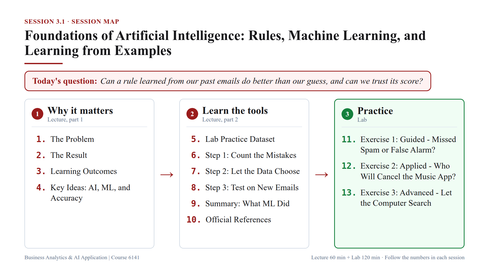

* **Lecture Presentation:** [Download Slides (PDF)](slides/session_03_01_lecture.pdf)
* **Reading (PDF):** [Download Reading (PDF)](handouts/session_03_01_reading.pdf): read before class
* **Schedule:** Week 9 (115/11/08 - 115/11/14) | In-person classes (1:2 Delivery Ratio: 60 Min Lecture + 120 Min Lab)
* **How this session is organized:** first the problem, then the result, then how machine learning produced that result, step by step with code. The three exercises come last.

* **1. The Problem:**
  * Every email service (Gmail, Outlook, your university mail) must decide, for each new message, whether it goes to the inbox or to the spam folder.
  * The filter can be wrong in two ways, and you have probably seen both:
    * **Missed spam:** a scam message lands in your inbox. You might click a fake link.
    * **False alarm:** a real message, such as a reply from a professor or an order confirmation, goes to the spam folder, and you never see it.
  * A small email service uses a simple rule written by its team: **an email with 3 or more links goes to the spam folder**. Spam messages are full of links ("click here", "claim now"), so the rule makes sense, but the number 3 was a guess.
  * The team manager asks: can a rule learned from our past emails do better than our guess, and can we trust its score?

* **2. The Result:**
  * Python tested both rules on 20 past emails whose answers are known (their readers marked them as spam or not), and then on 10 new emails from the next month:

    | Rule | Mistakes on 20 past emails | Accuracy, past | Accuracy, 10 new emails |
    |---|---|---|---|
    | Old rule: `3` or more links | `4` | `80%` | `60%` |
    | Learned from the data: `4` or more links | `1` | `95%` | `80%` |

  * **Answer 1:** the learned rule is better. On the past emails it removes all three false alarms of the old rule.
  * **Answer 2:** its score must be checked on new emails. On the past emails it looks 95% accurate, because it was chosen to fit them. On new emails it is 80% accurate: still better than the old rule's 60%, but this is the number to report.
  * **How the number `4` was found:** nobody guessed it. Python tried many thresholds, counted each one's mistakes on the past emails, and kept the one with the fewest. That search is what "learning" means in machine learning. Sections 6 to 8 do it step by step.

* **3. Expected Learning Outcomes (By the end of this session, you will be able to):**
  1. "Is this really AI?": tell apart AI (Artificial Intelligence), ML (Machine Learning), and DL (Deep Learning), and decide when a written rule is enough
  2. "Which rule makes fewer mistakes?": apply a threshold rule to a table and count its mistakes against the known answers
  3. "Can we trust the score?": test a learned rule on new data it has not seen, and explain why its score drops

* **4. Key Ideas: AI, ML, and Accuracy:**
  * **AI, ML, and DL are three nested ideas.** "AI" is a wide label. Inside it, machine learning is the part where the computer learns its rule from examples instead of being told the rule. Inside machine learning, deep learning uses very large models (many-layered neural networks) for images, sound, and text.

    | Term | What it is | Example you know |
    |---|---|---|
    | AI (Artificial Intelligence) | any computer system that does a task we link to human thinking | a chatbot that answers questions |
    | ML (Machine Learning) | AI that **learns a rule from past examples** with known answers | a spam filter that learns from emails marked as spam |
    | DL (Deep Learning) | ML with many-layered neural networks, for images, sound, and text | your phone recognizing your face |

  * **Rule-based system:** code that follows a rule a person wrote, such as "3 or more links". The email team's old rule is one. An app sold as "AI" can still be rule-based: ask which past examples it learned from.
  * *Picture it:* the left box shows how the three ideas nest. The right side shows the one difference that matters today: in a rule-based system a person writes the rule; in machine learning the computer finds the rule from past examples.

    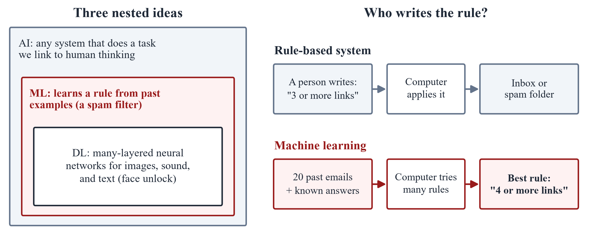
  * **Threshold:** the cut-off value of a rule. Emails with at least this many links go to the spam folder (they are flagged).
  * **The four cases:** each past email has a known answer, so every decision of a rule is one of four cases (old rule, real emails):

    | Email | Links | Real answer | Spam folder? | Case |
    |---|---|---|---|---|
    | "You won a free iPhone!" | `5` | spam | yes | spam caught: correct |
    | "Lunch on Friday?" | `0` | real | no | real email delivered: correct |
    | "Weekly news from the campus" | `3` | real | yes | false alarm: mistake |
    | "Verify your bank account now" | `2` | spam | no | missed spam: mistake |

  * **Accuracy:** the share of decisions that are correct, correct decisions / all decisions. The old rule is right on 16 of the 20 past emails: `16 / 20 = 0.80`, or 80%.
  * *Picture it:* sort all 20 past emails into the four boxes. Green boxes are correct decisions, orange boxes are mistakes. Accuracy is the green share.

    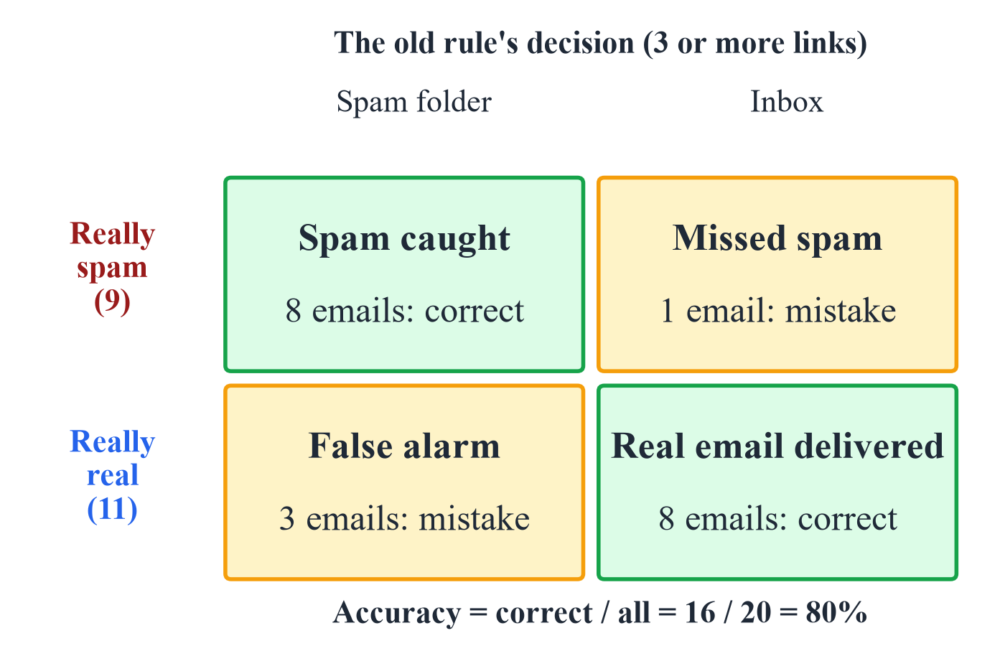

* **5. Lab Practice Dataset:**
  * All three files are fictional teaching data. Keep them in the `data/` folder next to your scripts.
  * File Link: [data/session_03_01_dataset.csv](data/session_03_01_dataset.csv): 20 past emails, one row per email:
    * `Message_ID`: Email code (e.g., `MSG-101`).
    * `Subject`: The subject line, such as `Lunch on Friday?`.
    * `Link_Count`: Number of links in the email, from `0` to `9`.
    * `Is_Spam_Binary`: The known answer: `1` = spam, `0` = real email. 9 of the 20 emails were spam.
  * File Link: [data/session_03_01_new_messages.csv](data/session_03_01_new_messages.csv): 10 emails from the next month, with the same 4 columns (`MSG-201` to `MSG-210`). They play the role of the future: no rule is chosen with them (Step 3).
  * File Link: [data/session_03_01_churn.csv](data/session_03_01_churn.csv): 16 users of a music streaming app, for Exercises 2 and 3:
    * `User_ID`: User code (e.g., `USR-101`).
    * `Weeks_Inactive_Count`: Weeks since the user last played a song.
    * `Cancelled_Binary`: `1` = the user cancelled the subscription the next month, `0` = stayed. 7 of the 16 cancelled.
  * Workflow in Google Antigravity IDE: name each script with your name and the session code (for example, `Reacher_S31_step_1.py`), run it in the Terminal with `python` followed by the file name, and check for return code `0`. On an error, paste the traceback into the AI Agent Chat and ask why it failed.

* **6. Step 1: Count the Mistakes:**
  * *Goal:* measure the old rule on the 20 past emails: which emails does it get wrong, and how many?
  * *Code:* `YourName_S31_step_1.py`
    ```python
    # 1. Input: 20 past emails, each marked spam or not by its reader
    import pandas as pd
    df = pd.read_csv("data/session_03_01_dataset.csv")

    # 2. Process: apply the rule and compare it with the real answers
    df["Flagged"] = df["Link_Count"] >= 3
    df["Is_Mistake"] = df["Flagged"] != (df["Is_Spam_Binary"] == 1)

    # 3. Output: the mistakes and how many there are
    mistakes = df[df["Is_Mistake"]]
    print(mistakes[["Subject", "Link_Count", "Is_Spam_Binary"]])
    print("Mistakes:", df["Is_Mistake"].sum(), "of", len(df))
    ```
  * *How it works, line by line:*
    * `df["Link_Count"] >= 3` applies the rule to all 20 emails at once and gives `True` (spam folder) or `False` (inbox) for each (Session 1.3).
    * `df["Is_Spam_Binary"] == 1` turns the answer `1` / `0` into `True` / `False`, so both sides of the comparison use the same values.
    * `!=` means "is not equal". A row is a mistake when the rule and the real answer disagree.
    * `df[df["Is_Mistake"]]` keeps only the mistake rows (Session 1.4), and the double brackets pick three columns to print. `.sum()` counts the `True` values, because `True` counts as 1.
  * *Read the output:*

    ```text
                             Subject  Link_Count  Is_Spam_Binary
    3    Weekly news from the campus           3               0
    4   Verify your bank account now           2               1
    9             Club dinner photos           3               0
    17   Flight booking confirmation           3               0
    Mistakes: 4 of 20
    ```

    * Three real emails with exactly 3 links (a newsletter, photos, a booking) went to the spam folder: false alarms.
    * One scam, "Verify your bank account now", has only 2 links and reached the inbox: missed spam.
    * 4 mistakes in 20 decisions: an accuracy of 80%.
  * *Picture it:* each dot is one past email, placed by its number of links. The red line is the threshold: everything to its right goes to the spam folder. Orange rings mark the mistakes. The three real emails with 3 links sit just right of the line.

    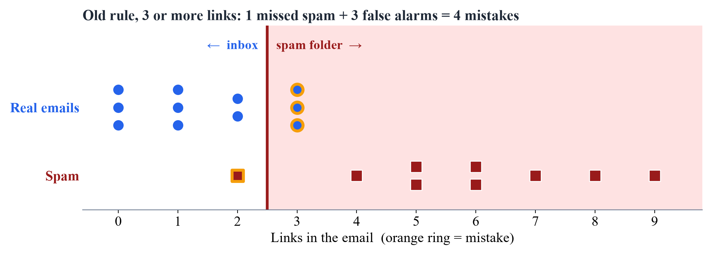
  * *Common mistake:* judging a rule by the cases you remember. You remember the obvious spam it caught, not the three real emails it hid. Count every case.
  * *Quick Check 1 (`.mean()` of True/False):*
    * New tool: `.mean()` on a `True` / `False` column gives the share of `True` values, because `True` counts as 1. Why: tells the team what share of all emails the rule sends to the spam folder.
    * Task: add one line to part **3. Output**: `print("Share sent to spam:", df["Flagged"].____())`
    * Check: the Terminal shows `Share sent to spam: 0.55`: 11 of the 20 emails, although only 9 were spam.

* **7. Step 2: Let the Data Choose:**
  * *Goal:* instead of guessing, try several thresholds on the same past emails and keep the one with the fewest mistakes. This is the "learning" in machine learning.
  * *Code:* `YourName_S31_step_2.py`
    ```python
    # 1. Input: the same 20 past emails
    import pandas as pd
    df = pd.read_csv("data/session_03_01_dataset.csv")
    is_spam = df["Is_Spam_Binary"] == 1

    # 2. Process: one function counts the mistakes of any threshold
    def count_mistakes(threshold):
        flagged = df["Link_Count"] >= threshold
        return (flagged != is_spam).sum()

    # 3. Output: try thresholds from 1 to 6 links
    for threshold in [1, 2, 3, 4, 5, 6]:
        print(f"{threshold}+ links: mistakes {count_mistakes(threshold)}")
    ```
  * *How it works, line by line:*
    * `is_spam` stores the real answers as `True` / `False` once, so the function can reuse them.
    * `def count_mistakes(threshold):` packs Step 1 into a function (Session 2.4): give it a threshold, and it returns the number of mistakes.
    * The `for` loop (Session 1.2) calls the function once for each threshold in the list.
  * *Read the output:*

    ```text
    1+ links: mistakes 8
    2+ links: mistakes 5
    3+ links: mistakes 4
    4+ links: mistakes 1
    5+ links: mistakes 2
    6+ links: mistakes 4
    ```

    * `3+ links` means "3 or more links go to the spam folder".
    * The mistakes fall and then rise again. The two kinds of mistakes explain why:

      | Spam if links are | Missed spam | False alarms | Mistakes |
      |---|---|---|---|
      | `1` or more links | `0` | `8` | `8` |
      | `2` or more links | `0` | `5` | `5` |
      | `3` or more links (old rule) | `1` | `3` | `4` |
      | `4` or more links (learned) | `1` | `0` | `1` |
      | `5` or more links | `2` | `0` | `2` |
      | `6` or more links | `4` | `0` | `4` |

    * A low threshold sends many real emails to the spam folder; a high one lets spam through. `4` links is the best balance on these emails: the learned rule of section 2.
  * *Picture it (1):* the bars are the output of Step 2. Blue (false alarms) shrinks as the threshold rises, red (missed spam) grows, and the total is lowest at `4` links.

    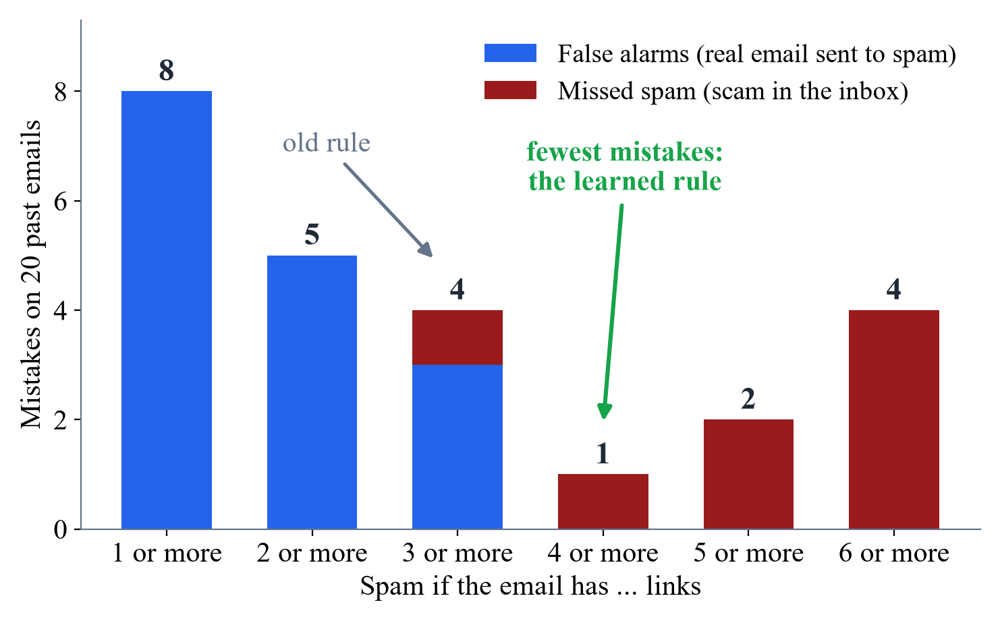
  * *Picture it (2):* moving the line one step to the right, from 3 to 4 links, puts the three real emails with 3 links back in the inbox and catches the same spam.

    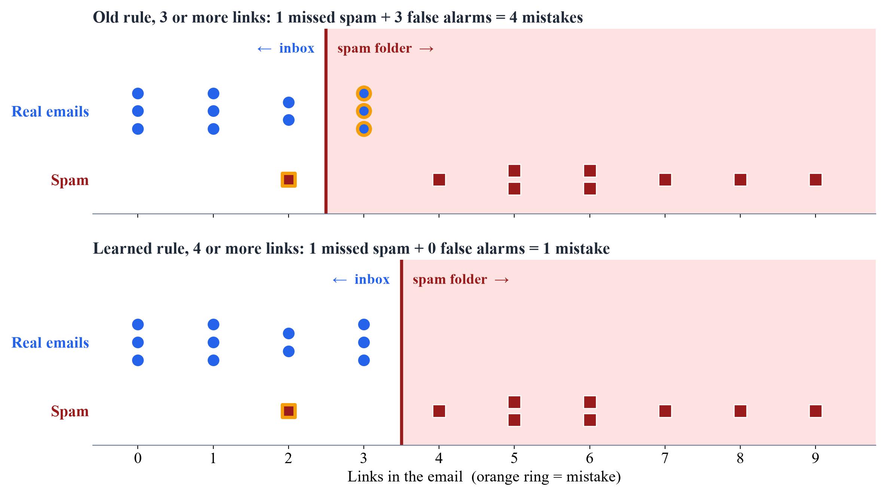
    * The computer does not "understand" spam. It only finds the rule that best matches the known answers. Exercise 3 lets the computer try every possible threshold by itself.
  * *Quick Check 2 (`range()` with a step):*
    * New tool: `range(start, stop, step)` makes evenly spaced numbers; the stop value itself is not included. Why: tests many thresholds without typing each one.
    * Task: replace the list in the `for` line with `range(1, 10, _)` so that the thresholds go up in steps of 2.
    * Check: 5 thresholds are printed (`1`, `3`, `5`, `7`, `9`); the best of them is `5` with 2 mistakes. The step of 2 skipped `4`, the true best.

* **8. Step 3: Test on New Emails:**
  * *Goal:* the learned threshold was chosen to fit the past emails, so its score on them is too optimistic. Score both rules on the 10 new emails, which played no part in choosing the rule.
  * *Code:* `YourName_S31_step_3.py`
    ```python
    # 1. Input: the past emails and next month's new emails
    import pandas as pd
    past = pd.read_csv("data/session_03_01_dataset.csv")
    new = pd.read_csv("data/session_03_01_new_messages.csv")

    # 2. Process: accuracy = the share of emails the rule gets right
    def accuracy(data, threshold):
        flagged = data["Link_Count"] >= threshold
        return (flagged == (data["Is_Spam_Binary"] == 1)).mean()

    # 3. Output: both rules, on past and on new emails
    for name, threshold in [("Old rule", 3), ("Learned rule", 4)]:
        print(f"{name} ({threshold}+ links): past {accuracy(past, threshold):.0%}, "
              f"new {accuracy(new, threshold):.0%}")
    ```
  * *How it works, line by line:*
    * The function takes the table as well as the threshold, so the same code scores the past and the new emails.
    * `==` marks the correct decisions, and `.mean()` turns them into a share: the accuracy (Quick Check 1).
    * The list holds pairs of `(name, threshold)`; `for name, threshold in ...` unpacks each pair into two variables.
    * `:.0%` prints a share such as `0.95` as `95%`.
  * *Read the output:*

    ```text
    Old rule (3+ links): past 80%, new 60%
    Learned rule (4+ links): past 95%, new 80%
    ```

    * Both rules score lower on the new emails: the past score was optimistic.
    * The learned rule still beats the old rule on new emails, 80% against 60%. That is the honest comparison to report: the result of section 2.
  * *Picture it:* for each rule, the grey bar is the score on the emails used to choose it and the red bar is the score on new emails. Both bars drop; compare rules only by the red bars.

    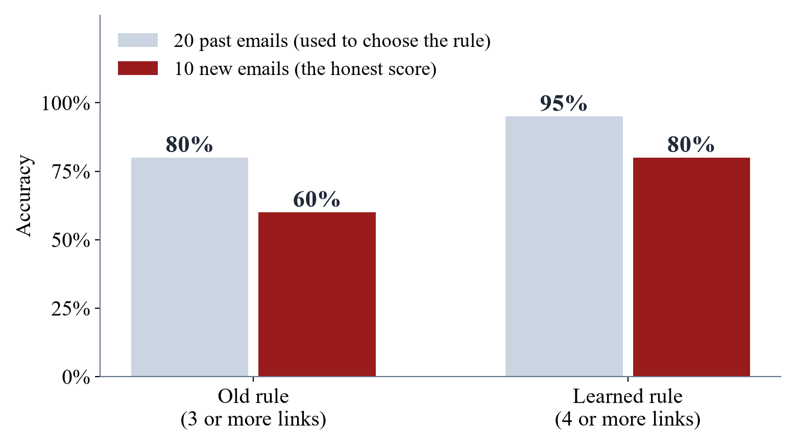
  * *Why the score drops:* the new emails contain cases the past emails did not show.

    | New email | Links | Real answer | Learned rule | Case |
    |---|---|---|---|---|
    | "Online course newsletter" | `4` | real | spam folder | false alarm |
    | "Reset your password here" | `2` | spam | inbox | missed spam |

    A scam with few links looks like a real email when links are the only clue. Real spam filters use many clues, such as the sender, the words, and whether the address is new.
  * *Common mistake:* reporting the past score ("95% accurate"). That number describes how well the rule fits the examples it was chosen from, not how it will do next month. This is why every model in Sessions 3.2 to 3.4 is tested on data kept aside.
  * *Quick Check 3 (add a third rule):*
    * Tool: the list of `(name, threshold)` pairs in part **3. Output**.
    * Task: add a third pair to the list: `("Strict rule", _)` with the threshold `6`.
    * Check: the Terminal shows `Strict rule (6+ links): past 80%, new 80%`. It ties the learned rule on new emails, but it lets 2 of the 4 new scams through, while the learned rule lets 1 through: the same accuracy can hide different mistakes.

* **9. Summary: What ML Did:**
  * The three steps are the core of every machine learning model in this course:

    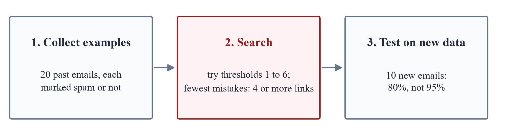

    | Step | What we did | In later sessions |
    |---|---|---|
    | 1. Collect examples with known answers | 20 emails marked spam or not | 16 music app users (3.2), 20 used phone sales (3.3) |
    | 2. Try many rules and keep the one with the fewest mistakes | thresholds from `1` to `6` links; best `4` | Scikit-Learn's `.fit()` does this search for you (3.3) |
    | 3. Test on data that was not used to choose the rule | 10 new emails: 80%, not 95% | the train/test split (3.2) and test scores (3.3, 3.4) |

  * **When is a written rule enough?**

    | Decision | Rule or ML? | Why |
    |---|---|---|
    | A student discount for anyone with a valid student ID | rule | the policy is clear and never guesses |
    | Free delivery for orders over $30 | rule | a fixed, written shop policy |
    | Which emails are spam? | ML | spammers keep changing their tricks, so the rule must be relearned |
    | Which songs will you like next? | ML | many signals combine in ways no one can write down |
    | Unlocking a phone with your face | ML (deep learning) | images need many-layered models |

  * *Remember:* machine learning = try many rules on past examples, keep the one with the fewest mistakes, then judge it only on new examples.

* **10. Official Python Documentation & References:**
  * [Google: Machine Learning Crash Course (Introduction to ML)](https://developers.google.com/machine-learning/crash-course).
  * [Scikit-Learn: Machine Learning in Python Official Overview](https://scikit-learn.org/stable/).
  * [Agrawal, Gans, Goldfarb: Prediction Machines: The Simple Economics of AI (Harvard Business Review Press)](https://www.predictionmachines.ai/).
  * [pandas User Guide: Boolean Indexing](https://pandas.pydata.org/docs/user_guide/indexing.html#boolean-indexing).

* **11. Exercise 1: Guided Practice - Missed Spam or False Alarm?:**
  * *Step 1: Open Script:* In Google Antigravity IDE, create a new script named `YourName_S31_mistakes.py`, replacing `YourName` with your own name (for example, `Reacher_S31_mistakes.py`).
  * *Step 2: Split the Mistakes into Their Two Kinds:*
    Type the following code:
    ```python
    # 1. Input: the 20 past emails
    import pandas as pd
    df = pd.read_csv("data/session_03_01_dataset.csv")
    is_spam = df["Is_Spam_Binary"] == 1

    # 2. Process: count the two kinds of mistakes for one threshold
    def mistake_report(threshold):
        flagged = df["Link_Count"] >= threshold
        missed = (flagged == False) & is_spam
        false_alarm = flagged & (is_spam == False)
        print(f"{threshold}+ links: missed spam {missed.sum()}, "
              f"false alarms {false_alarm.sum()}")
        print("  Missed:", list(df.loc[missed, "Subject"]))

    # 3. Output: the old rule and the learned rule
    mistake_report(3)
    mistake_report(4)
    ```
    * `(flagged == False) & is_spam` is `True` for spam that was not flagged; `&` means "and", and each condition sits in its own brackets (Session 1.4).
    * `df.loc[missed, "Subject"]` picks the subject lines of those rows, and `list(...)` prints them as a list.
  * *Step 3: Interpret:* In two comment lines, answer: which kind of mistake did the learned rule remove? Why can no link threshold catch "Verify your bank account now"?
  * *Step 4: Execute in Terminal:* Run `python YourName_S31_mistakes.py` in Panel `[4]` and confirm return code `0`.
  * *Success Check:* the old rule has `missed spam 1, false alarms 3`; the learned rule has `missed spam 1, false alarms 0`. Both miss "Verify your bank account now" (`2` links): with links as the only clue, this scam looks like a real email. Session 3.2 prepares data with many clues (columns) for a model.

* **12. Exercise 2: Applied Practice - Who Will Cancel the Music App?:**
  * *Coding Challenge:* In `YourName_S31_cancel.py`, use the method of Step 2 on new data. A music streaming app sends a "come back" discount to every user who has not played a song for **2 or more** weeks. Is there a better threshold for spotting the users who will cancel?
  * *Task 1 (Load and Look):* Load `data/session_03_01_churn.csv` into `users`. Print the share of users who cancelled with `.mean()` on `Cancelled_Binary`.
  * *Task 2 (Count Mistakes):* Make `cancelled = users["Cancelled_Binary"] == 1`. Write `count_mistakes(threshold)`: flag users whose `Weeks_Inactive_Count` is at or above the threshold, and return the number of mistakes, as in Step 2.
  * *Task 3 (Compare Thresholds):* Loop over the thresholds `1` to `6` with `range(1, 7)` and print each threshold with its mistakes.
  * *Task 4 (Report):* Print the accuracy of the app's threshold and of the best one: `1 - count_mistakes(t) / len(users)`.
  * *Success Check:* cancel share `0.4375` (7 of 16); mistakes `7`, `3`, `2`, `3`, `4`, `5` for thresholds 1 to 6; the best threshold is `3` weeks, with accuracy `0.875` against `0.8125` for the app's `2` weeks; return code `0`.

* **13. Exercise 3: Advanced Practice - Let the Computer Search:**
  * *Goal:* In Step 2, you chose the thresholds to try. Write a function that tries every value in a column as a threshold and keeps the best one by itself, which is the search that machine learning does. Then test the result on new data.
  * *What you need:*
    * Files: `data/session_03_01_dataset.csv`, `data/session_03_01_new_messages.csv`, and `data/session_03_01_churn.csv` (described in **5. Lab Practice Dataset**).
    * Script name: `YourName_S31_search.py`.
    * Tools you already know: functions with `return`, `for` loops, `if`, comparisons, `.sum()`, and f-strings.
  * *Requirements (follow them in order):*
    1. Write a function `find_best_threshold(data, feature, target)`. `feature` is the column to test, such as `"Link_Count"`; `target` is the answer column, such as `"Is_Spam_Binary"`.
    2. Inside it, loop over every value in `data[feature]`, use it as the threshold, and count its mistakes.
    3. Keep the threshold with the fewest mistakes. If two thresholds tie, keep the one found first.
    4. Count how many thresholds were tried, and return three values: the best threshold, its mistakes, and the number tried.
    5. Run the function on the past emails and on the music app users, and print the results with f-strings.
    6. Apply the best email threshold to the new emails and print how many of the 10 it gets right.
  * *Hints:*
    * Before the loop, start with `best_threshold = None` and `best_mistakes = len(data) + 1`, a number that any real threshold will beat.
    * Inside the loop, update both variables only when `mistakes < best_mistakes`.
    * `return best_threshold, best_mistakes, tried` returns three values; receive them with `threshold, mistakes, tried = find_best_threshold(...)`.
  * *Self-Check (expected results):*
    * Emails: `20` thresholds tried; best `4` links, with `1` mistake.
    * Music app users: `16` thresholds tried; best `3` weeks, with `2` mistakes. The same answer as Exercise 2, found without choosing the list by hand.
    * New emails: `8` of `10` correct. Meaning: the search found the best rule for the past, but only new data shows how good it really is (Step 3).

---

<a id="session-03-02"></a>
### Session 3.2: Preparing Data for Machine Learning: Features, Text, Gaps, Scales, and a Fair Test

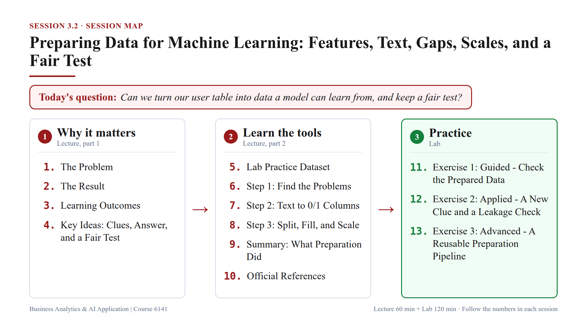

* **Lecture Presentation:** [Download Slides (PDF)](slides/session_03_02_lecture.pdf)
* **Reading (PDF):** [Download Reading (PDF)](handouts/session_03_02_reading.pdf): read before class
* **Schedule:** Week 10 (115/11/15 - 115/11/21) | In-person classes (1:2 Delivery Ratio: 60 Min Lecture + 120 Min Lab)
* **How this session is organized:** first the problem, then the result, then how each preparation step produced that result, step by step with code. The three exercises come last.

* **1. The Problem:**
  * In Session 3.1, a music streaming app spotted likely cancellations with one clue: the weeks since a user last played a song. A real model uses several clues at once: the user's age, the minutes they listen per month, the weeks they have been inactive, and their plan (`Student`, `Individual`, or `Family`).
  * The app's team collects these clues for 16 users and gives the table to a machine learning model from Scikit-Learn, Python's machine learning library. Python stops twice:

    ```text
    ValueError: could not convert string to float: 'Student'
    ValueError: Input X contains NaN.
    ```

    * The first error: a model computes with numbers only, and the plan column holds text.
    * The second error, after the text column is removed: two cells are empty. `NaN` ("Not a Number") is how pandas marks an empty cell. One user skipped the age question at sign-up, and one user's listening log was lost.
  * A third problem raises no error: the columns use very different units. Monthly minutes run from `90` to `2,400`; weeks inactive from `0` to `6`. A model would treat a difference of 100 minutes as far bigger than a difference of 5 weeks, only because the numbers are bigger.
  * The team lead asks: can we turn our user table into data a model can learn from, and keep a fair test? A fair test shows how the model will do on next month's users.

* **2. The Result:**
  * After three preparation steps, the same table is ready for a model. Here is user `USR-209`, a Student whose listening minutes were lost:

    | Column | Raw value | Model-ready value | What happened |
    |---|---|---|---|
    | `Age_Years_Count` | `22` | `-0.99` | scaled: 0.99 standard deviations below the average age |
    | `Monthly_Minutes_Count` | empty | `-0.19` | filled with the median, `950`, then scaled |
    | `Weeks_Inactive_Count` | `2` | `0.13` | scaled: just above the average |
    | `Plan_Type` | `Student` | `Plan_Type_Individual` = `0`, `Plan_Type_Student` = `1` | one 0/1 column per plan |

  * And for the whole table:

    | Problem | Raw table | Prepared table |
    |---|---|---|
    | Text columns | `1` (`Plan_Type`) | `0`: two 0/1 columns instead |
    | Empty cells | `2` | `0` |
    | Units | minutes `90` to `2,400`; weeks `0` to `6` | every number column has an average of `0` and a spread of `1` on the training users |
    | Fair test | none | `4` users set aside before anything was learned |

  * **Answer 1:** yes. The table becomes model-ready: only numbers, no gaps, and one common scale.
  * **Answer 2:** the test stays fair because the 4 test users are set aside **first**. The fill values and the averages are learned from the 12 training users only. The test users turn out to be older and to listen less than the training users (scaled averages `+1.24` for age and `-0.78` for minutes): a real difference the model will have to face. If the test users were scaled on their own, every average would become `0` and the difference would disappear (Exercise 2).
  * **How it was done:** three short steps with pandas and Scikit-Learn. Sections 6 to 8 do them one by one. Session 3.3 then trains a model on prepared data.

* **3. Expected Learning Outcomes (By the end of this session, you will be able to):**
  1. "What do we predict, and from what?": split a table into features `X` (the clues) and the target `y` (the answer to predict), and find its text columns and gaps
  2. "How do text and gaps become numbers?": turn text categories into 0/1 columns (one-hot encoding), fill gaps with the median (imputation), and put numbers on one scale (standardization)
  3. "How do we keep the test fair?": split the data into a training set and a test set before learning anything from it, so that no test information leaks into training (data leakage)

* **4. Key Ideas: Clues, Answer, and a Fair Test:**
  * **Features and target.** A prediction model learns a link between clues and an answer. The clues are called **features** and are kept in a table named `X`; the answer to predict is the **target**, kept in `y`. Each row is one example: one user's clues and that user's real outcome.

    | Column | Role | Why |
    |---|---|---|
    | `Age_Years_Count`, `Monthly_Minutes_Count`, `Weeks_Inactive_Count`, `Plan_Type` | features (`X`) | known about the user today |
    | `Cancelled_Binary` | target (`y`) | the answer: `1` = cancelled the next month, `0` = stayed |
    | `User_ID` | neither | a label; it says nothing about the user |

  * *Picture it:* the raw table with each column's role. Orange cells are the gaps; the purple column is text. Both stop a model.

    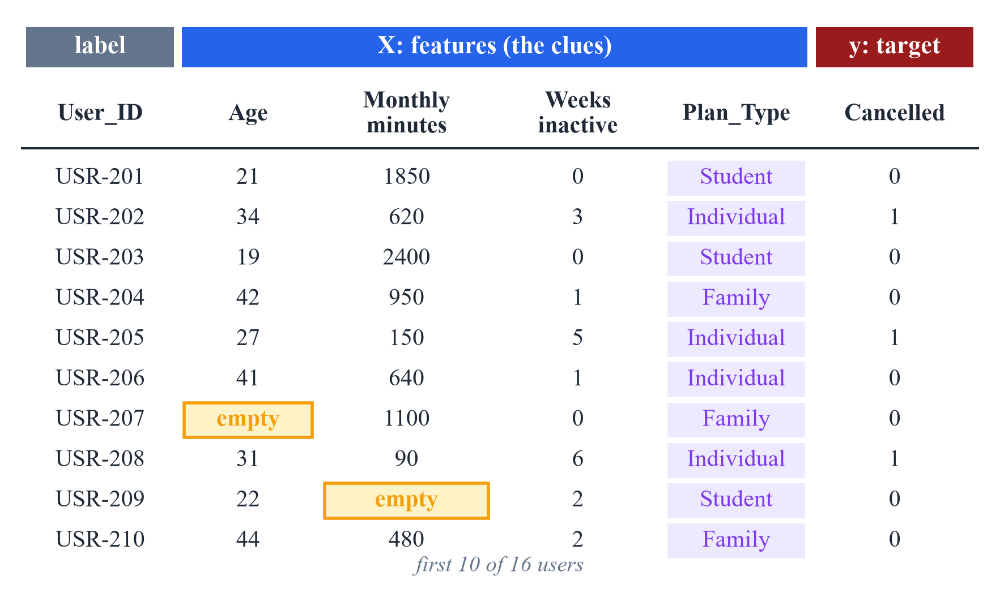

  * **Four preparation tools**, each with a version you already know:

    | Tool | What it does | An everyday version |
    |---|---|---|
    | Imputation | fills an empty cell with a typical value of its column, here the **median** (the middle value) | a form left the age blank, so you assume a typical age |
    | One-hot encoding | turns one text column into one 0/1 column per category | a checkbox on a form: "Student plan? yes = 1, no = 0" |
    | Standardization | rewrites each value as its distance from the average, counted in standard deviations | "2 points above the class average" instead of "87 points" |
    | Train/test split | keeps some rows aside to test the model at the end | a final exam uses questions you have not practiced |

  * **Standard deviation:** how spread out a column is; roughly, the typical distance of a value from the average.
  * **Data leakage:** information from the test rows slipping into training, for example a scaler that learns the test users' average. It makes a model look better than it really is. The rule: **split first, then learn from the training rows only**.
  * **Two Scikit-Learn verbs:** `.fit()` learns something from data (a median, an average); `.transform()` applies what was learned. `.fit_transform()` does both at once. Fit on the training rows only; transform both sets.

* **5. Lab Practice Dataset:**
  * File Link: [data/session_03_02_dataset.csv](data/session_03_02_dataset.csv)
  * 16 users of a music streaming app (fictional teaching data), one row per user, with 2 empty cells on purpose:
    * `User_ID`: User code (e.g., `USR-201`). A label, not a feature.
    * `Age_Years_Count`: Age in years (empty for `USR-207`, who skipped the question).
    * `Monthly_Minutes_Count`: Minutes of music played last month (empty for `USR-209`, whose log was lost).
    * `Weeks_Inactive_Count`: Weeks since the user last played a song, as in Session 3.1.
    * `Plan_Type`: `Student`, `Individual`, or `Family`.
    * `Cancelled_Binary`: The target: `1` = cancelled the next month, `0` = stayed. 4 of the 16 users cancelled.
  * Workflow in Google Antigravity IDE: name each script with your name and the session code (for example, `Reacher_S32_step_1.py`), run it in the Terminal with `python` followed by the file name, and check for return code `0`. First time only: `pip install scikit-learn`. On an error, paste the traceback into the AI Agent Chat and ask why it failed.

* **6. Step 1: Find the Problems:**
  * *Goal:* separate the clues from the answer, and list what a model cannot read: gaps, text, and very different units.
  * *Code:* `YourName_S32_step_1.py`
    ```python
    # 1. Input: 16 users of the music app, labeled by their User_ID
    import pandas as pd
    df = pd.read_csv("data/session_03_02_dataset.csv", index_col="User_ID")

    # 2. Process: the clues (X) and the answer to predict (y)
    X = df.drop(columns=["Cancelled_Binary"])
    y = df["Cancelled_Binary"]

    # 3. Output: the gaps, the text column, and the range of each number column
    print("Gaps per column:\n", X.isnull().sum())
    print(X["Plan_Type"].value_counts().sort_index())
    print(X.describe().loc[["min", "max"]])
    ```
  * *How it works, line by line:*
    * `index_col="User_ID"` uses the user codes as row labels instead of a column, so the ID can never become a clue, and every printed row shows whose it is.
    * `df.drop(columns=["Cancelled_Binary"])` returns a copy of the table without the answer: the features `X`. The original `df` is unchanged. `df["Cancelled_Binary"]` picks the answer: the target `y`.
    * `X.isnull().sum()` counts the empty cells in each column; `True` counts as 1 (Session 3.1).
    * `.value_counts().sort_index()` counts each plan and lists the plans in alphabetical order.
    * `X.describe()` computes summary numbers for the number columns; `.loc[["min", "max"]]` keeps two of its rows (Session 1.4).
  * *Read the output:*

    ```text
    Gaps per column:
     Age_Years_Count          1
    Monthly_Minutes_Count    1
    Weeks_Inactive_Count     0
    Plan_Type                0
    dtype: int64
    Plan_Type
    Family        6
    Individual    6
    Student       4
    Name: count, dtype: int64
         Age_Years_Count  Monthly_Minutes_Count  Weeks_Inactive_Count
    min             19.0                   90.0                   0.0
    max             45.0                 2400.0                   6.0
    ```

    * One age and one minutes value are empty: they must be filled (Step 3).
    * `Plan_Type` is text with three categories: it must become numbers (Step 2).
    * Minutes reach `2400`, but weeks only `6`: the columns must be put on one scale (Step 3).
  * *Common mistake:* leaving the target inside `X`. The model would "predict" cancellation by reading the answer itself, score perfectly in testing, and be useless next month, when new users have no answer yet.
  * *Quick Check 1 (`value_counts(normalize=True)`):*
    * New tool: `.value_counts(normalize=True)` gives each value's share instead of its count. Why: the cancel rate is the first number the team lead asks for.
    * Task: add one line to part **3. Output**: `print(y.value_counts(_________=True))`
    * Check: `0` has `0.75` and `1` has `0.25`: a 25% cancel rate.

* **7. Step 2: Text to 0/1 Columns:**
  * *Goal:* replace the text in `Plan_Type` with numbers, without inventing an order between the plans.
  * *Code:* `YourName_S32_step_2.py`
    ```python
    # 1. Input: the clues of the 16 users
    import pandas as pd
    df = pd.read_csv("data/session_03_02_dataset.csv", index_col="User_ID")
    X = df.drop(columns=["Cancelled_Binary"])

    # 2. Process: one 0/1 column per plan, except the first
    X = pd.get_dummies(X, columns=["Plan_Type"], drop_first=True, dtype=int)

    # 3. Output: the new column names, and the plan columns of three users
    print(X.columns.tolist())
    plans = X[["Plan_Type_Individual", "Plan_Type_Student"]]
    print(df[["Plan_Type"]].join(plans).head(3))
    ```
  * *How it works, line by line:*
    * `pd.get_dummies(X, columns=["Plan_Type"], ...)` replaces the text column with one 0/1 column per plan: one-hot encoding. `dtype=int` writes `0` and `1` instead of `False` and `True`.
    * The plans are sorted alphabetically: `Family`, `Individual`, `Student`. `drop_first=True` leaves out the first one, `Family`.
    * `plans` keeps the two new columns; `.join()` puts the original plan next to them, so you can compare them row by row.
  * *Read the output:*

    ```text
    ['Age_Years_Count', 'Monthly_Minutes_Count', 'Weeks_Inactive_Count', 'Plan_Type_Individual', 'Plan_Type_Student']
              Plan_Type  Plan_Type_Individual  Plan_Type_Student
    User_ID                                                     
    USR-201     Student                     0                  1
    USR-202  Individual                     1                  0
    USR-203     Student                     0                  1
    ```

    * `Plan_Type` is gone from `X`; two number columns took its place.
    * A Student has `1` in `Plan_Type_Student`; an Individual user has `1` in `Plan_Type_Individual`.
    * There is no `Plan_Type_Family`: a user with `0` in both columns is on the Family plan.
  * *Picture it:* one text column becomes two yes/no columns. Each row has at most one `1`.

    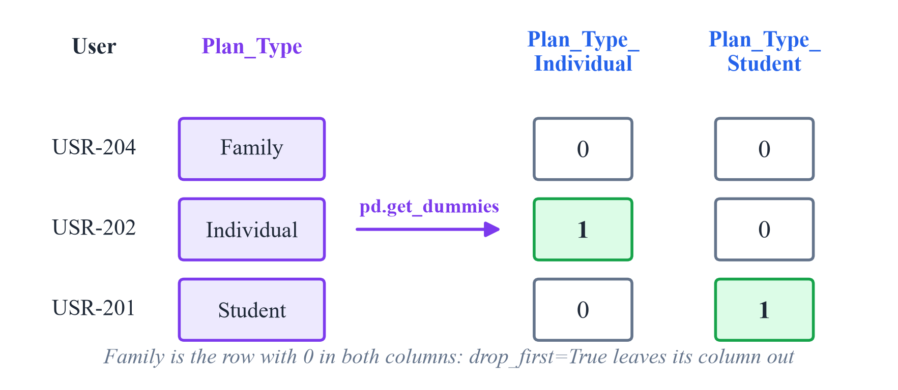

  * *Why not 1, 2, 3:* writing `Family = 1`, `Individual = 2`, `Student = 3` would tell the model that a Student plan is "three times" a Family plan: an order and a size that do not exist. A 0/1 column says only "this plan or not".
  * *Why drop one column:* it adds nothing. If `Plan_Type_Individual` and `Plan_Type_Student` are both `0`, the plan must be Family.
  * *Quick Check 2 (`drop_first`):*
    * New tool: the `drop_first` setting. `True` leaves out the first category; `False` keeps a column for every category. Why: shows what "the first category is implied" means.
    * Task: in part **2. Process**, change `drop_first=True` to `drop_first=_____`.
    * Check: the column list now ends with `'Plan_Type_Family', 'Plan_Type_Individual', 'Plan_Type_Student'`, and every user has exactly one `1` among the three. Change it back to `True` afterwards.

* **8. Step 3: Split, Fill, and Scale:**
  * *Goal:* set the test users aside before learning anything. Then fill the gaps and put the number columns on one scale, with rules learned from the training users only.
  * *Code:* `YourName_S32_step_3.py`
    ```python
    # 1. Input: encode, then split before learning anything
    import pandas as pd
    from sklearn.model_selection import train_test_split
    from sklearn.impute import SimpleImputer
    from sklearn.preprocessing import StandardScaler
    df = pd.read_csv("data/session_03_02_dataset.csv", index_col="User_ID")
    X = pd.get_dummies(df.drop(columns=["Cancelled_Binary"]),
                       columns=["Plan_Type"], drop_first=True, dtype=int)
    y = df["Cancelled_Binary"]
    X_train, X_test, y_train, y_test = train_test_split(
        X, y, test_size=0.25, random_state=42, stratify=y)

    # 2. Process: fill and scale the number columns with training rules
    numbers = ["Age_Years_Count", "Monthly_Minutes_Count",
               "Weeks_Inactive_Count"]
    imputer = SimpleImputer(strategy="median")
    X_train[numbers] = imputer.fit_transform(X_train[numbers])
    X_test[numbers] = imputer.transform(X_test[numbers])
    scaler = StandardScaler()
    X_train[numbers] = scaler.fit_transform(X_train[numbers])
    X_test[numbers] = scaler.transform(X_test[numbers])

    # 3. Output: the split, the training rules, and the test users
    print("Train rows:", len(X_train), "| Test rows:", len(X_test))
    print("Medians from training rows:", imputer.statistics_.tolist())
    print(X_test[numbers].round(2))
    ```
  * *How it works, line by line:*
    * `train_test_split(...)` shuffles the rows and returns four parts: training clues, test clues, training answers, and test answers. `test_size=0.25` keeps 4 of the 16 users for the test. `stratify=y` keeps the cancel rate the same in both parts (3 of 12 and 1 of 4: 25%). `random_state=42` gives the same split on every run.
    * `numbers` lists the three number columns. The plan columns are already 0/1 and stay as they are.
    * `SimpleImputer(strategy="median")` creates a gap-filler. `.fit_transform(X_train[numbers])` learns the training medians and fills the training gaps; `.transform(X_test[numbers])` fills any test gap with those same training medians.
    * `StandardScaler()` works the same way. It learns each column's training average and standard deviation, then rewrites every value as `(value - average) / standard deviation`.
    * `imputer.statistics_` holds the medians it learned; a trailing `_` marks something learned during `fit`.
  * *Read the output:*

    ```text
    Train rows: 12 | Test rows: 4
    Medians from training rows: [31.0, 950.0, 1.0]
             Age_Years_Count  Monthly_Minutes_Count  Weeks_Inactive_Count
    User_ID                                                              
    USR-206             1.33                  -0.63                 -0.39
    USR-210             1.70                  -0.86                  0.13
    USR-211             1.09                  -1.25                  1.17
    USR-212             0.84                  -0.38                 -0.39
    ```

    * 12 users for training and 4 kept aside for the final test.
    * The training medians (age `31`, minutes `950`, weeks `1`) fill every gap, in either set.
    * A scaled value counts standard deviations from the training average. `USR-210`'s age, `1.70`, is well above average. `USR-211`'s minutes, `-1.25`, are well below: a light listener who, in fact, cancelled.
  * *Standardization by hand:* the scaler learned a training average age of `30.08` years and a standard deviation of `8.20` years. For `USR-210`, aged `44`: `(44 - 30.08) / 8.20 = 1.70`. For minutes, the average is `1083.33` and the standard deviation `698.90`. For `USR-211`, with `210` minutes: `(210 - 1083.33) / 698.90 = -1.25`.
  * *Why the median:* a few extreme values pull the average but not the median. The 11 known training minutes average `1095.45`, pulled up by two heavy listeners (`2050` and `2400`); their median, `950`, stays in the middle.
  * *Picture it (1):* the three number columns before and after scaling, drawn on one ruler. Before, age and weeks are squeezed near zero while minutes stretch to 2,400. After, all three spread over the same range around `0`.

    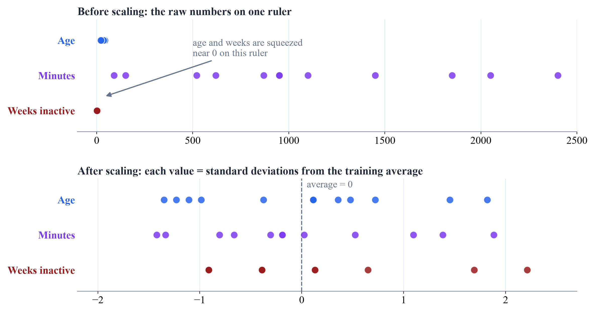

  * *Picture it (2):* the order of the work. The split comes first; the imputer and the scaler learn only from the 12 training users; then the same rules are applied to both sets.

    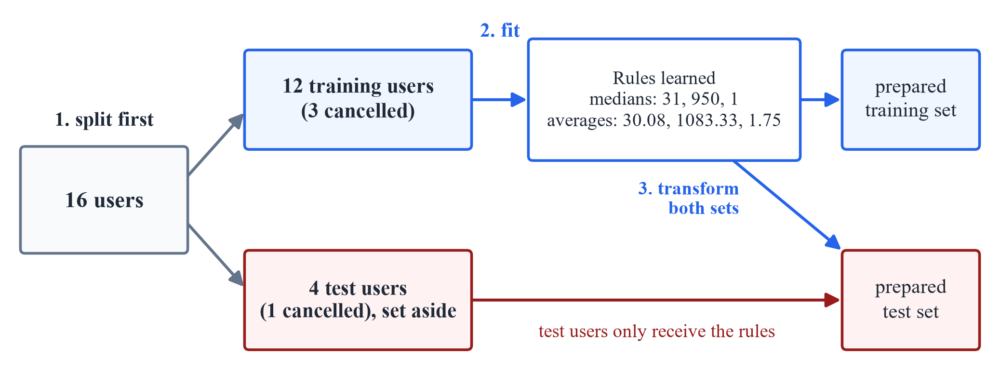

  * *Common mistake:* `scaler.fit_transform(X_test[numbers])`. The scaler then learns the test users' own average, and every test average becomes `0`: the test users look "average", although they are older and listen less than the training users. This is data leakage, and Exercise 2 lets you see it.

    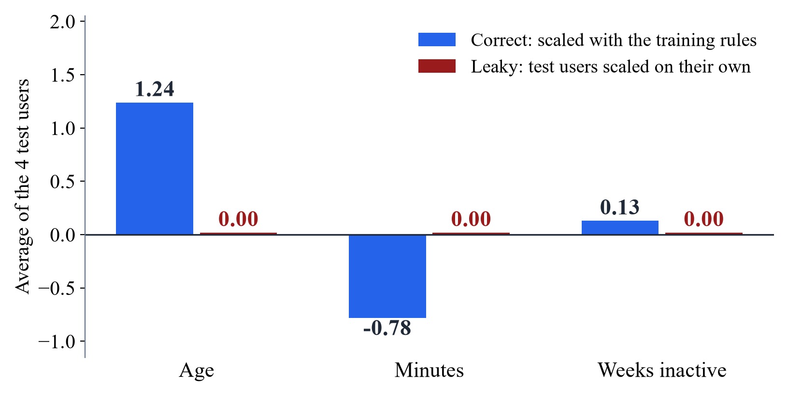

  * *Quick Check 3 (`scaler.mean_`):*
    * New tool: `scaler.mean_` holds the column averages the scaler learned from the training rows. Why: shows exactly what "fit on the training set" means.
    * Task: add one line to part **3. Output**: `print("Averages learned by the scaler:", scaler._____.round(2).tolist())`
    * Check: the Terminal shows `[30.08, 1083.33, 1.75]`: the training averages of age, minutes, and weeks.

* **9. Summary: What Preparation Did:**
  * The three steps turn any raw table into data a model can learn from:

    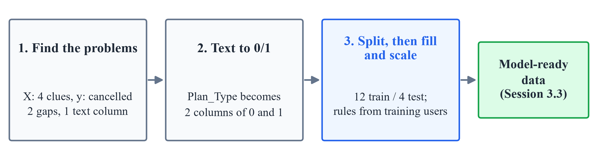

    | Step | What we did | In later sessions |
    |---|---|---|
    | 1. Separate the clues and the answer; list the problems | `X` with 4 clues, `y` = cancelled; 2 gaps, 1 text column, very different units | 3.3 builds `X` and `y` from 20 used phone sales |
    | 2. Turn text into 0/1 columns | `Plan_Type` became 2 columns | any text column, such as a region or a product type, before a model |
    | 3. Split first; fill and scale with training rules | 12 training and 4 test users; medians and averages from the 12 | 3.3 trains on `X_train` and scores on `X_test`; 3.4 scales two columns before grouping users; 4.1 saves the scaler together with the model |

  * *Remember:* split first, `fit` on the training rows, `transform` both sets.

* **10. Official Python Documentation & References:**
  * [Scikit-Learn Preprocessing Guide: StandardScaler and OneHotEncoder](https://scikit-learn.org/stable/modules/preprocessing.html).
  * [Scikit-Learn Imputation of Missing Values: SimpleImputer](https://scikit-learn.org/stable/modules/impute.html).
  * [Scikit-Learn Model Selection: train_test_split](https://scikit-learn.org/stable/modules/generated/sklearn.model_selection.train_test_split.html).
  * [Scikit-Learn: Common Pitfalls (Data Leakage)](https://scikit-learn.org/stable/common_pitfalls.html).
  * [pandas: get_dummies](https://pandas.pydata.org/docs/reference/api/pandas.get_dummies.html).

* **11. Exercise 1: Guided Practice - Check the Prepared Data:**
  * *Step 1: Open Script:* In Google Antigravity IDE, create a new script named `YourName_S32_check.py`, replacing `YourName` with your own name (for example, `Reacher_S32_check.py`).
  * *Step 2: Prepare the Data and Check It:*
    Type the following code. Parts 1 and 2 are the same as in Step 3; part 3 checks the result:
    ```python
    # 1. Input: encode, then split before learning anything
    import pandas as pd
    from sklearn.model_selection import train_test_split
    from sklearn.impute import SimpleImputer
    from sklearn.preprocessing import StandardScaler
    df = pd.read_csv("data/session_03_02_dataset.csv", index_col="User_ID")
    X = pd.get_dummies(df.drop(columns=["Cancelled_Binary"]),
                       columns=["Plan_Type"], drop_first=True, dtype=int)
    y = df["Cancelled_Binary"]
    X_train, X_test, y_train, y_test = train_test_split(
        X, y, test_size=0.25, random_state=42, stratify=y)

    # 2. Process: fill and scale the number columns with training rules
    numbers = ["Age_Years_Count", "Monthly_Minutes_Count",
               "Weeks_Inactive_Count"]
    imputer = SimpleImputer(strategy="median")
    X_train[numbers] = imputer.fit_transform(X_train[numbers])
    X_test[numbers] = imputer.transform(X_test[numbers])
    scaler = StandardScaler()
    X_train[numbers] = scaler.fit_transform(X_train[numbers])
    X_test[numbers] = scaler.transform(X_test[numbers])

    # 3. Output: four checks of the prepared data
    print("Gaps left:", X_train.isnull().sum().sum() + X_test.isnull().sum().sum())
    print("Training averages:", X_train[numbers].mean().round(2).tolist())
    print("Training spreads:", X_train[numbers].std(ddof=0).round(2).tolist())
    print("Cancelled in train:", y_train.sum(), "| in test:", y_test.sum())
    ```
    * `.isnull().sum().sum()` counts the gaps per column, then adds up the columns.
    * `.std(ddof=0)` uses the same standard deviation formula as the scaler. pandas' default formula gives a slightly larger value for small tables.
  * *Step 3: Interpret:* In two comment lines, answer: why are the training averages exactly `0`, while the test users' averages are not? Why does the test set hold exactly 1 cancelled user?
  * *Step 4: Execute in Terminal:* Run `python YourName_S32_check.py` in Panel `[4]` and confirm return code `0`.
  * *Success Check:* `Gaps left: 0`; training averages `[0.0, 0.0, -0.0]` (a printed `-0.0` is the same as `0.0`); spreads `[1.0, 1.0, 1.0]`; `Cancelled in train: 3 | in test: 1`, thanks to `stratify=y`. The scaler was fitted on the training users, so their averages are `0` by construction; the test users only receive the training rules.

* **12. Exercise 2: Applied Practice - A New Clue and a Leakage Check:**
  * *Coding Challenge:* In `YourName_S32_practice.py`, starting from the code of Step 3, add one new clue, read a common error, and see with your own eyes what data leakage hides.
  * *Task 1 (Engineer a Feature):* After loading `df`, add `Inactive_3_Plus_Flag` = `1` when `Weeks_Inactive_Count` is 3 or more, the best threshold found in Session 3.1, Exercise 2: `(df["Weeks_Inactive_Count"] >= 3).astype(int)`. `.astype(int)` turns `True` / `False` into `1` / `0`. Print `pd.crosstab(df["Inactive_3_Plus_Flag"], df["Cancelled_Binary"])`, a table that counts each combination of the two columns.
  * *Task 2 (Read the NotFittedError & AI Diagnosis):* At the end of the script, create a new `StandardScaler()` and call `.transform(X_test[numbers])` on it before any `.fit()`. The script stops with `NotFittedError: This StandardScaler instance is not fitted yet.` Capture the traceback with `Win + Shift + S`, paste it into Panel `[3]` (AI Agent Chat) with `Ctrl + V`, and ask what "fitted" means. Then delete the two lines.
  * *Task 3 (See the Leakage):*
    * Correct: at the end of the script, print the test users' averages: `print(X_test[numbers].mean().round(2).tolist())`.
    * Leaky: change the last line of part **2. Process** to `X_test[numbers] = StandardScaler().fit_transform(X_test[numbers])` and run the script again.
  * *Success Check:*
    * Task 1: the flag splits the users perfectly: all 4 flagged users cancelled and all 12 others stayed. With only 16 users, treat a perfect pattern as a warning sign, not as proof.
    * Task 3: the correct averages are `[1.24, -0.78, 0.13]`: the test users are older, listen less, and have been inactive a little longer than the training users. The leaky averages are `[0.0, 0.0, 0.0]`: the difference has disappeared, and the test no longer shows how different next month's users can be.

* **13. Exercise 3: Advanced Practice - A Reusable Preparation Pipeline:**
  * *Goal:* Build one preparation object that handles the number and the text columns in one step, is fitted on the training users, can be reused on any new user, and does not crash on a plan it has never seen.
  * *What you need:*
    * File: `data/session_03_02_dataset.csv` (described in **5. Lab Practice Dataset**).
    * Script name: `YourName_S32_pipeline.py`.
    * Tools you already know: `train_test_split` (same settings as Step 3), `SimpleImputer`, `StandardScaler`, and `.fit()` / `.transform()`.
  * *Requirements (follow them in order):*
    1. Load the data with `index_col="User_ID"`. Split the raw features (before any encoding) and the target with `test_size=0.25`, `random_state=42`, and `stratify=y`.
    2. Define `numbers = ["Age_Years_Count", "Monthly_Minutes_Count", "Weeks_Inactive_Count"]` and `text = ["Plan_Type"]`.
    3. Build a `Pipeline` for the number columns: fill with the median, then standardize.
    4. Combine it with a `OneHotEncoder(handle_unknown="ignore")` for the text column in one `ColumnTransformer`.
    5. Fit the combined object on the training users only. Print the output column names, then the transformed test users, rounded to 2 decimals.
    6. Transform one new user: age missing (`None`), `300` minutes, `4` weeks inactive, and the plan `"Duo"`, which the app launched after the training data was collected. Print the result, rounded to 2 decimals.
    7. In a comment, explain what happened to the missing age and to the unseen plan.
  * *New tools for this exercise:*
    * `from sklearn.pipeline import Pipeline`: `Pipeline([("impute", SimpleImputer(strategy="median")), ("scale", StandardScaler())])` runs its steps in order, and fits them in order.
    * `from sklearn.compose import ColumnTransformer`: sends each group of columns to its own tool and joins the results side by side, for example:

      ```text
      ColumnTransformer([
          ("num", number_pipeline, numbers),
          ("cat", OneHotEncoder(handle_unknown="ignore"), text),
      ])
      ```
    * `from sklearn.preprocessing import OneHotEncoder`: the Scikit-Learn version of one-hot encoding. It keeps a column for every category. `handle_unknown="ignore"` writes `0` in every plan column for a plan it never saw, instead of raising an error.
    * `.get_feature_names_out()` returns the names of the output columns.
    * A one-row DataFrame for the new user: `pd.DataFrame({"Age_Years_Count": [None], "Monthly_Minutes_Count": [300], "Weeks_Inactive_Count": [4], "Plan_Type": ["Duo"]})`.
  * *Hints:*
    * Wrap a result in `pd.DataFrame(result, columns=prep.get_feature_names_out())` to read it with column names.
    * Without `handle_unknown="ignore"`, the new user raises `ValueError: Found unknown categories ['Duo']`. Try it once to see why the setting matters.
  * *Self-Check (expected results):*
    * Output columns (6): `num__Age_Years_Count`, `num__Monthly_Minutes_Count`, `num__Weeks_Inactive_Count`, `cat__Plan_Type_Family`, `cat__Plan_Type_Individual`, `cat__Plan_Type_Student`.
    * Transformed test users: shape `(4, 6)`, with the same scaled numbers as Step 3; `USR-210`, on the Family plan, is `1.7`, `-0.86`, `0.13`, `1.0`, `0.0`, `0.0`.
    * New user: `0.11`, `-1.12`, `1.17`, `0.0`, `0.0`, `0.0`. The missing age was filled with the training median (`31.0`) before scaling, and the unseen `"Duo"` plan became all zeros instead of crashing the script. Business meaning: the same object can now prepare every future user in one call, exactly as it prepared the training users.

---

<a id="session-03-03"></a>
### Session 3.3: Training and Testing a Prediction Model: Fit, Predict, Measure the Error, and Cross-Validate

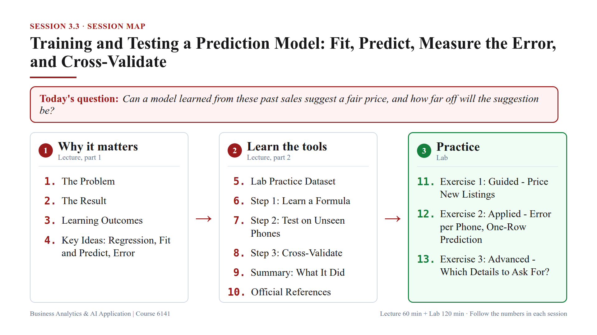

* **Lecture Presentation:** [Download Slides (PDF)](slides/session_03_03_lecture.pdf)
* **Reading (PDF):** [Download Reading (PDF)](handouts/session_03_03_reading.pdf): read before class
* **Before class (homework):** [Pre-Class Practice (PDF)](homework/preclass_session_03_03.pdf) and [report template (Word)](homework/preclass_session_03_03_template.docx): six short tasks on a small example and a report of about 5 pages, due Tuesday, November 24, 2026, 5 pm (Taiwan time) on iLearn, the day before this session
* **Schedule:** Week 11 (115/11/22 - 115/11/28) | In-person classes (1:2 Delivery Ratio: 60 Min Lecture + 120 Min Lab)
* **How this session is organized:** first the problem, then the result, then how a Scikit-Learn model produced that result, step by step with code. The three exercises come last.

* **1. The Problem:**
  * You want to sell your used phone on a second-hand marketplace app. What price should you ask? Too high, and nobody buys it. Too low, and you lose money.
  * Today most sellers guess. The app wants to suggest a fair price as soon as a seller types in the phone's details.
  * The app has the records of 20 used iPhone 13 phones that sold recently: how old each phone was, its storage, its battery health, and the price it sold for.
  * The product manager asks: can a model learned from these past sales suggest a fair price, and how far off will the suggestion be?

* **2. The Result:**
  * Python learned a price formula from 15 of the sales. Each part of the formula is easy to read:

    | Feature | Learned effect on the price |
    |---|---|
    | `Age_Months` | `-159.4`: each month older, about NT$159 less |
    | `Storage_GB` | `+12.2`: each extra GB, about NT$12 more (128 GB to 256 GB: about NT$1,560 more) |
    | `Battery_Health_Pct` | `+129.1`: each extra point of battery health, about NT$129 more |

    NT$ is the New Taiwan dollar.
  * The model was then tested on the other 5 sales, which it had not seen, and checked again with 5 different splits:

    | How to price a phone | Typical error on unseen phones |
    |---|---|
    | Guess the average price of past sales | NT$`2,448` |
    | The learned formula, 5 test phones | NT$`555` (about 3% of an average price of NT$19,170) |
    | The learned formula, 5 rounds of testing (cross-validation) | NT$`475` on average; NT$`569` in the worst round |

  * **Answer 1:** yes. The model suggests a price about 4 to 5 times closer than guessing the average.
  * **Answer 2:** a suggestion is typically off by about NT$500, so the app can show a range such as "NT$19,000 to NT$20,000".
  * **How it was done:** Scikit-Learn's create, fit, and predict, an error measure, and cross-validation. Sections 6 to 8 do it step by step.

* **3. Expected Learning Outcomes (By the end of this session, you will be able to):**
  1. "Can a model learn prices from past sales?": train a linear regression model with Scikit-Learn's `.fit()` and read its formula (how much the price changes for one more unit of each feature)
  2. "How far off is it?": measure the error on unseen data with MAE (Mean Absolute Error), and compare it with simply guessing the average
  3. "Can we trust that number?": check it with cross-validation (several rounds of testing), and predict the price of one new phone

* **4. Key Ideas: Regression, Fit and Predict, Error:**
  * **Regression and classification.** Both learn from examples with known answers (Session 3.1).
    * **Regression** predicts a number, such as a price. Today's model, linear regression, is one example.
    * **Classification** predicts a category, such as spam or not (Session 3.1) or cancel or stay (Session 3.2). Session 3.4 trains a classifier.
  * **Linear regression** learns a formula of the form *price = start value + effect 1 x feature 1 + effect 2 x feature 2 + ...*. It picks the start value and the effects that make the errors on the training phones as small as possible. Each effect (a **coefficient**) is the change in price for one more unit of its feature, **while the other features stay the same**.
  * *Picture it:* with one feature, the formula is a straight line through the past sales. Older phones sell for less; the line shows how much less per month.

    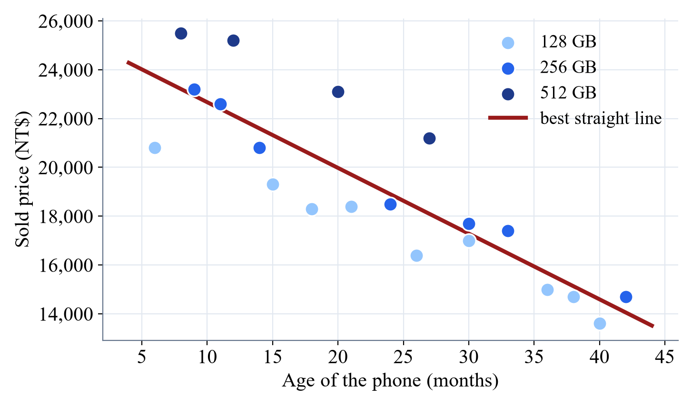

  * **The estimator pattern.** Every Scikit-Learn model, from the simplest to the most advanced, is used in the same three steps: **create** an empty model, **fit** it to examples with known answers (this is where it learns), and **predict** answers for new rows.

    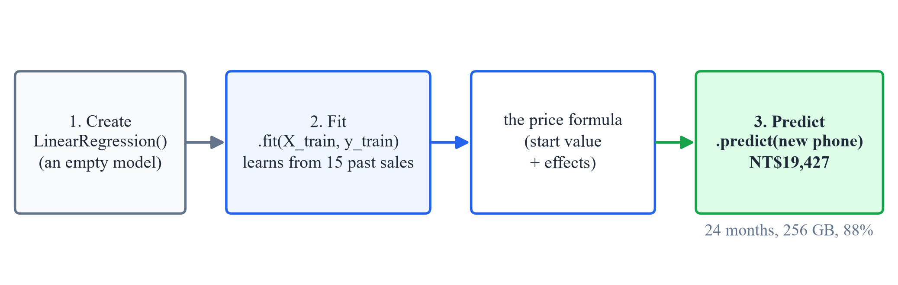

  * **The typical error.** An error is the predicted price minus the actual price. **MAE** (Mean Absolute Error) is the average size of the errors, in NT$: "on average, the suggestion is off by this much". Lower is better.
  * **A benchmark.** A model is only useful if it beats a simple guess. The simplest guess is the average price of past sales: every phone gets the same price.
  * **Cross-validation** repeats the test several times, each time with a different group of phones held out, so that one lucky or unlucky split does not decide the result.

* **5. Lab Practice Dataset:**
  * File Link: [data/session_03_03_dataset.csv](data/session_03_03_dataset.csv)
  * 20 used iPhone 13 phones sold on a second-hand marketplace (fictional teaching data), one row per sale:
    * `Listing_ID`: Listing code (e.g., `PH-101`). A label, not a feature.
    * `Age_Months`: How old the phone was when it sold, in months (`6` to `42`).
    * `Storage_GB`: Storage size: `128`, `256`, or `512` GB.
    * `Battery_Health_Pct`: Battery health shown in the phone's settings, in percent (`76` to `98`).
    * `Photos_Count`: Number of photos in the listing (`1` to `8`). Used only in Exercise 3.
    * `Sold_Price_TWD`: The price the phone sold for, in New Taiwan dollars. This is the target.
  * Workflow in Google Antigravity IDE: activate your `.venv` (Python Setup Clinic), name each script with your name and the session code (for example, `Reacher_S33_step_1.py`), run it with `python` followed by the file name, and check for return code `0`. On an error, paste the traceback into the AI Agent Chat and ask why it failed.

* **6. Step 1: Learn a Formula:**
  * *Goal:* split the sales, train a linear regression model on 15 of them, and read the formula it learned.
  * *Code:* `YourName_S33_step_1.py`
    ```python
    # 1. Input: 20 past sales of used iPhone 13 phones
    import pandas as pd
    from sklearn.linear_model import LinearRegression
    from sklearn.model_selection import train_test_split
    df = pd.read_csv("data/session_03_03_dataset.csv", index_col="Listing_ID")
    features = ["Age_Months", "Storage_GB", "Battery_Health_Pct"]
    X_train, X_test, y_train, y_test = train_test_split(
        df[features], df["Sold_Price_TWD"], test_size=0.25, random_state=42)

    # 2. Process: learn a price formula from the 15 training sales
    model = LinearRegression()
    model.fit(X_train, y_train)

    # 3. Output: the learned formula
    print("Start value:", round(model.intercept_, 1))
    for name, coef in zip(features, model.coef_):
        print(f"{name}: {coef:+,.1f}")
    ```
  * *How it works, line by line:*
    * `df[features]` keeps the three clues (`X`); `df["Sold_Price_TWD"]` is the answer (`y`) (Session 3.2).
    * `train_test_split(..., test_size=0.25, random_state=42)` keeps 5 of the 20 sales aside for the test.
    * `model = LinearRegression()` **creates** an empty model; `model.fit(X_train, y_train)` **fits** it: it learns the formula from the 15 training sales.
    * `model.intercept_` is the start value and `model.coef_` holds one effect per feature, in the order of `features`. A trailing `_` marks something learned during `fit` (Session 3.2).
    * `zip(features, model.coef_)` walks through the names and the effects side by side; `{coef:+,.1f}` prints each effect with its sign, thousands separators, and 1 decimal.
  * *Read the output:*

    ```text
    Start value: 8776.8
    Age_Months: -159.4
    Storage_GB: +12.2
    Battery_Health_Pct: +129.1
    ```

    * Each month of age lowers the price by about NT$159, with storage and battery health held fixed.
    * Each extra GB adds about NT$12: a 256 GB phone sells for about `128 x 12.2 = 1,562` more than the same phone with 128 GB.
    * Each point of battery health adds about NT$129.
    * The start value, `8776.8`, is only where the formula begins. On its own it means nothing: no phone has 0 GB of storage.
  * *Worked example:* a phone that is 24 months old, with 256 GB and 88% battery health:

    | Part | Calculation | Amount |
    |---|---|---|
    | start value | | `8,776.8` |
    | age | `-159.4 x 24` | `-3,825.6` |
    | storage | `12.2 x 256` | `3,123.2` |
    | battery | `129.1 x 88` | `11,360.8` |
    | **suggested price** | sum | about NT$`19,435` |

    `model.predict()` gives NT$`19,427`; the small difference comes from rounding the effects to one decimal in the table (Exercise 2).
  * *Common mistake:* trusting the formula far outside the past sales. A 10-year-old phone (`120` months, 128 GB, `60`% battery) gets a "price" of NT$`-1,042`: a negative price. The past sales were only 6 to 42 months old, so the model knows nothing about older phones.
  * *Quick Check 1 (`.score()`):*
    * New tool: `model.score(X_test, y_test)` returns R-squared: the share of the price differences between the test phones that the model explains, from `0` to `1`. Why: a one-number summary of how well the model fits new data.
    * Task: add one line to part **3. Output**: `print("Test R-squared:", round(model._____(X_test, y_test), 3))`
    * Check: the Terminal shows `Test R-squared: 0.841`. On the training sales it is `0.988`: a model always looks better on the examples it learned from.

* **7. Step 2: Test on Unseen Phones:**
  * *Goal:* predict the 5 test phones, compare with their real prices, and compare the model with simply guessing the average price.
  * *Code:* `YourName_S33_step_2.py`
    ```python
    # 1. Input: the same sales, split, and model as Step 1
    import pandas as pd
    from sklearn.linear_model import LinearRegression
    from sklearn.model_selection import train_test_split
    from sklearn.metrics import mean_absolute_error
    df = pd.read_csv("data/session_03_03_dataset.csv", index_col="Listing_ID")
    features = ["Age_Months", "Storage_GB", "Battery_Health_Pct"]
    X_train, X_test, y_train, y_test = train_test_split(
        df[features], df["Sold_Price_TWD"], test_size=0.25, random_state=42)
    model = LinearRegression().fit(X_train, y_train)

    # 2. Process: predict the 5 test phones and measure the errors
    predicted = model.predict(X_test)
    result = pd.DataFrame({"Actual": y_test, "Predicted": predicted.round().astype(int)})
    result["Error"] = result["Predicted"] - result["Actual"]
    mae_model = mean_absolute_error(y_test, predicted)
    mae_guess = mean_absolute_error(y_test, [y_train.mean()] * len(y_test))

    # 3. Output: each test phone, then the typical error of two ways to price
    print(result)
    print(f"Model: typical error NT${mae_model:,.0f}")
    print(f"Guessing the average price: typical error NT${mae_guess:,.0f}")
    ```
  * *How it works, line by line:*
    * `LinearRegression().fit(...)` creates and fits in one line; `model.predict(X_test)` **predicts** the 5 test prices.
    * `.round().astype(int)` rounds each prediction to a whole NT$ amount for the table.
    * `mean_absolute_error(actual, predicted)` averages the sizes of the errors: the MAE.
    * `[y_train.mean()] * len(y_test)` makes a list of 5 copies of the average training price: the "guess the average" benchmark.
  * *Read the output:*

    ```text
                Actual  Predicted  Error
    Listing_ID                          
    PH-101       20800      21902   1102
    PH-118       23100      23177     77
    PH-116       20800      21796    996
    PH-102       17700      17955    255
    PH-109       21200      21545    345
    Model: typical error NT$555
    Guessing the average price: typical error NT$2,448
    ```

    * The model is very close on `PH-118` (NT$77) and within NT$350 on three phones.
    * It is about NT$1,000 too high on `PH-101` and `PH-116`, two young phones with very good batteries. All five errors are positive here: on these test phones the model suggests a little too much.
    * The model's typical error, NT$555, is about 4 times smaller than guessing the average: the formula is worth using.
  * *Picture it (1):* the actual and predicted price of each test phone. The gaps are the errors.

    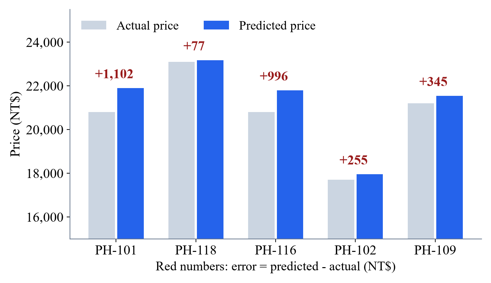

  * *Picture it (2):* the model against the benchmark.

    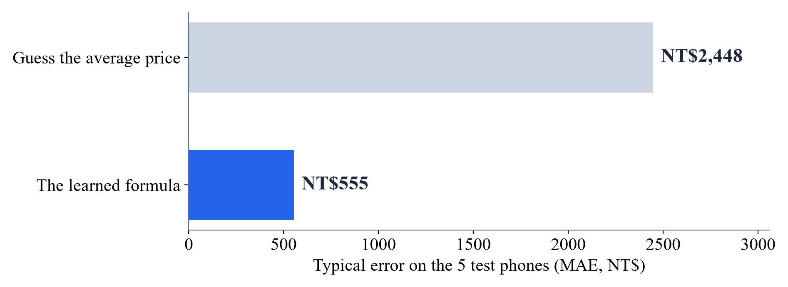

  * *Common mistake:* measuring the error on the training sales. The model learned from them, so they look easier than any new phone will be (Quick Check 1).
  * *Quick Check 2 (RMSE):*
    * New tool: RMSE (Root Mean Squared Error) squares each error before averaging, then takes the square root, so large errors count extra. Why: if one big miss would hurt a seller, RMSE shows it.
    * Task: change the import to `from sklearn.metrics import mean_absolute_error, mean_squared_error`, then add one line to part **3. Output**: `print(f"RMSE: NT${mean_squared_error(y_test, predicted) ** 0.5:,.0f}")`. `** 0.5` is the square root.
    * Check: `RMSE: NT$692`, higher than the MAE because the two errors of about NT$1,000 weigh more.

* **8. Step 3: Cross-Validate:**
  * *Goal:* with only 20 sales, the result depends on which 5 phones land in the test set. Test the model 5 times, each time on a different group of phones, and look at the average and the worst result.
  * *Code:* `YourName_S33_step_3.py`
    ```python
    # 1. Input: all 20 sales
    import pandas as pd
    from sklearn.linear_model import LinearRegression
    from sklearn.model_selection import cross_val_score
    df = pd.read_csv("data/session_03_03_dataset.csv", index_col="Listing_ID")
    features = ["Age_Months", "Storage_GB", "Battery_Health_Pct"]

    # 2. Process: 5 rounds; each round tests on a different 4 phones
    scores = cross_val_score(LinearRegression(), df[features], df["Sold_Price_TWD"],
                             cv=5, scoring="neg_mean_absolute_error")
    errors = -scores

    # 3. Output: the typical error of each round, the average, and the worst
    print("Typical error per round:", errors.round().tolist())
    print(f"Average: NT${errors.mean():,.0f} | Worst round: NT${errors.max():,.0f}")
    ```
  * *How it works, line by line:*
    * `cross_val_score(model, X, y, cv=5, ...)` cuts the 20 sales into 5 groups of 4 (called **folds**), in file order. In each round it fits a fresh model on 16 sales and tests it on the other 4. Every phone is tested exactly once.
    * `scoring="neg_mean_absolute_error"` asks for the MAE of each round. Scikit-Learn treats a higher score as better, so it returns the MAE with a minus sign; `errors = -scores` turns it back into positive NT$ amounts.
    * `.round().tolist()` prints the 5 values as a plain list.
  * *Read the output:*

    ```text
    Typical error per round: [554.0, 533.0, 233.0, 569.0, 487.0]
    Average: NT$475 | Worst round: NT$569
    ```

    * Every round stays below NT$600: the model works no matter which phones are held out.
    * The average, NT$475, is close to the NT$555 of the single test in Step 2: that result was not luck.
    * The app can promise sellers a suggestion that is typically within about NT$500.
  * *Picture it:* each row is one round. The 4 phones in red are tested; the other 16 train the model.

    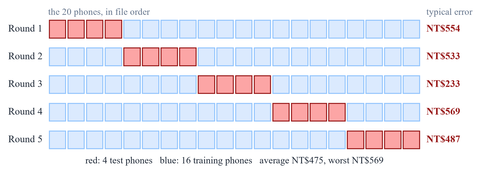

  * *Common mistake:* reporting only the best round (NT$233). Report the average, and mention the worst round too.
  * *Quick Check 3 (`cv=4`):*
    * Tool: the `cv` setting chooses the number of rounds.
    * Task: change `cv=5` to `cv=_` so that each round tests 5 phones.
    * Check: `[549.0, 434.0, 449.0, 611.0]`; average NT$511, worst round NT$611. Fewer, larger test groups: the same picture, a typical error of about NT$500.

* **9. Summary: What It Did:**
  * Every prediction model in this course follows the same steps:

    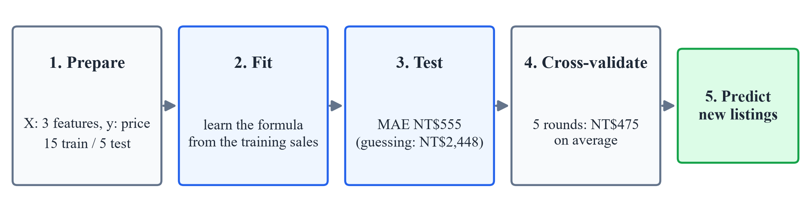

    | Step | Today | In later sessions |
    |---|---|---|
    | 1. Create and fit | `LinearRegression().fit()` on 15 sales | the same pattern with a classifier (3.4) |
    | 2. Test on unseen rows, against a benchmark | MAE NT$555, against NT$2,448 for guessing the average | accuracy, precision, and recall for categories (3.4) |
    | 3. Cross-validate | 5 rounds: NT$475 on average, NT$569 at worst | every model you compare |
    | 4. Predict new rows | a suggested price for a new listing (Exercises 1 and 2) | a nightly prediction job (4.1) |

  * *Remember:* create, fit, predict; measure the error on unseen rows; beat the simple guess; check with cross-validation.

* **10. Official Python Documentation & References:**
  * [Scikit-Learn: Linear Models (LinearRegression)](https://scikit-learn.org/stable/modules/linear_model.html).
  * [Scikit-Learn: Cross-Validation](https://scikit-learn.org/stable/modules/cross_validation.html).
  * [Scikit-Learn: Regression Metrics (MAE, RMSE, R-squared)](https://scikit-learn.org/stable/modules/model_evaluation.html#regression-metrics).
  * [Gareth James et al.: An Introduction to Statistical Learning (with Applications in Python)](https://www.statlearning.com/).

* **11. Exercise 1: Guided Practice - Price New Listings:**
  * *Step 1: Open Script:* In Google Antigravity IDE, create a new script named `YourName_S33_suggest.py`, replacing `YourName` with your own name (for example, `Reacher_S33_suggest.py`).
  * *Step 2: Predict Three New Phones:*
    Type the following code:
    ```python
    # 1. Input: train the model as in Step 1
    import pandas as pd
    from sklearn.linear_model import LinearRegression
    from sklearn.model_selection import train_test_split
    df = pd.read_csv("data/session_03_03_dataset.csv", index_col="Listing_ID")
    features = ["Age_Months", "Storage_GB", "Battery_Health_Pct"]
    X_train, X_test, y_train, y_test = train_test_split(
        df[features], df["Sold_Price_TWD"], test_size=0.25, random_state=42)
    model = LinearRegression().fit(X_train, y_train)

    # 2. Process: three new listings, one row each, with the same columns
    new = pd.DataFrame({
        "Age_Months": [10, 24, 36],
        "Storage_GB": [256, 128, 512],
        "Battery_Health_Pct": [95, 86, 79],
    }, index=["NEW-1", "NEW-2", "NEW-3"])
    new["Suggested"] = model.predict(new[features]).round(-2).astype(int)
    new["Low"] = new["Suggested"] - 500
    new["High"] = new["Suggested"] + 500

    # 3. Output: a suggested price and a range for each listing
    print(new)
    ```
    * `pd.DataFrame({...}, index=[...])` builds a table of new phones with the **same column names** as the training data.
    * `.round(-2)` rounds to the nearest NT$100, the way prices are usually written.
    * The range of NT$500 on each side comes from the typical error of Step 3.
  * *Step 3: Interpret:* In two comment lines, answer: why is `NEW-3`, the oldest phone, suggested at a higher price than `NEW-2`? Which feature explains it?
  * *Step 4: Execute in Terminal:* Run `python YourName_S33_suggest.py` in Panel `[4]` and confirm return code `0`.
  * *Success Check:* suggested prices NT$`22,600` (`NEW-1`), NT$`17,600` (`NEW-2`), and NT$`19,500` (`NEW-3`), each with a range of NT$500 on each side. `NEW-3` is a year older than `NEW-2` with a weaker battery, but its 512 GB of storage adds about `384 x 12.2 = 4,685` more than `NEW-2`'s 128 GB.

* **12. Exercise 2: Applied Practice - Error per Phone, One-Row Prediction:**
  * *Coding Challenge:* In `YourName_S33_practice.py`, start from the code of Step 2. Show each test phone's error in percent, read a common error message, then price one phone.
  * *Task 1 (Percentage Error per Phone):* Add a column `Error_Pct` = absolute error / actual price x 100, rounded to 2 decimals: `(abs(result["Error"]) / result["Actual"] * 100).round(2)`. Print the table, then the average `Error_Pct`, called MAPE (Mean Absolute Percentage Error), rounded to 1 decimal.
  * *Task 2 (Read the ValueError & AI Diagnosis):* Price your own phone, 24 months old, 256 GB, 88% battery health, by writing `model.predict([24, 256, 88])`. The script stops with `ValueError: Expected 2D array, got 1D array instead`. Capture the traceback with `Win + Shift + S` (Mac: `Cmd + Ctrl + Shift + 4`), paste it into Panel `[3]` (AI Agent Chat), and ask what "2D" means.
  * *Task 3 (Fix the Shape):* A model always expects a table: rows and columns ("2D"), even for one phone. A plain list such as `[24, 256, 88]` has no rows ("1D"). Make a one-row DataFrame with the same column names, `phone = pd.DataFrame([[24, 256, 88]], columns=features)`, then predict and print the price with thousands separators.
  * *Success Check:*
    * Percentage errors: `PH-101` `5.3`%, `PH-118` `0.33`%, `PH-116` `4.79`%, `PH-102` `1.44`%, `PH-109` `1.63`%; MAPE `2.7`%.
    * Your phone: NT$`19,427` (the worked example of Step 1).

* **13. Exercise 3: Advanced Practice - Which Details to Ask For?:**
  * *Goal:* Every detail the app asks a seller for makes listing a phone slower. Find out, with 5-fold cross-validation, which details really improve the suggested price.
  * *What you need:*
    * File: `data/session_03_03_dataset.csv` (described in **5. Lab Practice Dataset**).
    * Script name: `YourName_S33_details.py`.
    * Tools you already know: `LinearRegression`, `cross_val_score()` with `scoring="neg_mean_absolute_error"` (Step 3), dictionaries, `for` loops, and `pd.DataFrame()`.
  * *Requirements (follow them in order):*
    1. Define four candidate feature lists in a dictionary:
       * `"A: age"`: `["Age_Months"]`
       * `"B: age + storage"`: `["Age_Months", "Storage_GB"]`
       * `"C: age + storage + battery"`: `["Age_Months", "Storage_GB", "Battery_Health_Pct"]`
       * `"D: C + photos"`: the three above plus `"Photos_Count"`
    2. For each candidate, run 5-fold cross-validation (`cv=5`) and record the number of features, the average MAE, and the worst round's MAE, both rounded to whole NT$.
    3. Collect the results in one DataFrame with the columns `Model`, `Features`, `Avg_MAE_TWD`, and `Worst_MAE_TWD`, sorted by `Avg_MAE_TWD` from lowest to highest.
    4. Apply the app's rule: among the models whose average MAE is within NT$50 of the best one, choose the one with the fewest features.
    5. Print the table and the chosen model, with one sentence that explains the choice.
  * *New tools for this exercise:*
    * Looping over a dictionary: `for name, cols in candidates.items():` gives each key (`name`) and its value (`cols`) in turn.
    * Collecting rows: start with `rows = []`, append one dictionary per model, such as `rows.append({"Model": name, "Features": len(cols), ...})`, and finish with `pd.DataFrame(rows)`.
  * *Hints:*
    * First print the 5 round values of each model before you average them.
    * For the rule, keep the rows with `Avg_MAE_TWD <= best + 50`, then sort them by `Features`.
  * *Self-Check (expected results):*
    * Average MAE: B NT$`470`, C NT$`475`, D NT$`492`, A NT$`1,541`. Worst round: B NT$`542`, C NT$`569`, D NT$`576`, A NT$`1,949`.
    * Within NT$50 of the best (NT$470): B, C, and D. Chosen: **B: age + storage**.
    * Business meaning: storage is worth asking for (it cuts the error from about NT$1,500 to under NT$500). Battery health adds almost nothing here, because older phones already have weaker batteries: age tells the model most of it. The photo count only adds noise. The app can ask for two details instead of four.

---

<a id="session-03-04"></a>
### Session 3.4: Classifying and Grouping: Supervised vs. Unsupervised Learning, Thresholds, Precision, and Recall

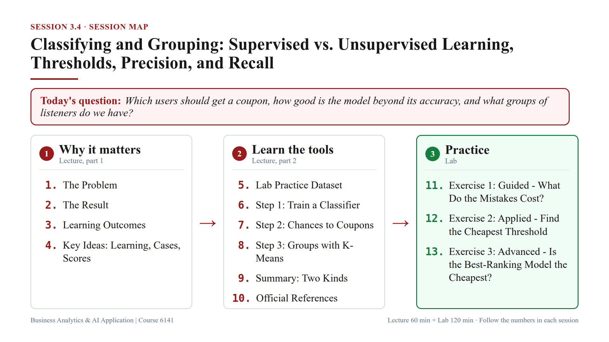

* **Lecture Presentation:** [Download Slides (PDF)](slides/session_03_04_lecture.pdf)
* **Reading (PDF):** [Download Reading (PDF)](handouts/session_03_04_reading.pdf): read before class
* **Before class (homework):** [Pre-Class Practice (PDF)](homework/preclass_session_03_04.pdf) and [report template (Word)](homework/preclass_session_03_04_template.docx): six short tasks on a small example and a report of about 5 pages, due Tuesday, December 1, 2026, 5 pm (Taiwan time) on iLearn, the day before this session
* **Schedule:** Week 12 (115/11/29 - 115/12/05) | In-person classes (1:2 Delivery Ratio: 60 Min Lecture + 120 Min Lab)
* **How this session is organized:** first the problem, then the result, then how a classifier and a grouping method produced that result, step by step with code. The three exercises come last.

* **1. The Problem:**
  * The music streaming app of Session 3.2 loses subscribers every month. A subscription costs about NT$150 a month, so a user who cancels takes about NT$1,800 of next year's payments away.
  * The app can send a "come back" coupon to users who look likely to cancel. A coupon costs the app NT$60. Assume that a coupon keeps a user who was about to cancel.
  * Two mistakes are possible, and they cost very different amounts:
    * **Missed:** no coupon for a user who then cancels: NT$1,800 lost.
    * **False alarm:** a coupon for a user who would have stayed anyway: NT$60 wasted.
  * The marketing team also wants to know what kinds of listeners the app has, without being told the answer in advance.
  * The growth manager asks: which users should get a coupon, how good is the model beyond its accuracy, and what groups of listeners do we have?

* **2. The Result:**
  * A classifier learned from 20 users gives each of 20 other users a **chance of cancelling** between 0 and 1. A coupon goes to every user whose chance is at or above a cut-off (the **threshold**). On the 20 test users:

    | Threshold | Cancellers caught | Missed | False alarms | Cost of mistakes |
    |---|---|---|---|---|
    | `0.5` (the usual default) | 5 of 7 | 2 | 2 | NT$`3,720` |
    | `0.3` (chosen by cost) | 7 of 7 | 0 | 3 | NT$`180` |

    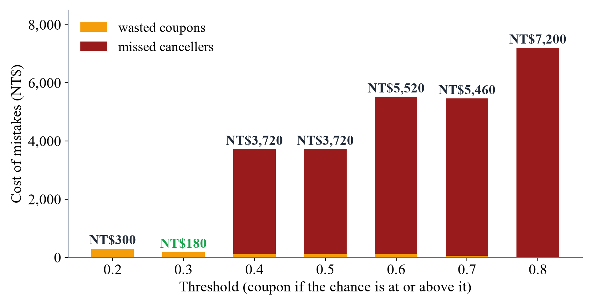

  * Grouping all 40 users by listening habits, with no answers given, finds three kinds of listeners:

    | Group | Users | Weeks inactive (average) | Minutes per month (average) | Cancelled afterwards |
    |---|---|---|---|---|
    | steady listeners | 12 | 0.6 | 2,117 | 0% |
    | casual listeners | 14 | 3.0 | 1,485 | 29% |
    | drifting away | 14 | 5.3 | 591 | 79% |

  * **Answer 1:** send a coupon when the chance is **0.3 or more**. A missed canceller costs 30 times more than a wasted coupon, so the cut-off should be low.
  * **Answer 2:** accuracy alone is misleading. At `0.5` the model is 80% accurate but misses 2 of the 7 cancellers; never sending any coupon would still be 65% accurate. **Recall** (the share of cancellers caught) and the cost tell the real story.
  * **Answer 3:** three groups; the "drifting away" group is where most cancellations come from.
  * **How it was done:** a classifier (supervised learning), a threshold with a confusion matrix, and K-Means (unsupervised learning). Sections 6 to 8 do it step by step.

* **3. Expected Learning Outcomes (By the end of this session, you will be able to):**
  1. "Which kind of learning fits this problem?": tell supervised learning (learning from examples with known answers) from unsupervised learning (finding groups without answers)
  2. "How good is the classifier, really?": turn chances into decisions with a threshold, read a confusion matrix, and calculate accuracy, precision, and recall
  3. "Which threshold, and which groups?": choose the threshold with the lowest business cost, and group users with K-Means

* **4. Key Ideas: Learning, Cases, Scores:**
  * **Supervised and unsupervised learning.**

    | | Supervised learning | Unsupervised learning |
    |---|---|---|
    | Past examples come with the answer? | yes: `Cancelled_Binary` | no |
    | What it does | learns to predict the answer for new rows | finds groups of similar rows by itself |
    | Today | a classifier that predicts who will cancel | K-Means groups of listeners |
    | Earlier | the spam rule (3.1), the price formula (3.3) | |

  * **A classifier gives a chance, not a decision.** Logistic regression, today's classifier, gives each user a chance of cancelling between `0` and `1`. A **threshold** turns the chance into a decision: coupon if the chance is at or above it.
  * **The four cases** (as in Session 3.1). Every decision about a test user is one of four:

    | | Coupon (predicted: will cancel) | No coupon (predicted: will stay) |
    |---|---|---|
    | **Really cancelled** | TP (True Positive): caught | FN (False Negative): missed, NT$1,800 |
    | **Really stayed** | FP (False Positive): false alarm, NT$60 | TN (True Negative): correctly left alone |

    This 2x2 table of counts is called a **confusion matrix**.
  * **Three scores, three questions:**

    | Score | Formula | Question it answers |
    |---|---|---|
    | Accuracy | (TP + TN) / all | What share of all decisions was right? |
    | Precision | TP / (TP + FP) | Of the users who got a coupon, what share would really have cancelled? |
    | Recall | TP / (TP + FN) | Of all the users who cancelled, what share did we catch? |

  * **The trade-off.** A lower threshold sends more coupons: more cancellers caught (higher recall) but more wasted coupons (lower precision). The costs of the two mistakes decide where the threshold should sit.
  * **K-Means** puts rows into K groups so that rows in the same group are close to each other. Columns are first put on one scale (Session 3.2), so that minutes, in the thousands, do not drown out weeks.

* **5. Lab Practice Dataset:**
  * File Link: [data/session_03_04_dataset.csv](data/session_03_04_dataset.csv)
  * 40 users of the music streaming app (fictional teaching data), one row per user:
    * `User_ID`: User code (e.g., `USR-301`). A label, not a feature.
    * `Weeks_Inactive_Count`: Weeks since the user last played a song (`0` to `7`).
    * `Monthly_Minutes_Count`: Minutes of music played last month (`60` to `2,800`).
    * `Cancelled_Binary`: The answer: `1` = cancelled the next month, `0` = stayed. 15 of the 40 users cancelled.
  * Workflow in Google Antigravity IDE: activate your `.venv` (Python Setup Clinic), name each script with your name and the session code (for example, `Reacher_S34_step_1.py`), run it with `python` followed by the file name, and check for return code `0`. On an error, paste the traceback into the AI Agent Chat and ask why it failed.

* **6. Step 1: Train a Classifier:**
  * *Goal:* learn from 20 users who cancelled or stayed, then give each of the other 20 users a chance of cancelling.
  * *Code:* `YourName_S34_step_1.py`
    ```python
    # 1. Input: 40 users; half train the model, half test it
    import pandas as pd
    from sklearn.linear_model import LogisticRegression
    from sklearn.model_selection import train_test_split
    from sklearn.pipeline import make_pipeline
    from sklearn.preprocessing import StandardScaler
    df = pd.read_csv("data/session_03_04_dataset.csv", index_col="User_ID")
    features = ["Weeks_Inactive_Count", "Monthly_Minutes_Count"]
    X_train, X_test, y_train, y_test = train_test_split(
        df[features], df["Cancelled_Binary"], test_size=0.5, random_state=42,
        stratify=df["Cancelled_Binary"])

    # 2. Process: scale, then learn to classify; score each test user
    model = make_pipeline(StandardScaler(), LogisticRegression())
    model.fit(X_train, y_train)
    chance = model.predict_proba(X_test)[:, 1]

    # 3. Output: the test users, highest chance of cancelling first
    result = pd.DataFrame({"Weeks": X_test["Weeks_Inactive_Count"],
                           "Minutes": X_test["Monthly_Minutes_Count"],
                           "Chance": chance.round(2), "Cancelled": y_test})
    print(result.sort_values("Chance", ascending=False))
    ```
  * *How it works, line by line:*
    * `test_size=0.5` keeps 20 users for the test; `stratify=...` puts the same share of cancellers in both halves (Session 3.2).
    * `make_pipeline(StandardScaler(), LogisticRegression())` chains two steps: put both columns on one scale, then classify. Fitting the pipeline fits both steps on the training users only (Session 3.2).
    * `model.fit(X_train, y_train)` is the same create-and-fit pattern as Session 3.3; only the model is different.
    * `model.predict_proba(X_test)` returns two columns per user: the chance of `0` (stay) and the chance of `1` (cancel). `[:, 1]` keeps every row (`:`) of the second column (`1`).
    * `pd.DataFrame({...})` builds a table with short column names: the two features, the chance, and the real answer. `.sort_values("Chance", ascending=False)` puts the highest chance first.
  * *Read the output:*

    ```text
             Weeks  Minutes  Chance  Cancelled
    User_ID                                   
    USR-309      7      100    0.97          1
    USR-328      6       60    0.95          1
    USR-301      6      650    0.88          1
    USR-326      6     1200    0.77          1
    USR-334      4      520    0.73          0
    USR-337      4      840    0.63          0
    USR-324      4     1060    0.55          1
    USR-315      4     1480    0.40          1
    USR-325      3     1110    0.38          0
    USR-338      3     1180    0.36          1
    USR-336      3     1680    0.21          0
    USR-323      3     1720    0.20          0
    USR-333      3     1840    0.17          0
    USR-313      2     1600    0.14          0
    USR-312      2     1700    0.12          0
    USR-306      1     1910    0.05          0
    USR-307      1     1930    0.05          0
    USR-318      2     2460    0.04          0
    USR-332      0     2200    0.02          0
    USR-335      0     2800    0.01          0
    ```

    * Users who stopped listening weeks ago and play few minutes get the highest chances; heavy, recent listeners get chances near `0`.
    * The ranking is good but not perfect: `USR-334` and `USR-337` (chances `0.73` and `0.63`) stayed, while `USR-315` and `USR-338` (`0.40` and `0.36`) cancelled.
    * The model gives chances, not decisions. Step 2 turns them into coupons.
  * *Common mistake:* calling `predict_proba()` and keeping both columns. `chance` must be the second column only, the chance of cancelling.
  * *Quick Check 1 (`.predict()`):*
    * New tool: `model.predict(X_test)` gives `1` or `0` for each user directly, using a threshold of `0.5`. Why: the quick default, which Step 2 questions.
    * Task: add one line to part **3. Output**: `print("Coupons at 0.5:", model._______(X_test).sum())`
    * Check: `Coupons at 0.5: 7`: the 7 users from the top of the list down to `USR-324` (`0.55`).

* **7. Step 2: Chances to Coupons:**
  * *Goal:* send a coupon to every test user whose chance is at least `0.5`, count the four cases, and calculate accuracy, precision, and recall.
  * *Code:* `YourName_S34_step_2.py`
    ```python
    # 1. Input: the same users, split, and model as Step 1
    import pandas as pd
    from sklearn.linear_model import LogisticRegression
    from sklearn.model_selection import train_test_split
    from sklearn.pipeline import make_pipeline
    from sklearn.preprocessing import StandardScaler
    from sklearn.metrics import confusion_matrix
    from sklearn.metrics import accuracy_score, precision_score, recall_score
    df = pd.read_csv("data/session_03_04_dataset.csv", index_col="User_ID")
    features = ["Weeks_Inactive_Count", "Monthly_Minutes_Count"]
    X_train, X_test, y_train, y_test = train_test_split(
        df[features], df["Cancelled_Binary"], test_size=0.5, random_state=42,
        stratify=df["Cancelled_Binary"])
    model = make_pipeline(StandardScaler(), LogisticRegression()).fit(X_train, y_train)
    chance = model.predict_proba(X_test)[:, 1]

    # 2. Process: send a coupon when the chance is 0.5 or more, then count the 4 cases
    coupon = (chance >= 0.5).astype(int)
    tn, fp, fn, tp = confusion_matrix(y_test, coupon).ravel()

    # 3. Output: the four cases and three scores
    print(f"Caught: {tp} | False alarms: {fp} | Missed: {fn} | Left alone: {tn}")
    print(f"Accuracy: {accuracy_score(y_test, coupon):.2f}")
    print(f"Precision: {precision_score(y_test, coupon):.2f}")
    print(f"Recall: {recall_score(y_test, coupon):.2f}")
    ```
  * *How it works, line by line:*
    * `(chance >= 0.5)` compares every chance with the threshold and gives `True` or `False`; `.astype(int)` turns them into `1` (coupon) and `0` (no coupon) (Session 3.2).
    * `confusion_matrix(actual, decision)` counts the four cases in a 2x2 table; `.ravel()` flattens it into four numbers, always in the order TN, FP, FN, TP. Unpacking them into four variables names each count.
    * `accuracy_score()`, `precision_score()`, and `recall_score()` compute the three scores of section 4 from the same two columns.
  * *Read the output:*

    ```text
    Caught: 5 | False alarms: 2 | Missed: 2 | Left alone: 11
    Accuracy: 0.80
    Precision: 0.71
    Recall: 0.71
    ```

    * 16 of the 20 decisions are right: an accuracy of 80%.
    * Precision `0.71`: of the 7 coupons, 5 went to users who would really have cancelled.
    * Recall `0.71`: of the 7 users who cancelled, the coupons caught 5. The other 2, `USR-315` and `USR-338`, cost NT$1,800 each.
  * *Picture it:* the 20 test users sorted by their chance of cancelling, with the threshold drawn in. Moving the line down to `0.3` catches the 2 missed cancellers at the price of 1 more wasted coupon.

    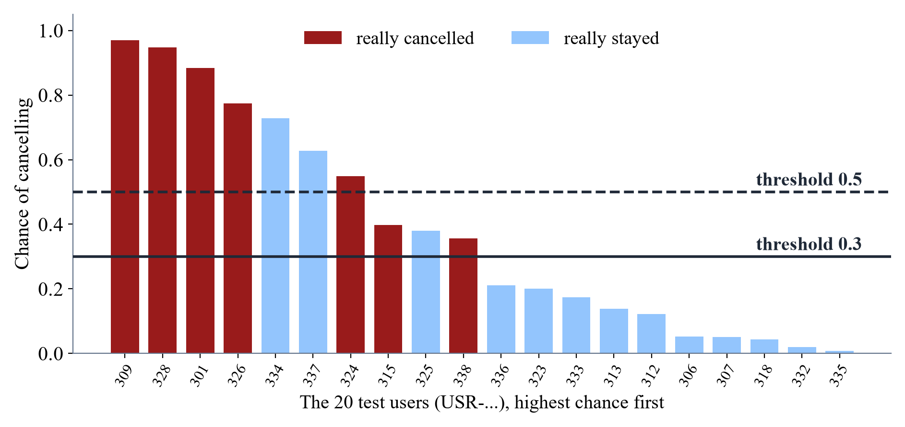

  * *Picture it:* the confusion matrix at `0.5`.

    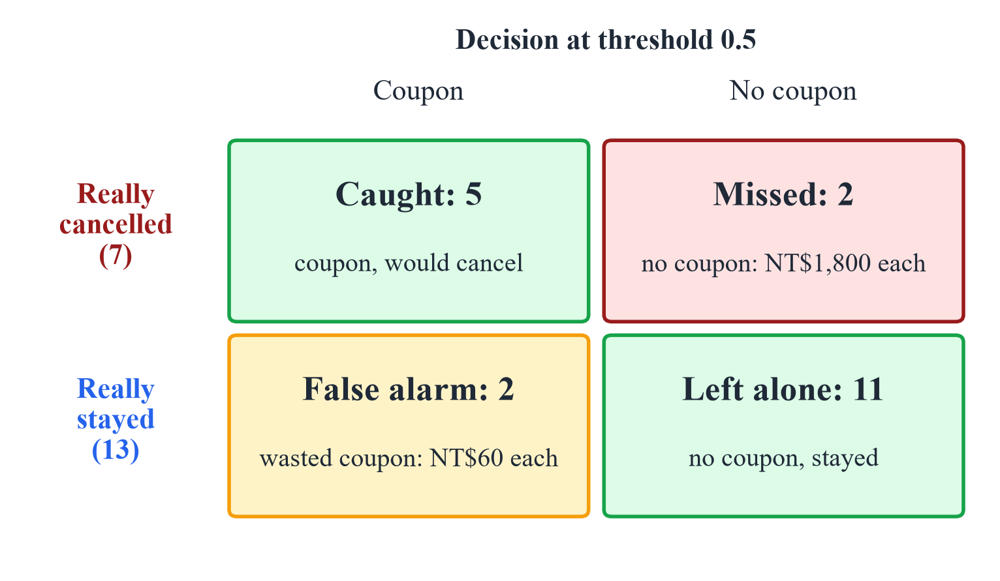

  * *Common mistake:* trusting accuracy. Most users stay, so a lazy "never send a coupon" rule is already 65% accurate and catches nobody (Quick Check 2). For a costly mistake such as a missed canceller, look at recall and at the cost.
  * *Quick Check 2 (the accuracy trap):*
    * Tool: `accuracy_score()` with a list of zeros: "never send a coupon".
    * Task: add one line to part **3. Output**: `print("Never send:", accuracy_score(y_test, [_] * len(y_test)))`
    * Check: `Never send: 0.65`. 65% accurate, recall `0`: it catches no canceller at all.

* **8. Step 3: Groups with K-Means:**
  * *Goal:* group all 40 users by how they listen, without using the cancel answers, then read what each group looks like.
  * *Code:* `YourName_S34_step_3.py`
    ```python
    # 1. Input: all 40 users; the answer column is not used to find the groups
    import pandas as pd
    from sklearn.cluster import KMeans
    from sklearn.preprocessing import StandardScaler
    df = pd.read_csv("data/session_03_04_dataset.csv", index_col="User_ID")
    features = ["Weeks_Inactive_Count", "Monthly_Minutes_Count"]

    # 2. Process: put both columns on one scale, then find 3 groups of similar users
    scaled = StandardScaler().fit_transform(df[features])
    kmeans = KMeans(n_clusters=3, random_state=42, n_init=10)
    df["Group"] = kmeans.fit_predict(scaled)

    # 3. Output: a profile of each group; the cancel rate only helps us read them
    profile = df.groupby("Group").agg(
        Users=("Cancelled_Binary", "size"),
        Weeks=("Weeks_Inactive_Count", "mean"),
        Minutes=("Monthly_Minutes_Count", "mean"),
        Cancel_Rate=("Cancelled_Binary", "mean"))
    print(profile.round(2))
    ```
  * *How it works, line by line:*
    * Only the two listening columns go in: K-Means never sees `Cancelled_Binary`. This is what makes it unsupervised.
    * `StandardScaler().fit_transform(...)` puts weeks and minutes on one scale first (Session 3.2); without it, minutes would decide the groups alone.
    * `KMeans(n_clusters=3, ...)` asks for 3 groups. `n_init=10` tries 10 different starting points and keeps the best result; `random_state=42` gives the same groups on every run.
    * `.fit_predict(scaled)` finds the groups and returns a group number (`0`, `1`, or `2`) for each user.
    * `df.groupby("Group").agg(...)` summarizes each group (Session 1.4): the number of users, the average weeks and minutes, and the share who cancelled. The cancel rate is added only **after** grouping, to help us name the groups.
  * *Read the output:*

    ```text
           Users  Weeks  Minutes  Cancel_Rate
    Group                                    
    0         14   3.00  1485.00         0.29
    1         12   0.58  2116.67         0.00
    2         14   5.29   591.43         0.79
    ```

    * Group `1`: **steady listeners**: active this week, over 2,000 minutes a month; none cancelled.
    * Group `0`: **casual listeners**: about 3 weeks inactive, about 1,500 minutes; 29% cancelled.
    * Group `2`: **drifting away**: over 5 weeks inactive, under 600 minutes; 79% cancelled.
    * The group numbers are only names; K-Means might number the same groups differently on another computer. Read the profile, not the number.
  * *Picture it:* each dot is a user, placed by weeks inactive and minutes, and colored by its group.

    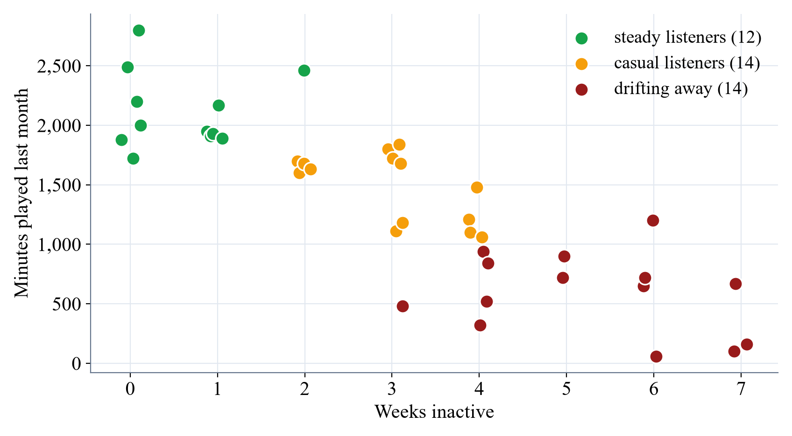

  * *Common mistake:* forgetting to scale. Then minutes, which run into the thousands, decide the groups almost alone, and weeks inactive, the strongest warning sign, is nearly ignored.
  * *Quick Check 3 (`n_clusters`):*
    * Tool: `n_clusters` chooses the number of groups.
    * Task: change `n_clusters=3` to `n_clusters=_` to split the users into 2 groups.
    * Check: two groups of 20 users: one averages 4.8 weeks and 771 minutes (75% cancelled), the other 1.35 weeks and 1,952.5 minutes (0% cancelled). More groups show more detail; the business question decides how many are useful.

* **9. Summary: Two Kinds:**
  * The two methods answer different questions:

    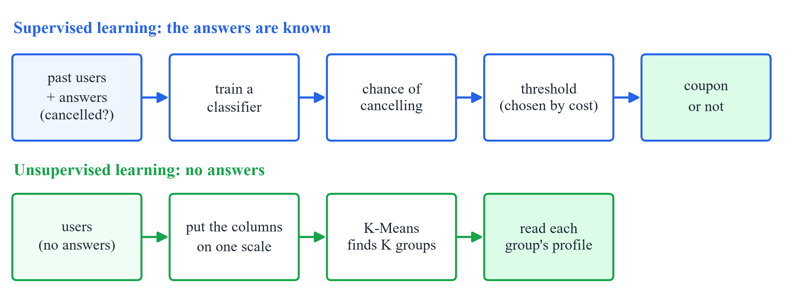

    | Step | What we did | In later sessions |
    |---|---|---|
    | 1. Train a classifier (supervised) | chances of cancelling for 20 test users | a churn model for a whole customer base (4.2) |
    | 2. Turn chances into decisions | threshold `0.5`: accuracy `0.80`, recall `0.71`; threshold `0.3` by cost (Exercise 2) | decisions with business costs (4.1, 4.2) |
    | 3. Find groups (unsupervised) | 3 kinds of listeners with K-Means | K-Means on the paragraphs of 10-K reports (term project) |

  * *Remember:* supervised learning predicts a known answer; unsupervised learning finds groups. A classifier gives chances; the threshold, chosen by cost, makes the decisions; and recall shows what accuracy hides.

* **10. Official Python Documentation & References:**
  * [Scikit-Learn: Logistic Regression](https://scikit-learn.org/stable/modules/linear_model.html#logistic-regression).
  * [Scikit-Learn: Classification Metrics (Confusion Matrix, Precision, Recall, ROC-AUC)](https://scikit-learn.org/stable/modules/model_evaluation.html#classification-metrics).
  * [Scikit-Learn: K-Means Clustering](https://scikit-learn.org/stable/modules/clustering.html#k-means).
  * [Google Machine Learning Crash Course: Classification (Thresholds, Precision, Recall, ROC)](https://developers.google.com/machine-learning/crash-course/classification).

* **11. Exercise 1: Guided Practice - What Do the Mistakes Cost?:**
  * *Step 1: Open Script:* In Google Antigravity IDE, create a new script named `YourName_S34_cost.py`, replacing `YourName` with your own name (for example, `Reacher_S34_cost.py`).
  * *Step 2: Put a Price on Each Mistake:*
    Copy parts **1. Input** and **2. Process** of Step 2, then replace part **3. Output** with:
    ```python
    # 3. Output: the cost of the two kinds of mistakes at threshold 0.5
    MISS_COST = 1800        # a user who cancels takes NT$1,800 away
    COUPON_COST = 60        # a wasted coupon costs NT$60
    cost = fn * MISS_COST + fp * COUPON_COST
    print(f"Missed cancellers: {fn} x NT${MISS_COST:,} = NT${fn * MISS_COST:,}")
    print(f"Wasted coupons: {fp} x NT${COUPON_COST} = NT${fp * COUPON_COST}")
    print(f"Cost of mistakes: NT${cost:,}")
    ```
    * Names in capital letters, such as `MISS_COST`, are a Python habit for fixed settings that the code does not change.
    * `{MISS_COST:,}` prints the number with a thousands separator.
  * *Step 3: Interpret:* In two comment lines, answer: which kind of mistake makes up most of the cost? Should the threshold go up or down?
  * *Step 4: Execute in Terminal:* Run `python YourName_S34_cost.py` in Panel `[4]` and confirm return code `0`.
  * *Success Check:* `Missed cancellers: 2 x NT$1,800 = NT$3,600`, `Wasted coupons: 2 x NT$60 = NT$120`, and `Cost of mistakes: NT$3,720`. The misses are 97% of the cost, so the threshold should go **down**: more coupons, fewer misses.

* **12. Exercise 2: Applied Practice - Find the Cheapest Threshold:**
  * *Coding Challenge:* In `YourName_S34_threshold.py`, start from Exercise 1 and try the thresholds `[0.2, 0.3, 0.4, 0.5, 0.6, 0.7, 0.8]`.
  * *Task 1 (Loop over Thresholds):* For each threshold, make the coupon decisions, count the four cases with `confusion_matrix(...).ravel()`, and compute the cost. Print one line per threshold with the threshold, caught, missed, false alarms, and the cost. Write the list of thresholds by hand: a loop with `np.arange()` gives values such as `0.30000000000000004`.
  * *Task 2 (Read the ValueError & AI Diagnosis):* Write `confusion_matrix(y_test, chance)`, with the chances instead of the 0/1 decisions. The script stops with `ValueError: Classification metrics can't handle a mix of binary and continuous targets`. Capture the traceback (Windows: `Win + Shift + S`; Mac: `Cmd + Ctrl + Shift + 4`), paste it into Panel `[3]` (AI Agent Chat), and ask what "continuous" means. Then delete the line.
  * *Task 3 (Choose):* Print the threshold with the lowest cost and its recall.
  * *Success Check:*

    | Threshold | Caught | Missed | False alarms | Cost |
    |---|---|---|---|---|
    | `0.2` | 7 | 0 | 5 | NT$`300` |
    | `0.3` | 7 | 0 | 3 | NT$`180` |
    | `0.4` | 5 | 2 | 2 | NT$`3,720` |
    | `0.5` | 5 | 2 | 2 | NT$`3,720` |
    | `0.6` | 4 | 3 | 2 | NT$`5,520` |
    | `0.7` | 4 | 3 | 1 | NT$`5,460` |
    | `0.8` | 3 | 4 | 0 | NT$`7,200` |

    The cheapest threshold is `0.3` (NT$180, recall `1.00`). Going even lower (`0.2`) wastes 2 more coupons and catches nobody new.

* **13. Exercise 3: Advanced Practice - Is the Best-Ranking Model the Cheapest?:**
  * *Goal:* The app could build its model from weeks inactive only, from minutes only, or from both. Compare the three with ROC-AUC, a score of how well a model ranks the cancellers above the stayers, and with the cost at each model's cheapest threshold. Do the two measures pick the same model?
  * *What you need:*
    * File: `data/session_03_04_dataset.csv` (described in **5. Lab Practice Dataset**).
    * Script name: `YourName_S34_compare.py`.
    * Tools you already know: the split and the pipeline of Step 1, the threshold loop and the cost of Exercise 2, dictionaries, and `pd.DataFrame()`.
  * *Requirements (follow them in order):*
    1. Split the data as in Step 1 (`test_size=0.5`, `random_state=42`, `stratify`).
    2. Define three feature lists in a dictionary: `"weeks only"`: `["Weeks_Inactive_Count"]`; `"minutes only"`: `["Monthly_Minutes_Count"]`; `"both"`: both columns.
    3. For each list, fit `make_pipeline(StandardScaler(), LogisticRegression())` on the training users, get the chances for the test users, and compute the ROC-AUC rounded to 3 decimals.
    4. For each list, find the cheapest threshold among `[0.2, 0.3, 0.4, 0.5, 0.6, 0.7, 0.8]` with the costs of Exercise 1. If two thresholds cost the same, keep the lower one.
    5. Print one table with the columns `Model`, `ROC_AUC`, `Best_Threshold`, and `Lowest_Cost_TWD`, then one sentence: which model would you choose, and why?
  * *New tools for this exercise:*
    * `from sklearn.metrics import roc_auc_score`; `roc_auc_score(y_test, chance)` takes the **chances**, not the 0/1 decisions. It is `1.0` when every canceller has a higher chance than every stayer, and `0.5` when the ranking is no better than a coin flip.
    * `X_train[cols]` and `X_test[cols]` keep only the columns of one feature list.
  * *Hints:*
    * Put the threshold loop of Exercise 2 into a function, such as `lowest_cost(chance)`, that returns the best threshold and its cost.
    * `min(results, key=...)` or sorting a small DataFrame both work for finding the cheapest threshold.
  * *Self-Check (expected results):*
    * ROC-AUC: weeks only `0.934`, both `0.923`, minutes only `0.868`.
    * Cheapest threshold and cost: both `0.3`, NT$`180`; minutes only `0.2`, NT$`240`; weeks only `0.2`, NT$`360`.
    * Business meaning: the model that ranks best (weeks only) is not the cheapest one. ROC-AUC judges the whole ranking; the cost judges the decisions the app will really make. Choose **both**, by cost.

---

<a id="session-04-01"></a>
### Session 4.1: Putting a Model to Work: Save It, Score Every Night, Watch for Drift, and Fall Back Safely

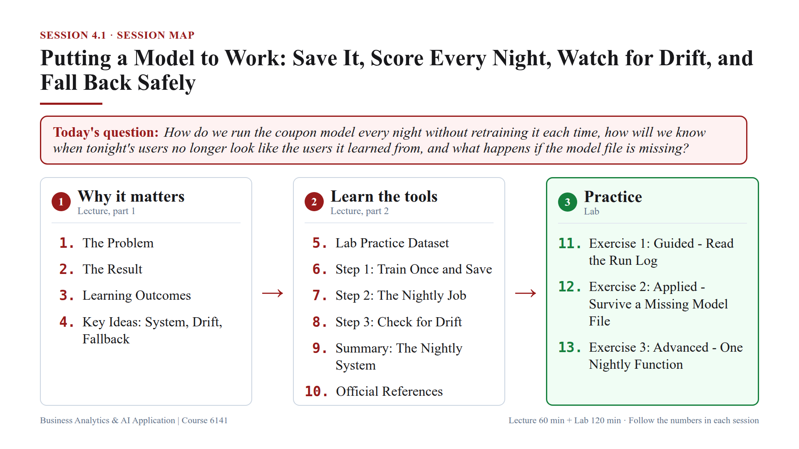

* **Lecture Presentation:** [Download Slides (PDF)](slides/session_04_01_lecture.pdf)
* **Reading (PDF):** [Download Reading (PDF)](handouts/session_04_01_reading.pdf): read before class
* **Schedule:** Week 13 (115/12/06 - 115/12/12) | In-person classes (1:2 Delivery Ratio: 60 Min Lecture + 120 Min Lab)
* **How this session is organized:** first the problem, then the result, then how a saved model, a nightly job, and a drift check produced that result, step by step with code. The three exercises come last.

* **1. The Problem:**
  * In Session 3.4, the music app built a model that gives each user a chance of cancelling, and chose to send a "come back" coupon at a chance of `0.3` or more.
  * A model in a student's script helps nobody. It creates value only when it runs **every night by itself**: new users come in, the model scores them, and the coupons go out before morning.
  * Tonight is in the middle of final exams. Many students still open the app, but they listen much less than usual.
  * The head of the app's data team asks: how do we run the coupon model every night without retraining it each time, how will we know when tonight's users no longer look like the users it learned from, and what happens if the model file is missing?

* **2. The Result:**
  * The model was trained **once** and saved to a file. Tonight's job loads the file, scores the 10 new users, and decides the coupons in a fraction of a second:

    | Tonight | Result |
    |---|---|
    | Users scored | `10` |
    | Coupons to send (chance `0.3` or more) | `5`: `USR-401`, `USR-403`, `USR-405`, `USR-406`, `USR-407` |
    | Expected cancellations without coupons (sum of the chances) | about `4.0` |

  * A drift check compares tonight's users with the training users:

    | Feature | Training average | Tonight's average | Change | Drift? |
    |---|---|---|---|---|
    | `Weeks_Inactive_Count` | `3.1` | `2.9` | `-5.7`% | no |
    | `Monthly_Minutes_Count` | `1,361.8` | `780.0` | `-42.7`% | **yes** |

  * **Answer 1:** save the trained model once with `joblib`; every night, load it and score. No retraining, no person needed.
  * **Answer 2:** tonight's users listen 43% less than the users the model learned from. The coupons still go out, but the night is flagged for a person to review: during exam season, low minutes may not mean that a user is about to leave.
  * **Answer 3:** if the model file is missing, the job switches to a simple, safe rule (a coupon for 3 or more weeks inactive, Session 3.1) instead of crashing (Exercise 2).
  * **How it was done:** three short steps with `joblib` and pandas. Sections 6 to 8 do them one by one.

* **3. Expected Learning Outcomes (By the end of this session, you will be able to):**
  1. "How does a model get from training to daily use?": describe a decision system (data in, checks, model, action), and save and reload a trained model with `joblib`
  2. "Is tonight's data still like the training data?": detect data drift by comparing feature averages
  3. "What if something breaks at night?": read a run log for warning signs, and keep the job running with a fallback rule when the model file is missing

* **4. Key Ideas: System, Drift, Fallback:**
  * **Train once, use many times.** Training is done rarely, because it needs the past users and their answers. Scoring is done every night, on new users. So the trained model is **saved** to a file once, and the nightly job **loads** it.
  * **A decision system** turns predictions into actions automatically. Every night it runs four stages as one **batch** (a group of records processed together):

    | Stage | What happens | In the music app |
    |---|---|---|
    | Ingestion | collect the day's data | the users to check tonight |
    | Validation | check the data before use | all columns present, no empty cells |
    | Scoring | the model gives each record a chance | the chance of cancelling, from 0 to 1 |
    | Action | a business rule turns chances into actions | a coupon at a chance of `0.3` or more |

    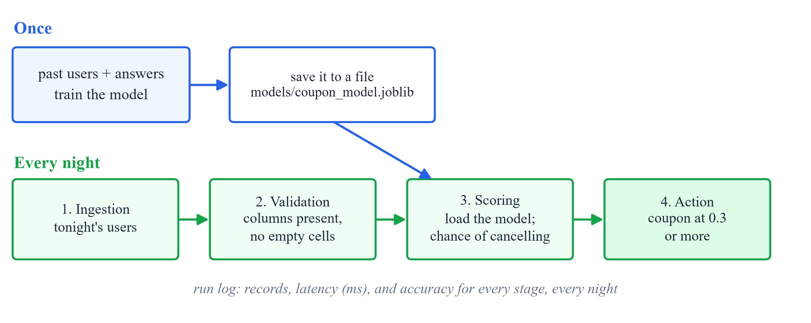

  * **Batch and real-time.** Batch scoring runs on a schedule, such as every night, for many users at once: cheap, and fine when the decision can wait until morning. Real-time scoring answers one request within milliseconds, for example while a user waits for a recommendation: faster, but more expensive to build and run.
  * **Data drift.** A model is only reliable on data like the data it learned from. When the new data changes, for example during exam season or a holiday, the model's chances can become wrong. A simple check: compare each feature's average tonight with its training average, and flag a change of more than 20% in either direction.
  * **Monitoring.** A **run log** records every night's stages: how many records each one handled, how long it took (its **latency**, in milliseconds; 1,000 ms = 1 second), and the accuracy on users whose answer is now known. Rising latency or falling accuracy is an early warning (Exercise 1).
  * **Fallback.** A simple, safe rule used when the model cannot run, so that the business keeps going while someone fixes the problem.

* **5. Lab Practice Dataset:**
  * Three files (all fictional teaching data):
    * Training data: [data/session_03_04_dataset.csv](data/session_03_04_dataset.csv), the 40 users of Session 3.4 with their known answers (`Cancelled_Binary`).
    * Tonight's users: [data/session_04_01_new_batch.csv](data/session_04_01_new_batch.csv), 10 new users during final exams, with `User_ID`, `Weeks_Inactive_Count`, and `Monthly_Minutes_Count`, and no answer column.
    * Run log: [data/session_04_01_dataset.csv](data/session_04_01_dataset.csv), 20 rows: 5 nights x 4 stages, for Exercise 1.
  * Run log columns:
    * `Run_Date`: The night of the run, `2026-12-07` to `2026-12-11`.
    * `Pipeline_Stage`: `Ingestion`, `Validation`, `Scoring`, or `Action`.
    * `Records_Count`: Records handled by the stage. For `Action`, the number of coupons sent.
    * `Latency_Ms`: Time the stage took, in milliseconds.
    * `Model_Accuracy`: Accuracy on users whose answer is now known. Filled only for the `Scoring` stage; empty for the others.
  * Workflow in Google Antigravity IDE: activate your `.venv` (Python Setup Clinic), name each script with your name and the session code (for example, `Reacher_S41_step_1.py`), run it with `python` followed by the file name, and check for return code `0`. `joblib` comes with Scikit-Learn, so there is nothing new to install. Step 1 creates a `models/` folder next to your scripts.

* **6. Step 1: Train Once and Save:**
  * *Goal:* train the coupon model on all 40 users once, and save it to a file that the nightly job can load.
  * *Code:* `YourName_S41_step_1.py`
    ```python
    # 1. Input: all 40 users with known answers (Session 3.4)
    import os
    import joblib
    import pandas as pd
    from sklearn.linear_model import LogisticRegression
    from sklearn.pipeline import make_pipeline
    from sklearn.preprocessing import StandardScaler
    train = pd.read_csv("data/session_03_04_dataset.csv", index_col="User_ID")
    features = ["Weeks_Inactive_Count", "Monthly_Minutes_Count"]

    # 2. Process: train once on every user, then save the trained model to a file
    model = make_pipeline(StandardScaler(), LogisticRegression())
    model.fit(train[features], train["Cancelled_Binary"])
    os.makedirs("models", exist_ok=True)
    joblib.dump(model, "models/coupon_model.joblib")

    # 3. Output: where the model went, and how it does on its own training users
    accuracy = model.score(train[features], train["Cancelled_Binary"])
    print("Saved: models/coupon_model.joblib")
    print(f"Training accuracy: {accuracy:.2f}")
    ```
  * *How it works, line by line:*
    * The model is the same pipeline as Session 3.4: scale, then classify. In Session 3.4, half of the users were kept aside to **test** the model. Now that it has passed its test, it is trained on **all** 40 users, so that it learns from every example.
    * `os.makedirs("models", exist_ok=True)` creates a `models/` folder; `exist_ok=True` means "no error if it is already there".
    * `joblib.dump(model, path)` writes the whole trained pipeline, the scaler and the classifier together, into one file.
    * `model.score(...)` gives the accuracy on the training users (Session 3.3).
  * *Read the output:*

    ```text
    Saved: models/coupon_model.joblib
    Training accuracy: 0.90
    ```

    * The model file now sits in `models/`. You can see it in the File Explorer, Panel `[1]`.
    * `0.90` is measured on the users the model learned from, so it is optimistic (Session 3.3); the honest test was done in Session 3.4.
  * *Common mistake:* saving only the classifier, without the scaler. The nightly job would then score unscaled minutes in the thousands with a classifier that learned from scaled values, and every chance would be wrong. Saving the whole pipeline keeps the two together.
  * *Quick Check 1 (`os.path.exists()`):*
    * New tool: `os.path.exists(path)` is `True` if a file exists. Why: the nightly job should check for the model file before it loads it (Exercise 2).
    * Task: add one line to part **3. Output**: `print(os.path.______("models/coupon_model.joblib"))`
    * Check: `True`.

* **7. Step 2: The Nightly Job:**
  * *Goal:* load the saved model, give each of tonight's 10 users a chance of cancelling, decide the coupons at `0.3`, and save the decisions.
  * *Code:* `YourName_S41_step_2.py`
    ```python
    # 1. Input: the saved model and tonight's new users
    import joblib
    import pandas as pd
    model = joblib.load("models/coupon_model.joblib")
    tonight = pd.read_csv("data/session_04_01_new_batch.csv", index_col="User_ID")
    features = ["Weeks_Inactive_Count", "Monthly_Minutes_Count"]

    # 2. Process: score every user, then apply the threshold chosen in Session 3.4
    chance = model.predict_proba(tonight[features])[:, 1]
    tonight["Chance"] = chance.round(2)
    tonight["Coupon"] = (chance >= 0.3).astype(int)
    tonight.to_csv("data/coupons_tonight.csv")

    # 3. Output: tonight's decisions
    print(tonight[["Chance", "Coupon"]])
    print("Coupons to send:", tonight["Coupon"].sum(), "of", len(tonight))
    ```
  * *How it works, line by line:*
    * `joblib.load(path)` reads the trained pipeline back from the file, ready to predict: no data, no training.
    * `predict_proba(...)[:, 1]` gives each user's chance of cancelling (Session 3.4). The scaler inside the pipeline uses the **training** averages, as Session 3.2 requires.
    * The coupon decision uses the exact chances; `.round(2)` is only for the printed column.
    * `tonight.to_csv("data/coupons_tonight.csv")` saves the decisions, with the two features, for the next system, the one that sends the coupons: this is the **action** stage.
    * `tonight[["Chance", "Coupon"]]` prints only the two new columns; the features are in the data file.
  * *Read the output:*

    ```text
             Chance  Coupon
    User_ID                
    USR-401    0.32       1
    USR-402    0.05       0
    USR-403    0.72       1
    USR-404    0.19       0
    USR-405    0.48       1
    USR-406    0.78       1
    USR-407    0.94       1
    USR-408    0.23       0
    USR-409    0.07       0
    USR-410    0.20       0
    Coupons to send: 5 of 10
    ```

    * 5 coupons tonight. `USR-407` (6 weeks inactive, 150 minutes) is the clearest case, at `0.94`.
    * `USR-401` gets a coupon at `0.32` although it was inactive only 2 weeks: it played just 250 minutes.
    * `USR-410` gets none, although it was inactive 3 weeks: it still played 1,650 minutes. Exercise 2 shows that the simple rule would decide the other way for both users.
  * *Picture it:* tonight's 10 users and the coupon threshold.

    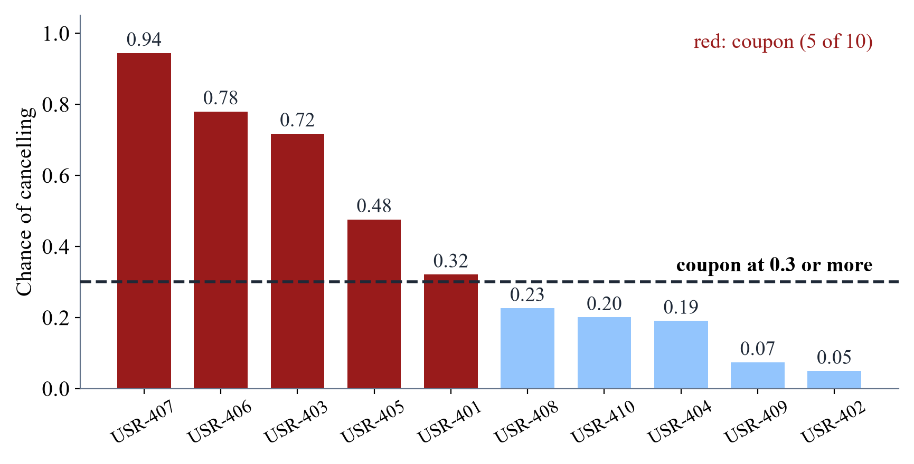

  * *Common mistake:* retraining the model inside the nightly job. Tonight's users have no answers yet, so there is nothing to learn from; the job only **loads and scores**.
  * *Quick Check 2 (expected cancellations):*
    * New tool: the sum of the chances is the number of cancellations to expect if no coupons are sent. Why: a single number for tonight's risk.
    * Task: add one line to part **3. Output**: `print("Expected cancellations:", round(chance.___(), 1))`
    * Check: `Expected cancellations: 4.0`.

* **8. Step 3: Check for Drift:**
  * *Goal:* compare the average of each feature tonight with its average in the training data, and flag a change of more than 20%.
  * *Code:* `YourName_S41_step_3.py`
    ```python
    # 1. Input: the training users and tonight's users
    import pandas as pd
    train = pd.read_csv("data/session_03_04_dataset.csv", index_col="User_ID")
    tonight = pd.read_csv("data/session_04_01_new_batch.csv", index_col="User_ID")
    features = ["Weeks_Inactive_Count", "Monthly_Minutes_Count"]

    # 2. Process: compare each feature's average tonight with its training average
    drift = pd.DataFrame({"Train_Avg": train[features].mean(),
                          "Tonight_Avg": tonight[features].mean()})
    change = drift["Tonight_Avg"] - drift["Train_Avg"]
    drift["Change_Pct"] = change / drift["Train_Avg"] * 100
    drift["Drift_Flag"] = drift["Change_Pct"].abs() > 20

    # 3. Output: the averages, the change in percent, and the flag
    print(drift.round(1))
    ```
  * *How it works, line by line:*
    * `train[features].mean()` gives one average per feature; so does `tonight[features].mean()`. Putting both in one DataFrame lines them up by feature name.
    * The change in percent is (tonight - training) / training x 100.
    * `.abs()` turns a negative change into a positive one, so that a large drop and a large rise are both flagged.
  * *Read the output:*

    ```text
                           Train_Avg  Tonight_Avg  Change_Pct  Drift_Flag
    Weeks_Inactive_Count         3.1          2.9        -5.7       False
    Monthly_Minutes_Count     1361.8        780.0       -42.7        True
    ```

    * Weeks inactive barely changed (`-5.7`%): students still open the app.
    * Minutes fell by `42.7`%: exam season. The model learned that low minutes mean "about to leave", which may not be true this week.
    * The coupons can still go out, but the night is flagged for a person to review, and the team should watch whether these users really cancel.
  * *Picture it:* the minutes of the 40 training users and of tonight's 10 users, with their averages.

    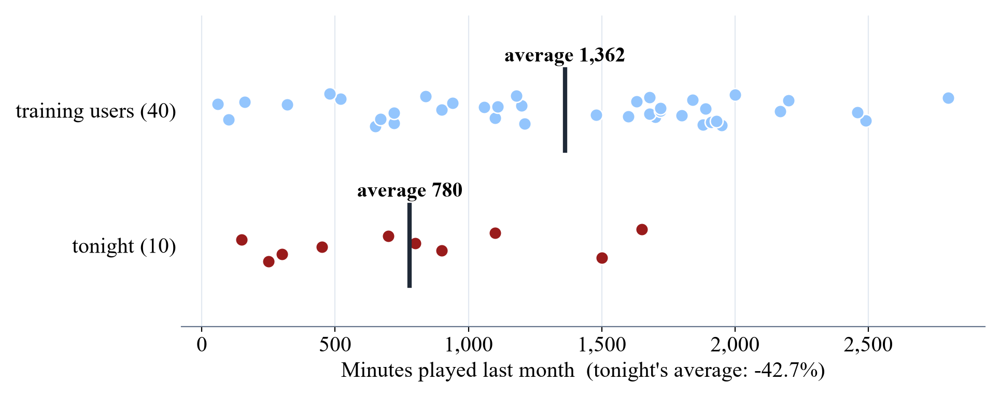

  * *Common mistake:* trusting the model's chances without looking at the data. A model never says "I have not seen data like this"; the drift check has to say it.
  * *Quick Check 3 (a stricter rule):*
    * Tool: the `20` in `drift["Change_Pct"].abs() > 20`.
    * Task: change the rule to `> _` to flag any change of more than 5%.
    * Check: both features are now `True`. A stricter rule raises more alarms; each team chooses the level that it can act on.

* **9. Summary: The Nightly System:**
  * The three steps fit together into one job that runs every night:

    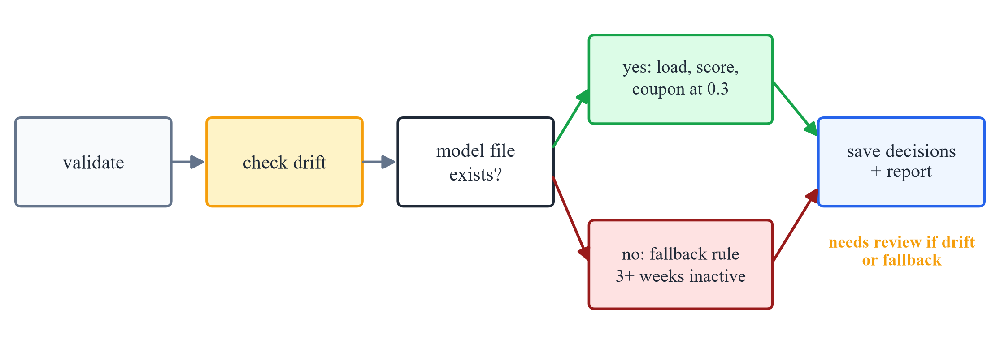

    | Step | What we did | Why it matters |
    |---|---|---|
    | 1. Train once and save | `joblib.dump()` of the whole pipeline | the nightly job needs no training data |
    | 2. Load, score, decide | 5 coupons for 10 users at `0.3` | predictions become actions every night |
    | 3. Check drift | minutes `-42.7`%: flagged | the model warns nobody by itself |
    | Exercises | run log alerts, a fallback rule, one nightly function | the job keeps working and reports its own doubts |

  * *Remember:* train once, save, load every night; check that tonight looks like training; keep a fallback; log every run.

* **10. Official Python Documentation & References:**
  * [Scikit-Learn: Model Persistence (joblib)](https://scikit-learn.org/stable/model_persistence.html).
  * [joblib: dump and load](https://joblib.readthedocs.io/en/stable/persistence.html).
  * [Python: os.path.exists](https://docs.python.org/3/library/os.path.html#os.path.exists).
  * [Google Cloud: MLOps: Continuous Delivery and Automation Pipelines in Machine Learning](https://cloud.google.com/architecture/mlops-continuous-delivery-and-automation-pipelines-in-machine-learning).

* **11. Exercise 1: Guided Practice - Read the Run Log:**
  * *Step 1: Open Script:* In Google Antigravity IDE, create a new script named `YourName_S41_monitoring.py`, replacing `YourName` with your own name (for example, `Reacher_S41_monitoring.py`).
  * *Step 2: Find the Nights That Need Attention:*
    Type the following code:
    ```python
    # 1. Input: the run log, 5 nights x 4 stages
    import pandas as pd
    log = pd.read_csv("data/session_04_01_dataset.csv")

    # 2. Process: health rules for the Scoring stage, then totals per night
    scoring = log[log["Pipeline_Stage"] == "Scoring"].copy()
    scoring["Alert"] = (scoring["Latency_Ms"] > 900) | (scoring["Model_Accuracy"] < 0.88)
    nightly = log.groupby("Run_Date").agg(
        Total_Latency_Ms=("Latency_Ms", "sum"),
        Users_In=("Records_Count", "first"),
    )

    # 3. Output: the Scoring stage per night, then the nightly totals
    print(scoring[["Run_Date", "Latency_Ms", "Model_Accuracy", "Alert"]])
    print(nightly)
    ```
    * `.copy()` makes `scoring` an independent table, so adding the `Alert` column does not change `log`.
    * `|` means "or": a night is flagged if either rule is broken. Each rule sits in its own brackets (Session 1.4).
    * `"first"` in `.agg()` takes the first value of each night: the `Ingestion` row's count.
  * *Step 3: Interpret:* In two comment lines, describe the trend in latency and accuracy across the 5 nights, and what the team should do next.
  * *Step 4: Execute in Terminal:* Run `python YourName_S41_monitoring.py` in Panel `[4]` and confirm return code `0`.
  * *Success Check:* alerts on `2026-12-10` (latency `910`, accuracy `0.871`) and `2026-12-11` (`980`, `0.846`). The total latency is `1470` ms on the first two nights, then rises every night to `1730` ms, while the users coming in grow from `52000` to `61500`. More users and falling accuracy together point to drift: the model should be checked, and possibly retrained on recent users.

* **12. Exercise 2: Applied Practice - Survive a Missing Model File:**
  * *Coding Challenge:* In `YourName_S41_fallback.py`, make the nightly job of Step 2 keep working when the model file cannot be found.
  * *Task 1 (Read the FileNotFoundError & AI Diagnosis):* In a copy of Step 2, change the path to `"models/coupon_modle.joblib"` (a typo). The script stops with `FileNotFoundError: [Errno 2] No such file or directory: 'models/coupon_modle.joblib'`. Capture the traceback (Windows: `Win + Shift + S`; Mac: `Cmd + Ctrl + Shift + 4`), paste it into Panel `[3]` (AI Agent Chat), and ask how to check for a file before loading it.
  * *Task 2 (Add a Fallback Rule):* Store the path in a variable `model_path`. If `os.path.exists(model_path)`, load the model and decide as in Step 2, and set `method = "model"`. Otherwise, use the fallback rule of Session 3.1: a coupon when `Weeks_Inactive_Count` is 3 or more, and set `method = "fallback rule"`. Print the method used.
  * *Task 3 (Compare):* Run the script once with the typo and once with the correct path, and print the IDs of the users who get a coupon each time: `list(tonight.index[tonight["Coupon"] == 1])`.
  * *Success Check:*
    * With the typo, the fallback rule sends 5 coupons: `USR-403`, `USR-405`, `USR-406`, `USR-407`, `USR-410`.
    * With the correct path, the model sends 5 coupons: `USR-401`, `USR-403`, `USR-405`, `USR-406`, `USR-407`.
    * Same number, different users: the rule misses `USR-401` (only 250 minutes) and wastes a coupon on `USR-410` (1,650 minutes). The script ends with return code `0` both times: the fallback keeps the app running, but it is weaker than the model, so the missing file must still be fixed quickly.

* **13. Exercise 3: Advanced Practice - One Nightly Function:**
  * *Goal:* Combine everything into one function that the data team could schedule to run every night: validate, check drift, score (or fall back), act, and report.
  * *What you need:*
    * Files: `data/session_03_04_dataset.csv` (training), `data/session_04_01_new_batch.csv` (tonight), and `models/coupon_model.joblib` (from Step 1).
    * Script name: `YourName_S41_nightly.py`.
    * Tools you already know: functions (Session 2.4), `assert` (Session 2.3), `os.path.exists()`, `joblib.load()`, `.predict_proba()`, the drift table of Step 3, and the fallback rule of Exercise 2.
  * *Requirements (follow them in order):*
    1. Write `run_nightly(batch_path, model_path, train_path)` that returns a dictionary summary.
    2. **Validation:** check with `assert` that the batch has both feature columns and no empty cells in them.
    3. **Drift:** compute the change in percent of each feature's average, as in Step 3, and collect the names of the features whose absolute change is above 20.
    4. **Scoring:** if the model file exists, send a coupon at a chance of `0.3` or more; otherwise, use the fallback rule of Exercise 2.
    5. **Action:** save the batch with `Coupon` and `Method` columns to `data/nightly_decisions.csv`.
    6. **Report:** return `{"records": ..., "coupons": ..., "method": ..., "drift_features": [...], "needs_review": ...}`, where `needs_review` is `True` if any feature drifted **or** the fallback was used.
    7. Call the function twice, once with the correct model path and once with a wrong path, and print both summaries.
  * *New tools for this exercise:*
    * Checking that columns exist: `set(features).issubset(batch.columns)` is `True` when every name in `features` is a column of `batch`.
    * A list of names from a True/False column: `list(drift.index[drift["Drift_Flag"]])` keeps the row labels (the feature names) where the flag is `True`.
  * *Hints:*
    * Write and test each stage as a few lines first, then move them into the function.
    * Use `int(...)` around counts so the dictionary prints plain numbers.
  * *Self-Check (expected results):*
    * Correct path: `{'records': 10, 'coupons': 5, 'method': 'model', 'drift_features': ['Monthly_Minutes_Count'], 'needs_review': True}`.
    * Wrong path: `{'records': 10, 'coupons': 5, 'method': 'fallback rule', 'drift_features': ['Monthly_Minutes_Count'], 'needs_review': True}`.
    * Business meaning: even when the model runs, tonight still needs a person's review, because tonight's users listen far less than the users the model learned from. A decision system should report its own doubts, not only its decisions.

---

<a id="session-04-02"></a>
### Session 4.2: Turning Predictions into Money: Profit at Risk, Net Benefit, ROI, and the Best Offer

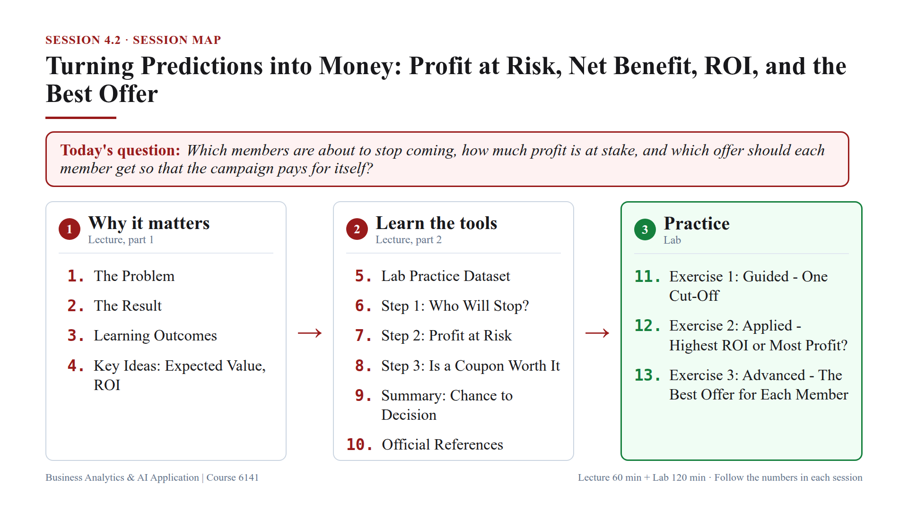

* **Lecture Presentation:** [Download Slides (PDF)](slides/session_04_02_lecture.pdf)
* **Reading (PDF):** [Download Reading (PDF)](handouts/session_04_02_reading.pdf): read before class
* **Schedule:** Week 14 (115/12/13 - 115/12/19) | In-person classes (1:2 Delivery Ratio: 60 Min Lecture + 120 Min Lab)
* **How this session is organized:** first the problem, then the result, then how a churn model and a little arithmetic produced that result, step by step with code. The three exercises come last.

* **1. The Problem:**
  * A drink shop near campus runs a membership app. Some members visit every week; others slowly stop coming. When a regular stops coming, the shop loses the **profit** that member brought in every month.
  * The shop can send an offer through the app to members who look likely to stop:
    * a **free-drink coupon**: costs the shop NT$45, and brings back 1 in 4 members who would otherwise stop;
    * a **buy-one-get-one month** ("BOGO"): costs NT$150, and brings back 45% of them.
  * Members are not equally valuable: one brings in NT$30 of profit a month, another NT$265. A member who is likely to stop but brings in little may not be worth an offer; a valuable member may be worth one even at a lower risk.
  * The shop owner asks: which members are about to stop coming, how much profit is at stake, and which offer should each member get so that the campaign pays for itself?

* **2. The Result:**
  * A churn model (churn: customers leaving) learned from 30 past members gives each of the 12 current members a chance of stopping. Multiplied by each member's yearly profit, this gives the **profit at risk**: NT$`7,355` for the 12 members.
  * Three ways to plan the campaign, compared on the same 12 members:

    | Plan | Members contacted | Net benefit (saved profit - cost) |
    |---|---|---|
    | Coupon for every member with a chance of `0.5` or more | 3 | NT$`689` (ROI `510.6`%) |
    | Coupon for every member with a chance of `0.3` or more | 7 | NT$`1,349` (ROI `428.2`%) |
    | Coupon only where its expected value is positive | 8 | NT$`1,441` |
    | The best offer for each member: BOGO, coupon, or none | 8 | NT$`2,059` |

    ROI (Return on Investment) = net benefit / cost x 100.
  * **Answer 1:** the members most likely to stop are not the ones with the most profit at stake. `NOW-203` has a high chance (`0.736`) but little profit; `NOW-204` has a lower chance (`0.396`) but the highest profit.
  * **Answer 2:** judge each member by expected money, not by a single cut-off. The highest ROI (`510.6`%) comes from the smallest campaign, but the largest profit comes from contacting more members.
  * **Answer 3:** give each member the offer with the highest expected net value: BOGO for 7 valuable members, a coupon for 1, and nothing for the 4 who are not at risk. This earns NT$`2,059`, about NT$`710` more than the best single cut-off.
  * **How it was done:** Sections 6 to 8 build it step by step; the exercises compare the plans.

* **3. Expected Learning Outcomes (By the end of this session, you will be able to):**
  1. "Who is likely to stop coming?": train a churn model on past members and score the current members
  2. "How much money is at stake?": calculate profit at risk (chance x yearly profit) and rank members by it
  3. "Which offer pays?": calculate the expected net value of an offer for each member, and a campaign's net benefit and ROI

* **4. Key Ideas: Expected Value, ROI:**
  * **Learn from the past, act on the present.** The history file holds past members whose outcome is known: they stopped coming or they stayed. The active file holds current members whose outcome is not known yet, the only ones an offer can still help. The model learns from the history and predicts for the active members (Sessions 3.4 and 4.1).
  * **Expected value: a chance times an amount.** If a member brings in NT$2,040 of profit a year and has a `0.748` chance of stopping, the profit we expect to lose is `0.748 x 2,040 = NT$1,526`: the **profit at risk**. This is not what will happen to this one member (they either stay or go), but it is the fair average over many members like them.
  * **The expected value of an offer, for one member:**

    | Part | Formula | `NOW-209`, free-drink coupon |
    |---|---|---|
    | Expected saved profit | chance x success rate x yearly profit | `0.748 x 0.25 x 2,040 = 381.48` |
    | Cost | the offer's cost | `45` |
    | Expected net value | saved profit - cost | `+336.48`: worth sending |

    An offer is worth sending when its expected net value is above `0`.
  * **Two summary numbers for a campaign:**
    * **Net benefit** = total saved profit - total cost, in NT$: how much the campaign adds to profit.
    * **ROI** = net benefit / cost x 100, in percent: how much each NT$1 spent brings back.
    * The plan with the highest ROI is often small; the plan with the highest net benefit is often larger. A shop that can afford the campaign should prefer the higher net benefit.

    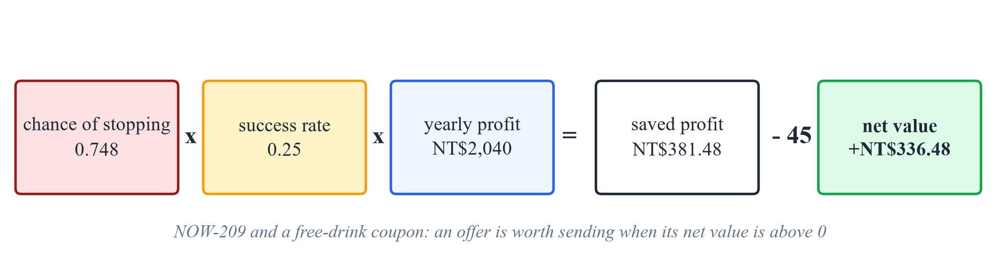

* **5. Lab Practice Dataset:**
  * Two files (fictional teaching data):
    * History: [data/session_04_02_dataset.csv](data/session_04_02_dataset.csv), 30 past members with their outcome; 11 of them stopped coming.
    * Active: [data/session_04_02_active.csv](data/session_04_02_active.csv), 12 current members with the same columns except the outcome.
  * Columns:
    * `Member_ID`: Member code (`MEM-...` in the history, `NOW-...` for current members).
    * `Months_As_Member_Count`: Months since the member joined (`1` to `35`).
    * `Visits_Last_Month_Count`: Visits to the shop in the last month (`0` to `12`).
    * `Days_Since_Last_Visit_Count`: Days since the last visit (`5` to `53`).
    * `Monthly_Profit_TWD`: The shop's average profit from this member per month, after the cost of the drinks (`30` to `265`).
    * `Stopped_Visiting_Binary` (history only): `1` = stopped coming within 60 days, `0` = kept coming.
  * Workflow in Google Antigravity IDE: activate your `.venv` (Python Setup Clinic), name each script with your name and the session code (for example, `Reacher_S42_step_1.py`), run it with `python` followed by the file name, and check for return code `0`. On an error, paste the traceback into the AI Agent Chat and ask why it failed.

* **6. Step 1: Who Will Stop?:**
  * *Goal:* train a churn model on the 30 past members and give each of the 12 current members a chance of stopping.
  * *Code:* `YourName_S42_step_1.py`
    ```python
    # 1. Input: 30 past members with their outcome, and 12 current members
    import pandas as pd
    from sklearn.linear_model import LogisticRegression
    from sklearn.pipeline import make_pipeline
    from sklearn.preprocessing import StandardScaler
    history = pd.read_csv("data/session_04_02_dataset.csv", index_col="Member_ID")
    active = pd.read_csv("data/session_04_02_active.csv", index_col="Member_ID")
    features = ["Months_As_Member_Count", "Visits_Last_Month_Count",
                "Days_Since_Last_Visit_Count"]

    # 2. Process: learn from the past members, then score the current ones
    model = make_pipeline(StandardScaler(), LogisticRegression())
    model.fit(history[features], history["Stopped_Visiting_Binary"])
    active["Chance"] = model.predict_proba(active[features])[:, 1].round(3)

    # 3. Output: the current members, most likely to stop first
    ranked = active.sort_values("Chance", ascending=False)
    print(ranked[["Days_Since_Last_Visit_Count", "Chance"]])
    ```
  * *How it works, line by line:*
    * Two files: `history` has the answers and trains the model; `active` has none and is scored. The model never sees the current members' outcomes, which do not exist yet.
    * The pipeline is the same as in Sessions 3.4 and 4.1: scale, then classify.
    * `.round(3)` keeps three decimals; the next steps use these rounded chances, so all numbers in this session match your screen.
    * `ranked[[...]]` shows one feature next to the chance, so you can see why a member scores high.
  * *Read the output:*

    ```text
               Days_Since_Last_Visit_Count  Chance
    Member_ID                                     
    NOW-209                             29   0.748
    NOW-203                             51   0.736
    NOW-201                             53   0.715
    NOW-210                             33   0.426
    NOW-204                             37   0.396
    NOW-212                             22   0.389
    NOW-205                             34   0.341
    NOW-202                             25   0.296
    NOW-207                              8   0.025
    NOW-208                              5   0.021
    NOW-206                             21   0.019
    NOW-211                              9   0.011
    ```

    * Three members are very likely to stop (chances above `0.7`); four are clearly safe (below `0.03`).
    * `NOW-201` and `NOW-203` have not been in for over 50 days. `NOW-209` comes first although its last visit was only 29 days ago: it made no visit at all last month.
  * *Common mistake:* training on the active members. They have no outcome yet, so there is nothing to learn from them; they are only scored.
  * *Quick Check 1 (the base rate):*
    * New tool: the mean of a 0/1 column is the share of 1s (Session 3.1). Why: the share of past members who stopped is the base rate that every chance is compared with.
    * Task: add one line to part **3. Output**: `print("Past stop rate:", round(history["Stopped_Visiting_Binary"].____(), 2))`
    * Check: `Past stop rate: 0.37`: 11 of the 30 past members stopped coming.

* **7. Step 2: Profit at Risk:**
  * *Goal:* turn each member's chance into money: one year of profit, and the part of it that is at risk.
  * *Code:* `YourName_S42_step_2.py`
    ```python
    # 1. Input: score the current members, as in Step 1
    import pandas as pd
    from sklearn.linear_model import LogisticRegression
    from sklearn.pipeline import make_pipeline
    from sklearn.preprocessing import StandardScaler
    history = pd.read_csv("data/session_04_02_dataset.csv", index_col="Member_ID")
    active = pd.read_csv("data/session_04_02_active.csv", index_col="Member_ID")
    features = ["Months_As_Member_Count", "Visits_Last_Month_Count",
                "Days_Since_Last_Visit_Count"]
    model = make_pipeline(StandardScaler(), LogisticRegression())
    model.fit(history[features], history["Stopped_Visiting_Binary"])
    active["Chance"] = model.predict_proba(active[features])[:, 1].round(3)

    # 2. Process: one year of profit, and the part of it that is at risk
    active["Annual_Profit"] = active["Monthly_Profit_TWD"] * 12
    active["Profit_At_Risk"] = (active["Chance"] * active["Annual_Profit"]).round(0)

    # 3. Output: the members ranked by profit at risk, and the total
    ranked = active.sort_values("Profit_At_Risk", ascending=False)
    print(ranked[["Chance", "Annual_Profit", "Profit_At_Risk"]])
    total = active["Profit_At_Risk"].sum()
    print(f"Total profit at risk: NT${total:,.0f}")
    ```
  * *How it works, line by line:*
    * `Monthly_Profit_TWD * 12` gives one year of profit per member. A member's whole value over many years is called **CLV** (Customer Lifetime Value); one year is simpler and a cautious basis for spending decisions.
    * `Chance * Annual_Profit` is the expected loss: the profit at risk (section 4).
    * The ranking is now by money, not by chance.
  * *Read the output:*

    ```text
               Chance  Annual_Profit  Profit_At_Risk
    Member_ID                                       
    NOW-209     0.748           2040          1526.0
    NOW-201     0.715           1860          1330.0
    NOW-204     0.396           3180          1259.0
    NOW-212     0.389           2280           887.0
    NOW-205     0.341           1980           675.0
    NOW-202     0.296           1860           551.0
    NOW-210     0.426           1260           537.0
    NOW-203     0.736            600           442.0
    NOW-208     0.021           3180            67.0
    NOW-207     0.025           2580            64.0
    NOW-211     0.011            900            10.0
    NOW-206     0.019            360             7.0
    Total profit at risk: NT$7,355
    ```

    * `NOW-204` jumps to third: its chance is only `0.396`, but it brings in the most profit (NT$3,180 a year).
    * `NOW-203` falls to eighth: it is very likely to stop (`0.736`) but brings in only NT$600 a year.
    * `NOW-208` brings in as much as `NOW-204`, but it is safe (`0.021`), so little of its profit is at risk.
  * *Picture it:* the same 12 members, ranked by chance and ranked by profit at risk.

    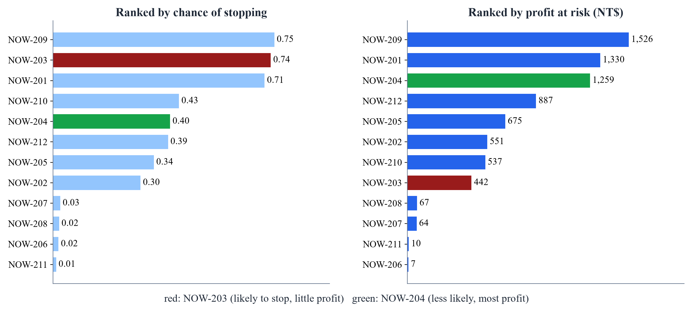

  * *Common mistake:* counting each likely-to-stop member's full yearly profit as "at risk". A member with a `0.4` chance will, on average, cost 40% of their profit, not 100%.
  * *Quick Check 2 (where the risk sits):*
    * Tool: `.head(3)` on the ranked table.
    * Task: add one line to part **3. Output**: `print(round(ranked["Profit_At_Risk"].____(3).sum() / total, 2))`
    * Check: `0.56`: the top 3 members hold 56% of the profit at risk.

* **8. Step 3: Is a Coupon Worth It:**
  * *Goal:* for each member, compare the expected saved profit of a free-drink coupon with its cost, and send it only where it pays.
  * *Code:* `YourName_S42_step_3.py`
    ```python
    # 1. Input: score the current members and add their profit, as in Step 2
    import pandas as pd
    from sklearn.linear_model import LogisticRegression
    from sklearn.pipeline import make_pipeline
    from sklearn.preprocessing import StandardScaler
    history = pd.read_csv("data/session_04_02_dataset.csv", index_col="Member_ID")
    active = pd.read_csv("data/session_04_02_active.csv", index_col="Member_ID")
    features = ["Months_As_Member_Count", "Visits_Last_Month_Count",
                "Days_Since_Last_Visit_Count"]
    model = make_pipeline(StandardScaler(), LogisticRegression())
    model.fit(history[features], history["Stopped_Visiting_Binary"])
    active["Chance"] = model.predict_proba(active[features])[:, 1].round(3)
    active["Annual_Profit"] = active["Monthly_Profit_TWD"] * 12

    # 2. Process: the expected net value of a free-drink coupon for each member
    COUPON_COST = 45        # a free drink costs the shop NT$45
    SUCCESS_RATE = 0.25     # a coupon brings back 1 in 4 members who would stop
    saved = active["Chance"] * SUCCESS_RATE * active["Annual_Profit"]
    active["Coupon_Net"] = (saved - COUPON_COST).round(0)
    worth_it = active[active["Coupon_Net"] > 0]

    # 3. Output: each member's coupon value, then the campaign
    ranked = active.sort_values("Coupon_Net", ascending=False)
    print(ranked[["Chance", "Annual_Profit", "Coupon_Net"]])
    net = worth_it["Coupon_Net"].sum()
    print(f"Coupons worth sending: {len(worth_it)} of {len(active)}")
    print(f"Net benefit: NT${net:,.0f}")
    ```
  * *How it works, line by line:*
    * Names in capital letters, such as `COUPON_COST`, are fixed settings (Session 3.4, Exercise 1).
    * `saved` multiplies three things per member: the chance they would stop, the chance the coupon brings them back, and their yearly profit.
    * `Coupon_Net` subtracts the coupon's cost; `worth_it` keeps the members where the result is positive.
  * *Read the output:*

    ```text
               Chance  Annual_Profit  Coupon_Net
    Member_ID                                   
    NOW-209     0.748           2040       336.0
    NOW-201     0.715           1860       287.0
    NOW-204     0.396           3180       270.0
    NOW-212     0.389           2280       177.0
    NOW-205     0.341           1980       124.0
    NOW-202     0.296           1860        93.0
    NOW-210     0.426           1260        89.0
    NOW-203     0.736            600        65.0
    NOW-208     0.021           3180       -28.0
    NOW-207     0.025           2580       -29.0
    NOW-206     0.019            360       -43.0
    NOW-211     0.011            900       -43.0
    Coupons worth sending: 8 of 12
    Net benefit: NT$1,441
    ```

    * A coupon pays for 8 members, including `NOW-202` with a chance of only `0.296`: it brings in enough profit to be worth NT$45.
    * For the 4 safe members, the coupon costs more than it is expected to save, even for the valuable `NOW-208`.
    * Net benefit NT$1,441: more than any single cut-off on the chance (Exercise 2).
  * *Common mistake:* sending an offer to every member "just in case". For the 4 safe members, each coupon loses about NT$30 to NT$45.
  * *Quick Check 3 (a weaker coupon):*
    * Tool: the `SUCCESS_RATE` setting.
    * Task: change `SUCCESS_RATE = 0.25` to `0.15`, a coupon that brings back fewer members.
    * Check: still 8 coupons worth sending, but the net benefit falls to NT$721. How well an offer works matters as much as who gets it.

* **9. Summary: Chance to Decision:**
  * Each step turned the model's output into something closer to a business decision:

    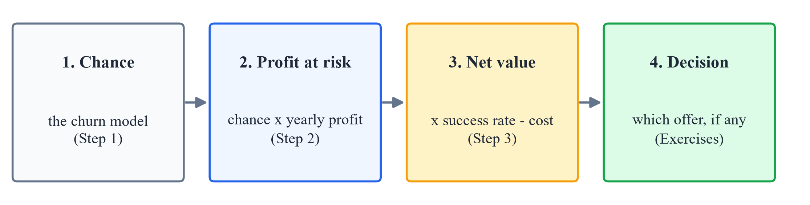

    | Step | What we did | Result |
    |---|---|---|
    | 1. Score | churn model on 30 past members | a chance for each of 12 current members |
    | 2. Put a price on it | chance x yearly profit | NT$7,355 of profit at risk |
    | 3. Decide | send a coupon only where its expected net value is positive | 8 coupons, net NT$1,441 |
    | Exercises | the business case, ROI vs net benefit, and the best offer per member | up to NT$2,059 |

  * *Remember:* chance x money = expected value; send an offer only when its expected saved profit beats its cost; the highest ROI is not always the most profit.

* **10. Official Python Documentation & References:**
  * [Scikit-Learn: Logistic Regression (predict_proba)](https://scikit-learn.org/stable/modules/linear_model.html#logistic-regression).
  * [pandas: sort_values](https://pandas.pydata.org/docs/reference/api/pandas.DataFrame.sort_values.html).
  * [Harvard Business Review: The Value of Keeping the Right Customers](https://hbr.org/2014/10/the-value-of-keeping-the-right-customers).
  * [Investopedia: Return on Investment (ROI)](https://www.investopedia.com/terms/r/returnoninvestment.asp).

* **11. Exercise 1: Guided Practice - One Cut-Off:**
  * *Step 1: Open Script:* In Google Antigravity IDE, create a new script named `YourName_S42_case.py`, replacing `YourName` with your own name (for example, `Reacher_S42_case.py`).
  * *Step 2: Price a Coupon Campaign for Members at 0.5 or Above:*
    Copy part **1. Input** of Step 3, then add:
    ```python
    # 2. Process: target by one cut-off, then saved profit, cost, net benefit, ROI
    COUPON_COST = 45
    SUCCESS_RATE = 0.25
    targeted = active[active["Chance"] >= 0.5]
    saved = (targeted["Chance"] * SUCCESS_RATE * targeted["Annual_Profit"]).sum()
    cost = len(targeted) * COUPON_COST
    net_benefit = saved - cost
    roi_pct = net_benefit / cost * 100

    # 3. Output: the business case
    print(f"Members targeted: {len(targeted)}")
    print(f"Expected saved profit: NT${saved:,.2f}")
    print(f"Campaign cost: NT${cost:,.2f}")
    print(f"Net benefit: NT${net_benefit:,.2f} | ROI: {roi_pct:.1f}%")
    ```
    * `.sum()` adds up the expected saved profit of all targeted members.
    * `cost` is the number of coupons times their cost.
  * *Step 3: Interpret:* In two comment lines, explain why we multiply by the chance of stopping instead of counting each targeted member's full yearly profit.
  * *Step 4: Execute in Terminal:* Run `python YourName_S42_case.py` in Panel `[4]` and confirm return code `0`.
  * *Success Check:* `Members targeted: 3`; expected saved profit `NT$824.36`; cost `NT$135.00`; net benefit `NT$689.36`; ROI `510.6`%. A high ROI, but Step 3 earned twice as much by contacting 8 members chosen by value.

* **12. Exercise 2: Applied Practice - Highest ROI or Most Profit?:**
  * *Coding Challenge:* In `YourName_S42_cutoffs.py`, test the cut-offs `[0.3, 0.4, 0.5, 0.6, 0.7]` and compare the best ROI with the best net benefit.
  * *Task 1 (Cut-Off Loop):* For each cut-off, repeat the business case of Exercise 1 and collect `Cutoff`, `Targeted`, `Saved_TWD`, `Cost_TWD`, `Net_Benefit_TWD`, and `ROI_Pct` in one DataFrame (round the money to 2 decimals and the ROI to 1).
  * *Task 2 (Read the ValueError & AI Diagnosis):* Score the current members with only two features by mistake: `model.predict_proba(active[["Months_As_Member_Count", "Visits_Last_Month_Count"]])`. The script stops with `ValueError: The feature names should match those that were passed during fit.` Capture the traceback (Windows: `Win + Shift + S`; Mac: `Cmd + Ctrl + Shift + 4`), paste it into Panel `[3]` (AI Agent Chat), and ask why the model needs the same columns it was trained on. Then fix the line.
  * *Task 3 (Two Recommendations):* Print the cut-off with the highest `ROI_Pct` and the cut-off with the highest `Net_Benefit_TWD`. If cut-offs tie, report the higher one, since it contacts fewer members.
  * *Success Check:*

    | Cut-off | Targeted | Net benefit | ROI |
    |---|---|---|---|
    | `0.3` | 7 | NT$`1,348.89` | `428.2`% |
    | `0.4` | 4 | NT$`778.54` | `432.5`% |
    | `0.5` | 3 | NT$`689.36` | `510.6`% |
    | `0.6` | 3 | NT$`689.36` | `510.6`% |
    | `0.7` | 3 | NT$`689.36` | `510.6`% |

    Highest ROI: `0.7` (`510.6`%, tied with `0.5` and `0.6`; no member's chance lies between `0.5` and `0.7`). Highest net benefit: `0.3` (NT$`1,348.89`). The broader campaign earns NT$`659.53` more at a lower ROI: if the shop can afford it, net benefit is what adds to profit.

* **13. Exercise 3: Advanced Practice - The Best Offer for Each Member:**
  * *Goal:* Stop using one offer for everyone. For each current member, choose the offer with the highest expected net value, or no offer at all, and show the owner how much more this earns than the best cut-off of Exercise 2.
  * *What you need:*
    * Files: `data/session_04_02_dataset.csv` (history) and `data/session_04_02_active.csv` (current members).
    * Script name: `YourName_S42_offers.py`.
    * Tools you already know: the scoring and yearly profit of Step 3, `.loc[]` with conditions (Session 1.4), `.value_counts()`, and `.sum()`.
  * *Requirements (follow them in order):*
    1. Score the 12 current members and add `Annual_Profit`, as in part **1. Input** of Step 3.
    2. Two possible offers:
       * **Coupon** (a free drink): costs NT$45, brings back 25% of the members who would stop
       * **BOGO** (a buy-one-get-one month): costs NT$150, brings back 45%
    3. For each member, compute `Coupon_Net` = chance x 0.25 x yearly profit - 45, and `BOGO_Net` = chance x 0.45 x yearly profit - 150, both rounded to 2 decimals.
    4. Set `Best_Offer`: `"BOGO"` if `BOGO_Net` is above 0 and above `Coupon_Net`; otherwise `"Coupon"` if `Coupon_Net` is above 0; otherwise `"None"`.
    5. Add `Expected_Net`: the net value of the chosen offer, or `0` for `"None"`.
    6. Print each member's chance, yearly profit, both net values, best offer, and expected net. Then print the count per offer, the total expected net, and the difference from Exercise 2's best net benefit (NT$1,348.89).
  * *New tools for this exercise:*
    * Ordered rules with `.loc[]`: set the default first (`active["Best_Offer"] = "None"`), then overwrite with `"Coupon"`, then with `"BOGO"`. The conditions of step 4 make sure the last rule wins only when it should.
    * Copying values from another column for some rows: `active.loc[mask, "Expected_Net"] = active.loc[mask, "Coupon_Net"]`.
  * *Hints:*
    * Start `Expected_Net` at `0.0` for every member.
    * Check one member by hand first, such as `NOW-209`: `0.748 x 0.45 x 2,040 - 150 = 536.66`.
  * *Self-Check (expected results):*
    * Offers: BOGO for `NOW-201`, `NOW-202`, `NOW-204`, `NOW-205`, `NOW-209`, `NOW-210`, and `NOW-212`; Coupon for `NOW-203`; None for `NOW-206`, `NOW-207`, `NOW-208`, and `NOW-211`.
    * Total expected net value: NT$`2,059.42`, which is NT$`710.53` more than the best cut-off plan.
    * Business meaning: matching the offer to the member beats any single cut-off. `NOW-203` is very likely to stop, but brings in little, so only the cheap coupon pays; the expensive BOGO pays for valuable members such as `NOW-204`, even at a moderate chance.

---

<a id="session-04-03"></a>
### Session 4.3: Setting Prices with Data: Price Elasticity, Profit Simulation, and Clearing Stock Before a Deadline

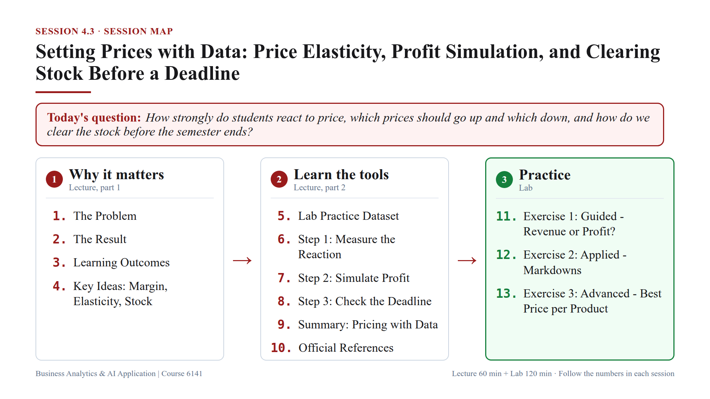

* **Lecture Presentation:** [Download Slides (PDF)](slides/session_04_03_lecture.pdf)
* **Reading (PDF):** [Download Reading (PDF)](handouts/session_04_03_reading.pdf): read before class
* **Schedule:** Week 15 (115/12/20 - 115/12/26) | In-person classes (1:2 Delivery Ratio: 60 Min Lecture + 120 Min Lab)
* **How this session is organized:** first the problem, then the result, then how a price test and a few simulations produced that result, step by step with code. The three exercises come last.

* **1. The Problem:**
  * The campus store sells 10 university products: a hoodie, T-shirts, caps, mugs, and more. The semester ends in **14 days**. After that, students go home, and anything left in stock is sold to a discount wholesaler for 40% of what it cost the store: a loss of 60% of the cost on every unsold item.
  * The prices were set by gut feeling. Some may be too low: the product would sell out anyway, so the store leaves profit on the table. Others may be too high: the product will not sell out before the semester ends.
  * A lower price sells more items but earns less on each one. Which effect is stronger depends on how strongly students react to price.
  * The store manager asks: how strongly do students react to price, which prices should go up and which down, and how do we clear the stock before the semester ends?

* **2. The Result:**
  * A 5-week price test on the hoodie measured how strongly students react: a **1% price rise loses about 1.55% of sales** (the price elasticity, `-1.55`).
  * Simulating price changes for the whole store, with that reaction:

    | Change to every price | Daily revenue | Daily profit |
    |---|---|---|
    | `-15`% | NT$`33,356` (the most) | NT$`17,063` |
    | no change | NT$`31,840` | NT$`18,620` |
    | `+5`% | NT$`30,841` | NT$`18,646` (the most) |

  * At today's sales, 5 of the 10 products will still have stock when the semester ends: the hoodie, T-shirt, tote bag, mug, and lanyard.
  * One price for each product, chosen for the whole 14 days and counting the loss on leftovers:

    | Plan | Profit over the 14 days |
    |---|---|
    | today's prices | NT$`242,372` |
    | the best price change for each product (5 cuts, 5 rises) | NT$`253,557`: NT$`11,185` more |

  * **Answer 1:** students react strongly to price (`-1.55`): a cut brings many more sales, so revenue rises, but the margin on each item falls.
  * **Answer 2:** profit, not revenue, is the goal. A store-wide cut brings in the most money but earns less; a small rise earns slightly more.
  * **Answer 3:** one rule for all products leaves money behind. Products that will not sell out in time need a cut to avoid leftover losses; products that will sell out anyway can carry a higher price (Exercise 3).
  * **How it was done:** Sections 6 to 8 measure the reaction, simulate profit, and find the slow products, step by step.

* **3. Expected Learning Outcomes (By the end of this session, you will be able to):**
  1. "How strongly do customers react to price?": estimate the price elasticity of demand from a price test
  2. "Would a price change raise profit?": simulate units, revenue, and profit for several price changes before making them
  3. "How do we clear the stock in time?": find the products that will not sell out before a deadline, and calculate the price cut each one needs

* **4. Key Ideas: Margin, Elasticity, Stock:**
  * **Price, volume, and profit.** For the hoodie (`MER-101`):

    | Term | Meaning | Hoodie |
    |---|---|---|
    | Unit margin | price - unit cost: what the store keeps on one item | `890 - 420 = NT$470` |
    | Margin % | unit margin / price x 100 | `52.8`% |
    | Daily profit | unit margin x daily sales | `470 x 8 = NT$3,760` |
    | Days of stock | stock / daily sales: how long the stock lasts | `120 / 8 = 15.0` days |

  * **Price elasticity of demand.** The % change in sales for a 1% change in price. An elasticity of `-1.55` means a 1% rise loses about 1.55% of sales, and a 1% cut gains about 1.55%. Between `0` and `-1`, customers barely react; below `-1`, as here, they react strongly.
  * **Using the elasticity** for a small price change (up to about 20%): new daily sales = old daily sales x (1 + elasticity x price change). For a `+5`% change: `1 + (-1.55 x 0.05) = 0.9225`, so about 7.75% fewer sales.

    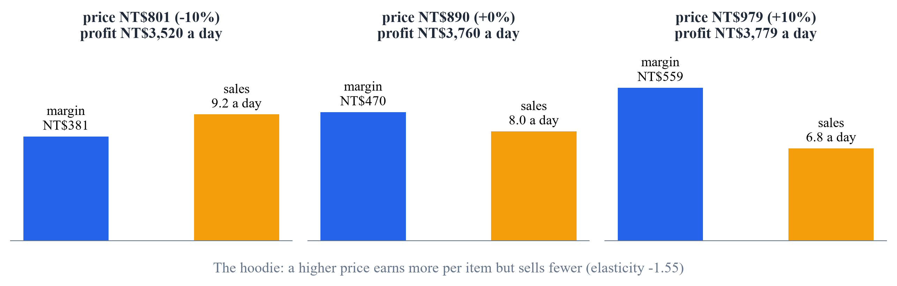

  * **Profit is the goal, not revenue.** A cut can raise revenue and still lower profit, because each extra sale brings in a smaller margin.
  * **Stock and time.** If the days of stock are more than the days left, some items will be left over. They lose 60% of their cost, so a cut that sells them can earn more than keeping the price.

* **5. Lab Practice Dataset:**
  * Two files (fictional teaching data):
    * Products: [data/session_04_03_dataset.csv](data/session_04_03_dataset.csv), the 10 products of the campus store, one row per product.
    * Price test: [data/session_04_03_price_test.csv](data/session_04_03_price_test.csv), 5 weeks of tested hoodie prices.
  * Product columns:
    * `Product_ID`: Product code (`MER-101` to `MER-110`).
    * `Product_Name`: Hoodie, T-shirt, Cap, Tote bag, Mug, Water bottle, Notebook, Umbrella, Lanyard, Keychain.
    * `Price_TWD`: Today's price in NT$.
    * `Unit_Cost_TWD`: What one item costs the store.
    * `Stock_Units`: Items in stock.
    * `Daily_Units`: Average items sold per day at today's price.
  * Price test columns: `Test_Week` (1 to 5), `Product_ID`, `Test_Price_TWD`, and `Avg_Daily_Units` (average hoodies sold per day that week).
  * Workflow in Google Antigravity IDE: activate your `.venv` (Python Setup Clinic), name each script with your name and the session code (for example, `Reacher_S43_step_1.py`), run it with `python` followed by the file name, and check for return code `0`. On an error, paste the traceback into the AI Agent Chat and ask why it failed.

* **6. Step 1: Measure the Reaction:**
  * *Goal:* measure the price elasticity from the 5-week hoodie price test.
  * *Code:* `YourName_S43_step_1.py`
    ```python
    # 1. Input: 5 weeks of tested prices for the hoodie
    import numpy as np
    import pandas as pd
    test = pd.read_csv("data/session_04_03_price_test.csv")

    # 2. Process: a straight line through log(units) against log(price)
    slope, intercept = np.polyfit(np.log(test["Test_Price_TWD"]),
                                  np.log(test["Avg_Daily_Units"]), 1)
    elasticity = round(slope, 2)

    # 3. Output: the elasticity and what it means
    print("Price elasticity of demand:", elasticity)
    print(f"A 1% price rise loses about {abs(elasticity)}% of units sold.")
    ```
  * *How it works, line by line:*
    * The store charged a different hoodie price each week (NT$790 to NT$990) and counted the hoodies sold per day.
    * `np.log(...)` takes the logarithm of every price and every sales count. A logarithm turns percentage changes into plain differences, so a straight line through the logs has a slope that reads as "% change in sales for a 1% change in price": the elasticity.
    * `np.polyfit(x, y, 1)` fits the best straight line (degree `1`) through the 5 points and returns its slope and intercept (Session 3.3 found such a line with Scikit-Learn).
    * `round(slope, 2)` keeps 2 decimals; `abs()` drops the minus sign for the sentence.
  * *Read the output:*

    ```text
    Price elasticity of demand: -1.55
    A 1% price rise loses about 1.55% of units sold.
    ```

    * `-1.55` is below `-1`: students react strongly to the hoodie's price.
    * A 10% rise would lose about 15.5% of sales. Whether that raises or lowers profit depends on the margin: Step 2 checks.
  * *Picture it:* the 5 test weeks, with the line that measures the reaction.

    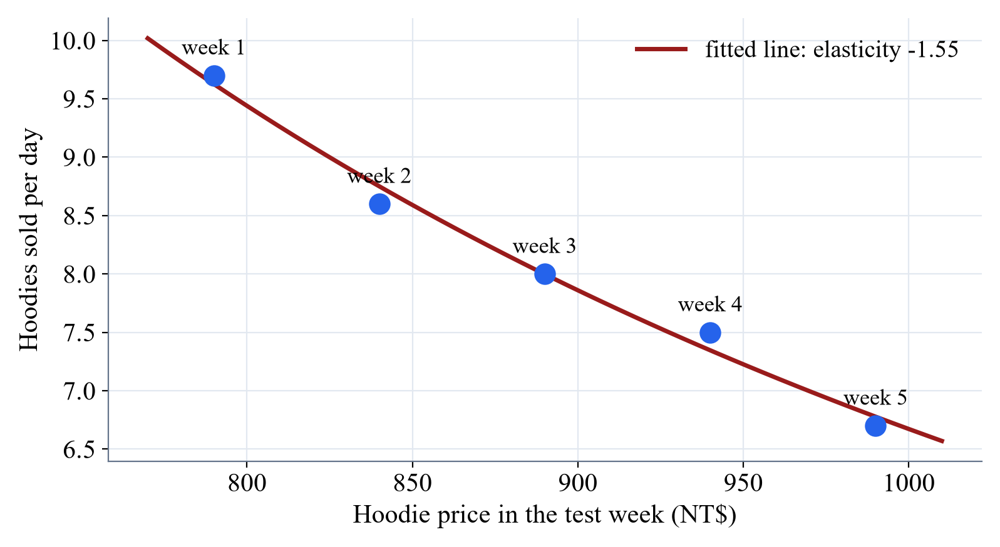

  * *Common mistake:* measuring the reaction from a single price change. One week can be unusual (an exam week, a holiday); a line through several weeks is more reliable.
  * *Quick Check 1 (`.pct_change()`):*
    * New tool: `column.pct_change()` gives the change from the previous row, as a share (`0.063` = 6.3%). Why: shows the week-to-week reactions behind the single slope.
    * Task: add one line to part **3. Output**: `print((test[["Test_Price_TWD", "Avg_Daily_Units"]].__________() * 100).round(1))`
    * Check: the second row shows `6.3` (price up 6.3%) and `-11.3` (sales down 11.3%). The first row is `NaN`, because week 1 has no previous week. The weekly reactions vary; the line averages them.

* **7. Step 2: Simulate Profit:**
  * *Goal:* use the elasticity to predict the whole store's daily profit if every price changed by -10% to +10%.
  * *Code:* `YourName_S43_step_2.py`
    ```python
    # 1. Input: the store's products and the elasticity from Step 1
    import pandas as pd
    df = pd.read_csv("data/session_04_03_dataset.csv", index_col="Product_ID")
    elasticity = -1.55

    # 2. Process: one function, used for every price change
    def daily_profit(price_change):
        price = df["Price_TWD"] * (1 + price_change)
        units = df["Daily_Units"] * (1 + elasticity * price_change)
        return round(((price - df["Unit_Cost_TWD"]) * units).sum())

    curve = {}
    for change in [-0.10, -0.05, 0.0, 0.05, 0.10]:
        curve[f"{change * 100:+.0f}%"] = daily_profit(change)

    # 3. Output: the whole store's daily profit at each price change
    for label, profit in curve.items():
        print(f"{label}: NT${profit:,}")
    ```
  * *How it works, line by line:*
    * `elasticity = -1.55` uses the hoodie's value for every product. A real store would test each product group; the hoodie is our best estimate.
    * `daily_profit(price_change)` computes the new prices, the new daily sales (section 4), and the store's total daily profit: (price - cost) x sales, added up over the 10 products.
    * The loop runs the function for 5 price changes and stores each result in a dictionary, labeled like `+5%`. `f"{change * 100:+.0f}%"` writes the change with its sign.
  * *Read the output:*

    ```text
    -10%: NT$17,829
    -5%: NT$18,348
    +0%: NT$18,620
    +5%: NT$18,646
    +10%: NT$18,424
    ```

    * Profit rises from `-10`% up to `+5`%, then falls again at `+10`%: there is a best point in between.
    * A store-wide 10% cut loses about NT$790 of profit a day, even though it sells more.
    * A 5% rise earns only NT$26 more a day: the store-wide price is already close to its best. The bigger gains come from treating products differently (Exercise 3).
  * *Picture it:* daily revenue and daily profit for price changes from -15% to +15% (Exercise 1).

    

  * *Common mistake:* choosing the price with the highest revenue. Revenue is highest with a 15% cut (Exercise 1), but profit is lower there: the store would work harder for less.
  * *Quick Check 2 (`max(..., key=...)`):*
    * New tool: `max(curve, key=curve.get)` returns the label with the highest value. Why: finds the best scenario without reading the list by eye.
    * Task: add one line to part **3. Output**: `print("Best change:", ___(curve, key=curve.get))`
    * Check: `Best change: +5%`.

* **8. Step 3: Check the Deadline:**
  * *Goal:* compare each product's days of stock with the 14 days left in the semester.
  * *Code:* `YourName_S43_step_3.py`
    ```python
    # 1. Input: the store's products; the semester ends in 14 days
    import pandas as pd
    df = pd.read_csv("data/session_04_03_dataset.csv", index_col="Product_ID")
    days_left = 14

    # 2. Process: how many days the stock lasts at today's sales
    df["Days_Of_Stock"] = (df["Stock_Units"] / df["Daily_Units"]).round(1)
    too_slow = df[df["Days_Of_Stock"] > days_left]

    # 3. Output: the products that will still have stock when the semester ends
    columns = ["Product_Name", "Stock_Units", "Daily_Units", "Days_Of_Stock"]
    print(too_slow[columns])
    ```
  * *How it works, line by line:*
    * `Stock_Units / Daily_Units` is how many days the stock lasts if sales stay as they are.
    * `df[df["Days_Of_Stock"] > days_left]` keeps the products that would still have items after 14 days (Session 1.4).
  * *Read the output:*

    ```text
               Product_Name  Stock_Units  Daily_Units  Days_Of_Stock
    Product_ID                                                      
    MER-101          Hoodie          120          8.0           15.0
    MER-102         T-shirt          310         20.0           15.5
    MER-104        Tote bag          190         12.0           15.8
    MER-105             Mug           90          5.0           18.0
    MER-109         Lanyard          150          9.0           16.7
    ```

    * 5 of the 10 products will not sell out by the end of the semester.
    * The mug is the slowest: 18 days of stock for 14 days left, so 20 mugs would be left over.
    * The other 5 products will sell out in time; their prices could even go up.
  * *Picture it:* days of stock for every product, against the 14 days left.

    

  * *Common mistake:* cutting the price of every product before a deadline. Half of these products will sell out anyway; a cut there only gives away margin.
  * *Quick Check 3 (`np.where()`):*
    * New tool: `np.where(condition, value_if_true, value_if_false)` fills a whole column with one of two values. Why: labels every product in one line.
    * Task: add `import numpy as np` to part **1. Input**, and one line at the end of part **2. Process**: `df["Action"] = np._____(df["Days_Of_Stock"] > days_left, "Markdown", "Keep")`. Then print `df["Action"].value_counts()`.
    * Check: `Markdown` `5`, `Keep` `5`.

* **9. Summary: Pricing with Data:**
  * Three short steps replace gut feeling with numbers:

    

    | Step | What we did | Result |
    |---|---|---|
    | 1. Measure the reaction | a line through the logs of the hoodie price test | elasticity `-1.55` |
    | 2. Simulate profit | daily profit for price changes from -10% to +10% | best store-wide change `+5`%; a cut earns less |
    | 3. Check the deadline | days of stock against 14 days left | 5 products need a cut |
    | Exercises | revenue vs profit, markdowns, and the best price per product | NT$11,185 more over 14 days |

  * *Remember:* measure how customers react before changing a price; simulate profit, not revenue; count the cost of what will be left over.

* **10. Official Python Documentation & References:**
  * [NumPy: `numpy.polyfit`](https://numpy.org/doc/stable/reference/generated/numpy.polyfit.html).
  * [NumPy: `numpy.where`](https://numpy.org/doc/stable/reference/generated/numpy.where.html).
  * [pandas: `pct_change`](https://pandas.pydata.org/docs/reference/api/pandas.DataFrame.pct_change.html).
  * [Investopedia: Price Elasticity of Demand](https://www.investopedia.com/terms/p/priceelasticity.asp).

* **11. Exercise 1: Guided Practice - Revenue or Profit?:**
  * *Step 1: Open Script:* In Google Antigravity IDE, create a new script named `YourName_S43_curve.py`, replacing `YourName` with your own name (for example, `Reacher_S43_curve.py`).
  * *Step 2: Simulate a Wider Range of Price Changes:*
    Type the following code:
    ```python
    # 1. Input: the store's products and the measured elasticity
    import pandas as pd
    df = pd.read_csv("data/session_04_03_dataset.csv", index_col="Product_ID")
    elasticity = -1.55

    # 2. Process: today's margins, then units, revenue, and profit from -15% to +15%
    margin = df["Price_TWD"] - df["Unit_Cost_TWD"]
    df["Margin_Pct"] = (margin / df["Price_TWD"] * 100).round(1)
    rows = []
    for change in [-0.15, -0.10, -0.05, 0.0, 0.05, 0.10, 0.15]:
        price = df["Price_TWD"] * (1 + change)
        units = df["Daily_Units"] * (1 + elasticity * change)
        rows.append({
            "Change_Pct": round(change * 100),
            "Daily_Units": round(units.sum(), 1),
            "Revenue_TWD": round((price * units).sum()),
            "Profit_TWD": round(((price - df["Unit_Cost_TWD"]) * units).sum()),
        })
    curve = pd.DataFrame(rows)

    # 3. Output: margins today, then the curve
    print("Margin % by product:", df["Margin_Pct"].tolist())
    print(curve)
    ```
    * `rows.append({...})` adds one dictionary per price change; `pd.DataFrame(rows)` turns the list into a table (Session 3.3, Exercise 3).
  * *Step 3: Interpret:* In two comment lines, explain why the price change with the highest revenue is not the one with the highest profit.
  * *Step 4: Execute in Terminal:* Run `python YourName_S43_curve.py` in Panel `[4]` and confirm return code `0`.
  * *Success Check:* margins range from `52.8`% (hoodie) to `68.8`% (lanyard). Profit peaks at `+5` (NT$`18,646`), while revenue is highest at `-15` (NT$`33,356`): the 15% cut sells the most items (`123.2` a day) but earns the least profit (NT$`17,063`).

* **12. Exercise 2: Applied Practice - Markdowns:**
  * *Coding Challenge:* In `YourName_S43_markdown.py`, start from Step 3 and calculate the price cut each slow product needs to sell out in 14 days.
  * *Task 1 (Required Price Change):* For the products in `too_slow`, add:
    * `Needed_Daily_Units` = `Stock_Units` / 14: the daily sales needed to sell out in time
    * `Change_Pct` = (`Needed_Daily_Units` / `Daily_Units` - 1) / elasticity x 100, rounded to 1 decimal. This reverses the rule of section 4: if sales must rise by a given share, the price must change by that share divided by the elasticity (`-1.55`). The result is negative: a cut.
  * *Task 2 (Read the SyntaxError & AI Diagnosis):* Write the new price line with a missing bracket: `too_slow["New_Price_TWD"] = too_slow["Price_TWD"] * (1 + too_slow["Change_Pct"] / 100`. Run the script: Python stops before running anything, with `SyntaxError: '(' was never closed`. Capture the error (Windows: `Win + Shift + S`; Mac: `Cmd + Ctrl + Shift + 4`), paste it into Panel `[3]` (AI Agent Chat), and ask how to find the missing bracket. Antigravity highlights the matching bracket when you place the cursor next to one.
  * *Task 3 (Fix and Save):* Close the bracket, round `New_Price_TWD` to whole NT$, and save `Product_Name`, `Price_TWD`, `Change_Pct`, and `New_Price_TWD` for the slow products to `data/markdown_plan.csv`. Use `too_slow = df[...].copy()` in Step 3's code so that adding columns does not raise a warning.
  * *Success Check:*

    | Product | Price | Change | New price |
    |---|---|---|---|
    | Hoodie | NT$890 | `-4.6`% | NT$`849` |
    | T-shirt | NT$390 | `-6.9`% | NT$`363` |
    | Tote bag | NT$290 | `-8.4`% | NT$`266` |
    | Mug | NT$350 | `-18.4`% | NT$`286` |
    | Lanyard | NT$80 | `-12.3`% | NT$`70` |

    The deepest cut goes to the product with the most stock relative to its sales (the mug), not to the most expensive one (the hoodie).

* **13. Exercise 3: Advanced Practice - Best Price per Product:**
  * *Goal:* Find, for each product, the price that earns the most over the 14 days left, counting the loss on any stock left over. Some prices may go up and some down. Show the manager how much the plan adds compared with keeping today's prices.
  * *What you need:*
    * File: `data/session_04_03_dataset.csv` (described in **5. Lab Practice Dataset**).
    * Script name: `YourName_S43_plan.py`.
    * Tools you already know: functions, `for` loops, `min()`, lists of dictionaries, and `pd.DataFrame()`.
  * *Rules of the season:*
    * 14 days left; elasticity `-1.55`; daily sales at a new price: daily sales x (1 + elasticity x change).
    * Items sold in 14 days: the smaller of (daily sales x 14) and the stock: the store cannot sell items it does not have.
    * Unsold items go to the wholesaler at 40% of their cost: a loss of `0.6 x unit cost` each.
    * Season profit = (price - unit cost) x items sold - 0.6 x unit cost x unsold items.
  * *Requirements (follow them in order):*
    1. Write `season_profit(price, unit_cost, daily_units, stock)` that returns the season profit, following the rules above.
    2. For each product, try the price changes `-20%`, `-15%`, `-10%`, `-5%`, `0%`, `+5%`, `+10%`, `+15%`, and `+20%`. Round each new price to whole NT$ before you use it.
    3. Keep, for each product, the change with the highest season profit (if two tie, keep the first one tried), and also record the season profit at `0%`.
    4. Build one DataFrame with `Product_Name`, `Best_Change_Pct`, `Best_Price_TWD`, `Best_Profit_TWD`, and `Today_Profit_TWD`, profits rounded to whole NT$.
    5. Print the table, the total of both profit columns, and the difference.
    6. Count how many products get a cut, a rise, or no change.
  * *New tools for this exercise:*
    * Looping over rows: `for product_id, row in df.iterrows():`. Each `row` works like a small dictionary: `row["Unit_Cost_TWD"]`.
    * `min(a, b)` returns the smaller of two numbers.
  * *Hints:*
    * Test `season_profit()` on the hoodie at `0%` first: 112 hoodies sold in 14 days, 8 left over, so `470 x 112 - 0.6 x 420 x 8 = NT$50,624`.
    * Inside the product loop, keep the best result so far in two variables and update them when a change earns more.
  * *Self-Check (expected results):*
    * Cuts: hoodie, T-shirt, and tote bag (`-5`% each), mug and lanyard (`-10`% each). Rises: notebook and umbrella (`+5`% each); cap, water bottle, and keychain (`+10`% each).
    * Total profit over the 14 days: NT$`253,557` with the plan, against NT$`242,372` at today's prices: NT$`11,185` more.
    * Business meaning: the five cuts go exactly to the products that would not sell out (Step 3), and none of them needs the full markdown of Exercise 2: the mug does best at `-10`%, not `-18.4`%, because a few leftover mugs cost less than a deep cut on every mug sold.

---

<a id="session-04-04"></a>
### Session 4.4: Is the AI Fair? Auditing a Screening Tool: Group Rates, the Four-Fifths Rule, Explanations, and Governance


* **Lecture Presentation:** [Download Slides (PDF)](slides/session_04_04_lecture.pdf)
* **Reading (PDF):** [Download Reading (PDF)](handouts/session_04_04_reading.pdf): read before class
* **Schedule:** Week 16 (115/12/27 - 116/01/02) | In-person classes (1:2 Delivery Ratio: 60 Min Lecture + 120 Min Lab)
* **How this session is organized:** first the problem, then the result, then how a fairness audit produced that result, step by step with code. The three exercises come last.

* **1. The Problem:**
  * A technology company receives many applications for its summer internship. An AI screening tool gives every applicant a **screening score** from 0 to 1, and applicants with `0.70` or more are invited to an interview. Nobody reads the other applications.
  * The tool looks at three things: GPA, the score on an online coding test, and the number of club activities (clubs, student associations, volunteer roles) listed in the application.
  * The applicants come from two groups, `Group_A` and `Group_B`. The group is a **protected characteristic**, such as sex, that the law and the company's own rules forbid using against an applicant. The tool never sees the group; the company keeps it only to check fairness.
  * You are likely to meet tools like this when you apply for internships and jobs yourself.
  * The head of recruiting asks: does the tool invite both groups at similar rates, why was each rejected applicant rejected, and what should the company do before using the tool again?

* **2. The Result:**
  * On 20 applicants, 10 in each group:

    | Group | Invited | Invite rate |
    |---|---|---|
    | Group A | 7 of 10 | `70`% |
    | Group B | 3 of 10 | `30`% |

    The ratio of the two rates is `0.30 / 0.70 = 0.429`, far below `0.80`: the tool **fails the four-fifths rule**, a common first test of fairness.
  * The two groups have almost the same skills: an average GPA of `3.31` and `3.35`, and an average coding score of `70.7` and `70.1`. The difference is in club activities: `3.4` against `1.1` on average.
  * Explaining each rejection shows the main reason: for 5 of the 7 rejected Group B applicants, it was **too few club activities**, not a low GPA or coding score. `APP-315` (Group B, coding `78`, GPA `3.5`, no clubs) was rejected, while `APP-319` (Group A, coding `64`, GPA `3.0`, 5 clubs) was invited.
  * **Answer 1:** no. Group B is invited far less often, although its skills are the same on average.
  * **Answer 2:** each rejection can be explained by the effect of each feature; the club count is behind most Group B rejections. It may measure free time (for example, students who need a part-time job have less time for clubs) more than ability.
  * **Answer 3:** changing the threshold does not fix it (Exercise 3). The company should review whether club activities belong in the score, add a person's review of near-miss applicants, and write down every decision.
  * **How it was done:** Sections 6 to 8 do the audit step by step.

* **3. Expected Learning Outcomes (By the end of this session, you will be able to):**
  1. "Are the groups treated alike?": calculate each group's selection rate and the ratio of the rates, and apply the four-fifths rule
  2. "Where does a gap come from?": compare the groups' features, and explain each decision with feature effects
  3. "What should the company do?": test whether a threshold change can fix a gap, and write a governance record

* **4. Key Ideas: Bias, a Test, Explanations:**
  * **How a fair-looking tool can be unfair.** A model learns patterns from past data. The tool never sees the group, but if the groups differ on a feature that the tool uses, the tool's decisions will differ too. Nobody intended it.

    

  * **Two kinds of unfair treatment:**
    * **Disparate treatment:** deciding differently because of a person's group, for example a different threshold for each group. This is forbidden in hiring in many countries, so it can never be the fix.
    * **Disparate impact:** one rule for everyone on paper, but one group is selected far less often. It is a warning sign that must be investigated and justified.
  * **The four-fifths rule.** If one group's selection rate is less than 80% (four-fifths) of the highest group's rate, the gap needs review. It comes from US hiring guidelines (1978) and is widely used as a first test. Failing it is a reason to investigate, not proof of discrimination.
  * **Explaining a decision.** For a model that adds up its features, each feature's **effect** on one applicant = coefficient x (applicant's value - average value). A negative effect pulled the score down; the most negative one is the main reason.
  * **A copy of a hidden model.** The company bought the tool and does not know its formula. We fit a linear regression that copies the scores from the three features (a **surrogate model**) and explain the copy. Its explanations can be trusted only if the copy is accurate (Step 3).
  * **Governance.** The company stays responsible for its automated decisions. Laws such as the EU AI Act (European Union Artificial Intelligence Act) treat AI used in hiring as high-risk: it needs documentation, human oversight, and transparency. A written **governance record** states what was tested, what was found, and who decided what.

* **5. Lab Practice Dataset:**
  * File Link: [data/session_04_04_dataset.csv](data/session_04_04_dataset.csv)
  * 20 internship applicants (fictional teaching data), one row per applicant, 10 in each group:
    * `Applicant_ID`: Applicant code (`APP-301` to `APP-320`).
    * `Group`: The protected group, anonymized as `Group_A` or `Group_B`. The tool does not use it; auditors use it only to test fairness.
    * `GPA`: Grade point average, on a scale up to 4.3.
    * `Coding_Test_Score`: Score on the online coding test, from 0 to 100.
    * `Club_Activities_Count`: Club activities listed in the application (`0` to `5`).
    * `Screening_Score`: The AI tool's score, from 0 to 1; invited to an interview at `0.70` or more.
  * Workflow in Google Antigravity IDE: activate your `.venv` (Python Setup Clinic), name each script with your name and the session code (for example, `Reacher_S44_step_1.py`), run it with `python` followed by the file name, and check for return code `0`. On an error, paste the traceback into the AI Agent Chat and ask why it failed.

* **6. Step 1: Compare the Rates:**
  * *Goal:* turn the scores into decisions, compare the invite rates of the two groups, and apply the four-fifths rule.
  * *Code:* `YourName_S44_step_1.py`
    ```python
    # 1. Input: 20 internship applicants and their AI screening scores
    import pandas as pd
    df = pd.read_csv("data/session_04_04_dataset.csv", index_col="Applicant_ID")

    # 2. Process: invited at 0.70, the invite rate of each group, and the ratio
    df["Invited"] = (df["Screening_Score"] >= 0.70).astype(int)
    rates = df.groupby("Group")["Invited"].mean()
    ratio = rates.min() / rates.max()

    # 3. Output: rates, the ratio, and the four-fifths test
    print(rates)
    print(f"Ratio of the invite rates: {ratio:.3f}")
    print("Passes the four-fifths rule:", ratio >= 0.80)
    ```
  * *How it works, line by line:*
    * `(df["Screening_Score"] >= 0.70).astype(int)` turns each score into `1` (invited) or `0` (rejected) (Session 3.4).
    * `df.groupby("Group")["Invited"].mean()` gives each group's invite rate: the mean of a 0/1 column is the share of 1s (Session 3.1).
    * `rates.min() / rates.max()` divides the lower rate by the higher one, whichever group it is.
    * `ratio >= 0.80` gives `True` or `False`: the four-fifths test.
  * *Read the output:*

    ```text
    Group
    Group_A    0.7
    Group_B    0.3
    Name: Invited, dtype: float64
    Ratio of the invite rates: 0.429
    Passes the four-fifths rule: False
    ```

    * 7 of 10 Group A applicants are invited, but only 3 of 10 in Group B.
    * The ratio, `0.429`, is far below `0.80`: the gap must be investigated before the tool is used again.
  * *Picture it:* the invite rates of the two groups, and the four-fifths line.

    

  * *Common mistake:* concluding "the tool never sees the group, so it is fair". Step 2 shows how a gap appears anyway.
  * *Quick Check 1 (`pd.crosstab()`):*
    * Tool: `pd.crosstab(row_column, column_column)` counts each combination of two columns (Session 3.2, Exercise 2). Why: the board wants counts, not only rates.
    * Task: add one line to part **3. Output**: `print(pd.________(df["Group"], df["Invited"]))`
    * Check: Group A: `3` rejected (`0`), `7` invited (`1`); Group B: `7` rejected, `3` invited.

* **7. Step 2: Find the Cause:**
  * *Goal:* compare the two groups on the three features that the tool uses, and on the score.
  * *Code:* `YourName_S44_step_2.py`
    ```python
    # 1. Input: the 20 applicants
    import pandas as pd
    df = pd.read_csv("data/session_04_04_dataset.csv", index_col="Applicant_ID")
    features = ["GPA", "Coding_Test_Score", "Club_Activities_Count"]

    # 2. Process: the average of each feature and of the score, by group
    profile = df.groupby("Group")[features + ["Screening_Score"]].mean().round(2)

    # 3. Output: the two groups side by side
    print(profile.T)
    ```
  * *How it works, line by line:*
    * `features + ["Screening_Score"]` joins two lists: the three features and the score.
    * `df.groupby("Group")[...].mean()` averages each column within each group (Session 1.4).
    * `profile.T` flips the table (`T` for "transpose"): the measures become rows and the two groups become columns, which is easier to compare.
  * *Read the output:*

    ```text
    Group                  Group_A  Group_B
    GPA                       3.31     3.35
    Coding_Test_Score        70.70    70.10
    Club_Activities_Count     3.40     1.10
    Screening_Score           0.75     0.62
    ```

    * GPA and coding scores are almost the same in both groups: on the skills the job needs, the groups are alike.
    * Club activities differ a lot: `3.4` against `1.1`. The tool gives points for clubs, so Group B scores lower on average (`0.62` against `0.75`).
    * The real question for people, not for data: does the number of clubs measure ability for this job, or does it measure free time? Students who work part-time jobs or care for family members have less time for clubs.
  * *Picture it:* the three features, group by group.

    

  * *Common mistake:* removing the group column and believing the problem is solved. The tool never had the group column; the gap comes through a feature that differs between the groups (a **proxy**).
  * *Quick Check 2 (the spread inside each group):*
    * Tool: `.min()` and `.max()` with `groupby()`.
    * Task: add one line to part **3. Output**: `print(df.groupby("Group")["Club_Activities_Count"].agg(["min", "max"]))`
    * Check: Group A `1` to `5`; Group B `0` to `3`. Three Group B applicants listed no club at all; every Group A applicant listed at least one.

* **8. Step 3: Explain Each Decision:**
  * *Goal:* copy the hidden score with a linear model, then show how much each feature pushed each rejected applicant's score down, and name the main reason.
  * *Code:* `YourName_S44_step_3.py`
    ```python
    # 1. Input: the 20 applicants and the three features
    import pandas as pd
    from sklearn.linear_model import LinearRegression
    df = pd.read_csv("data/session_04_04_dataset.csv", index_col="Applicant_ID")
    features = ["GPA", "Coding_Test_Score", "Club_Activities_Count"]

    # 2. Process: copy the hidden score, then the effect of each feature
    copy = LinearRegression().fit(df[features], df["Screening_Score"])
    effects = ((df[features] - df[features].mean()) * copy.coef_).round(3)
    effects.columns = ["GPA", "Test", "Clubs"]
    effects["Main_Reason"] = effects.idxmin(axis=1)
    rejected = df["Screening_Score"] < 0.70

    # 3. Output: how well the copy fits, then the reasons for each rejection
    fit = copy.score(df[features], df["Screening_Score"])
    print("R-squared of the copy:", round(fit, 3))
    print(effects[rejected].join(df["Group"]))
    ```
  * *How it works, line by line:*
    * `LinearRegression().fit(...)` learns a formula that copies the tool's scores from the three features: the surrogate (Session 3.3).
    * `(df[features] - df[features].mean()) * copy.coef_` computes every applicant's effect for all three features at once: each column's average is subtracted, and each column is multiplied by its own coefficient.
    * `effects.columns = [...]` gives the three effects short names.
    * `effects.idxmin(axis=1)` returns, for each row (`axis=1`), the name of the column with the most negative value: the main reason.
    * `effects[rejected].join(df["Group"])` keeps the rejected applicants and adds their group, for the audit only.
  * *Read the output:*

    ```text
    R-squared of the copy: 0.987
                    GPA   Test  Clubs Main_Reason    Group
    Applicant_ID                                          
    APP-303       0.043 -0.080 -0.014        Test  Group_B
    APP-305      -0.068 -0.080  0.101        Test  Group_A
    APP-306      -0.052 -0.028 -0.072       Clubs  Group_B
    APP-307      -0.068 -0.086 -0.072        Test  Group_B
    APP-312      -0.005  0.010 -0.129       Clubs  Group_B
    APP-313      -0.036 -0.048 -0.129       Clubs  Group_B
    APP-315       0.027  0.049 -0.129       Clubs  Group_B
    APP-316      -0.084 -0.061 -0.072         GPA  Group_A
    APP-318      -0.036 -0.099  0.101        Test  Group_A
    APP-320      -0.021 -0.009 -0.072       Clubs  Group_B
    ```

    * The copy explains `98.7`% of the score differences, so its explanations can be trusted.
    * The 3 rejected Group A applicants were rejected for their coding score or GPA.
    * For 5 of the 7 rejected Group B applicants, the main reason is club activities. `APP-315` had a better GPA and coding score than average (`+0.027` and `+0.049`), but having no clubs (`-0.129`) pulled the score below `0.70`.
  * *Picture it:* `APP-315` (rejected) and `APP-319` (invited), feature by feature.

    

  * *Common mistake:* explaining a model you have not checked. A surrogate's explanations are only as good as its fit.
  * *Quick Check 3 (counting the main reasons):*
    * Tool: `pd.crosstab()` again.
    * Task: add one line to part **3. Output**: `print(pd.crosstab(df.loc[rejected, "Group"], effects.loc[rejected, "Main_Reason"]))`
    * Check: Group A: GPA `1`, Test `2`, Clubs `0`; Group B: Clubs `5`, Test `2`.

* **9. Summary: The Audit:**
  * The same three steps work for any automated decision about people:

    

    | Step | What we did | Result |
    |---|---|---|
    | 1. Compare rates | invite rate by group; four-fifths rule | `70`% vs `30`%; ratio `0.429`: fails |
    | 2. Find the cause | average features by group | same skills; club activities `3.4` vs `1.1` |
    | 3. Explain decisions | feature effects from a surrogate (R-squared `0.987`) | clubs is the main reason for 5 of 7 Group B rejections |
    | Exercises | an audit report, a governance record, a threshold test | the threshold cannot fix the gap |

  * *What a fix may and may not do:*

    | Possible fix | Allowed? | Why |
    |---|---|---|
    | A lower threshold for Group B | no | deciding by group is disparate treatment |
    | One lower threshold for everyone | only with care | Exercise 3: it invites applicants below the coding bar |
    | Review whether club activities belong in the score | yes | addresses the cause |
    | A person reviews applicants just below `0.70` | yes | human oversight of near misses |
    | Document every test and decision | yes | the company stays accountable |

  * *Remember:* a tool can be unfair without seeing the group; compare rates, find the feature behind the gap, explain each decision, never decide by group, and write everything down.

* **10. Official Python Documentation & References:**
  * [European Commission: Regulatory Framework for Artificial Intelligence (EU AI Act)](https://digital-strategy.ec.europa.eu/en/policies/regulatory-framework-ai).
  * [US Equal Employment Opportunity Commission: Uniform Guidelines, Questions and Answers (the four-fifths rule)](https://www.eeoc.gov/laws/guidance/questions-and-answers-clarify-and-provide-common-interpretation-uniform-guidelines).
  * [Fairlearn: A Python Toolkit for Assessing and Improving Fairness in AI](https://fairlearn.org/).
  * [Barocas, Hardt, Narayanan: Fairness and Machine Learning](https://fairmlbook.org/).

* **11. Exercise 1: Guided Practice - The Audit Report:**
  * *Step 1: Open Script:* In Google Antigravity IDE, create a new script named `YourName_S44_audit.py`, replacing `YourName` with your own name (for example, `Reacher_S44_audit.py`).
  * *Step 2: Write the Report:*
    Type the following code:
    ```python
    # 1. Input: the 20 applicants
    import pandas as pd
    df = pd.read_csv("data/session_04_04_dataset.csv", index_col="Applicant_ID")

    # 2. Process: decisions in words, counts per group, rates, and the ratio
    invited = df["Screening_Score"] >= 0.70
    df["Decision"] = invited.map({True: "Invited", False: "Rejected"})
    counts = pd.crosstab(df["Group"], df["Decision"])
    rates = counts["Invited"] / counts.sum(axis=1)
    ratio = rates.min() / rates.max()

    # 3. Output: the audit findings
    print(counts)
    rate_a, rate_b = rates["Group_A"], rates["Group_B"]
    print(f"Group A: {rate_a:.0%} invited | Group B: {rate_b:.0%} invited")
    print(f"Ratio of the invite rates: {ratio:.3f}")
    if ratio < 0.80:
        print("ALERT: fails the four-fifths rule; investigate before using it again.")
    else:
        print("Passes the four-fifths rule.")
    ```
    * `.map({True: "Invited", False: "Rejected"})` replaces each value using a dictionary: reports for people should use words, not codes.
    * `counts.sum(axis=1)` adds up each row: the number of applicants per group.
    * `{rate_a:.0%}` prints a share as a whole percent.
  * *Step 3: Interpret:* In two comment lines, explain why failing the four-fifths rule calls for an investigation, and why it does not by itself prove that the tool discriminates.
  * *Step 4: Execute in Terminal:* Run `python YourName_S44_audit.py` in Panel `[4]` and confirm return code `0`.
  * *Success Check:* the table shows Group A `7` invited and `3` rejected, Group B `3` invited and `7` rejected; `Group A: 70% invited | Group B: 30% invited`; ratio `0.429`; the `ALERT` line prints.

* **12. Exercise 2: Applied Practice - Audit Function and Record:**
  * *Coding Challenge:* In `YourName_S44_record.py`, turn the audit into a function and save a governance record for the company's management.
  * *Task 1 (Audit Function):* Write `screening_audit(df, threshold)` that computes the invite rate of each group and `ratio` at any threshold, as in Step 1.
  * *Task 2 (Read the NameError & AI Diagnosis):* Call `screening_audit(df, 0.70)`, then write `print(ratio)` on the next line, outside the function. The script stops with `NameError: name 'ratio' is not defined`. Capture the traceback (Windows: `Win + Shift + S`; Mac: `Cmd + Ctrl + Shift + 4`), paste it into Panel `[3]` (AI Agent Chat), and ask why a variable created inside a function is not available outside it.
  * *Task 3 (Return, Record, Save):* Make the function end with `return rates, ratio`, and call it as `rates, ratio = screening_audit(df, 0.70)`. Build a one-row governance record with `pd.DataFrame([{...}])` and the keys `Tool`, `Threshold`, `Group_A_Rate`, `Group_B_Rate`, `Ratio` (rounded to 3 decimals), `Passes_Four_Fifths`, `Main_Finding`, and `Status`. Set `Status` to `"Review before use"` if the test fails, otherwise `"Approved for use"`, and `Main_Finding` to `"Club activities drive most Group B rejections"`. Save it to `data/governance_record.csv` with `index=False` and print it.
  * *Success Check:* the record shows `Threshold` `0.7`, `Group_A_Rate` `0.7`, `Group_B_Rate` `0.3`, `Ratio` `0.429`, `Passes_Four_Fifths` `False`, and `Status` `Review before use`; the script ends with return code `0`.

* **13. Exercise 3: Advanced Practice - One Shared Threshold?:**
  * *Goal:* A different threshold for each group would be disparate treatment, so it is not an option. Test whether a **single threshold for everyone** can pass the four-fifths rule, and what it would cost: the company does not want to invite applicants who scored below `60` on the coding test (its skill bar).
  * *What you need:*
    * File: `data/session_04_04_dataset.csv` (described in **5. Lab Practice Dataset**).
    * Script name: `YourName_S44_threshold.py`.
    * Tools you already know: your `screening_audit()` function from Exercise 2, `for` loops, lists of dictionaries, `pd.DataFrame()`, and True/False masks.
  * *Requirements (follow them in order):*
    1. For each shared threshold in `[0.50, 0.55, 0.60, 0.65, 0.70, 0.75, 0.80]`, compute the number invited, the invite rate of each group, the ratio (rounded to 3 decimals), and `Below_Skill_Bar`: invited applicants with a coding score below `60`.
    2. Collect the results in one DataFrame with the columns `Threshold`, `Invited`, `Group_A_Rate`, `Group_B_Rate`, `Ratio`, and `Below_Skill_Bar`.
    3. Find the **highest** threshold that passes the four-fifths rule, and report its `Below_Skill_Bar`.
    4. Find the **highest** threshold that passes the four-fifths rule **and** has `0` applicants below the skill bar. If there is none, print that clearly.
    5. Write three comment lines for management: what a threshold can and cannot fix, and two other actions the company could take instead.
  * *New tools for this exercise:*
    * Combining two masks: `invited & (df["Coding_Test_Score"] < 60)` is `True` for applicants who are invited **and** below the skill bar; `.sum()` counts them.
    * Filtering a results table with two conditions: `results[(results["Ratio"] >= 0.80) & (results["Below_Skill_Bar"] == 0)]`. An empty result has a `len()` of `0`.
  * *Hints:*
    * Reuse `screening_audit()` inside the loop, so that every threshold is tested the same way.
    * Print the whole table before answering requirements 3 and 4.
  * *Self-Check (expected results):*
    * Ratios: `0.50` `0.889`, `0.55` `0.778`, `0.60` `0.556`, `0.65` `0.429`, `0.70` `0.429`, `0.75` `0.5`, `0.80` `0.25`.
    * Highest passing threshold: `0.50`, with 17 of 20 invited and `3` below the skill bar (`APP-303`, `APP-305`, `APP-318`).
    * No threshold passes the rule with `0` applicants below the skill bar.
    * Business meaning: moving one threshold either fails the fairness test or invites applicants who do not meet the skill bar. The threshold cannot fix the gap, because the gap comes from a feature. The company should review the club feature, have a person review near misses, and document the decision.
