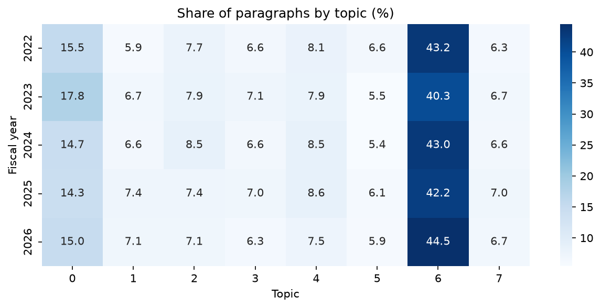
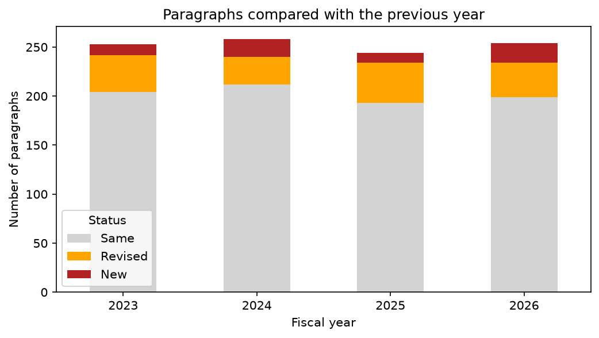
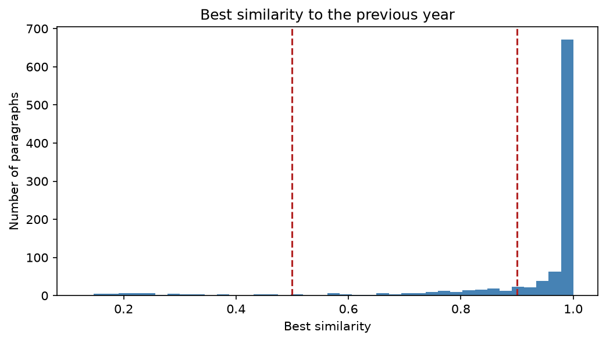
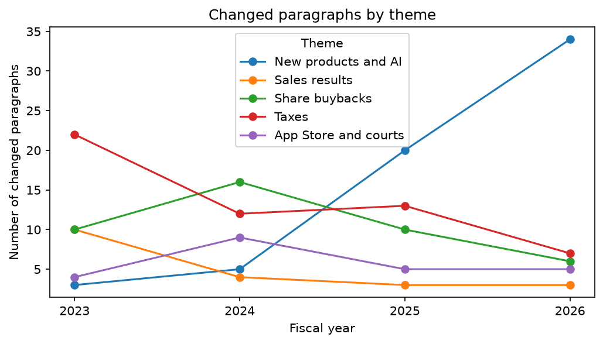
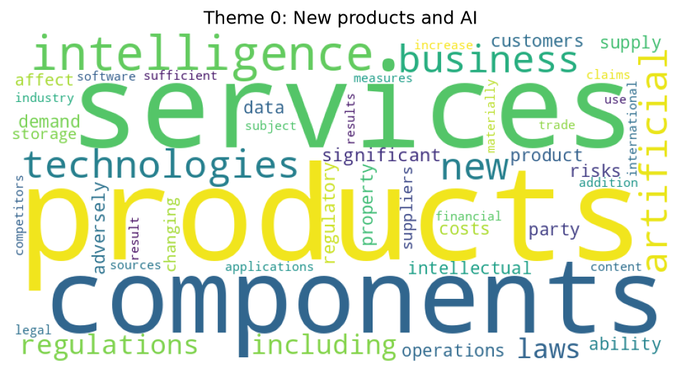
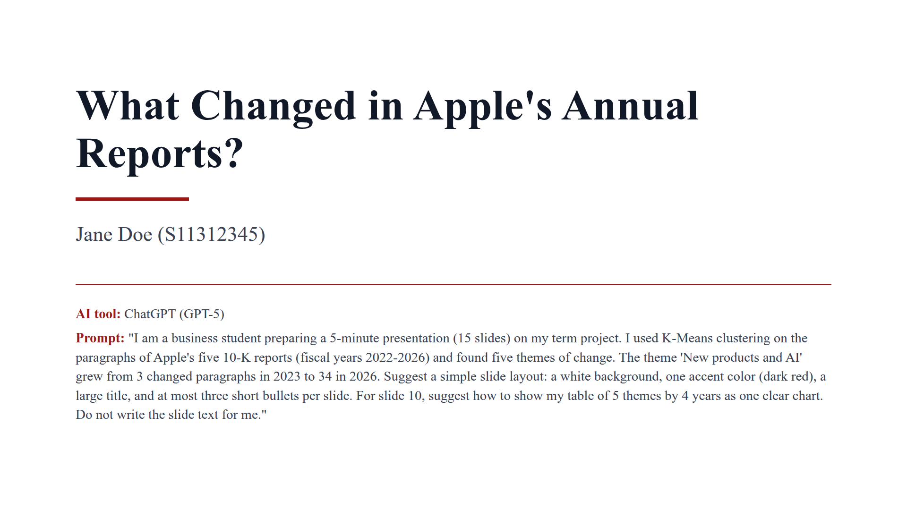
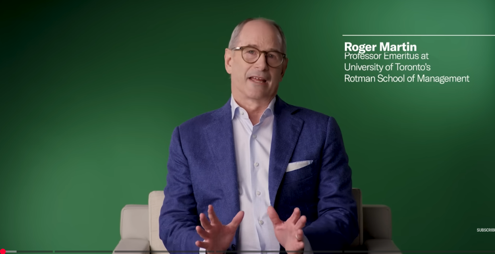

# Project Overview

Every US-listed company files an annual report with the US Securities and Exchange Commission (SEC). This report, called **Form 10-K**, explains the business, its results, and its risks in management's own words. It is long (30,000 to 60,000 words), and most of it is repeated from one year to the next. The new parts are where the news is.

You will pick one company, collect its five most recent 10-K reports, and use machine learning to answer one question:

> **What did [Company]'s management start to talk about in the last five years, and what does that mean for an investor?**

@tbl-steps shows the steps of the project and the course session where you learned each one.

| Step | What you do | Course session |
|---|:---|:---|
| Collect | Find and save five 10-K reports | 2.1 (HTTP requests, User-Agent) |
| Build the table | Read each report with Beautiful Soup; make a table of paragraphs | 2.1, 1.3 |
| Turn words into numbers | Represent each paragraph as a TF-IDF vector | New tool |
| Topic map | Group all paragraphs into topics with K-Means clustering | 3.4 |
| Find what changed | Compare each paragraph with last year's report | New tool |
| Themes of change | Group the changed paragraphs into themes with K-Means | 3.4 |
| Interpret | Read the paragraphs; explain why each theme appeared when it did | 2.4, 4.4 |
: Project steps and the course sessions they use {#tbl-steps}

# Company List and Selection Rules

## The 25 companies

Every company on the list files Form 10-K with the SEC, so the reports have the same structure and are free to download. Each one also has a clear story in 2025-2026 that its reports may reveal (@tbl-companies).

| # | Company (Ticker) | Industry | Story to look for |
|---|:---|---|:---|
| 1 | NVIDIA (NVDA) | Semiconductors | AI chip demand and supply |
| 2 | Advanced Micro Devices (AMD) | Semiconductors | The AI challenger |
| 3 | Intel (INTC) | Semiconductors | Restructuring and a US government stake |
| 4 | Micron Technology (MU) | Memory chips | The memory cycle and AI memory demand |
| 5 | Oracle (ORCL) | Software and cloud | Large AI cloud contracts and rising debt |
| 6 | Microsoft (MSFT) | Software and cloud | Azure growth and AI spending |
| 7 | United Parcel Service (UPS) | Logistics | Fewer packages and cost cuts |
| 8 | Amazon (AMZN) | E-commerce and cloud | AWS and heavy investment |
| 9 | Alphabet (GOOGL) | Internet | Search vs. AI, and antitrust cases |
| 10 | Meta Platforms (META) | Internet | AI spending and regulation |
| 11 | Netflix (NFLX) | Media | From subscriber growth to profit growth |
| 12 | Adobe (ADBE) | Software | The fear that AI replaces its products |
| 13 | Salesforce (CRM) | Software | Slower growth and AI agents |
| 14 | Tesla (TSLA) | Automobiles | Falling car margins and a story about AI and robots |
| 15 | Nike (NKE) | Apparel | Weak results, tariffs, and a turnaround plan |
| 16 | Walmart (WMT) | Retail | A traditional retailer valued like a technology company |
| 17 | Costco (COST) | Retail | The membership model |
| 18 | Target (TGT) | Retail | Falling sales and a falling stock |
| 19 | Coca-Cola (KO) | Beverages | A defensive company: does its story change at all? |
| 20 | Eli Lilly (LLY) | Pharmaceuticals | Fast growth from obesity drugs (GLP-1) |
| 21 | Pfizer (PFE) | Pharmaceuticals | Revenue falls after COVID-19 |
| 22 | UnitedHealth Group (UNH) | Health care | Rising medical costs and a CEO change in 2025 |
| 23 | Chevron (CVX) | Energy | The oil price cycle and acquisitions |
| 24 | Caterpillar (CAT) | Machinery | Power equipment for data centers |
| 25 | NextEra Energy (NEE) | Electric utilities | AI power demand and interest rates |
: The 25 companies to choose from, with the story to look for in each company's 10-K reports {#tbl-companies}

## Selection rules

* **One company per student.** Sign up for your company in iLearn. The first student to sign up gets the company.
* **Do not change companies after Week 10** unless the instructor agrees.

# Collect the Data

Use the **five most recent 10-K reports filed by November 1, 2026**, one per fiscal year. Keep this set even if the company files a new 10-K during the project. Some companies end their fiscal year in a month other than December (NVIDIA in January, Microsoft in June, Costco in August), so your five years may be, for example, fiscal years 2022 to 2026.

1. **Open the company's list of 10-K filings** in SEC EDGAR, the SEC's free filing database. This guide uses Apple (`AAPL`) as the example throughout; replace `AAPL` with your ticker:
   `https://www.sec.gov/cgi-bin/browse-edgar?action=getcompany&CIK=AAPL&type=10-K`
   Each row of the table is one filing, newest first. The first column (**Filings**) shows the form type. Use the five newest rows whose type is exactly **10-K**; skip **10-K/A** rows, which are corrections.
2. **Open the filing.** In the row, click the **Documents** button. A page called *Filing Index* opens. Its first table, *Document Format Files*, lists every file in the filing.
3. **Find the report file.** In that table, the row whose **Type** is **10-K** is the report itself (the other rows, such as EX-21, are attachments). Its file name tells you the fiscal year: `aapl-20260926.htm` means the fiscal year that ended on September 26, 2026, so it is the 2026 report.
4. **Get the address that Python can read.** Click the file name. The report opens in the SEC's *Inline XBRL Viewer*, and the address bar shows:
   `https://www.sec.gov/ix?doc=/Archives/edgar/data/320193/000032019326000026/aapl-20260926.htm`
   The viewer is a page for people; Python needs the report file behind it. Delete `ix?doc=/` from the address, so that it becomes:
   `https://www.sec.gov/Archives/edgar/data/320193/000032019326000026/aapl-20260926.htm`
   Paste this into your browser to check: you should see the plain report, without the viewer's menus.
5. **Repeat steps 2-4** for the other four years, and write down the five addresses with their years.
6. **Save each report with Python.** The SEC asks every script to name itself with a User-Agent (Session 2.1), so put your name and school email in it:

```python
import time
import requests

headers = {"User-Agent": "Your Name your.email@thu.edu.tw"}
reports = {                            # Apple's five reports; use your company's
    2022: "https://www.sec.gov/Archives/edgar/data/320193/000032019322000108/aapl-20220924.htm",
    2023: "https://www.sec.gov/Archives/edgar/data/320193/000032019323000106/aapl-20230930.htm",
    2024: "https://www.sec.gov/Archives/edgar/data/320193/000032019324000123/aapl-20240928.htm",
    2025: "https://www.sec.gov/Archives/edgar/data/320193/000032019325000079/aapl-20250927.htm",
    2026: "https://www.sec.gov/Archives/edgar/data/320193/000032019326000026/aapl-20260926.htm",
}

for year, url in reports.items():
    html_text = requests.get(url, headers=headers).text
    with open(f"AAPL_{year}.htm", "w", encoding="utf-8") as f:
        f.write(html_text)
    time.sleep(2)                       # pause between requests
```

If the saved file is very small and contains "Request Rejected" or "Undeclared Automated Tool", the SEC refused your request: check that the `User-Agent` has your real name and email, wait a few minutes, and try again.

# Analysis Steps

You will need one new library feature, `TfidfVectorizer`, and one new function, `cosine_similarity`. Both come with Scikit-Learn. If a library is missing, run this once in the Terminal:

```
pip install requests beautifulsoup4 pandas scikit-learn matplotlib seaborn wordcloud
```

## Step 1: Build a table of paragraphs

Read each report with Beautiful Soup, as you read the saved web page in Session 2.1, and keep every paragraph of at least 30 words. Short lines are mostly headings, page numbers, and table cells.

```python
import pandas as pd
from bs4 import BeautifulSoup

rows = []
for year in [2022, 2023, 2024, 2025, 2026]:
    html_text = open(f"AAPL_{year}.htm", encoding="utf-8").read()
    soup = BeautifulSoup(html_text, "html.parser")
    for line in soup.get_text("\n").split("\n"):
        paragraph = " ".join(line.split())          # remove extra spaces
        if len(paragraph.split()) >= 30:
            rows.append({"Year": year, "Paragraph": paragraph})

df = pd.DataFrame(rows)
print(df.groupby("Year").size())                    # paragraphs per year
```

* `soup.get_text("\n")` removes the HTML tags and keeps only the text, with a line break between blocks. In a 10-K, one paragraph is usually one block, so one line is usually one paragraph.
* `" ".join(line.split())` cuts the line into words and joins them again with single spaces. Extra spaces and the non-breaking spaces (`&nbsp;`) common in 10-K files disappear, so two copies of the same paragraph look the same.
* `len(paragraph.split()) >= 30` counts the words and keeps only paragraphs of 30 words or more.
* `df.groupby("Year").size()` counts the rows (paragraphs) of each year.

Output for Apple:

```text
Year
2022    271
2023    253
2024    258
2025    244
2026    254
dtype: int64
```

Each report gives about 250 paragraphs. If a year has far fewer (for example, 20), check that the saved file is the full report and not an error page.

## Step 2: Turn paragraphs into numbers with TF-IDF

A machine learning model needs numbers, not words. **TF-IDF** (Term Frequency-Inverse Document Frequency) gives each paragraph one number per word:

* **Term frequency:** a word that appears often in this paragraph gets a higher number.
* **Inverse document frequency:** a word that appears in almost every paragraph (such as "company") gets a lower number, because it says little about this paragraph.

The formula, as Scikit-Learn computes it, for a word $w$ in a paragraph $p$:

$$
\text{TF-IDF}(w, p) = \text{TF}(w, p) \times \text{IDF}(w)
$$

$$
\text{IDF}(w) = \ln\left(\frac{1 + n}{1 + \text{DF}(w)}\right) + 1
$$

* $\text{TF}(w, p)$: how many times $w$ appears in paragraph $p$.
* $n$: the number of paragraphs (1,280 for Apple's five reports).
* $\text{DF}(w)$: the number of paragraphs that contain $w$ at least once.
* $\ln$ is the natural logarithm. It keeps the IDF from growing too fast for very rare words.

**Example from Apple.** Take this paragraph from Apple's 2022 report: *"The Company's effective tax rate for 2022 was higher compared to 2021 due primarily to a higher effective tax rate on foreign earnings, including the impact to U.S. foreign tax credits as a result of regulatory guidance issued by the U.S. Department of the Treasury in 2022, and lower tax benefits ..."* @tbl-tfidf-example shows three of its words.

| Word | TF in this paragraph | DF (of 1,280) | IDF | TF × IDF |
|---|---|---|---|---|
| including | 1 | 371 | $\ln(1281 / 372) + 1 = 2.24$ | $1 \times 2.24 = 2.24$ |
| treasury | 1 | 3 | $\ln(1281 / 4) + 1 = 6.77$ | $1 \times 6.77 = 6.77$ |
| tax | 4 | 87 | $\ln(1281 / 88) + 1 = 3.68$ | $4 \times 3.68 = 14.71$ |
: TF-IDF of three words in one paragraph of Apple's 2022 report {#tbl-tfidf-example}

* "Including" is common in the whole report, so its IDF is low: it says little about this paragraph.
* "Treasury" is rare, so its IDF is high, but it appears only once.
* "Tax" is fairly rare **and** appears 4 times, so it gets the largest number. TF-IDF correctly says this paragraph is about tax.

Finally, Scikit-Learn scales each paragraph's numbers so that long and short paragraphs can be compared: it divides them by $\sqrt{\text{sum of their squares}}$, so every row has a length of 1.

```python
from sklearn.feature_extraction.text import TfidfVectorizer

vectorizer = TfidfVectorizer(stop_words="english",
                             token_pattern=r"(?u)\b[a-zA-Z]{2,}\b",
                             min_df=3, max_df=0.5)
X = vectorizer.fit_transform(df["Paragraph"])
words = vectorizer.get_feature_names_out()
print(X.shape)                                      # (paragraphs, words)
```

Output for Apple:

```text
(1280, 2222)
```

`X` is a table with one row for each of the 1,280 paragraphs (all five years) and one column for each of the 2,222 words that were kept.

* `stop_words="english"` drops common words such as "the" and "and".
* `token_pattern` keeps only words of two or more letters, so numbers and years do not count as words.
* `min_df=3` drops words that appear in fewer than 3 paragraphs; `max_df=0.5` drops words that appear in more than half of the paragraphs.
* `fit_transform()` learns the list of words from all paragraphs (fit) and turns each paragraph into its row of numbers (transform). `get_feature_names_out()` returns that list of words, in the same order as the columns of `X`.

## Step 3: Make a topic map with K-Means

Group all paragraphs into topics with K-Means clustering (Session 3.4). Paragraphs in the same cluster use similar words.

**What K-Means is for.** Your five reports have about 1,300 paragraphs, too many to read and sort by hand. K-Means sorts them into a few piles (clusters) so that the paragraphs in one pile talk about similar things, like sorting a stack of letters by topic. You choose how many piles (here 8); K-Means decides which paragraph goes into which pile. It does not name the piles: each pile's **top words**, the words most typical of it, give you the hint, and you give the name.

```python
from sklearn.cluster import KMeans

model = KMeans(n_clusters=8, random_state=0, n_init=10).fit(X)
df["Topic"] = model.labels_

for k in range(8):
    top = [words[i] for i in model.cluster_centers_[k].argsort()[-8:][::-1]]
    print(k, top)                                   # the 8 most typical words

share = pd.crosstab(df["Year"], df["Topic"], normalize="index") * 100
print(share.round(1))                               # % of each year's paragraphs
```

* `KMeans(n_clusters=8, random_state=0, n_init=10)` asks for 8 clusters. `n_init=10` tries 10 different starting centers and keeps the best result; `random_state=0` makes the result the same every time you run it.
* `model.labels_` gives each paragraph its cluster number (0 to 7).
* `model.cluster_centers_[k]` is the center of cluster `k`. `.argsort()[-8:][::-1]` finds the positions of its 8 largest weights, from largest to smallest, and `words[i]` turns each position into its word.
* `pd.crosstab(df["Year"], df["Topic"], normalize="index")` counts the paragraphs of each topic in each year (Session 2.3) and, with `normalize="index"`, divides by the year's total, so each row adds up to 1. `* 100` turns it into percentages.

Output for Apple:

```text
0 ['products', 'services', 'sales', 'net', 'product', 'property', 'intellectual', 'software']
1 ['notes', 'certificate', 'dated', 'forms', 'representing', 'officer', 'registrant', 'floating']
2 ['tax', 'billion', 'taxes', 'positions', 'income', 'state', 'decision', 'aid']
3 ['statements', 'consolidated', 'fiscal', 'financial', 'years', 'form', 'september', 'item']
4 ['securities', 'cash', 'pursuant', 'program', 'registrant', 'billion', 'marketable', 'act']
5 ['foreign', 'currency', 'rates', 'instruments', 'exchange', 'denominated', 'hedges', 'dollar']
6 ['business', 'components', 'operations', 'adversely', 'products', 'materially', 'stock', 'financial']
7 ['internal', 'control', 'reporting', 'financial', 'accordance', 'audit', 'reasonable', 'statements']
Topic     0    1    2    3    4    5     6    7
Year
2022   15.5  5.9  7.7  6.6  8.1  6.6  43.2  6.3
2023   17.8  6.7  7.9  7.1  7.9  5.5  40.3  6.7
2024   14.7  6.6  8.5  6.6  8.5  5.4  43.0  6.6
2025   14.3  7.4  7.4  7.0  8.6  6.1  42.2  7.0
2026   15.0  7.1  7.1  6.3  7.5  5.9  44.5  6.7
```

How to read it: topic 2 is about taxes (tax, income, state aid), topic 5 is about currency risk, and topic 6 (business, adversely, materially) is the risk factors, which make up more than 40% of the report every year. Each row adds up to 100%.

**Chart: topic shares as a heatmap.** Draw the table as a heatmap, as in Session 2.2. Each cell is colored by its value, so a column that changes color from year to year is a topic that grew or shrank.

```python
import matplotlib.pyplot as plt
import seaborn as sns

fig, ax = plt.subplots(figsize=(10, 4))
sns.heatmap(share, annot=True, fmt=".1f", cmap="Blues", ax=ax)
ax.set_title("Share of paragraphs by topic (%)")
ax.set_xlabel("Topic")
ax.set_ylabel("Fiscal year")
fig.savefig("topic_heatmap.png", dpi=150, bbox_inches="tight")
```

* `annot=True, fmt=".1f"` writes each value in its cell with one decimal place.
* `cmap="Blues"` colors low values light and high values dark blue.

{#fig-topic-heatmap}

In @fig-topic-heatmap, every column keeps almost the same color in all five years.

* **Name each topic** from its top words and from two or three of its paragraphs (for example, "taxes", "share buybacks", "supply chain risks").
* **Choose the number of topics.** Try 6, 8, and 10. Keep the number that gives topics you can name clearly, and explain your choice.
* You will see that the topic shares hardly move from year to year. Most of a 10-K is repeated, so the changes are hidden. Step 4 finds them.

## Step 4: Find the paragraphs that changed

Compare every paragraph with all the paragraphs of the previous year's report. **Cosine similarity** measures how alike two paragraphs are, from 0 (no words in common) to 1 (the same words in the same proportions). Each paragraph keeps its highest similarity to last year:

```python
import numpy as np
from sklearn.metrics.pairwise import cosine_similarity

sim_vectorizer = TfidfVectorizer(stop_words="english",
                                 token_pattern=r"(?u)\b[a-zA-Z]{2,}\b")
S = sim_vectorizer.fit_transform(df["Paragraph"])

years = sorted(df["Year"].unique())
df["Best_Similarity"] = np.nan
for prev, year in zip(years, years[1:]):
    this_rows = df.index[df["Year"] == year]
    prev_rows = df.index[df["Year"] == prev]
    best = cosine_similarity(S[this_rows], S[prev_rows]).max(axis=1)
    df.loc[this_rows, "Best_Similarity"] = best
```

* `sim_vectorizer` keeps **all** words (no `min_df` or `max_df`), so that a small edit, such as one new word, still lowers the similarity.
* `zip(years, years[1:])` makes the pairs of consecutive years: (2022, 2023), (2023, 2024), and so on.
* `cosine_similarity(S[this_rows], S[prev_rows])` makes a table with one row for each paragraph of this year and one column for each paragraph of last year. `.max(axis=1)` keeps the largest value in each row: the similarity to the most similar paragraph of last year.

Then label each paragraph as in @tbl-labels:

| Best similarity | Label | Meaning |
|---|---|:---|
| 0.9 or more | `Same` | Repeated from last year |
| 0.5 to 0.9 | `Revised` | Last year's paragraph, rewritten (for example, a new sentence added) |
| Below 0.5 | `New` | No similar paragraph last year |
: Labels for each paragraph, from its best similarity to the previous year's report {#tbl-labels}

@tbl-label-examples shows one real example of each label from Apple's reports. Words that differ are in **bold**.

| Label (best similarity) | This year's paragraph | Most similar paragraph last year | What changed |
|:---|:---|:---|:---|
| `Same` (1.00), 2023 | "... As of **September 30, 2023**, the Company had approximately **161,000** full-time equivalent employees." | "... As of **September 24, 2022**, the Company had approximately **164,000** full-time equivalent employees." | Only the date and the number. Numbers are not counted as words, so the similarity is 1.00. |
| `Revised` (0.85), 2023 | "The Company also produces its own digital content, which can be costly to produce due to intense and increasing competition for talent, content and subscribers, and may fail to appeal to the Company's customers." | The same sentence, followed by: "**The COVID-19 pandemic has also caused additional restrictions on production and increased costs for digital content.**" | One sentence removed: COVID-19 is no longer a risk for Apple's content. |
| `New` (0.15), 2026 | "The Company's business, including its artificial intelligence and machine learning offerings, also depends on access to sufficient compute capacity and storage resources. ..." | "Additionally, the Company's new products often utilize custom components available from only one source. ..." | Nothing similar last year. The closest paragraph is about a different subject: a new risk. |
: Examples of the three labels in Apple's 10-K reports {#tbl-label-examples tbl-colwidths="[14,30,30,26]"}

**Why 0.9 and 0.5?**

* **0.9:** numbers and dates are not counted as words, so a paragraph that only updates its figures scores 1.00, and small wording edits stay above 0.9. Below 0.9, a sentence was usually added, removed, or rewritten, as in the `Revised` example.
* **0.5:** below it, the most similar paragraph of last year is about a different subject, as in the `New` example. It is only the least different paragraph, not an earlier version.
* **The data agree:** few paragraphs have a best similarity near 0.5 (@fig-similarity-hist below), so 0.5 falls in a natural gap between rewritten and new paragraphs.

```python
df["Status"] = np.where(df["Best_Similarity"] >= 0.9, "Same",
               np.where(df["Best_Similarity"] >= 0.5, "Revised", "New"))
df.loc[df["Year"] == years[0], "Status"] = "First year"
print(pd.crosstab(df["Year"], df["Status"]))
```

* `np.where(condition, value_if_true, value_if_false)` fills a whole column at once (Session 4.3). Two of them inside each other give three labels: 0.9 or more is `Same`; otherwise 0.5 or more is `Revised`; otherwise `New`.
* A **threshold** is the cut-off value that decides the label. 0.9 and 0.5 are choices, not rules, so you will test them below.

Output for Apple:

```text
Status  First year  New  Revised  Same
Year
2022           271    0        0     0
2023             0   11       38   204
2024             0   18       28   212
2025             0   10       41   193
2026             0   20       35   199
```

For 2026, 35 + 20 = 55 of 254 paragraphs changed, so the change rate is 55 / 254 = 21.7%.

The first year has no previous report, so leave it out of this step. Report, for each year, the number of `Same`, `Revised`, and `New` paragraphs and the **change rate**: the percentage of paragraphs that are `Revised` or `New`.

**Chart: the change rate as a stacked bar chart.** One bar per year; the gray part is `Same`, and the colored parts on top are the paragraphs that changed.

```python
status_counts = pd.crosstab(df["Year"], df["Status"]).loc[years[1:], ["Same", "Revised", "New"]]

fig, ax = plt.subplots(figsize=(8, 4))
status_counts.plot(kind="bar", stacked=True, color=["lightgray", "orange", "firebrick"], rot=0, ax=ax)
ax.set_title("Paragraphs compared with the previous year")
ax.set_xlabel("Fiscal year")
ax.set_ylabel("Number of paragraphs")
fig.savefig("status_bar.png", dpi=150, bbox_inches="tight")
```

* `.loc[years[1:], ["Same", "Revised", "New"]]` leaves out the first year and puts the columns in this order, so that `Same` is at the bottom of each bar.
* `status_counts.plot(kind="bar", stacked=True, ax=ax)` is a pandas shortcut: it draws one bar per row and stacks the columns on top of each other.

{#fig-status-bar}

**Test your thresholds.** Try 0.4 and 0.6 instead of 0.5, and 0.85 and 0.95 instead of 0.9. Report whether your main findings stay the same.

**Chart: where the thresholds fall.** A **histogram** splits the range of values into equal bins (here 40 bins between 0 and 1) and draws one bar per bin; the height of the bar is the number of paragraphs in that bin. A histogram of the best similarities shows how many paragraphs are near each threshold. The two dashed lines are 0.5 and 0.9.

```python
fig, ax = plt.subplots(figsize=(8, 4))
ax.hist(df["Best_Similarity"].dropna(), bins=40, color="steelblue")
ax.axvline(0.5, color="firebrick", linestyle="--")
ax.axvline(0.9, color="firebrick", linestyle="--")
ax.set_title("Best similarity to the previous year")
ax.set_xlabel("Best similarity")
ax.set_ylabel("Number of paragraphs")
fig.savefig("similarity_hist.png", dpi=150, bbox_inches="tight")
```

* `.dropna()` removes the first year, which has no similarity.
* `ax.axvline(0.5)` draws a vertical line at 0.5.

{#fig-similarity-hist}

In @fig-similarity-hist, most of Apple's 1,009 paragraphs sit at or near 1.0 (repeated word for word). Moving a threshold changes the label only of the paragraphs between the old and the new line. Few paragraphs are near 0.5: moving it to 0.4 relabels 9 paragraphs, and moving it to 0.6 relabels 14. Many more are near 0.9: moving it to 0.85 relabels 39, and moving it to 0.95 relabels 61. So check the effect of the 0.9 threshold more carefully.

## Step 5: Group the changed paragraphs into themes

Keep only the `Revised` and `New` paragraphs and run K-Means again, this time with 4 to 6 clusters. Fit a new `TfidfVectorizer` on these paragraphs only: the words that matter among the changed paragraphs are different from the words that matter in the whole report.

```python
changed = df[df["Status"].isin(["Revised", "New"])].copy()

vectorizer2 = TfidfVectorizer(stop_words="english",
                              token_pattern=r"(?u)\b[a-zA-Z]{2,}\b",
                              min_df=2, max_df=0.5)
X_changed = vectorizer2.fit_transform(changed["Paragraph"])
words2 = vectorizer2.get_feature_names_out()

n_themes = 5
theme_model = KMeans(n_clusters=n_themes, random_state=0, n_init=10).fit(X_changed)
changed["Theme"] = theme_model.labels_
print(pd.crosstab(changed["Theme"], changed["Year"]))    # themes by year

for k in range(n_themes):
    top = [words2[i] for i in theme_model.cluster_centers_[k].argsort()[-8:][::-1]]
    print(k, top)
```

* `df["Status"].isin(["Revised", "New"])` is `True` for the rows whose label is either of the two. `.copy()` makes `changed` a separate table, so adding the `Theme` column does not change `df`.
* `min_df=2` instead of 3, because there are far fewer paragraphs (201 for Apple instead of 1,280).

Output for Apple:

```text
Year   2023  2024  2025  2026
Theme
0         3     5    20    34
1        10     4     3     3
2        10    16    10     6
3        22    12    13     7
4         4     9     5     5
0 ['products', 'services', 'components', 'intelligence', 'technologies', 'business', 'artificial', 'new']
1 ['net', 'sales', 'year', 'ipad', 'iphone', 'compared', 'higher', 'dollar']
2 ['shares', 'billion', 'security', 'plan', 'programs', 'repurchase', 'securities', 'share']
3 ['tax', 'foreign', 'rate', 'rates', 'asu', 'financial', 'gross', 'effective']
4 ['court', 'app', 'store', 'commission', 'changes', 'district', 'dma', 'developers']
```

Theme 0 grows from 3 to 34 changed paragraphs, and its top words include "artificial" and "intelligence". This is the theme to read first.

**Chart: themes of change as a line chart.** Replace the theme numbers with your theme names, and draw one line per theme.

```python
theme_names = {0: "New products and AI", 1: "Sales results", 2: "Share buybacks",
               3: "Taxes", 4: "App Store and courts"}      # use your own names
theme_counts = pd.crosstab(changed["Year"], changed["Theme"]).rename(columns=theme_names)

fig, ax = plt.subplots(figsize=(8, 4))
theme_counts.plot(marker="o", ax=ax)
ax.set_xticks(theme_counts.index)
ax.set_title("Changed paragraphs by theme")
ax.set_xlabel("Fiscal year")
ax.set_ylabel("Number of changed paragraphs")
fig.savefig("theme_lines.png", dpi=150, bbox_inches="tight")
```

* `pd.crosstab(changed["Year"], changed["Theme"])` puts years in rows and themes in columns, so each theme becomes one line.
* `.rename(columns=theme_names)` turns the column names 0 to 4 into your theme names, which then appear in the legend.
* `ax.set_xticks(theme_counts.index)` shows whole years (2023, 2024, ...) on the x-axis instead of values such as 2023.5.

{#fig-theme-lines}

In @fig-theme-lines, the AI line climbs while the others stay flat or fall. This is the main finding of the Apple example.

* Name each theme from its top words, as in Step 3.
* Read the table of themes by year. **A theme that grows over the years is your strongest evidence.**
* Find the **representative paragraph** of each theme: the paragraph closest to the cluster center. `theme_model.transform(X_changed)` gives every paragraph's distance to every center.

```python
distances = theme_model.transform(X_changed)
for k in range(n_themes):
    members = np.where(theme_model.labels_ == k)[0]
    closest = members[distances[members, k].argmin()]
    print(k, changed["Paragraph"].iloc[closest][:400])
```

* `distances[i, k]` is the distance from paragraph `i` to the center of theme `k`.
* `members` are the positions of the paragraphs in theme `k`; `.argmin()` finds the one with the smallest distance to the center.
* `.iloc[closest]` takes the paragraph at that position, and `[:400]` prints its first 400 characters.

Output for Apple (each paragraph is cut at 400 characters):

```text
0 Due to the highly volatile and competitive nature of the markets and industries in which the Company competes, the Company must continually introduce new products, services and technologies, enhance existing products and services, effectively stimulate customer demand for new and upgraded products, services and technologies, navigate global regulatory requirements and barriers to market access, an
1 The Company’s total net sales decreased 3% or $11.0 billion during 2023 compared to 2022. The weakness in foreign currencies relative to the U.S. dollar accounted for more than the entire year-over-year decrease in total net sales, which consisted primarily of lower net sales of Mac and iPhone, partially offset by higher net sales of Services.
2 As of September 30, 2023, the Company was authorized by the Board of Directors to purchase up to $90 billion of the Company’s common stock under a share repurchase program announced on May 4, 2023, of which $15.9 billion had been utilized. During the fourth quarter of 2023, the Company also utilized the final $4.6 billion under its previous repurchase program, which was most recently authorized in
3 The Company’s effective tax rate for 2024 was higher than the statutory federal income tax rate due primarily to a one-time income tax charge of $10.2 billion, net, related to the State Aid Decision (refer to Note 7, “Income Taxes” in the Notes to Consolidated Financial Statements in Part II, Item 8 of this Form 10-K) and state income taxes, partially offset by a lower effective tax rate on foreig
4 The Company distributes third-party applications for its products through the App Store. For the vast majority of applications, developers keep all of the revenue they generate on the App Store. The Company retains a commission from sales of applications and sales of digital services or goods initiated within an application. From time to time, the Company has made changes to its App Store, includi
```

With the top words and these paragraphs, the five themes can be named: new products and AI, sales results, share buybacks, taxes, and App Store and courts (@tbl-apple-themes in the next section).

**Chart: a word cloud of one theme.** A word cloud shows a theme's words at a glance: the larger the word, the more typical it is of the cluster. Install it once with `pip install wordcloud`.

```python
from wordcloud import WordCloud

k = 0                                                     # the theme to show
weights = dict(zip(words2, theme_model.cluster_centers_[k]))
cloud = WordCloud(width=800, height=400, background_color="white",
                  max_words=50).generate_from_frequencies(weights)

fig, ax = plt.subplots(figsize=(8, 4))
ax.imshow(cloud)
ax.axis("off")
ax.set_title(f"Theme {k}: {theme_names[k]}")
fig.savefig("theme_wordcloud.png", dpi=150, bbox_inches="tight")
```

* `theme_model.cluster_centers_[k]` holds one weight per word for theme `k`; these are the same weights that gave the top words above.
* `dict(zip(words2, ...))` pairs each word with its weight, for example `{"products": 0.087, "services": 0.071, ...}`.
* `generate_from_frequencies(weights)` sizes each word by its weight; `max_words=50` keeps only the 50 largest.
* `ax.imshow(cloud)` shows the picture, and `ax.axis("off")` hides the axes, which mean nothing here.

{#fig-theme-wordcloud}

A word cloud is a quick picture, not evidence. Use it to introduce a theme on a slide, and support your interpretation with the top words, the counts, and the quotes.

## Step 6: Read and interpret

The numbers tell you *where* to look; reading tells you *what it means*.

1. For your two or three most important themes, **quote at least three sentences** from the changed paragraphs.
2. Explain **why the theme appeared in that year**: an event in the company (a new product, a lawsuit, a new CEO), in its industry, or a new rule (for example, the SEC required a new cybersecurity section, Item 1C, in 10-K reports for fiscal years ending on or after December 15, 2023).
3. Say what an investor should **watch next year** because of it.

Watch out for these mistakes:

* **Routine updates are not news.** Some paragraphs change every year only because the dates and figures change (sales results, share buybacks, the auditor's report). Name these themes, but focus your interpretation on the others.
* **A cluster is not always one idea.** Read several paragraphs before you name a theme.
* **K-Means can give slightly different clusters** with a different `random_state`. Keep `random_state=0` so that your results can be repeated.

# Example: Apple

This example uses Apple's five most recent 10-K reports (fiscal years 2022 to 2026, ending in late September), with the settings above. @tbl-apple-change shows how much of each report changed, and @tbl-apple-themes shows what the changes were about.

| Fiscal year | Paragraphs | Same | Revised | New | Change rate |
|---|---|---|---|---|---|
| 2022 | 271 | (first year) | | | |
| 2023 | 253 | 204 | 38 | 11 | 19.4% |
| 2024 | 258 | 212 | 28 | 18 | 17.8% |
| 2025 | 244 | 193 | 41 | 10 | 20.9% |
| 2026 | 254 | 199 | 35 | 20 | 21.7% |
: Paragraphs and change rate in Apple's 10-K reports, fiscal years 2022-2026 {#tbl-apple-change}

* **Rows:** one fiscal year each. **Columns:** the number of paragraphs in that year's report, and how many of them are `Same`, `Revised`, or `New` compared with the previous year.
* **From the code:** Paragraphs (Step 1), Same, Revised, and New (Step 4).
* **Added by the researcher:** the change rate, calculated by hand as (Revised + New) / Paragraphs, for example (35 + 20) / 254 = 21.7% for 2026; and the note "(first year)", because 2022 has no previous report to compare with.

| Cluster | Theme (our name) | Top words (from the code) | 2023 | 2024 | 2025 | 2026 |
|---|---|:---|---|---|---|---|
| 0 | New products and AI | products, services, components, intelligence, technologies, business, artificial, new | 3 | 5 | 20 | 34 |
| 1 | Sales results | net, sales, year, ipad, iphone, compared, higher, dollar | 10 | 4 | 3 | 3 |
| 2 | Share buybacks | shares, billion, security, plan, programs, repurchase, securities, share | 10 | 16 | 10 | 6 |
| 3 | Taxes | tax, foreign, rate, rates, asu, financial, gross, effective | 22 | 12 | 13 | 7 |
| 4 | App Store and courts | court, app, store, commission, changes, district, dma, developers | 4 | 9 | 5 | 5 |
: Themes of change in Apple's 10-K reports: 5 clusters of the 201 changed paragraphs, with the number of changed paragraphs per year {#tbl-apple-themes tbl-colwidths="[9,19,48,6,6,6,6]"}

* **Rows:** one cluster of changed paragraphs each. **Columns:** the cluster number, its name, its top words, and how many changed paragraphs of each year belong to it.
* **From the code (Step 5):** the cluster number, the top words (in the order the code prints them), and the counts per year.
* **Added by the researcher:** the theme names. K-Means gives only numbers; we named each cluster after reading its top words and its representative paragraph. The total of 201 is the sum of the counts.

In your own report, keep the same rule: say which values your code printed and which ones you calculated or named yourself.

**A good interpretation reads like this:**

* **Most of the report is repeated.** About 80% of Apple's paragraphs are the same every year, and the topic map barely moves. The news is in the 18% to 22% that changes each year.
* **AI is the theme that grows.** Changed paragraphs about new products and artificial intelligence rose from 3 in 2023 to 34 in 2026. The 2026 report adds a new risk: *"The Company's business, including its artificial intelligence and machine learning offerings, also depends on access to sufficient compute capacity and storage resources. Demand for cloud compute and storage services and other artificial intelligence infrastructure has increased substantially across the technology industry, resulting in constrained supply, extended lead times, and increasing costs."* Apple now tells investors that its AI plans depend on computing power it partly buys from others.
* **Some themes are events.** The tax theme peaks in 2023-2024: the 2024 report explains *"a one-time income tax charge of $10.2 billion, net, related to the State Aid Decision"* of the European Commission. The App Store theme peaks in 2024, when new rules in the European Union and court cases in the US changed how Apple may charge app developers.
* **Some themes are routine.** Sales results and share buybacks change every year because their figures change; they are not new risks.
* **For investors:** the question to watch next year is whether the cost and supply of AI computing power starts to show up in Apple's margins.

# What to Submit

@tbl-submit lists everything you submit, with its deadline and file name.

| Deadline (Taiwan time) | What to submit | File name | Where |
|:---|:---|:---|---|
| Week 10: Friday, November 20, 5 pm | Report, **Chapter 1 only** (PDF, Word template) | `StudentID_Name_Ch1.pdf` | iLearn |
| Week 14: Friday, December 18, 5 pm | **Full report**: Chapters 1-4 and appendix, at least 10 pages (PDF, Word template) | `StudentID_Name_Report.pdf` | iLearn |
| | **Slides**: at least 15 (PDF) | `StudentID_Name_Slides.pdf` | iLearn |
| | **Presentation video**: 5 minutes, face visible (uploaded to Google Drive) | Link only | iLearn |
: What to submit, when, and under which file name {#tbl-submit}

Example file name: `S11312345_JohnSmith_Report.pdf` (your name in English letters, no spaces).

## Checklists before you submit

Late work is not accepted, so check everything **before** the deadline.

**Week 10: Chapter 1**

- [ ] Written in the Word template, in English
- [ ] Sections 1.1-1.4 are all there (about 2 pages)
- [ ] The table lists your five most recent 10-K reports filed by November 1, 2026 (fiscal year, filing date, link); no 10-K/A
- [ ] Word's Spelling & Grammar check is done
- [ ] Saved as PDF and named `StudentID_Name_Ch1.pdf`; the PDF opens correctly
- [ ] Uploaded to iLearn before Friday, November 20, 5 pm (Taiwan time)

**Week 14: Final report**

- [ ] Written in the Word template: title, your name, abstract (about 100 words), and keywords are filled in
- [ ] All of the template's sample text and instructions are deleted
- [ ] Chapters 1-4 follow the sections in the report chapters table; Chapter 1 is improved with the Week 10 feedback
- [ ] The main text (start of Chapter 1 to end of Chapter 4) is at least 10 pages
- [ ] Results include the topic map, the change rate by year, the themes of change by year, the representative paragraphs, and the threshold test
- [ ] Results include the five figures from the Analysis Steps (heatmap, stacked bar chart, similarity histogram, theme line chart, and at least one word cloud), each with a title and axis labels
- [ ] At least three quotes from the 10-K reports, in quotation marks and cited (for example, [3], Item 1A)
- [ ] Every table and figure is numbered and mentioned in the text
- [ ] Every figure is followed by two or three sentences on what it shows and what it means
- [ ] The References section lists your five 10-K reports and any other sources
- [ ] Appendix A: your complete script (1. Input, 2. Process, 3. Output), which runs without errors
- [ ] Appendix B: sources with dates
- [ ] Appendix C: AI tools, what you used them for, and every prompt; or "No AI tools were used."
- [ ] Nothing is copied directly from AI output
- [ ] Word's Spelling & Grammar check is done
- [ ] Saved as PDF and named `StudentID_Name_Report.pdf`; the PDF opens correctly

**Week 14: Slides**

- [ ] At least 15 slides, in English
- [ ] The title slide has the title and your name; if you used AI for the slides, it also shows the AI tool's name and your prompts
- [ ] Each results slide shows one figure, and its title states the finding in a full sentence
- [ ] You practiced and finish within 5 minutes
- [ ] Saved as PDF and named `StudentID_Name_Slides.pdf`; the PDF opens correctly

**Week 14: Presentation video**

- [ ] About 5 minutes, in English
- [ ] Your face is visible for the whole video
- [ ] Uploaded to Google Drive, shared as "Anyone with the link" (Viewer)
- [ ] The link opens in a private browser window
- [ ] The link is submitted in iLearn

**All three Week 14 items are uploaded before Friday, December 18, 5 pm (Taiwan time).**

**Only students who submitted all three Week 14 items (the final report, the slides, and the video link) on time may present in class.**

# Report

Write the report in four chapters plus an appendix (@tbl-chapters). The main text (Chapters 1-4) is at least **10 pages**, counted in the Word template's format from the start of Chapter 1 to the end of Chapter 4, including tables and figures. The title, abstract, references, and appendix do not count toward this minimum.

| Chapter | Sections | Suggested length | Due |
|---|:---|---|---|
| 1. Introduction | 1.1 The company and why you chose it<br>1.2 Its 2025-2026 story<br>1.3 Your research question<br>1.4 Data: a table of your five 10-K reports (fiscal year, filing date, link) | 2 pages | Week 10 |
| 2. Data and Method | 2.1 From five reports to a table of paragraphs (paragraphs per year)<br>2.2 TF-IDF and its settings<br>2.3 K-Means and how you chose the number of clusters<br>2.4 Cosine similarity and your thresholds | 2-3 pages | Week 14 |
| 3. Results | 3.1 The topic map: topic names and shares by year (heatmap)<br>3.2 The change rate by year (`Same`, `Revised`, `New`; stacked bar chart)<br>3.3 Themes of change by year (line chart and word clouds)<br>3.4 Representative paragraphs<br>3.5 The threshold test (similarity histogram) | 4-5 pages | Week 14 |
| 4. Conclusion | 4.1 Interpretation of the main themes, with quotes<br>4.2 What investors should watch next year<br>4.3 Limitations of the method<br>4.4 Summary | 2-3 pages | Week 14 |
| Appendix | A. Your complete Python script<br>B. Sources with dates<br>C. AI use: tool names and prompts (see [Use of AI Tools](#use-of-ai-tools)) | No limit | Week 14 |
: Report chapters, sections, and suggested lengths {#tbl-chapters tbl-colwidths="[18,56,14,12]"}

* **Use the Word template for both Chapter 1 (Week 10) and the final report (Week 14):** download [`template.docx`](template.docx), fill in the title, your name, a short abstract (about 100 words), and keywords, then replace the template's sample sections with Chapters 1-4 and the appendix. Use the template's heading, table, and figure styles, and convert the finished report to PDF.
* **See a finished example:** [this journal article](sustainability-18-11469.pdf) was written in the same template (Aybar-Bellido et al., *Sustainability*, 2026; open access, CC BY). Click it to see how the title, authors, abstract, keywords, numbered headings, tables, figures, and references should look. Use it as a model for the **format** only: your report is shorter and follows the chapters in @tbl-chapters.
* Your script follows the course structure (1. Input, 2. Process, 3. Output) and runs from start to finish without errors. Name it `StudentID_Name_Project.py`.
* Number every table and figure (Table 1, Figure 1) and refer to it in the text.
* **Explain every figure.** Right below each figure, write two or three sentences: what the figure shows and what it means. For example: "In Figure 4, the number of changed paragraphs about new products and AI rose from 3 in 2023 to 34 in 2026, while the other themes stayed flat or fell. Apple's new disclosures are mostly about AI."
* The final report includes all four chapters. Improve Chapter 1 using the feedback you received in Week 10.
* **Quote and cite carefully.** Put every quote from a 10-K in quotation marks and cite it the way the template does: a reference number in order of appearance, plus the item of the report, for example [3], Item 1A. List your five 10-K reports and any other sources in the template's References section.
* Everything is in English: the report, the slides, the video, and the live presentation.
* **Check grammar and spelling with Microsoft Word's own checker:** on the **Review** tab, click **Spelling & Grammar** (or press `F7`; in Microsoft 365 it is called **Editor**). This check does not need to be listed in Appendix C.

# Presentation

## Final presentations (Weeks 15-16)

The live presentation in class and the presentation video (see below) are **separate**. You must do both.

* **Every student must present in class.** The presentation order is set in class.
* **Only students who submitted all three Week 14 items (the final report, the slides, and the video link) on time may present in class.**
* **Duration:** 6 minutes in total: a 5-minute presentation and 1 minute of questions and answers (Q&A).
* **Attendance:** mandatory.

## Structure (5 minutes)

Organize your 5 minutes as in @tbl-structure.

| Section | Time |
|:---|---|
| Company and question | 0:45 |
| Data and method: from five reports to clusters | 1:00 |
| Results: change rate and themes of change | 1:30 |
| Interpretation and recommendation: "If I Advised This Company's Investors" | 1:15 |
| Summary | 0:30 |
: Structure of the 5-minute presentation {#tbl-structure}

Practice several times to stay within the time. Presentations will be stopped at 5 minutes.

## Slides (at least 15)

Use at least the 15 slides in @tbl-slides.

| # | Slide | Section |
|---|:---|---|
| 1 | Title: company, your name, student ID (and, if you used AI for the slides, the AI tool's name and your prompts) | Company and question |
| 2 | Research question and why you chose this company | Company and question |
| 3 | The company's 2025-2026 story | Company and question |
| 4 | Data: the five 10-K reports | Data and method |
| 5 | Method: from reports to paragraphs, TF-IDF, and clusters (one diagram) | Data and method |
| 6 | Settings: number of clusters and similarity thresholds, and why (similarity histogram) | Data and method |
| 7 | Topic map: the topics and their names | Results |
| 8 | Topic shares by year (heatmap) | Results |
| 9 | Change rate by year: `Same`, `Revised`, `New` (stacked bar chart) | Results |
| 10 | Themes of change by year (line chart) | Results |
| 11 | Theme 1: a word cloud, a quote, and why it appeared that year | Interpretation |
| 12 | Theme 2: a word cloud, a quote, and why it appeared that year | Interpretation |
| 13 | Real news vs. routine updates | Interpretation |
| 14 | Recommendation: "If I Advised This Company's Investors" | Interpretation |
| 15 | Limitations and summary | Summary |
: The 15 slides and their content {#tbl-slides}

You may add slides (for example, a third theme), but keep within 5 minutes.

* **One figure and one message per results slide (slides 6 and 8-12).** Show one figure, and write the slide title as the finding, in a full sentence. For example, slide 10 is titled "AI became the fastest-growing theme of change", not "Themes by year". With 15 slides in 5 minutes, you have about 20 seconds per slide.

* **Design the slides your own way**, in any tool you like (PowerPoint, Google Slides, Canva, or others). There is no template. Submit them as PDF.
* If you used an AI tool to make the slides, show the **AI tool's name and your prompts on the title slide**, as in @fig-title-slide.

{#fig-title-slide width=100%}

## Presentation video

* Record your 5-minute presentation in English.
* **Only you need to be in the video:** your face must be visible throughout. Slides are not needed in the video.
* **Sample video:** [A Plan Is Not a Strategy](https://youtu.be/iuYlGRnC7J8) (Harvard Business Review; @fig-sample-video). Watch it for the format:
  * One speaker, framed from the waist up, in the middle of the screen.
  * A plain, quiet background with nothing distracting behind the speaker.
  * The speaker looks at the camera and talks to the viewer, using natural hand gestures, without reading from a script.
  * Only a short caption with the speaker's name appears on screen. No slides.
* Upload the video to Google Drive. Set sharing to **"Anyone with the link"** with the role **Viewer**, and submit the link in iLearn by the Week 14 deadline.

{#fig-sample-video width=80%}

## Q&A (1 minute)

Be ready to answer questions about:

* How TF-IDF turns a paragraph into numbers
* Why you chose your number of clusters and your similarity thresholds
* Why one of your themes appeared in the year it did
* What one of your quoted sentences really says
* Which of your themes are real news and which are routine updates

# Submission

## Deadlines

All deadlines are in Taiwan time (@tbl-deadlines).

| Deadline | Submission |
|:---|:---|
| Week 10 (Friday, November 20, 5 pm Taiwan time) | Chapter 1 (PDF) |
| Week 14 (Friday, December 18, 5 pm Taiwan time) | Final report (PDF), slides (PDF), and the link to your presentation video |
: Submission deadlines (Taiwan time) {#tbl-deadlines}

## Submission process

1. **Convert to PDF:** both the report and the slides. Put your Python script in the report appendix.
2. **Name your files:**
   * `StudentID_Name_Ch1.pdf`
   * `StudentID_Name_Report.pdf`
   * `StudentID_Name_Slides.pdf`
   * Example: `S11312345_JohnSmith_Report.pdf` (your name in English letters, no spaces)
3. **Upload your presentation video to Google Drive** and submit only its link in iLearn. Set sharing to "Anyone with the link" (Viewer), then open the link in a private browser window to make sure anyone can view it.
4. **Submit to iLearn:** upload each file, or the video link, to the submission folder for that deadline.

## Use of AI Tools

You may use AI tools (for example, ChatGPT, Claude, Gemini, or the agent in Google Antigravity) to help write the report, the code, or the slides. If you do, you **must** report it:

* In **Appendix C. AI Use** of your report, list for each tool:
  1. The tool's name (and model, if shown), for example "ChatGPT (GPT-5)".
  2. What you used it for (for example, "fixing an error in Step 4", "improving the English of Chapter 4", "making slide 5").
  3. **Every prompt you used, copied exactly.**
* For the slides, also show the AI tool's name and your prompts on the **title slide** (see the Presentation section).
* If you did not use any AI tool, write "No AI tools were used." in Appendix C.

You are responsible for everything in your report. Check every number, quote, and fact an AI tool gives you against your own results and the 10-K reports.

**A report or slide deck copied directly from AI output will not be graded.** AI may help you, but the analysis, the interpretation, and the writing must be your own.

## Important notes

* All times are Taiwan time (UTC+8).
* **Late submissions are not accepted.** After the deadline, the iLearn submission is closed and the work receives no points.
* Only PDF files are accepted.
* Make sure your files open correctly before you submit them.

# Evaluation

Your grade has two parts (@tbl-eval).

| Item | Weight |
|---|---|
| Written report | 10% |
| Presentation | 90% |
| **Total** | **100%** |
: Evaluation weights {#tbl-eval}

**Data source:** Form 10-K reports from SEC EDGAR (US Securities and Exchange Commission).
