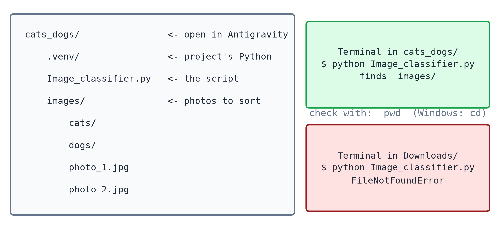
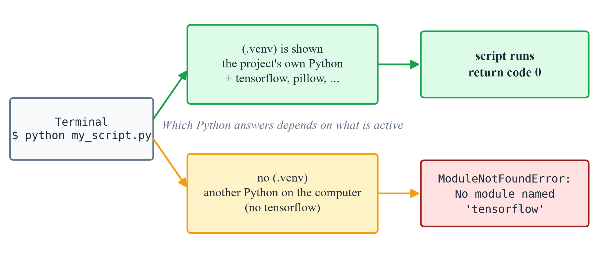
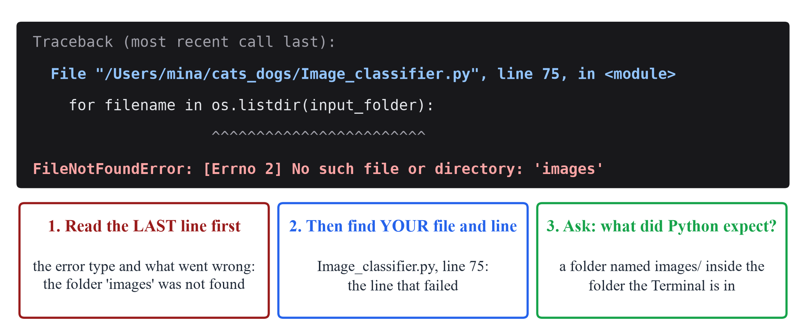
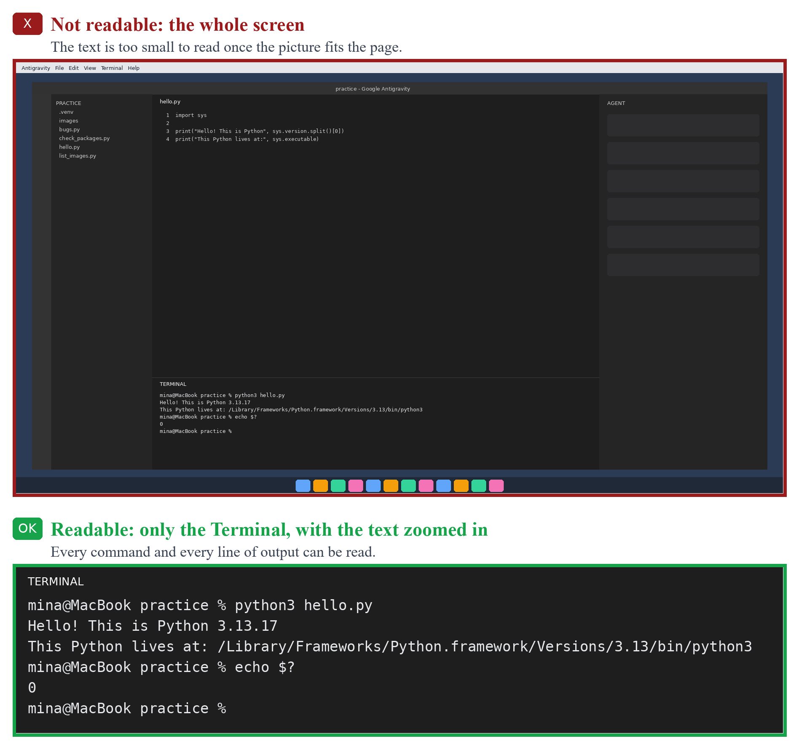

# Python Setup Clinic: Install Python, Run Scripts, and Read Errors (Mac and Windows)

Course 6141: Business Analytics and AI Application | Self-study, about 2 to 3 hours | Homework due **Tuesday, November 24, 2026, 5 pm (Taiwan time)** on iLearn

## Why this guide

In the lab of Wednesday, November 18, many students could not run the cat-and-dog classifier (`Image_classifier.py`) at all. The code was fine: it runs as given with Python 3.13, TensorFlow 2.21, and Pillow. The problems came earlier:

* Python was missing, or it was a version that TensorFlow does not support.
* The package was installed into one Python, but the script ran with another one.
* The Terminal was in the wrong folder, so Python could not find the `images` folder.
* The error message looked like noise, so nobody read its last line.

This guide fixes each of these problems once. Work through Parts 1 to 6, then do the 10 exercises. By the next class, you should run `Image_classifier.py` on your own computer and see `Processing complete.`

**What you need:** your laptop (Mac or Windows), Google Antigravity IDE, an internet connection (TensorFlow is about 220 MB to download on a Mac and 350 MB on Windows, and the trained model about 100 MB), about 3 GB of free disk space, 4 photos of cats and dogs, and Microsoft Word for the homework. Word is free for Tunghai University students: the university's Microsoft 365 license covers every enrolled student. Download it from Tunghai University's campus software site, <https://software.thu.edu.tw/new/> (Microsoft campus license). Activation works on the campus network or through the university VPN.

---

## Part 1: Six Ideas in Plain Words

| Idea | What it is | Why it matters |
|---|---|---|
| **Python interpreter** | the program that reads your `.py` file and runs it, line by line | a computer can have several Pythons, each with its own version |
| **Python version** | a number such as `3.13.17`: major `3`, minor `13`, patch `17` | packages support only some versions. TensorFlow supports Python **3.10 to 3.13**, not 3.14 or 3.15 |
| **Terminal** | a window where you type commands instead of clicking | you install packages and run scripts here |
| **Current folder** (working directory) | the folder the Terminal is "standing in" right now | a script that opens `images` looks for it in this folder |
| **Package** | an add-on library, such as TensorFlow or pandas, installed with `pip` | a package is installed into **one** Python, not into all of them |
| **Virtual environment** (venv) | a private Python for one project, kept in a folder named `.venv` | every project gets the right packages, and nothing mixes |

**The course rule for Python versions:** everyone uses **Python 3.13** this semester (Intel Mac: 3.12, see below), so that every lab and every error looks the same on every laptop. It is the newest version that TensorFlow supports, and pandas, scikit-learn, and Matplotlib all work with it. The python.org front page now offers 3.15, which is too new for TensorFlow.

---

## Part 2: Check What You Have

Open a terminal **outside** Antigravity first:

* **Mac:** press `Cmd + Space`, type `Terminal`, press Enter. The window runs a shell (a command reader) called zsh.
* **Windows:** press `Win`, type `cmd`, press Enter. The window is the **Command Prompt** (cmd). This guide uses the Command Prompt for every Windows command.

Type each command and press Enter:

| What you want to know | Mac | Windows (Command Prompt) |
|---|---|---|
| The Python version | `python3 --version` | `python --version` |
| Every installed Python | `which -a python3` | `py --list` |
| Where `python` lives | `which python3` | `where python` |
| The chip in your computer | `uname -m` (`arm64` = Apple Silicon, `x86_64` = Intel) | not needed |

Then read your result:

| You see | Meaning | What to do |
|---|---|---|
| `Python 3.13.x` | the course version | keep it; skip Part 3 |
| `Python 3.10.x` to `3.12.x` | an older version | install Python 3.13 as well (Part 3), so that everyone in class uses the same version. The older one can stay |
| `Python 3.14.x` or `3.15.x` | too new for TensorFlow | install Python 3.13 as well (Part 3). Both can live side by side |
| `Python 3.9.6` on a Mac | the old Python that comes with Apple's developer tools | install Python 3.13 (Part 3) |
| `zsh: command not found: python3` | no Python on this Mac | install Python 3.13 (Part 3) |
| `Python was not found; run without arguments to install from the Microsoft Store...` | Windows has only a shortcut, not Python | install Python 3.13 (Part 3) |

### `python` or `python3`? Why there are two names

Until 2020, many computers had two Pythons: the old Python 2 and the new Python 3. The command `python3` was added so that people could ask for Python 3 for sure. Python 2 is gone today, but both names remain, and Mac and Windows use them differently:

| Command | Mac | Windows |
|---|---|---|
| `python` | usually **not found** (`zsh: command not found: python`): macOS and the python.org installer provide only `python3` | the Python you installed from python.org |
| `python3` | the first Python 3 found on the **PATH** (the list of folders the terminal searches for commands) | usually **not** your Python: a Microsoft Store shortcut that prints `Python was not found...` or opens the Store |
| `python3.13` | exactly Python 3.13 | not available; use `py -3.13` |
| `py` | not available | the Python Launcher: `py -3.13` starts Python 3.13, and `py --list` lists every installed Python |
| inside an active `.venv` (Part 5) | `python` and `python3` both mean the project's Python | `python` means the project's Python |

**Rule of thumb:**

* Outside a `.venv`: on a Mac, type `python3` (or `python3.13`); on Windows, type `python` (or `py -3.13`).
* Inside an active `.venv`: type `python` on both. That is why every command after Part 5 uses `python`.
* Not sure which Python a command runs? Ask it to print its own location:

  Mac:

  ```text
  python3 -c "import sys; print(sys.executable)"
  ```

  Windows (Command Prompt):

  ```text
  python -c "import sys; print(sys.executable)"
  ```

**Intel Mac (`x86_64`):** the newest TensorFlow no longer supports Intel Macs. Use Python **3.12** instead of 3.13, and in Part 5 install `tensorflow==2.16.2`, the last version for Intel Macs. Everything else in this guide is the same.

---

## Part 3: Install Python 3.13

### Mac

1. Go to <https://www.python.org/downloads/macos/>.
2. Under **Stable Releases**, find the newest **Python 3.13** release that has a **macOS installer** (for example, Python 3.13.17). Download it. Intel Mac: choose the newest **Python 3.12** release with an installer instead.
3. Open the downloaded `.pkg` file and click through the installer.
4. When it finishes, a Finder window opens the folder **Applications > Python 3.13**. Double-click **Install Certificates.command**. A Terminal window runs for a few seconds. This step lets Python download files over a secure connection; without it, the model download in `Image_classifier.py` fails with `CERTIFICATE_VERIFY_FAILED`.
5. Open a **new** Terminal window and check: `python3.13 --version` shows `Python 3.13.x`.

### Windows

Follow the course guide `windows11_python_antigravity_setup.pdf`, with two details:

1. On <https://www.python.org/downloads/windows/>, choose the newest **Python 3.13** release that offers **Windows installer (64-bit)**, not the newest Python overall.
2. On the first installer screen, select **Add python.exe to PATH**. On the last screen, if you see **Disable path length limit**, click it. TensorFlow has very long file names, and without this step its installation can fail with an error that mentions **Windows Long Path support**.

Check in a **new** Command Prompt window: `py -3.13 --version` shows `Python 3.13.x`.

---

## Part 4: The Terminal Inside Antigravity

From now on, work inside Google Antigravity IDE.

1. Make one folder for all labs, for example `6141_labs` in your Documents folder. Keep the path short, with no spaces and only English letters, digits, and underscores: `Documents/6141_labs` is good; `Documents/Class Files/6141 labs (final)` causes trouble.
2. In Antigravity, choose **File > Open Folder** and open `6141_labs`. Panel `[1]` (File Explorer) now shows this folder.
3. Open the Terminal: **Terminal > New Terminal** (or `Ctrl + backtick`; the backtick key is left of `1`). Panel `[4]` opens **in the folder you opened**. That is the main reason to open a folder, not a single file.
4. **Windows only, once:** Antigravity opens PowerShell by default, but this course uses the Command Prompt. In the Terminal panel, click the small arrow next to `+`, choose **Select Default Profile**, then **Command Prompt**. Close the Terminal (trash-can icon) and open a new one. The prompt now looks like `C:\Users\mina\Documents\6141_labs>`. (Or press `Ctrl + Shift + P`, type `Terminal: Select Default Profile`, and choose **Command Prompt**.)

Six commands are enough for this course. Two of them have different names on Mac and Windows:

| What it does | Mac (zsh) | Windows (Command Prompt) | Example |
|---|---|---|---|
| prints the current folder | `pwd` ("print working directory") | `cd` with nothing after it | Mac: `/Users/mina/Documents/6141_labs`; Windows: `C:\Users\mina\Documents\6141_labs` |
| lists the files and folders here | `ls` | `dir` | `cats_dogs  practice` |
| moves into a folder | `cd folder_name` | `cd folder_name` | `cd cats_dogs` |
| moves up one folder | `cd ..` | `cd ..` | back to `6141_labs` |
| makes a new folder | `mkdir folder_name` | `mkdir folder_name` | `mkdir practice` |
| runs a script in the current folder | `python file.py` | `python file.py` | `python hello.py` |

**Windows paths use backslashes.** In the Command Prompt, write `images\cats`, not `images/cats`: `mkdir images/cats` fails with `The syntax of the command is incorrect.` because cmd reads `/` as the start of an option.

Three keys save time: `Tab` completes a file or folder name, the `Up arrow` brings back the last command, and `Ctrl + C` stops a running script.



**Remember:** before `python something.py`, check where you are and what is there: `pwd` and `ls` on a Mac, `cd` and `dir` on Windows. If you cannot see `something.py` in the list, you are in the wrong folder.

---

## Part 5: One Project, One Private Python (venv)

A virtual environment is a private copy of Python inside your project folder. Packages you install while it is active go into that folder only. Without it, `pip` may install TensorFlow into one Python while `python` runs another, and you get `ModuleNotFoundError` even "after installing it".



**Create it once per project** (in the Antigravity Terminal, inside the project folder):

| Step | Mac | Windows (Command Prompt) |
|---|---|---|
| Create | `python3.13 -m venv .venv` | `py -3.13 -m venv .venv` |
| Activate | `source .venv/bin/activate` | `.venv\Scripts\activate` |
| Check | the prompt starts with `(.venv)`; `python --version` shows `3.13.x` | the same |
| Leave (when needed) | `deactivate` | `deactivate` |

* `-m venv .venv` means: "run Python's `venv` tool and make an environment in a folder named `.venv`". On a Mac, the folder is hidden in Finder because its name starts with a dot; Antigravity's File Explorer shows it.
* **Windows:** if you see `...Activate.ps1 cannot be loaded because running scripts is disabled on this system`, the Terminal is PowerShell, not the Command Prompt. Switch the default profile to Command Prompt (Part 4, step 4), open a new Terminal, and activate again with `.venv\Scripts\activate`.
* **Activate again in every new Terminal.** Closing Antigravity or opening a new Terminal starts without `(.venv)`. Always check the prompt first.
* After activation, the command is just `python` on both Mac and Windows: it now means the project's Python.

**Install packages with `python -m pip`:**

```text
python -m pip install --upgrade pip
python -m pip install tensorflow pillow
```

* `python -m pip` runs the `pip` that belongs to the Python you are using. A bare `pip` may belong to a different Python. Always use `python -m pip`.
* TensorFlow is large: the installation can take several minutes. Wait for the prompt to come back.
* Intel Mac: `python -m pip install tensorflow==2.16.2 pillow`.
* Pillow is the image library that TensorFlow's `load_img()` uses to open photos. Without it, `Image_classifier.py` stops with `ImportError: Could not import PIL.Image. The use of load_img requires PIL.`
* Later sessions need more packages. Install them the same way, inside the active `.venv`: `python -m pip install pandas scikit-learn matplotlib`.

---

## Part 6: Read an Error in 3 Steps

When something goes wrong, Python prints a **traceback**: a report of where it was and what failed.



1. **Read the last line first.** It names the error type and the reason, for example `FileNotFoundError: ... 'images'`.
2. **Find your file and line.** Look for the `File "..."` line that names **your** script, such as `Image_classifier.py", line 75`. Lines that name files inside `.venv` or `site-packages` belong to the packages; the cause is usually in your own line.
3. **Ask what Python expected.** Here it expected a folder named `images` in the current folder.

**Not every red line is an error.** TensorFlow prints many log lines that start with `I0000`, `W0000`, or `E0000`, or that mention CUDA, GPU, oneDNN, or CPU instructions. They describe your hardware. On a laptop without an NVIDIA graphics card they are expected. The run failed **only** if you see `Traceback (most recent call last):` followed by an error line, or if the script never prints its last message (`Processing complete.`).

**The errors you will meet most often:**

| You see | What it means | Fix |
|---|---|---|
| `zsh: command not found: python` (Mac) | on a Mac, the command is `python3`, or `.venv` is not active | activate `.venv`, then use `python` |
| `ModuleNotFoundError: No module named 'tensorflow'` | this Python does not have the package | check `(.venv)` in the prompt; then `python -m pip install tensorflow` |
| `ERROR: No matching distribution found for tensorflow` | your Python version is not supported (3.14, 3.15), or the computer is an Intel Mac | create `.venv` with Python 3.13 (Intel Mac: 3.12 and `tensorflow==2.16.2`) |
| `error: externally-managed-environment` | you tried to install into a system Python (for example, Homebrew's) | create and activate `.venv` first |
| `FileNotFoundError: [Errno 2] No such file or directory: 'images'` (Mac) or `[WinError 3] The system cannot find the path specified: 'images'` (Windows) | the Terminal is not in the project folder, or the folder is missing | check the folder (Mac: `pwd`, `ls`; Windows: `cd`, `dir`), then `cd` into the folder that contains `images` |
| `ImportError: Could not import PIL.Image. The use of load_img requires PIL.` | Pillow is missing | `python -m pip install pillow` |
| an error containing `CERTIFICATE_VERIFY_FAILED` (Mac) | Python cannot check secure websites yet | run **Install Certificates.command** (Part 3) |
| an install error that mentions `Windows Long Path support` | Windows refused TensorFlow's long file names | rerun the Python installer, choose **Modify**, finish, and click **Disable path length limit**; or ask the instructor |
| `SyntaxError`, `NameError`, `TypeError` | a typing mistake in the code | read the line number and fix the code (Exercise 8) |

**Ask the AI Agent Chat (Panel `[3]`) the right way.** Paste everything it needs in one message:

```text
I am on [Mac Apple Silicon / Mac Intel / Windows 11].
My Python is [paste the output of: python --version].
(.venv) is active: [yes / no]. The current folder is [paste the output of: pwd (Mac) or cd (Windows)].
I ran: [paste the command].
I got this error (full traceback): [paste it].
Why did this happen, and how do I fix it?
```

---

## Practice: 10 Exercises

Do them in order: each one builds on the one before. Every exercise ends with a **Check**: compare your screen with it before you move on. When the commands differ, the Mac commands come first and the Windows (Command Prompt) commands follow, each in its own box, one command per line.

### Homework: Submit Your Results

The 10 exercises are this week's homework.

1. Download the Word template [python_setup_clinic_homework.docx](python_setup_clinic_homework.docx) (A4) from the course page, next to this guide. Open it in **Microsoft Word**, free for Tunghai University students from <https://software.thu.edu.tw/new/> (not Pages or Google Docs, which can move the boxes and tables), and fill in your name, student ID, and computer on page 1.
2. For each exercise, follow its **Submit** line: paste the screenshot(s) into the box for that exercise and type the short answers. The grey text in each box is only a hint: click it, delete it, then paste or type in its place.
3. Every screenshot must be **readable**: the instructor has to read each command and each line of output. Follow "How to Take a Readable Screenshot" below.
4. Save the finished file as a PDF in **Microsoft Word** (**File > Save As**, then choose **PDF** as the file format) named `StudentID_Name_SetupClinic.pdf`, with your name in English letters and no spaces, for example `S11312345_JohnSmith_SetupClinic.pdf`. Upload the PDF to iLearn by **Tuesday, November 24, 2026, 5 pm (Taiwan time)**, and check that it opens and shows every screenshot.
5. Stuck on an exercise? Do not leave it blank. Paste the error you got and write what you tried in the **Where I Got Stuck** table on the last page of the template (copy the table once for each exercise you could not finish), and bring the same laptop to class.

### How to Take a Readable Screenshot

A picture of the whole screen shrinks to fit the page, and the Terminal text becomes too small to read. Capture only the Terminal, with the text made bigger first.



1. **Make the text bigger.** In Antigravity, zoom in two or three times. Zoom back to normal when you are done.

   | | Mac | Windows |
   |---|---|---|
   | Zoom in | `Cmd + =` | `Ctrl + =` |
   | Back to normal | `Cmd + 0` | `Ctrl + 0` |

2. **Make the Terminal taller.** Drag the top edge of the Terminal panel up, so that the command and all of its output fit on the screen.
3. **Capture only the Terminal area.** Drag from the first command to the last line of output, including the prompt with your folder path. Do not capture the whole screen or the whole window.

   | | Mac | Windows |
   |---|---|---|
   | Capture an area | `Cmd + Ctrl + Shift + 4`, then drag over the area | `Win + Shift + S`, then drag over the area |
   | Paste into Word | `Cmd + V` | `Ctrl + V` |

   On a Mac, `Cmd + Shift + 4` without `Ctrl` saves the picture on the Desktop instead of copying it.
4. **Check it in Word.** After pasting, view the page at 100% zoom. If you cannot read every character, capture it again with bigger text. Do not make the picture smaller in Word.
5. **Long output?** Take two screenshots instead of one tiny one. Never take a photo of the screen with a phone.

### Exercise 1: Find Your Python

**Goal:** know which Python you have, where it lives, and which chip your computer uses.

**Do:**

1. Open a terminal (Part 2). Type each command and press Enter.

   Mac:

   ```text
   python3 --version
   which -a python3
   uname -m
   ```

   Windows (Command Prompt):

   ```text
   python --version
   py --list
   where python
   ```

2. Try the other name, and read what happens (see "`python` or `python3`?" in Part 2).

   Mac:

   ```text
   python --version
   ```

   Windows (Command Prompt):

   ```text
   python3 --version
   ```

   If the Microsoft Store opens, close it: that is the result.

**Check:**

* You can say which computer you have (Mac Apple Silicon, Mac Intel, or Windows), which Python version it has, and whether you need to install Python 3.13.
* You can say in one sentence why the other name gave a different answer.

**Submit:** a screenshot of the commands and their output, and the four answers in the template.

### Exercise 2: Get Python 3.13

**Goal:** have the Python version that the course uses.

**Do:**

1. If Exercise 1 showed `Python 3.13.x`, go to step 2. Otherwise, install Python 3.13 (Part 3). Intel Mac: install Python 3.12.
2. Check the version.

   Mac:

   ```text
   python3.13 --version
   ```

   Windows (Command Prompt):

   ```text
   py -3.13 --version
   ```

   Intel Mac: `python3.12 --version`

**Check:** the output is `Python 3.13.x` (Intel Mac: `Python 3.12.x`).

**Submit:** a screenshot of the version check.

### Exercise 3: Move Around in the Terminal

**Goal:** control which folder the Terminal is in.

**Do:**

1. Create a folder named `6141_labs` in your Documents folder.
2. In Antigravity, choose **File > Open Folder** and open `6141_labs`.
3. Open a Terminal (Part 4). Type these commands one by one.

   Mac:

   ```text
   pwd
   mkdir practice
   ls
   cd practice
   pwd
   cd ..
   pwd
   ```

   Windows (Command Prompt):

   ```text
   cd
   mkdir practice
   dir
   cd practice
   cd
   cd ..
   cd
   ```

**Check:**

* The first folder printed ends with `6141_labs`.
* After `cd practice`, it ends with `6141_labs/practice` (Windows: `6141_labs\practice`).
* After `cd ..`, it ends with `6141_labs` again.
* The list (`ls` or `dir`) shows `practice`.

**Submit:** one or two screenshots that show all seven commands and their output.

### Exercise 4: Run a Script and Check Its Return Code

**Goal:** run a script and confirm that it finished without errors.

**Do:**

1. In Antigravity, create `hello.py` inside the `practice` folder with this code, and save it (Mac: `Cmd + S`; Windows: `Ctrl + S`):

   ```python
   import sys

   print("Hello! This is Python", sys.version.split()[0])
   print("This Python lives at:", sys.executable)
   ```

2. In the Terminal, move into `practice` and run the script. The last command prints the **return code**: the number a program reports when it ends.

   Mac:

   ```text
   cd practice
   python3 hello.py
   echo $?
   ```

   Windows (Command Prompt):

   ```text
   cd practice
   python hello.py
   echo %ERRORLEVEL%
   ```

**Check:**

* The first line shows your version, for example `Hello! This is Python 3.13.17`.
* The second line shows where that Python is installed. Mac: a path that contains `Python.framework/Versions/3.13` or `/usr/local/bin`. Windows: a path such as `C:\Users\...\Python313\python.exe`.
* The return code is `0`, which means "finished with no error".

**Submit:** a screenshot of the run and the return code.

### Exercise 5: Create and Activate a venv

**Goal:** give the project its own Python.

**Do:** in the `practice` folder, create and activate `.venv`, then run `hello.py` again.

Mac:

```text
python3.13 -m venv .venv
source .venv/bin/activate
python hello.py
```

Windows (Command Prompt):

```text
py -3.13 -m venv .venv
.venv\Scripts\activate
python hello.py
```

**Check:**

* The prompt starts with `(.venv)`.
* The version is `3.13.x`.
* The path now ends with `practice/.venv/bin/python` (Windows: `practice\.venv\Scripts\python.exe`). Same script, different Python: that is exactly what activation changes.

**Submit:** a screenshot that shows the `(.venv)` prompt and the output of `hello.py`.

### Exercise 6: Install TensorFlow and Pillow

**Goal:** install packages into the project's Python and prove it.

**Do:**

1. With `(.venv)` active, install the packages (the same commands on Mac and Windows). Wait until the prompt comes back; TensorFlow takes several minutes.

   ```text
   python -m pip install --upgrade pip
   python -m pip install tensorflow pillow
   ```

   Intel Mac: `python -m pip install tensorflow==2.16.2 pillow`

2. Create `check_packages.py` in `practice`:

   ```python
   import sys
   import tensorflow as tf
   import PIL

   print("Python:", sys.version.split()[0])
   print("TensorFlow:", tf.__version__)
   print("Pillow:", PIL.__version__)
   ```

3. Run it, then list the installed packages and find `tensorflow` and `pillow`:

   ```text
   python check_packages.py
   python -m pip list
   ```

**Check:**

* Three lines such as `Python: 3.13.17`, `TensorFlow: 2.21.0` (Intel Mac: `2.16.2`), and `Pillow: 13.0.0`. Any Pillow version is fine.
* The first import of TensorFlow can take 10 to 30 seconds and may print log lines that start with `I0000` or `W0000`. They are not errors (Part 6).

**Submit:** a screenshot of the output of `check_packages.py`.

### Exercise 7: Meet ModuleNotFoundError on Purpose

**Goal:** recognize the most common setup error and fix it in one step.

**Do:**

1. Turn the venv off and run the script with the other Python. Read the last line of the error.

   Mac:

   ```text
   deactivate
   python3 check_packages.py
   ```

   Windows (Command Prompt):

   ```text
   deactivate
   python check_packages.py
   ```

2. Turn the venv on again and run the script.

   Mac:

   ```text
   source .venv/bin/activate
   python check_packages.py
   ```

   Windows (Command Prompt):

   ```text
   .venv\Scripts\activate
   python check_packages.py
   ```

**Check:**

* Without `.venv`, the last line is `ModuleNotFoundError: No module named 'tensorflow'`.
* With `.venv` active, the three lines of Exercise 6 come back.
* You can say in one sentence why: the package lives in the project's Python, not in the other one.
* No error without `.venv`? Then your other Python also has TensorFlow, for example from the November 18 lab. Paste that run and say so in your answer.

**Submit:** one screenshot of the error, one of the fixed run, and your one-sentence explanation.

### Exercise 8: Read a Traceback and Fix Three Bugs

**Goal:** use the error type and the line number to fix code, one error at a time.

**Do:**

1. Create `bugs.py` in `practice` exactly as below. The mistakes are on purpose.

   ```python
   # Three bugs: fix them one at a time
   prices = [12.5, 8.0, 20.0]
   total = 0
   for price in prices:
       total = total + price
   print("Total:", totl)
   count = "3"
   average = total / count
   print("Average:", round(average, 2)
   ```

2. Run it with `python bugs.py` (`.venv` active).
3. Read the last line and the line number. Fix only that error, save, and run again.
4. Repeat until the script finishes.

**Check:** you meet the errors in this order.

1. `SyntaxError: '(' was never closed` (line 9). Python checks the grammar of the whole file before it runs anything, so this error comes first. Add the missing `)`.
2. `NameError: name 'totl' is not defined. Did you mean: 'total'?` (line 6). A typo in a variable name.
3. `TypeError: unsupported operand type(s) for /: 'float' and 'str'` (line 8). `"3"` in quotes is text, not a number: write `count = 3`.

The fixed script prints `Total: 40.5` and `Average: 13.5`, with return code `0`.

**Submit:** the three errors in the order Python reported them, each with its type (the last line), its line number, and your fix (the corrected line of code), in the table of the template; and a screenshot of the final run.

### Exercise 9: Meet FileNotFoundError on Purpose

**Goal:** see that the current folder decides which files a script can find.

**Do:**

1. In `practice`, make a folder named `images`: `mkdir images`.
2. Copy any 2 photos into `images` (drag them into the folder in Antigravity's File Explorer).
3. Create `list_images.py` in `practice`:

   ```python
   import os

   for name in os.listdir("images"):
       print(name)
   ```

4. Run 1: go up to `6141_labs` and run the script from there. Read the last line.

   Mac:

   ```text
   cd ..
   python practice/list_images.py
   ```

   Windows (Command Prompt):

   ```text
   cd ..
   python practice\list_images.py
   ```

5. Run 2: go back into `practice` and run it again (the same on Mac and Windows):

   ```text
   cd practice
   python list_images.py
   ```

**Check:**

* Run 1 ends with an error. Mac: `FileNotFoundError: [Errno 2] No such file or directory: 'images'`. Windows: `FileNotFoundError: [WinError 3] The system cannot find the path specified: 'images'`.
* Run 2 prints the names of your two photos.
* Python found the script both times, but found `images` only when the Terminal was in `practice`.

**Submit:** a screenshot of both runs, and one sentence on why Run 1 failed.

### Exercise 10: Run the November 18 Lab

**Goal:** run `Image_classifier.py` from start to finish on your own computer.

**Do:**

1. In the Terminal, go to `6141_labs` and make the project folders.

   Mac:

   ```text
   mkdir cats_dogs
   cd cats_dogs
   mkdir images
   mkdir images/cats
   mkdir images/dogs
   ```

   Windows (Command Prompt):

   ```text
   mkdir cats_dogs
   cd cats_dogs
   mkdir images
   mkdir images\cats
   mkdir images\dogs
   ```

2. Put `Image_classifier.py` from the November 18 lab in `cats_dogs`.
3. Put 4 photos (2 cats and 2 dogs; `.jpg` or `.png`) in `cats_dogs/images`, not in the `cats` or `dogs` folders.
4. Create and activate a new `.venv` in `cats_dogs`, and install `tensorflow pillow` (Exercises 5 and 6). Each project gets its own `.venv`.
5. Check where you are. Mac: `pwd` and `ls`. Windows: `cd` and `dir`. The folder ends with `cats_dogs`, and the list shows `Image_classifier.py` and `images`.
6. Run the lab script:

   ```text
   python Image_classifier.py
   ```

   The first run downloads the trained model (about 100 MB) into a folder named `.keras` in your home folder. Later runs skip this step.

**Check:**

* For each photo, you see `Processing <photo name>...`, a predicted class such as `Egyptian_cat` or `Labrador_retriever`, and a line such as `cat_1.jpg moved to images/cats`.
* The last line is `Processing complete.`, and the return code is `0`.
* The photos now sit in `images/cats` and `images/dogs`.
* A photo that the model does not recognize as a cat or a dog stays in `images`, with the message `... is not a cat or dog.` That is a prediction, not an error.

**Submit:**

* a screenshot of the end of the run, with `Processing complete.`
* a screenshot of Antigravity's File Explorer (Panel `[1]`) with `images/cats` and `images/dogs` opened, showing the photos inside
* for each photo: its name, the predicted class, and the folder it moved to (or `stayed in images`), in the table of the template

**If it fails:** read the last line of the error and find it in the table of Part 6. If it is not there, ask the AI Agent Chat with the template of Part 6.

---


## Quick Reference Card

| Task | Mac (zsh) | Windows (Command Prompt) |
|---|---|---|
| Python version | `python3 --version` | `python --version` / `py --list` |
| Where am I? What is here? | `pwd`, `ls` | `cd`, `dir` |
| Move into / up | `cd folder`, `cd ..` | `cd folder`, `cd ..` |
| Create a venv (once per project) | `python3.13 -m venv .venv` | `py -3.13 -m venv .venv` |
| Activate (every new Terminal) | `source .venv/bin/activate` | `.venv\Scripts\activate` |
| Install a package | `python -m pip install name` | `python -m pip install name` |
| Run a script | `python script.py` | `python script.py` |
| Return code of the last command | `echo $?` | `echo %ERRORLEVEL%` |
| Stop a running script | `Ctrl + C` | `Ctrl + C` |

**Before every lab:** open the lab folder in Antigravity, open a Terminal, activate `.venv`, check `(.venv)` and the current folder (Mac: `pwd`; Windows: `cd`), then run.

## Official Links

* Python downloads for macOS: <https://www.python.org/downloads/macos/>
* Python downloads for Windows: <https://www.python.org/downloads/windows/>
* Python tutorial, virtual environments and packages: <https://docs.python.org/3/tutorial/venv.html>
* TensorFlow installation with pip (supported Python versions): <https://www.tensorflow.org/install/pip>
* Google Antigravity setup documentation: <https://www.antigravity.google/docs/getting-started?tab=ide>
